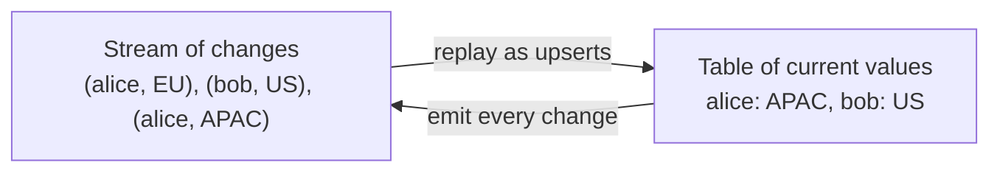

# Lesson 1. Streams and Tables

**Mission link:** The first success bullet asks you to explain, from the stream-table duality, how a topic, a changelog and a KTable relate. Every later lesson assumes you can look at a topic and say which of the two readings it was written for.
**Primary source:** [Docs: "Core Concepts", Apache Kafka 4.3](https://kafka.apache.org/43/streams/core-concepts/)
**Prerequisites:** [Log compaction](../../kafka/GLOSSARY.md) and [Partition](../../kafka/GLOSSARY.md) from the Kafka track, [Stream-table duality](../GLOSSARY.md), [KStream](../GLOSSARY.md), [KTable](../GLOSSARY.md), [Tombstone](../GLOSSARY.md)

## Know this

### One sequence of records, two readings

A Kafka topic holds key-value records in offset order, and nothing in a record says how it should be read. Take two records with the same key, `("alice", 1)` followed by `("alice", 3)`, and sum the values per key. The Streams DSL guide gives two answers for this exact input ([Streams DSL: KStream and KTable](https://kafka.apache.org/43/streams/developer-guide/dsl-api/#kstream)):

- Read as a **[KStream](../GLOSSARY.md)**, every record is an independent event, an INSERT into an append-only ledger. The second record does not replace the first, so the sum for alice is 4.
- Read as a **[KTable](../GLOSSARY.md)**, every record is the latest value for its key, an UPSERT. The second record overwrites the first, so the sum for alice is 3.

Neither answer is wrong. A payment, a page view or a log line is an event: two payments by alice are two payments. A user's current region or an account balance is a fact that changes: the newer value supersedes the older. The data does not decide which reading is right; what the records mean does.

### The duality

The **[stream-table duality](../GLOSSARY.md)** is the observation that these two readings convert into each other without losing anything ([Core Concepts: Duality of Streams and Tables](https://kafka.apache.org/43/streams/core-concepts/#duality-of-streams-and-tables)):

- **Stream as table.** A stream of changes is a table in disguise. Replay it from the beginning, applying each record as an upsert, and you rebuild the table. Aggregating a stream does the same thing: counting page views per user turns a stream of events into a table of counts.
- **Table as stream.** A table is a stream in disguise. Every time a row changes, emit the change, and the sequence of changes is a stream, called a changelog.

Kafka Streams uses this loop in three places you will meet later: a state store is backed by a changelog topic so another instance can rebuild it by replay (lesson 5), an aggregation's output is a KTable whose changes flow downstream as a stream (lesson 6), and the same mechanism is how change data capture replicates a database table into Kafka. The DSL makes the duality explicit with three abstractions: `KStream`, `KTable` and `GlobalKTable`, the last being a table every instance holds in full, which lesson 11 covers.

### How a topic holds a table: compaction

A topic read as a table only needs the latest value of each key, which is exactly what **[log compaction](../../kafka/GLOSSARY.md)** keeps. The Kafka track's [glossary entry](../../kafka/GLOSSARY.md) and its [lesson on retention and compaction](../../kafka/lessons/0010-retention-and-log-compaction.md) cover the mechanics; three consequences matter here.

**Compaction is safe for a table and a mistake for a stream.** Compacting the alice topic above removes `("alice", 1)`. A KTable reader still sums to 3, the same answer as before. A KStream reader now sums to 3 instead of 4: compaction silently deleted an event. The DSL guide says it plainly: compaction is perfectly safe for a KTable and a mistake for a KStream ([Streams DSL: KTable](https://kafka.apache.org/43/streams/developer-guide/dsl-api/#ktable)).

**Compaction is a floor, not a snapshot.** The cleaner runs in the background and never touches the active segment, so a reader replaying a compacted topic can still meet older values for a key. That does not hurt a table reader, which applies records in offset order and ends on the latest one. It does mean you cannot treat a compacted topic as already deduplicated.

**Order per key comes from the partition.** Replay rebuilds the right table only because every record for one key lands in one partition, where offsets order them. Two producers writing the same key with different partitioners would break that, and the table would end on whichever write a reader happened to see last.

### Tombstones

A record with a key and a null value is a **[tombstone](../GLOSSARY.md)**. What it means depends on the reading again:

- A KTable interprets it as a DELETE for that key ([Streams DSL: KTable](https://kafka.apache.org/43/streams/developer-guide/dsl-api/#ktable)).
- A KStream sees just another record that happens to carry a null value. A stream `count()` ignores it, because counting a grouped stream skips records with a null key or value ([Streams DSL: Aggregating](https://kafka.apache.org/43/streams/developer-guide/dsl-api/#aggregating)).
- A compacted topic first keeps the tombstone as the key's latest value, so late readers still learn of the delete, then removes the key entirely once the tombstone is older than `delete.retention.ms`, as the Kafka glossary describes.

### Worked example: one topic, three views

A topic `user-region` with one partition receives four records:

| Offset | Key | Value |
|---|---|---|
| 0 | alice | EU |
| 1 | bob | US |
| 2 | alice | APAC |
| 3 | bob | null |

- **As a KStream:** four events. A per-key `count()` gives alice 2 and bob 1, because the null at offset 3 is skipped.
- **As a KTable:** after offset 3 the table holds one row, alice: APAC. Bob was inserted at offset 1 and deleted at offset 3.
- **After compaction has run:** the topic holds offset 2, `(alice, APAC)`, and offset 3, the tombstone for bob. Once the tombstone passes `delete.retention.ms` it goes too, and a new reader rebuilds the same one-row table from a single record.

The KTable view survives compaction unchanged. The KStream count does not: a reader arriving after compaction counts alice once.

### Predict, then run

The Kafka Streams quickstart ships a WordCount demo inside the Kafka download, so you can watch the duality without writing any Java ([Kafka Streams quickstart](https://kafka.apache.org/43/streams/quickstart/)). It reads lines from `streams-plaintext-input`, counts words into a `KTable<String, Long>`, and writes every change of that table to `streams-wordcount-output`, which the quickstart creates with `cleanup.policy=compact`.

You will type three lines, in this order: `all streams lead to kafka`, then `hello kafka streams`, then `join kafka summit`. Before running it, predict:

1. How many records the output topic holds after all three lines, and how many of them have the key `kafka`.
2. Which value a consumer reading the output as a table ends on for `kafka`, and which value a consumer that sums the output as a stream gets.

The quickstart's own output answers the first: 11 records, three of them for `kafka` with values 1, 2 and 3. A table reader ends on 3; a stream reader that sums gets 6, a number that means nothing, which is why the output topic is compacted and meant to be read as a table. You see every one of those updates because the demo turns the record cache off, setting `statestore.cache.max.bytes` to 0 in its [source](https://github.com/apache/kafka/blob/4.3/streams/examples/src/main/java/org/apache/kafka/streams/examples/wordcount/WordCountDemo.java). An app left at the defaults can collapse several updates to one key into one, which lesson 6 explains.

## Practice

1. ▢ A KTable receives `("order-17", null)`. What does it do with order-17, and what would a KStream `count()` do with the same record?

Check

The KTable deletes order-17: a null value is a tombstone, interpreted as DELETE for that key. A stream `count()` ignores the record, because counting a grouped stream skips records with a null value. The same bytes mean "delete this row" to one reading and "skip me" to the other.

2. ▢ Which statement about log compaction and the two readings is true?

    - a) Compaction keeps every record for a key until its retention expires
    - b) Compaction is safe for a KTable but changes what KStreams count
    - c) Compaction removes a tombstone at once so the key disappears immediately
    - d) Compaction guarantees a reader never sees an older value per key

Check

**b)** A table only needs the latest value per key, so removing older ones changes nothing for it, while a stream loses events. (a) describes time-based retention, not compaction. (c) is wrong: the tombstone is kept until it is older than `delete.retention.ms`, so late readers still see the delete. (d) is wrong: the cleaner runs in the background and skips the active segment, so older values can still be read.

3. ▢ A topic receives `(k1, 5)`, `(k2, 2)`, `(k1, 7)`, `(k2, null)`, `(k1, 1)` in that order. Predict the per-key sum when it is read as a KStream (`groupByKey().reduce` adding values, nulls skipped) and the contents of the table when it is read as a KTable.

Hint

Do the two columns separately: for the stream, every non-null record adds; for the table, every record replaces, and a null removes.

Check

As a KStream: k1 sums to 5 + 7 + 1 = 13, k2 to 2 (the null is skipped). As a KTable: k1 is 1, the last value written, and k2 is absent, deleted by the tombstone. If your stream answer for k1 was 1, you read it as a table; if your table kept k2 at 2, you read the null as a skippable record rather than a delete.

4. ▢ A team stores a clickstream topic with `cleanup.policy=compact` "to save disk", keyed by user ID. A Streams app reads it with `builder.stream(...)` and counts clicks per user. Counts for new users look right; counts rebuilt after a reset, a week later, are much lower. What happened?

Hint

Ask which reading the app uses, and what compaction is allowed to remove under that reading.

Check

The topic is an event stream stored with a table's cleanup policy. Compaction kept only the latest click per user and deleted the rest, so a reprocessing run counts one click per user, or a few where compaction has not reached the newest segments yet. Live counts looked right because the app saw every click before the cleaner removed it. The fix is `cleanup.policy=delete` with a retention long enough for reprocessing; compaction belongs on topics read as tables.

5. ▢ Interleave the Kafka track: an upstream service writes customer profile updates keyed by customer ID, but a second service writing the same topic uses a custom partitioner that hashes the email field instead. A Streams app reads the topic as a KTable. What can go wrong, and why does replaying the topic not repair it?

Check

Updates for one customer can land in two partitions, so there is no single offset order for that key. Each partition's task holds its own copy of the row, and which value counts as latest depends on which partition a reader consumed last, not on which write happened last. Replay only rebuilds the right table when all records for a key sit in one partition; with two partitioners, replaying reproduces the same ambiguity. Both writers must partition by the record key the same way.

## Real-world reps

- [ ] Today: run the WordCount quickstart, write down your two predictions before typing the three lines, then compare them with what the console consumer prints.
- [ ] List three topics you work with, or three you can imagine for a shop: orders, prices, page views. For each, say whether it should be read as a stream or a table, and which `cleanup.policy` that implies.
- [ ] Tomorrow: without looking, write out the four-record `user-region` example and its three views (stream count, table, compacted topic). Check it against this lesson.

## Going further

- [DSL Operations](../reference/dsl-operations.md)
- [Docs: "Core Concepts", Apache Kafka 4.3](https://kafka.apache.org/43/streams/core-concepts/)
- [Docs: "Streams DSL", Apache Kafka 4.3](https://kafka.apache.org/43/streams/developer-guide/dsl-api/)
- [Paper: "Streams and Tables: Two Sides of the Same Coin", Sax, Wang, Weidlich and Freytag, BIRTE (2018)](https://dl.acm.org/doi/10.1145/3242153.3242155)
- [Kafka track: Lesson 10, Retention and Log Compaction](../../kafka/lessons/0010-retention-and-log-compaction.md)
- [Resources](../RESOURCES.md)

---

Not landing? Reread the primary source at the top, since this lesson compresses it and compression is where understanding leaks. Check the [glossary](../GLOSSARY.md) for any term that felt slippery.

If the lesson itself is unclear rather than the material, that is a defect: [open an issue](https://github.com/TokenCemetery/teach/issues).
