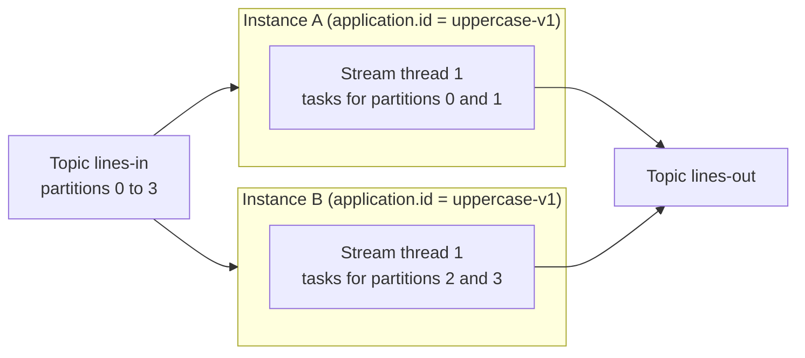

# Lesson 2. A Streams App Is a Library

**Mission link:** Stage 1 closes when you can say what a Streams app adds to a consumer. That answer is also the start of the mission's last clause: every internal topic, every byte of state and every recovery a topology costs lives in your process and in topics named after its application ID, not in a separate cluster someone else runs.
**Primary source:** [Docs: "Architecture", Apache Kafka 4.3](https://kafka.apache.org/43/streams/architecture/)
**Prerequisites:** [Lesson 1](0001-streams-and-tables.md), [Application ID](../GLOSSARY.md), [Stream thread](../GLOSSARY.md), [Task](../GLOSSARY.md), the Kafka track's [consumer groups sheet](../../kafka/reference/consumer-groups-and-rebalancing.md)

## Warm-up

1. ▢ A topic receives `("alice", 1)` then `("alice", 3)`. What is the per-key sum when it is read as a KStream, and when it is read as a KTable?

<details markdown="1"><summary>Check</summary>

4 as a KStream, where each record is a separate event, and 3 as a KTable, where the second record replaces the first.

</details>

2. ▢ Why is log compaction safe on a topic read as a table, and a mistake on one read as a stream?

<details markdown="1"><summary>Check</summary>

Compaction keeps at least the latest value per key. A table needs nothing more, so its contents do not change. A stream treats every record as an event, so compaction deletes events and changes every count or sum computed from the topic.

</details>

## Know this

### No cluster of its own

Kafka Streams is a client library. You add two Maven artifacts, `kafka-streams` and `kafka-clients`, to an ordinary Java program ([Writing a Streams Application](https://kafka.apache.org/43/streams/developer-guide/write-streams-app/)), and it runs wherever that program runs. The Architecture page puts it bluntly: Kafka Streams "is not a resource manager", it builds on the Kafka producer and consumer libraries, and its only external dependency is Kafka itself ([Architecture](https://kafka.apache.org/43/streams/architecture/); [Core Concepts](https://kafka.apache.org/43/streams/core-concepts/)). There is no job manager to submit to and no Streams server to deploy. To run more of it, you start more copies of your program.

### The smallest application

```java
import java.util.Properties;
import java.util.concurrent.CountDownLatch;
import org.apache.kafka.common.serialization.Serdes;
import org.apache.kafka.streams.KafkaStreams;
import org.apache.kafka.streams.StreamsBuilder;
import org.apache.kafka.streams.StreamsConfig;

public class UppercaseApp {
    public static void main(String[] args) throws InterruptedException {
        Properties props = new Properties();
        props.put(StreamsConfig.APPLICATION_ID_CONFIG, "uppercase-v1");
        props.put(StreamsConfig.BOOTSTRAP_SERVERS_CONFIG, "localhost:9092");
        props.put(StreamsConfig.DEFAULT_KEY_SERDE_CLASS_CONFIG, Serdes.StringSerde.class);
        props.put(StreamsConfig.DEFAULT_VALUE_SERDE_CLASS_CONFIG, Serdes.StringSerde.class);

        StreamsBuilder builder = new StreamsBuilder();
        builder.<String, String>stream("lines-in")
               .mapValues(line -> line.toUpperCase())
               .to("lines-out");

        KafkaStreams streams = new KafkaStreams(builder.build(), props);
        CountDownLatch latch = new CountDownLatch(1);
        Runtime.getRuntime().addShutdownHook(new Thread(() -> {
            streams.close();
            latch.countDown();
        }));

        streams.start();
        latch.await();
    }
}
```

Four things happen, in this order:

1. `Properties` carries the two required settings, `application.id` and `bootstrap.servers`, plus default Serdes for keys and values ([Configuring a Streams Application](https://kafka.apache.org/43/streams/developer-guide/config-streams/)). Lesson 3 covers Serdes.
2. `StreamsBuilder` records the DSL calls, and `build()` turns them into a `Topology`. Nothing touches Kafka yet.
3. `new KafkaStreams(topology, props)` initialises internal structures but processes nothing.
4. `start()` starts the threads in the background and returns at once, so `main` waits on a latch. `close()` signals every thread to stop and blocks until they have ([KafkaStreams javadoc](https://kafka.apache.org/43/javadoc/org/apache/kafka/streams/KafkaStreams.html)). The shutdown hook is the pattern the docs recommend so that SIGTERM closes the app cleanly, and the latch mirrors the project's own WordCount demo.

### What `start()` runs inside your process

One `KafkaStreams` instance runs `num.stream.threads` **[stream threads](../GLOSSARY.md)**, default 1. The configuration page lists the clients it creates and how it names them, with `client.id` defaulting to the application ID plus a random UUID ([Configuring a Streams Application: client.id](https://kafka.apache.org/43/streams/developer-guide/config-streams/)):

| Client | How many | Job |
|---|---|---|
| Main consumer | One per stream thread | Reads the input partitions of the thread's tasks |
| Restore consumer | One per stream thread | Replays changelog topics to rebuild state stores (lesson 5) |
| Producer | One per stream thread, under at-least-once and `exactly_once_v2` | Writes output, changelog and repartition records |
| Admin client | One per instance | Creates and inspects internal topics |
| Global consumer | One per instance, only with global tables | Reads every partition of a GlobalKTable's topic (lesson 11) |

Local state lives on disk under `state.dir`, default `${java.io.tmpdir}/kafka-streams`, in a subdirectory named after the application ID. Two instances of one app on one machine need different `state.dir` values ([Configuring a Streams Application: state.dir](https://kafka.apache.org/43/streams/developer-guide/config-streams/)). A default under the temp directory is a development convenience; a production app sets it to a disk that survives a reboot.

### The application ID names everything

The **[application ID](../GLOSSARY.md)** is not a label. The configuration page lists four places it is used ([Configuring a Streams Application: application.id](https://kafka.apache.org/43/streams/developer-guide/config-streams/)):

- the prefix of the consumer and producer client IDs,
- the consumer `group.id`, so every instance sharing it joins one group,
- the name of the subdirectory under `state.dir`,
- the prefix of every **[internal topic](../GLOSSARY.md)**, such as `uppercase-v1-counts-changelog`.

It must be unique within the Kafka cluster. Change it and the app finds no committed offsets, no internal topics and no local state under the new name, so it starts from nothing. That is sometimes exactly what you want: the page suggests embedding a version, as in `my-app-v1.0.0`, when an update should not reuse old state.

Kafka Streams also overrides some consumer settings you might expect to control: `enable.auto.commit` is forced to false, because Streams commits itself, `group.id` is forced to the application ID, the partition assignor is fixed to its own, and `auto.offset.reset` defaults to `earliest` rather than the consumer's `latest` (same page, "Default Values" and "Parameters controlled by Kafka Streams").

### Instances sharing an application ID split the work

Start the same program twice with the same `application.id`, and the two instances form one application. Kafka Streams creates a fixed set of **[tasks](../GLOSSARY.md)** from the input partitions, and assigns them across every thread of every instance ([Architecture: Stream Partitions and Tasks](https://kafka.apache.org/43/streams/architecture/#stream-partitions-and-tasks)). The task count, not the instance count, caps parallelism: with a 4-partition input, a fifth thread anywhere in the group sits idle until another one fails. When an instance stops, its tasks move to the survivors; when one starts, tasks move to it.



Which instance gets which task is the assignor's choice, made through the consumer group protocol your Kafka track covered; lessons 14 and 15 show how Streams makes it and what moving a stateful task costs.

### Against a plain consumer loop

The same uppercase job written on the clients directly is a loop you own:

```java
try (KafkaConsumer<String, String> consumer = new KafkaConsumer<>(consumerProps);
     KafkaProducer<String, String> producer = new KafkaProducer<>(producerProps)) {
    consumer.subscribe(List.of("lines-in"));
    while (running) {
        for (ConsumerRecord<String, String> r : consumer.poll(Duration.ofMillis(100))) {
            producer.send(new ProducerRecord<>("lines-out", r.key(), r.value().toUpperCase()));
        }
        producer.flush();
        consumer.commitSync();
    }
}
```

For a stateless one-record-in, one-record-out job, that is barely longer, and lesson 18 argues it is sometimes the better choice. The difference appears the moment the job needs anything else:

| Concern | Plain consumer and producer | Kafka Streams |
|---|---|---|
| Commit ordering against output | You flush and commit in the right order, every time | Done per commit interval |
| State such as a running count | Your own map, lost on crash, or your own database | A state store backed by a changelog topic, rebuilt on another instance |
| Grouping by a different key | Write to an intermediate topic yourself and consume it again | A repartition topic created for you (lesson 4) |
| Joins with a table | Your own lookup, cache and consistency rules | DSL joins over local state (lessons 11 and 12) |
| Exactly-once read-process-write | Transactions wired by hand | One setting, `processing.guarantee=exactly_once_v2` (lesson 13) |

### Predict, then run

Create `lines-in` with 4 partitions and `lines-out`, start `UppercaseApp` once, produce a few lines, and read `lines-out`. Before each step below, predict the answer, then check it:

1. Run `bin/kafka-topics.sh --bootstrap-server localhost:9092 --list`. Which topics starting with `uppercase-v1-` exist?
2. Run `bin/kafka-consumer-groups.sh --bootstrap-server localhost:9092 --describe --group uppercase-v1 --members`. How many members are there, and how many partitions does each own?
3. Start a second copy of the program in another terminal, with the same `application.id` and a different `state.dir`, and run the same command again. Then start three more copies.

The topology has no state and no key change, so it creates no internal topics: the list holds only your two topics. With one instance and one thread, one member owns all 4 partitions. With two, each typically owns 2. With five, four members own one partition each and the fifth owns none. The command works because, under the default classic protocol, the main consumers form an ordinary consumer group named after the application ID; an app that opts into `group.protocol=streams` is inspected with `kafka-streams-groups.sh` instead, which lesson 17 covers.

## Practice

1. ▢ Name the four places the `application.id` value is used.

<details markdown="1"><summary>Check</summary>

As the prefix of the consumer and producer client IDs, as the consumer `group.id`, as the name of the application's subdirectory under `state.dir`, and as the prefix of every internal topic name.

</details>

2. ▢ Which statement about what a Kafka Streams application needs in order to run is true?

    - a) A separate Streams cluster that schedules your topology across worker machines
    - b) Only Kafka brokers, with the library running inside your own process
    - c) A ZooKeeper ensemble that tracks the progress of every stream task
    - d) A dedicated broker plugin that executes the topology inside Kafka itself

<details markdown="1"><summary>Check</summary>

**b)** Kafka Streams is a library embedded in your program, and Kafka is its only external dependency. (a) describes a cluster framework such as Flink; Streams is explicitly not a resource manager. (c) is wrong: Kafka 4.x has no ZooKeeper, and Streams tracks progress through committed offsets. (d) is wrong: nothing runs inside the brokers; the brokers only store the topics.

</details>

3. ▢ An app reads a topic with 6 partitions. It runs as 3 instances with `num.stream.threads=4` each. How many stream threads have work, and how many are idle?

<details markdown="1"><summary>Hint</summary>

Count tasks first. They come from partitions, and threads only receive them.

</details>

<details markdown="1"><summary>Check</summary>

6 tasks, one per input partition, spread over 12 threads: 6 threads hold one task each and 6 are idle. More threads or instances than tasks adds standby capacity for failover, not throughput.

</details>

4. ▢ A developer copies a working Streams service to build a second, unrelated service and changes only the topology. Both deploy with `application.id=orders-enricher`. What breaks?

<details markdown="1"><summary>Hint</summary>

Ask what the two services now share because of that one string.

</details>

<details markdown="1"><summary>Check</summary>

They share a consumer group, so the brokers treat them as instances of one application and split partitions between them, while each runs a different topology. They also share the internal topic prefix, so internal topics with the same generated name collide, and on one machine they would share a state directory. Expect failed rebalances, records processed by the wrong topology, or state written by one read by the other. Each application needs its own ID.

</details>

5. ▢ Interleave lesson 1: a team rewrites a Streams app that counts orders per customer as a plain consumer loop holding counts in a `HashMap`, committing offsets after each poll. After a crash and restart, every customer's count starts again from zero, yet no orders are reprocessed. Explain both halves, and say what the Streams version did instead.

<details markdown="1"><summary>Check</summary>

The counts lived only in memory, so the crash lost them. The offsets were committed, so on restart the consumer resumed after the last committed position and never re-read the orders that built those counts. The Streams version keeps the count in a state store whose every update goes to a changelog topic, the table-as-stream half of the duality, and rebuilds the store by replaying that changelog before processing resumes, the stream-as-table half.

</details>

## Real-world reps

- [ ] Today: build and run `UppercaseApp` against a local broker and work through the three predictions above, writing each down before you run the command.
- [ ] Look at a Streams service you have access to, or the WordCount demo source. Find its `application.id`, its `state.dir`, and its `num.stream.threads`, and say how many tasks its input topics allow.
- [ ] Tomorrow: from memory, draw the clients one instance with two stream threads runs, then check your drawing against the client table in this lesson.

## Going further

- [DSL Operations](../reference/dsl-operations.md)
- [Docs: "Architecture", Apache Kafka 4.3](https://kafka.apache.org/43/streams/architecture/)
- [Docs: "Writing a Streams Application", Apache Kafka 4.3](https://kafka.apache.org/43/streams/developer-guide/write-streams-app/)
- [Docs: "Configuring a Streams Application", Apache Kafka 4.3](https://kafka.apache.org/43/streams/developer-guide/config-streams/)
- [Kafka track: Consumer Groups and Rebalancing](../../kafka/reference/consumer-groups-and-rebalancing.md)
- [Resources](../RESOURCES.md)

---

Not landing? Reread the primary source at the top, since this lesson compresses it and compression is where understanding leaks. Check the [glossary](../GLOSSARY.md) for any term that felt slippery.

If the lesson itself is unclear rather than the material, that is a defect: [open an issue](https://github.com/TokenCemetery/teach/issues).
