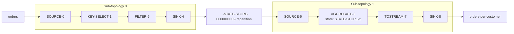

# Lesson 3. The DSL and Topologies

**Mission link:** The second success bullet asks you to build a topology with the DSL and read its `describe()` output. Everything the mission later asks you to cost (internal topics, state, recovery) shows up first as a line in that output, so reading it is the skill the rest of the track leans on.
**Primary source:** [Docs: "Streams DSL", Apache Kafka 4.3](https://kafka.apache.org/43/streams/developer-guide/dsl-api/)
**Prerequisites:** [Lesson 2](0002-a-streams-app-is-a-library.md), [Topology](../GLOSSARY.md), [Sub-topology](../GLOSSARY.md), [Serde](../GLOSSARY.md), [State store](../GLOSSARY.md)

## Warm-up

1. ▢ A Kafka Streams app reads a topic with 8 partitions and runs as 2 instances with 6 stream threads each. How many threads have work?

<details markdown="1"><summary>Check</summary>

Eight. The input gives 8 tasks, and 12 threads share them, so 4 threads are idle. Threads and instances receive tasks; they do not create them.

</details>

2. ▢ A topic `prices` holds the current price per product ID and is compacted. Should a Streams app read it with `builder.stream(...)` or `builder.table(...)`, and what does a record with a null value mean to the right choice?

<details markdown="1"><summary>Check</summary>

`builder.table(...)`: each record is the latest price for its key, which is a table reading, and the compaction policy only makes sense for one. A null value is a tombstone, so the KTable deletes that product.

</details>

## Know this

### A topology is a graph

A **[topology](../GLOSSARY.md)** is a graph of processors connected by streams ([Core Concepts: Stream Processing Topology](https://kafka.apache.org/43/streams/core-concepts/#stream-processing-topology)):

- A **source processor** has no upstream node. It consumes one or more topics and forwards each record downstream.
- A **stream processor** receives one record at a time, applies its operation, and may forward zero, one or more records.
- A **sink processor** has no downstream node. It writes each record it receives to a topic.

A processor that keeps state has one or more **[state stores](../GLOSSARY.md)** attached. The topology is a logical plan only: at run time it is copied into each task, one copy per partition (lesson 2).

### DSL calls build the graph

You do not add processors one by one in the DSL. You call operations on a `KStream` or `KTable`, and each call adds one or more processors to a graph that `StreamsBuilder` is accumulating ([Streams DSL: Transform a stream](https://kafka.apache.org/43/streams/developer-guide/dsl-api/#transform-a-stream)):

```java
StreamsBuilder builder = new StreamsBuilder();
KStream<String, String> stream = builder.stream("input");        // source
stream.filter((k, v) -> !v.equals("invalid_txn"))                // processor
      .mapValues(v -> v.substring(0, 5))                         // processor
      .to("output");                                             // sink
Topology topology = builder.build();
System.out.println(topology.describe());
```

`builder.stream`, `builder.table` and `builder.globalTable` create sources ([Streams DSL: Creating source streams](https://kafka.apache.org/43/streams/developer-guide/dsl-api/#creating-source-streams-from-kafka)). `to()` creates a sink. `build()` turns the accumulated graph into a `Topology`, and `describe()` prints it. None of this needs a broker: you can print a topology in a unit test or a scratch `main`.

### Serdes: every edge that touches Kafka needs one

A record crosses into and out of Kafka as bytes. Wherever the topology reads or writes a topic, a **[Serde](../GLOSSARY.md)** turns those bytes into typed keys and values and back. You supply them in three ways:

- **Defaults** in `Properties`: `default.key.serde` and `default.value.serde`. Both default to null, so you must set them or pass Serdes everywhere ([Configuring a Streams Application](https://kafka.apache.org/43/streams/developer-guide/config-streams/)).
- **Per source and sink**: `builder.stream("t", Consumed.with(Serdes.String(), Serdes.Long()))` and `to("t", Produced.with(Serdes.String(), Serdes.Long()))`.
- **Per internal step**: `Grouped.with(...)` for a repartition, `Materialized.with(...)` for a store.

The DSL guide's rule is short: if the types at a read or write do not match the configured defaults, you must give the Serdes explicitly ([Streams DSL: Creating source streams](https://kafka.apache.org/43/streams/developer-guide/dsl-api/#creating-source-streams-from-kafka)). The classic miss is a `count()`, whose values are `Long`, written with `to("counts")` while the default value Serde is `String`. Nothing complains at build time. At run time the producer fails with a `ClassCastException` saying the value serializer is not compatible with the actual value type, `java.lang.Long`.

### Reading `describe()`

The program above prints this ([Naming Operators in a Streams DSL Application](https://kafka.apache.org/43/streams/developer-guide/dsl-topology-naming/)):

```text
Topologies:
   Sub-topology: 0
    Source: KSTREAM-SOURCE-0000000000 (topics: [input])
      --> KSTREAM-FILTER-0000000001
    Processor: KSTREAM-FILTER-0000000001 (stores: [])
      --> KSTREAM-MAPVALUES-0000000002
      <-- KSTREAM-SOURCE-0000000000
    Processor: KSTREAM-MAPVALUES-0000000002 (stores: [])
      --> KSTREAM-SINK-0000000003
      <-- KSTREAM-FILTER-0000000001
    Sink: KSTREAM-SINK-0000000003 (topic: output)
      <-- KSTREAM-MAPVALUES-0000000002
```

Read it line by line:

- **`Sub-topology: 0`** opens a connected group of nodes. This one has a single sub-topology.
- **`Source:`**, **`Processor:`** and **`Sink:`** name the node type. A source lists its `topics`, a sink its `topic`, and a processor its `stores`; `[]` means stateless.
- **`-->`** points to a node's children and **`<--`** to its parents.
- **The generated name** is `KSTREAM-` or `KTABLE-`, then the operator, then a ten-digit counter. The counter is global across the whole builder and records the order in which nodes and stores were created, which is not always the order records flow through them. Store names draw from the same counter.

A stateful step shows its store. Replace the filter and map with `groupByKey().count().toStream().to("output")` and the same page prints:

```text
Topologies:
   Sub-topology: 0
    Source: KSTREAM-SOURCE-0000000000 (topics: [input])
      --> KSTREAM-AGGREGATE-0000000002
    Processor: KSTREAM-AGGREGATE-0000000002 (stores: [KSTREAM-AGGREGATE-STATE-STORE-0000000001])
      --> KTABLE-TOSTREAM-0000000003
      <-- KSTREAM-SOURCE-0000000000
    Processor: KTABLE-TOSTREAM-0000000003 (stores: [])
      --> KSTREAM-SINK-0000000004
      <-- KSTREAM-AGGREGATE-0000000002
    Sink: KSTREAM-SINK-0000000004 (topic: output)
      <-- KTABLE-TOSTREAM-0000000003
```

The store took counter value 1 before the aggregate processor took 2. `describe()` lists the store but not its changelog topic. You derive that from the store name, as `<application.id>-KSTREAM-AGGREGATE-STATE-STORE-0000000001-changelog`, the convention lesson 5 explains.

### Worked example: two sub-topologies

Count orders per customer when the input `orders` is keyed by order ID and carries the customer ID as its value:

```java
builder.<String, String>stream("orders")
       .selectKey((orderId, customerId) -> customerId)
       .groupByKey()
       .count()
       .toStream()
       .to("orders-per-customer", Produced.with(Serdes.String(), Serdes.Long()));
```

The count must see every order for one customer in one task, but the input is partitioned by order ID. So Kafka Streams writes the rekeyed records to a **[repartition topic](../GLOSSARY.md)** and reads them back, partitioned by customer ID. That topic cuts the graph in two:

```text
Topologies:
   Sub-topology: 0
    Source: KSTREAM-SOURCE-0000000000 (topics: [orders])
      --> KSTREAM-KEY-SELECT-0000000001
    Processor: KSTREAM-KEY-SELECT-0000000001 (stores: [])
      --> KSTREAM-FILTER-0000000005
      <-- KSTREAM-SOURCE-0000000000
    Processor: KSTREAM-FILTER-0000000005 (stores: [])
      --> KSTREAM-SINK-0000000004
      <-- KSTREAM-KEY-SELECT-0000000001
    Sink: KSTREAM-SINK-0000000004 (topic: KSTREAM-AGGREGATE-STATE-STORE-0000000002-repartition)
      <-- KSTREAM-FILTER-0000000005
   Sub-topology: 1
    Source: KSTREAM-SOURCE-0000000006 (topics: [KSTREAM-AGGREGATE-STATE-STORE-0000000002-repartition])
      --> KSTREAM-AGGREGATE-0000000003
    Processor: KSTREAM-AGGREGATE-0000000003 (stores: [KSTREAM-AGGREGATE-STATE-STORE-0000000002])
      --> KTABLE-TOSTREAM-0000000007
      <-- KSTREAM-SOURCE-0000000006
    Processor: KTABLE-TOSTREAM-0000000007 (stores: [])
      --> KSTREAM-SINK-0000000008
      <-- KSTREAM-AGGREGATE-0000000003
    Sink: KSTREAM-SINK-0000000008 (topic: orders-per-customer)
      <-- KTABLE-TOSTREAM-0000000007
```



Four things to read off it:

- **Two sub-topologies, joined only by a topic.** A sink in one and a source in the other name the same repartition topic. Each sub-topology gets its own tasks: one per partition of its input.
- **Nodes you did not write.** The filter, sink and source around the repartition topic were added for you, and the Kafka tutorial shows the same shape for its WordCount ([Tutorial: Write a Kafka Streams Application](https://kafka.apache.org/43/streams/tutorial/)). Treat them as plumbing, but count them: they take counter values like any other node.
- **Counter order is creation order.** The aggregate is 3 and the repartition nodes 4 to 6, because `count()` created its store and processor name before it wired in the repartition.
- **Topic names without the prefix.** `describe()` prints `KSTREAM-AGGREGATE-STATE-STORE-0000000002-repartition`. On the broker the topic is `<application.id>-KSTREAM-AGGREGATE-STATE-STORE-0000000002-repartition` ([Managing Streams Application Topics](https://kafka.apache.org/43/streams/developer-guide/manage-topics/)).

So this topology creates two internal topics: that repartition topic and the store's changelog. Lesson 4 is about predicting the first kind; lesson 5 about the second.

### Predict, then run

`describe()` needs no broker, so this rep takes a `main` method and the `kafka-streams` dependency. Write each prediction down in full, names and counters included, before you print anything:

1. `builder.stream("in").mapValues(v -> v.trim()).filter((k, v) -> !v.isEmpty()).to("out")`
2. `builder.stream("in").groupByKey().count().toStream().to("out")`
3. The `orders` example above with the `.selectKey(...)` line removed and nothing else changed.

The first prints one sub-topology: `KSTREAM-SOURCE-0000000000`, `KSTREAM-MAPVALUES-0000000001`, `KSTREAM-FILTER-0000000002`, `KSTREAM-SINK-0000000003`, all with `stores: []`. The second is the stateful output shown earlier, with the store at counter 1 and the aggregate at 2. The third has no key change left, so nothing needs repartitioning: one sub-topology, a source, the aggregate with its store, `KTABLE-TOSTREAM` and a sink, numbered like the second. If your prediction for the third still had two sub-topologies, lesson 4 is written for you.

## Practice

1. ▢ Name the three kinds of processor node in a topology and what each one does.

<details markdown="1"><summary>Check</summary>

A source processor has no parent and reads records from one or more topics. A stream processor receives one record at a time from its parents, applies an operation and forwards zero or more records. A sink processor has no children and writes the records it receives to a topic.

</details>

2. ▢ What does the ten-digit number in `KSTREAM-FILTER-0000000001` record?

    - a) The partition of the input topic that this filter instance is reading
    - b) The order in which the builder created this node among all names
    - c) The number of records the filter has dropped since the app started
    - d) The number of the sub-topology holding the node, padded to ten digits

<details markdown="1"><summary>Check</summary>

**b)** A single counter across the builder numbers every generated processor and store name in creation order. (a) is wrong: a topology is a logical plan shared by all tasks, so no node name refers to a partition. (c) is wrong: names are fixed when the topology is built, before any record flows. (d) is wrong: the sub-topology is printed on its own `Sub-topology:` line, and one sub-topology holds nodes with many different counters.

</details>

3. ▢ In the two-sub-topology `orders` output above, which node reads the repartition topic, which node owns the state store, and why does the filter carry a higher counter than the sink it feeds?

<details markdown="1"><summary>Check</summary>

`KSTREAM-SOURCE-0000000006` reads the repartition topic, and `KSTREAM-AGGREGATE-0000000003` owns `KSTREAM-AGGREGATE-STATE-STORE-0000000002`. The sink took counter 4 and the filter 5 because the builder generated the names in that order when it added the repartition step, even though records pass through the filter first. Counters show creation order, not flow order.

</details>

4. ▢ An app ends with `.count().toStream().to("word-counts")`. The default Serdes are both `StringSerde`. It builds and starts, then the first record fails. Predict the error and give the one-line fix.

<details markdown="1"><summary>Hint</summary>

Ask what type the values have after `count()`, and which Serde the sink uses when you give it none.

</details>

<details markdown="1"><summary>Check</summary>

`count()` produces `Long` values, and the sink falls back to the default value Serde, `StringSerde`, so producing the record fails with a `ClassCastException` reporting that the value serializer is not compatible with `java.lang.Long`. Fix: `.to("word-counts", Produced.with(Serdes.String(), Serdes.Long()))`. The build cannot catch it: Java erases the generic types, so the mismatch only surfaces when a real `Long` meets the `String` serializer.

</details>

5. ▢ Interleave lesson 2: the `orders` topic has 6 partitions. The two-sub-topology app runs as 3 instances with 2 threads each. How many tasks exist, and does any thread sit idle?

<details markdown="1"><summary>Hint</summary>

Count tasks per sub-topology, and look up how many partitions a repartition topic gets by default.

</details>

<details markdown="1"><summary>Check</summary>

12 tasks: 6 for sub-topology 0, one per partition of `orders`, and 6 for sub-topology 1, because the repartition topic takes its partition count from the upstream topics by default ([KStream javadoc](https://kafka.apache.org/43/javadoc/org/apache/kafka/streams/kstream/KStream.html)). 6 threads share 12 tasks, so none is idle; each runs about two.

</details>

## Real-world reps

- [ ] Today: run the three predict-then-run topologies and compare each printed line with what you wrote down.
- [ ] Take a Streams topology you have access to, or the WordCount demo, print its `describe()`, and draw it as boxes and arrows with one box per sub-topology. Label every topic as user or internal.
- [ ] Tomorrow: without the lesson, write the `describe()` output for `builder.stream("a").filter(...).to("b")`, names and counters included, then print it to check.

## Going further

- [DSL Operations](../reference/dsl-operations.md)
- [Docs: "Streams DSL", Apache Kafka 4.3](https://kafka.apache.org/43/streams/developer-guide/dsl-api/)
- [Javadoc: "Topology", Apache Kafka 4.3](https://kafka.apache.org/43/javadoc/org/apache/kafka/streams/Topology.html)
- [Docs: "Naming Operators in a Kafka Streams DSL Application", Apache Kafka 4.3](https://kafka.apache.org/43/streams/developer-guide/dsl-topology-naming/)
- [Docs: "Managing Streams Application Topics", Apache Kafka 4.3](https://kafka.apache.org/43/streams/developer-guide/manage-topics/)
- [Resources](../RESOURCES.md)

---

Not landing? Reread the primary source at the top, since this lesson compresses it and compression is where understanding leaks. Check the [glossary](../GLOSSARY.md) for any term that felt slippery.

If the lesson itself is unclear rather than the material, that is a defect: [open an issue](https://github.com/TokenCemetery/teach/issues).
