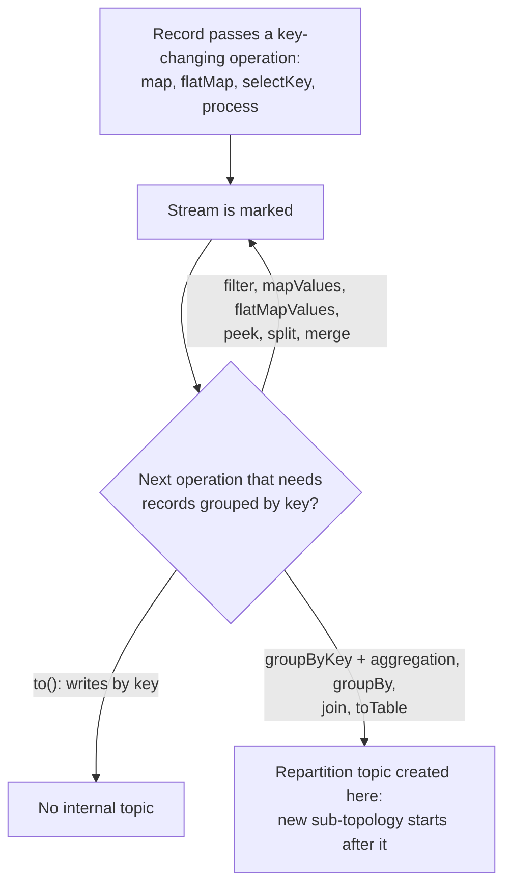

# Lesson 4. Stateless Operations and Repartitioning

**Mission link:** The second success bullet asks you to name every internal topic a topology creates and why. Repartition topics are the ones that appear without you asking, from a single key-changing call several lines above the step that needs them; after this lesson you can point at that call before running anything.
**Primary source:** [Docs: "Streams DSL", Stateless transformations, Apache Kafka 4.3](https://kafka.apache.org/43/streams/developer-guide/dsl-api/#stateless-transformations)
**Prerequisites:** [Lesson 3](0003-the-dsl-and-topologies.md), [Repartition topic](../GLOSSARY.md), [Internal topic](../GLOSSARY.md), [Sub-topology](../GLOSSARY.md), [Co-partitioning](../GLOSSARY.md)

## Warm-up

1. ▢ In a `describe()` output, what tells you that two sub-topologies are connected, given that no arrow runs between them?

<details markdown="1"><summary>Check</summary>

A sink in one sub-topology and a source in the other name the same topic. Sub-topologies share no processor; they connect only through a topic, typically a repartition topic.

</details>

2. ▢ `describe()` prints a repartition topic as `KSTREAM-AGGREGATE-STATE-STORE-0000000002-repartition`. What is its full name on the broker for an app with `application.id=billing`?

<details markdown="1"><summary>Check</summary>

`billing-KSTREAM-AGGREGATE-STATE-STORE-0000000002-repartition`. Internal topics carry the application ID as a prefix, which `describe()` leaves off.

</details>

3. ▢ Why does a table need all records for one key in one partition, in terms of lesson 1?

<details markdown="1"><summary>Check</summary>

A table applies each record as an upsert, so the latest record per key must be well defined. Offsets order records only within a partition, so a key spread over two partitions has no single latest value.

</details>

## Know this

### Stateless means one record at a time, no store

A stateless transformation handles each record on its own: no state store, nothing remembered between records ([Streams DSL: Stateless transformations](https://kafka.apache.org/43/streams/developer-guide/dsl-api/#stateless-transformations)). These are the ones on `KStream`:

| Operation | Input to output | Per record | Changes the key |
|---|---|---|---|
| `filter`, `filterNot` | KStream to KStream | Keeps or drops it | No |
| `mapValues` | KStream to KStream | One new value | No |
| `flatMapValues` | KStream to KStream | Zero or more new values | No |
| `map` | KStream to KStream | One new key and value | Yes |
| `flatMap` | KStream to KStream | Zero or more new keys and values | Yes |
| `selectKey` | KStream to KStream | One new key | Yes |
| `split` | KStream to `BranchedKStream` | Routed to the first branch whose predicate matches, else the default branch, else dropped | No |
| `merge` | Two KStreams to one | Passed through, no order across the two inputs | No |
| `peek` | KStream to KStream | Side effect, record passed on unchanged | No |
| `foreach` | KStream to nothing | Side effect, terminal | No |

`peek` and `foreach` exist for logging and metrics. Their side effects are outside Kafka, so they get none of its processing guarantees (same page).

### A key change marks the stream; a stateful step pays for it

Kafka Streams cannot see inside your lambda, so it cannot know whether `map` kept the key. It assumes the worst: `map`, `flatMap` and `selectKey` **mark the stream for repartitioning** (same page). So does `process()`, which the [KStream javadoc](https://kafka.apache.org/43/javadoc/org/apache/kafka/streams/kstream/KStream.html) counts as key changing whether or not your processor touches the key.

A mark costs nothing on its own. The repartition topic is created at the next operation that needs records grouped by key in one task:

- `groupByKey()` followed by an aggregation repartitions only if the stream is marked. `groupBy()` always does, being shorthand for `selectKey(...).groupByKey()` (same page).
- A stream-stream or stream-table join repartitions each marked input ([Streams DSL: Joining](https://kafka.apache.org/43/streams/developer-guide/dsl-api/#joining)).
- `toTable()` repartitions a marked stream, so the table ends up partitioned by its key (KStream javadoc).

Operations in between carry the mark along without paying it. `filter`, `mapValues`, `flatMapValues` and `peek` keep the stream marked, `split` hands the mark to every branch, and `merge` is marked if either input was (the [4.3 source](https://github.com/apache/kafka/blob/4.3/streams/src/main/java/org/apache/kafka/streams/kstream/internals/KStreamImpl.java) shows each case). A terminal `to()` never creates an internal topic: it writes each record to the output topic by its key through the producer's partitioner.



### `mapValues` over `map`

`mapValues` is preferred to `map` precisely because it cannot cause repartitioning (DSL guide). The trap is a `map` that returns the same key:

```java
stream.map((k, v) -> KeyValue.pair(k, v.trim()))   // key unchanged, stream marked anyway
      .groupByKey()
      .count();                                     // repartition topic created here
```

Replacing it with `mapValues(v -> v.trim())` removes the repartition topic, its extra sub-topology and its tasks, and one network round trip for every record. The same holds for `flatMapValues` over `flatMap`, and for `processValues` over `process` when your processor keeps the key.

### Naming the repartition topic

A repartition topic is named `${applicationId}-<name>-repartition` (KStream javadoc). Where `<name>` comes from:

| Repartition made by | `<name>` |
|---|---|
| `groupByKey(Grouped.as("by-customer"))` or `groupBy(..., Grouped.as("by-customer"))` | `by-customer` |
| An aggregation with no `Grouped` name | The store name, generated (`KSTREAM-AGGREGATE-STATE-STORE-0000000002`) or the one you gave in `Materialized.as(...)` |
| `repartition(Repartitioned.as("by-region"))` | `by-region` |
| `toTable(Named.as("current"))` | `current` |

Internal repartition topics are created with the delete cleanup policy and infinite retention, and Kafka Streams purges records it has consumed ([Managing Streams Application Topics](https://kafka.apache.org/43/streams/developer-guide/manage-topics/)). Their partition count follows the upstream topics unless you set it.

A generated name is fragile: insert one operator upstream and the counter shifts, renaming the topic on the next deploy. Lesson 20 deals with that; for now, notice that naming the grouping fixes it.

### `repartition()` and `Repartitioned`

`repartition()` forces a repartition topic at that point, always, marked or not ([Streams DSL: Repartition](https://kafka.apache.org/43/streams/developer-guide/dsl-api/#stateless-transformations)), and the stream after it is no longer marked, as the 4.3 source sets it. `Repartitioned` sets what the automatic path cannot:

```java
stream.selectKey((k, v) -> v.region())
      .repartition(Repartitioned.<String, Order>as("by-region")
                                .withNumberOfPartitions(12)
                                .withKeySerde(Serdes.String()))
      .process(RegionLimiter::new, "region-limits");
```

Reach for it in three cases:

- **Before `process()`**, which never repartitions on its own even when it is stateful and an upstream step changed the key (KStream javadoc).
- **To change the partition count** of everything downstream, to scale that sub-topology independently.
- **To co-partition a join input** with a table that has a different partition count, which lesson 11 works through.

### Worked example: one key change, one topic

The orders app from lesson 3, with the grouping named, under `application.id=orders-app`:

```java
builder.<String, String>stream("orders")                       // key: order ID, value: customer ID
       .selectKey((orderId, customerId) -> customerId)         // marks
       .filter((customerId, v) -> !customerId.isBlank())       // carries the mark
       .groupByKey(Grouped.as("by-customer"))                  // will repartition
       .count(Materialized.as("orders-per-customer-store"))    // creates the topic
       .toStream()
       .to("orders-per-customer", Produced.with(Serdes.String(), Serdes.Long()));
```

Internal topics on the broker:

- `orders-app-by-customer-repartition`, from the named grouping, written by sub-topology 0 and read by sub-topology 1.
- `orders-app-orders-per-customer-store-changelog`, the store's changelog (lesson 5).

Drop `.selectKey(...)` and the input is already keyed by what the count groups on, so the repartition topic disappears and the topology collapses to one sub-topology. Swap it for `.mapValues(...)` and the same happens.

### Predict, then run

Each line below starts from `builder.<String, String>stream("orders")` with `application.id=orders-app`, and ends in `.toStream().to("out", Produced.with(Serdes.String(), Serdes.Long()))` where it counts. For each, predict the number of sub-topologies and the full name of every repartition topic, then print `describe()` to check:

1. `.selectKey((k, v) -> v).mapValues(v -> v.length())` and then `.to("out", Produced.with(Serdes.String(), Serdes.Integer()))`
2. `.map((k, v) -> KeyValue.pair(k, v.toUpperCase())).groupByKey().count()`
3. `.mapValues(v -> v.toUpperCase()).groupByKey().count()`
4. `.groupBy((k, v) -> v).count()`
5. `.selectKey((k, v) -> v).groupByKey(Grouped.as("by-customer")).count()`

Then start the app against a broker for line 5 and run `bin/kafka-topics.sh --bootstrap-server localhost:9092 --list` to see the topics the app created.

1. One sub-topology, no repartition topic: nothing after the key change needs grouping, and `to()` partitions by key on write.
2. Two: `map` marked the stream though the key did not change. The topic is `orders-app-KSTREAM-AGGREGATE-STATE-STORE-0000000002-repartition`: the source took counter 0, `map` 1, the store 2.
3. One, no repartition topic: `mapValues` never marks.
4. Two, `orders-app-KSTREAM-AGGREGATE-STATE-STORE-0000000002-repartition`, with `KSTREAM-KEY-SELECT-0000000001` as the node `groupBy` added.
5. Two, `orders-app-by-customer-repartition`. The topic list also shows `orders-app-KSTREAM-AGGREGATE-STATE-STORE-0000000002-changelog`, the count's store changelog.

## Practice

1. ▢ Which of these mark a stream for repartitioning: `selectKey`, `mapValues`, `flatMap`, `filter`, `peek`, `map`, `process`, `processValues`?

<details markdown="1"><summary>Check</summary>

`selectKey`, `flatMap`, `map` and `process`. The first three can change the key; `process` is treated as key changing because Kafka Streams cannot tell. `mapValues`, `filter`, `peek` and `processValues` keep the key and leave the mark as it was.

</details>

2. ▢ A stream is rekeyed with `selectKey` early in a topology. When is the repartition topic actually created?

    - a) At the `selectKey` call, as soon as the key is replaced
    - b) At the next grouped aggregation, join or `toTable` that comes downstream
    - c) At the sink, when `to()` writes the records to the output
    - d) At startup, once for every key-changing operation found in the code

<details markdown="1"><summary>Check</summary>

**b)** The key change only marks the stream; the topic appears where an operation needs records grouped by key in one task. (a) is wrong: marking costs nothing, and a marked stream that only reaches `to()` never gets a repartition topic. (c) is wrong: `to()` writes by key through the producer's partitioner and creates no internal topic. (d) is wrong: two key changes before one aggregation still give one repartition topic, and a key change with no stateful step after it gives none.

</details>

3. ▢ Predict how many repartition topics this creates, and between which two operations each sits: `stream.selectKey(a).filter(b).mapValues(c).groupByKey().count().toStream().selectKey(d).to("out")`.

<details markdown="1"><summary>Hint</summary>

Follow the mark down the chain, and ask at each operation whether it needs records grouped by key.

</details>

<details markdown="1"><summary>Check</summary>

One, between `mapValues(c)` and the `count()`: `selectKey(a)` marks, `filter` and `mapValues` carry the mark, and the grouped `count()` pays it. The second `selectKey(d)` marks the stream again, but only `to()` follows, so no second topic appears. The output is written partitioned by the new key.

</details>

4. ▢ A teammate insists their topology never changes a key, yet `describe()` shows two sub-topologies around a `count()`. The code before it is `stream.map((k, v) -> KeyValue.pair(k, normalise(v))).groupByKey()`. Explain the second sub-topology and fix it.

<details markdown="1"><summary>Hint</summary>

Ask what Kafka Streams can know about the lambda passed to `map`.

</details>

<details markdown="1"><summary>Check</summary>

`map` may change the key, and Kafka Streams cannot look inside the lambda, so it marks the stream and the grouped `count()` adds a repartition topic, which splits the graph. Replace it with `mapValues(v -> normalise(v))`. The result is identical, and the repartition topic, its sub-topology, its tasks and the extra write and read of every record all go away.

</details>

5. ▢ Interleave lessons 1 and 3: an app does `builder.stream("profiles").selectKey((id, p) -> p.email()).toTable()` to keep the latest profile per email. Which internal topic appears, why does a table need it, and which `describe()` lines show it?

<details markdown="1"><summary>Check</summary>

A repartition topic, `<application.id>-<name>-repartition`, with `<name>` the generated `KSTREAM-TOTABLE-...` node name unless you pass `toTable(Named.as(...))`. A table applies upserts in order, which only works when every record for one email sits in one partition, and the input is partitioned by the old ID. In `describe()` it shows as a sink at the end of sub-topology 0 and a source at the start of sub-topology 1, both naming the same `...-repartition` topic.

</details>

## Real-world reps

- [ ] Today: run the five predict-then-run variants, writing every prediction down first, and list the topics the line 5 app created on the broker.
- [ ] In a Streams codebase you can read, search for `map(`, `flatMap(` and `selectKey(`. For each hit, find the next grouping, join or `toTable`, and say whether it creates a repartition topic and whether `mapValues` would do.
- [ ] Tomorrow: from memory, write the rule for when a repartition topic is created and three ways to name it. Check it against the [DSL Operations](../reference/dsl-operations.md) sheet.

## Going further

- [DSL Operations](../reference/dsl-operations.md)
- [Docs: "Streams DSL", Apache Kafka 4.3](https://kafka.apache.org/43/streams/developer-guide/dsl-api/)
- [Javadoc: "KStream", Apache Kafka 4.3](https://kafka.apache.org/43/javadoc/org/apache/kafka/streams/kstream/KStream.html)
- [Docs: "Managing Streams Application Topics", Apache Kafka 4.3](https://kafka.apache.org/43/streams/developer-guide/manage-topics/)
- [Resources](../RESOURCES.md)

---

Not landing? Reread the primary source at the top, since this lesson compresses it and compression is where understanding leaks. Check the [glossary](../GLOSSARY.md) for any term that felt slippery.

If the lesson itself is unclear rather than the material, that is a defect: [open an issue](https://github.com/TokenCemetery/teach/issues).
