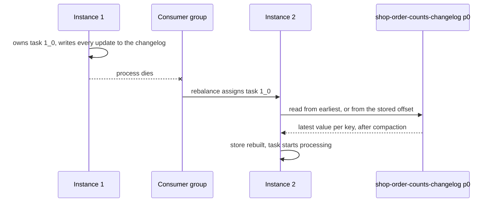

# Lesson 5. State Stores and Changelog Topics

**Mission link:** Stage 3 opens the state half of the mission: choosing a state store for a stateful operation and saying how its state is rebuilt when the instance holding it dies. This lesson is the mechanism underneath every later stateful step, from aggregations to windows to joins.
**Primary source:** [Docs: "Processor API", Apache Kafka 4.3](https://kafka.apache.org/43/streams/developer-guide/processor-api/) (the sections from "State Stores" to "ReadOnly State Stores")
**Prerequisites:** [Lesson 4](0004-stateless-operations-and-repartitioning.md), [State store](../GLOSSARY.md), [Changelog topic](../GLOSSARY.md), [Restoration](../GLOSSARY.md)

## Warm-up

1. ▢ A topic holds the latest address per customer, keyed by customer ID, with compaction enabled. Do you read it with `builder.stream()` or `builder.table()`, and why is compaction safe for one reading and wrong for the other?

<details markdown="1"><summary>Check</summary>

`builder.table()`, as a KTable. Each record replaces the previous value for its key, so dropping an older value for the same key loses nothing a table reader needs. Read as a KStream every record is a separate event, and compaction would silently delete events: a sum over a compacted record stream gives a different answer from the same sum over the uncompacted one.

</details>

2. ▢ What does a Kafka Streams application run inside your own process, and what does it not need that a cluster framework would?

<details markdown="1"><summary>Check</summary>

Consumers, producers, stream threads running tasks, and local state, all inside an ordinary JVM process that you start and deploy yourself. It has no cluster, master or job manager of its own: coordination comes from the Kafka consumer group protocol and durability from Kafka topics.

</details>

3. ▢ `orders.selectKey((k, v) -> v.customerId()).groupByKey().count()` runs in an app whose application ID is `shop`. Which internal topic does the key change add, and what kind is it?

<details markdown="1"><summary>Check</summary>

A [repartition topic](../GLOSSARY.md), named `shop-<generated name>-repartition`. `selectKey` marks the stream for repartitioning, so the next stateful step, `count()`, writes the records out keyed by customer ID and reads them back, so every record for one customer reaches one task.

</details>

## Know this

### State lives beside the processor

A stateful operation such as `count()`, `aggregate()`, a join or a windowed aggregation needs to remember something between records. Kafka Streams keeps that memory in a **[state store](../GLOSSARY.md)**: local storage owned by one [task](../GLOSSARY.md), on the machine running it, read and written without a network call ([Architecture](https://kafka.apache.org/43/streams/architecture/)). Each task holds only the shard for its own input partition, so an app reading a 6-partition topic has 6 shards of each store, spread across its instances.

Local storage makes reads fast and leaves one question open: what happens to the shard when its machine dies. The rest of this lesson answers it.

### Three shapes of store

| Shape | Holds | Created by |
|---|---|---|
| Key-value store | One value per key | `count`, `reduce` and `aggregate` without windows, `builder.table()` when materialized |
| Window store | One value per key per window, with the window's start time in the store key | Windowed aggregations (lesson 9) |
| Session store | One value per key per session, keyed by key and session bounds | Session-windowed aggregations (lesson 9) |

Key-value and window stores also come in timestamped variants, which store the timestamp of the latest update with the value, and KTables use those by default. A versioned key-value store keeps several timestamped versions per key so a lookup can ask "as of when"; it exists only on RocksDB and supports neither caching nor interactive queries ([Processor API](https://kafka.apache.org/43/streams/developer-guide/processor-api/)).

### Two engines: RocksDB or memory

Every shape is built on one of two engines ([Processor API](https://kafka.apache.org/43/streams/developer-guide/processor-api/), [Running Streams Applications](https://kafka.apache.org/43/streams/developer-guide/running-app/)):

| | RocksDB (persistent) | In-memory |
|---|---|---|
| Data lives in | Local disk, under `state.dir` | The JVM heap |
| Capacity | Larger than memory; must fit on disk | Must fit in the heap |
| DSL default | Yes, through `dsl.store.suppliers.class` | Opt in per store |
| After a restart on the same machine | Replays the changelog only from the offset the store last recorded | Nothing survives, so it replays the whole changelog |
| Memory to watch | Off-heap block cache and memtables per store instance, tuned with `rocksdb.config.setter` | Heap, and garbage collection on large stores |

The docs call RocksDB "the recommended store type for most use cases" and suggest the in-memory store where local disk is unavailable or wiped between restarts. The restart row is the deciding one: an in-memory store pays a full **[restoration](../GLOSSARY.md)** every time its process starts, even when nothing failed.

In the DSL you choose the name and the engine with `Materialized`:

```java
KTable<String, Long> counts = orders.groupByKey()
    .count(Materialized.<String, Long, KeyValueStore<Bytes, byte[]>>as("order-counts")
        .withStoreType(Materialized.StoreType.IN_MEMORY)
        .withValueSerde(Serdes.Long()));
```

Chain `withKeySerde` and `withValueSerde` after `as(...)`. The static `Materialized.with(keySerde, valueSerde)` called after `as(...)` builds a new instance and drops the store name, which the [Materialized javadoc](https://kafka.apache.org/43/javadoc/org/apache/kafka/streams/kstream/Materialized.html) warns about explicitly.

### The changelog topic

By default every write to a store is also sent to a **[changelog topic](../GLOSSARY.md)**, an [internal topic](../GLOSSARY.md) with one partition per task, so the store's content exists in Kafka as well as on the local disk ([Architecture](https://kafka.apache.org/43/streams/architecture/)). Its name is `<application.id>-<store name>-changelog`, which is why naming the store matters: an unnamed `count()` gets a generated store name such as `KSTREAM-AGGREGATE-STATE-STORE-0000000001`, and that number shifts when someone adds an operator upstream. Lesson 20 returns to what that costs.

The topic's cleanup policy depends on the store shape ([Managing Streams Application Topics](https://kafka.apache.org/43/streams/developer-guide/manage-topics/)):

| Store | `cleanup.policy` | Retention |
|---|---|---|
| Key-value | `compact` | Not time-based: compaction keeps the latest value per key |
| Window or session | `compact,delete` | The store's retention plus `windowstore.changelog.additional.retention.ms`, default 1 day |
| Versioned key-value | `compact` | `min.compaction.lag.ms` set to history retention plus 24 hours |

Compaction is what keeps a key-value changelog no larger than the store itself: older values for a key are removed, so restoring replays roughly one record per live key rather than every update ever made (see [log compaction](../../kafka/GLOSSARY.md) in the Kafka track). A window store's keys include the window start, so compaction alone would never shrink it; deletion removes windows once they are past retention.

Internal topics get their replication factor from `replication.factor`, default `-1`, meaning the broker's default; the configuration guide recommends 3 ([Configuring a Streams Application](https://kafka.apache.org/43/streams/developer-guide/config-streams/)). Any other topic setting can be passed per store with `withLoggingEnabled(Map)` on `Materialized` or on a `StoreBuilder`.

### Worked example: the topics one topology creates

An app with application ID `shop` reads a `customers` topic as a table and counts `orders` per key three ways:

```java
builder.table("customers", Materialized.as("customers-store"));
KGroupedStream<String, String> byKey = builder.<String, String>stream("orders").groupByKey();
byKey.count(Materialized.as("order-counts"));
byKey.windowedBy(TimeWindows.ofSizeWithNoGrace(Duration.ofMinutes(5)))
     .count(Materialized.as("order-counts-5m"));
byKey.count(Materialized.<String, Long, KeyValueStore<Bytes, byte[]>>as("order-counts-nolog")
     .withLoggingDisabled());
```

Run against a broker, it creates these internal topics:

| Topic | `cleanup.policy` | `retention.ms` |
|---|---|---|
| `shop-customers-store-changelog` | `compact` | (broker default, unused by compaction) |
| `shop-order-counts-changelog` | `compact` | (broker default, unused by compaction) |
| `shop-order-counts-5m-changelog` | `compact,delete` | 86,700,000: 5 minutes of window plus zero grace, plus 1 day |

Four stores, three changelogs. `order-counts-nolog` has none.

### Turning logging off, and what it costs

`withLoggingDisabled()` removes the changelog. The docs put the cost in one line: the store "is no longer fault tolerant and it can't have any standby replicas" ([Processor API](https://kafka.apache.org/43/streams/developer-guide/processor-api/)). Concretely, when the instance holding that task dies, the task starts elsewhere with an empty store and carries on counting from zero. Nothing fails, nothing is logged as an error, and the numbers are quietly wrong from then on.

What you save is one broker write per store update and the changelog's storage. That trade is defensible only when losing the state is harmless: a cache you can refill from elsewhere, or a deduplication store where a lost entry means a few duplicates you can tolerate. For a count or a balance it never is.

### The local state directory

RocksDB stores live under `state.dir`, whose default is `${java.io.tmpdir}/kafka-streams` ([Configuring a Streams Application](https://kafka.apache.org/43/streams/developer-guide/config-streams/)). Under it is one directory per application ID, then one per task, named `<sub-topology>_<partition>`:

```text
/var/lib/kafka-streams/              # state.dir
└── shop/                            # application.id
    ├── 0_1/rocksdb/customers-store  # task 0_1: sub-topology 0, partition 1
    ├── 1_0/rocksdb/order-counts
    ├── 1_0/order-counts-5m/         # window stores keep time segments
    └── ...
```

Two consequences. A temporary directory is wiped by many hosts and container platforms on restart, so the default turns every restart into a full restoration; point `state.dir` at a persistent volume. And since 4.3 each persistent store records its changelog offset inside RocksDB itself rather than in a separate checkpoint file, and RocksDB makes it durable only when a memtable is flushed or the store is closed cleanly ([Memory Management](https://kafka.apache.org/43/streams/developer-guide/memory-mgmt/)). A process killed without `KafkaStreams#close()` may therefore restore more than it needed to. The same change means a 4.3 state directory must be wiped before downgrading to 4.2 ([Upgrade Guide](https://kafka.apache.org/43/streams/upgrade-guide/)).

### Restoration: rebuilding a store on another instance

When a task moves, because its instance died or the group rebalanced, the new owner rebuilds every store of that task before it processes a single record ([Running Streams Applications](https://kafka.apache.org/43/streams/developer-guide/running-app/)):

- **No local copy:** replay the changelog partition from its earliest offset to its end.
- **A local copy exists:** replay only from the offset the store last recorded.



The task is unavailable for the whole replay, so restoration time is roughly the changelog partition's size divided by how fast one instance can read and write it. That is the number lesson 15 shortens with [standby replicas](../GLOSSARY.md), which keep a second copy warm by reading the same changelog. To watch a restoration, register a `StateRestoreListener` with `KafkaStreams#setGlobalStateRestoreListener`: it reports the start and end offsets and each batch restored.

### Source-topic reuse for a table read from a topic

A KTable read with `builder.table()` is already backed by a topic, its input. Writing every update a second time to `shop-customers-store-changelog` duplicates it. The `topology.optimization` setting removes that duplicate: with `reuse.ktable.source.topics` (or `all`), the source topic serves as the store's changelog and no `-changelog` topic is created ([Configuring a Streams Application](https://kafka.apache.org/43/streams/developer-guide/config-streams/)). It takes two steps, and the docs stress that both are needed:

```java
props.put(StreamsConfig.TOPOLOGY_OPTIMIZATION_CONFIG, StreamsConfig.REUSE_KTABLE_SOURCE_TOPICS);
Topology topology = builder.build(props);   // build() without props applies nothing
```

The same docs recommend naming the specific optimizations rather than `all`, so a library upgrade cannot change the topology under you. What you take on: restoration now replays your input topic, so that topic's cleanup policy decides both restore time and correctness. The docs require a compacted input for the related read-only stores. A `delete` policy topic is worse than slow to restore from: once retention has removed a key's only record, a running instance still holds the key while a freshly restored one does not.

### Predict, then run

Take the worked example's topology. Before you run it, predict for each of two runs which internal topics appear and with which cleanup policy:

- **Run 1:** application ID `shop-v1`, no optimization.
- **Run 2:** application ID `shop-v2`, `topology.optimization` set to `reuse.ktable.source.topics` and passed to `build(props)`.

<details markdown="1"><summary>Check</summary>

Run 1: `shop-v1-customers-store-changelog` (`compact`), `shop-v1-order-counts-changelog` (`compact`), `shop-v1-order-counts-5m-changelog` (`compact,delete`). Run 2: the same minus `shop-v2-customers-store-changelog`, because `customers` now serves as that store's changelog. Neither run creates a topic for `order-counts-nolog`. `describe()` prints the same topology for both runs: it lists stores, not changelogs, so the broker's topic list is the only place to see the difference.

</details>

## Practice

1. ▢ Name the three store shapes, and for each one a DSL operation that creates it.

<details markdown="1"><summary>Check</summary>

Key-value: an unwindowed `count`, `reduce` or `aggregate`, or a materialized `builder.table()`. Window: a `windowedBy(TimeWindows...)` aggregation. Session: a `windowedBy(SessionWindows...)` aggregation.

</details>

2. ▢ A store built with `withLoggingDisabled()` holds per-customer counts. The instance owning its task is killed. What happens next?

    - a) The task waits for the original instance to return
    - b) The task restores the counts from the input topic
    - c) The task restarts elsewhere and counts silently from zero
    - d) The application fails to rebalance and every task stops

<details markdown="1"><summary>Check</summary>

**c)** With no changelog there is nothing to restore from, so the store starts empty on its new instance and processing simply continues. (a) is wrong: Kafka Streams reassigns the task rather than waiting. (b) is wrong: only a source KTable with source-topic reuse restores from its input topic, and an aggregation's input is a record stream, not its state. (d) is wrong: disabling logging changes durability, not the rebalance.

</details>

3. ▢ Interleave lesson 4. An app with application ID `fraud` runs this topology. List every internal topic it creates, with each one's kind and cleanup policy.

    ```java
    builder.<String, Payment>stream("payments")
        .selectKey((k, p) -> p.cardId())
        .groupByKey(Grouped.as("by-card"))
        .windowedBy(TimeWindows.ofSizeAndGrace(Duration.ofMinutes(10), Duration.ofMinutes(2)))
        .count(Materialized.as("card-counts-10m"));
    ```

<details markdown="1"><summary>Hint</summary>

One topic comes from the key change, one from the store. For the store's retention, add the window size and the grace period before adding the extra day.

</details>

<details markdown="1"><summary>Check</summary>

`fraud-by-card-repartition`, a repartition topic with policy `delete` and infinite retention, which Streams purges itself once records are consumed. `fraud-card-counts-10m-changelog`, a changelog with policy `compact,delete` and retention of 10 + 2 minutes plus 1 day, 87,120,000 ms. `Grouped.as("by-card")` is what gives the repartition topic a stable name instead of a generated one.

</details>

4. ▢ A team runs a Streams app on Kubernetes with default settings and RocksDB stores. Every routine redeploy, even onto the same nodes, is followed by 20 minutes in which the app emits nothing, and the restore logs show every changelog replayed from offset 0. Name the most likely cause and the fix.

<details markdown="1"><summary>Hint</summary>

Replaying from offset 0 means the new process found no local store at all. Ask where `state.dir` points by default and what a container keeps across a restart.

</details>

<details markdown="1"><summary>Check</summary>

`state.dir` defaults to a directory under `java.io.tmpdir`, which sits on the container's own filesystem and disappears with the pod. With no local copy the restore replays each changelog from its earliest offset. Mount a persistent volume per instance and set `state.dir` to it, then shut down cleanly with `KafkaStreams#close()` so the stored offsets are current. An in-memory store would show the same symptom for a different reason, and the fix there is a persistent store.

</details>

5. ▢ A colleague proposes `reuse.ktable.source.topics` for a table read from `customers`, to save the changelog's storage. `customers` has `cleanup.policy=delete` and 7 days of retention, and many customers have not changed in a year. What would you say before approving it?

<details markdown="1"><summary>Check</summary>

That restoration would then replay `customers` itself, and that topic no longer holds a record for any customer unchanged in 7 days. A running instance still has those customers in its store; an instance that restores after a failure or a rebalance does not, so lookups start returning nothing for them and the two disagree. Approve it only after `customers` is made compacted, which is what a topic read as a table should be anyway.

</details>

## Real-world reps

- [ ] Today: run the predict-then-run against a local broker. Write your prediction down first, then list the topics with `kafka-topics.sh --list` and read each changelog's `cleanup.policy` with `kafka-configs.sh --describe --entity-type topics --entity-name <topic>`.
- [ ] Set `state.dir` to a directory you can watch, start the app, and match the task directories you find to the sub-topologies `describe()` printed.
- [ ] Tomorrow: register a `StateRestoreListener` that prints `onRestoreStart` and `onRestoreEnd`, write some thousands of keys, then stop the app, delete its state directory and start it again. Note how many records it restored and how long it took, then repeat without deleting the directory.

## Going further

- [State Stores](../reference/state-stores.md)
- [Docs: "Processor API", Apache Kafka 4.3](https://kafka.apache.org/43/streams/developer-guide/processor-api/)
- [Docs: "Running Streams Applications", Apache Kafka 4.3](https://kafka.apache.org/43/streams/developer-guide/running-app/)
- [Docs: "Managing Streams Application Topics", Apache Kafka 4.3](https://kafka.apache.org/43/streams/developer-guide/manage-topics/)
- [Docs: "Memory Management", Apache Kafka 4.3](https://kafka.apache.org/43/streams/developer-guide/memory-mgmt/)
- [Kafka track: Topic and Partition Design](../../kafka/reference/topic-and-partition-design.md), for how compaction and retention behave on the broker
- [Resources](../RESOURCES.md)

---

Not landing? Reread the primary source at the top, since this lesson compresses it and compression is where understanding leaks. Check the [glossary](../GLOSSARY.md) for any term that felt slippery.

If the lesson itself is unclear rather than the material, that is a defect: [open an issue](https://github.com/TokenCemetery/teach/issues).
