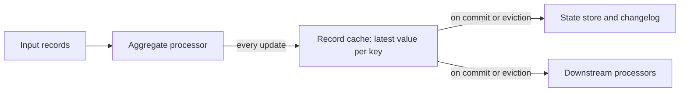

# Lesson 6. Aggregations, KTables and the Record Cache

**Mission link:** An aggregation is the most common stateful step, and choosing its store well includes knowing what it emits. This lesson explains why an aggregation's output is a stream of updates and which two settings decide how many of them reach the store, the changelog and the next processor.
**Primary source:** [Docs: "Memory Management", Apache Kafka 4.3](https://kafka.apache.org/43/streams/developer-guide/memory-mgmt/)
**Prerequisites:** [Lesson 5](0005-state-stores-and-changelog-topics.md), [KTable](../GLOSSARY.md), [Record cache](../GLOSSARY.md), [Commit interval](../GLOSSARY.md)

## Warm-up

1. ▢ An app with application ID `clicks` runs `groupByKey().count(Materialized.as("click-counts"))`. Name the changelog topic it creates and its cleanup policy.

<details markdown="1"><summary>Check</summary>

`clicks-click-counts-changelog`, with `cleanup.policy=compact`. It is a key-value store, so compaction alone keeps the topic to about one record per key.

</details>

2. ▢ The same count uses an in-memory store instead. The process is restarted on the same machine after a clean shutdown. How much of the changelog does it replay, and why?

<details markdown="1"><summary>Check</summary>

All of it, from the earliest offset. An in-memory store keeps nothing on disk, so on every start there is no local copy and no stored offset to resume from. A RocksDB store on a persistent `state.dir` would replay only from its recorded offset.

</details>

3. ▢ What does a record with a key and a null value mean when the topic is read as a KTable?

<details markdown="1"><summary>Check</summary>

It is a [tombstone](../GLOSSARY.md): it deletes that key from the table. A compacted topic eventually removes the key altogether.

</details>

## Know this

### Group first, and know whether that repartitions

Every aggregation starts from a grouped stream or table, and grouping decides whether records must move between tasks first ([Streams DSL](https://kafka.apache.org/43/streams/developer-guide/dsl-api/#stateful-transformations)):

| Call | On | Repartitions |
|---|---|---|
| `groupByKey()` | `KStream` | Only if an earlier key change marked the stream for repartitioning |
| `groupBy(mapper)` | `KStream` | Always; it is shorthand for `selectKey(mapper).groupByKey()` |
| `groupBy(mapper)` | `KTable` | Always; the new key may live on another task |

Prefer `groupByKey()` whenever the key is already right, and pass `Grouped.as("name")` either way, so a repartition topic, if one is made, gets a stable name instead of a generated one.

### Three aggregations

| Operation | You supply | Result type | Notes |
|---|---|---|---|
| `count()` | Nothing | `KTable<K, Long>` | On a stream, records with a null key or value are ignored |
| `reduce(reducer)` | `(agg, value) -> newAgg` | Same as the value type | The first value for a key becomes the aggregate as is |
| `aggregate(init, adder)` | An initializer and an adder | Any type | The initializer runs the first time a key is seen |

Each one writes its result into a key-value store, named and configured with `Materialized` as lesson 5 showed, and returns a `KTable`.

### Aggregating a table needs a subtractor

A grouped stream only ever adds: each record is a new event. A grouped table is different, because an update replaces a value that was already counted. So `KGroupedTable` takes a third function, the subtractor, and calls it with the old value to take that contribution back out ([Streams DSL](https://kafka.apache.org/43/streams/developer-guide/dsl-api/#stateful-transformations)).

The DSL guide's own example groups a `userProfiles` table, keyed by user with a region as value, by region and sums the length of each user name:

| Input to `userProfiles` | Read as | Adder | Subtractor | Result |
|---|---|---|---|---|
| `(alice, E)` | Insert | `E: 0 + 5` | | `E=5` |
| `(bob, A)` | Insert | `A: 0 + 3` | | `A=3, E=5` |
| `(charlie, A)` | Insert | `A: 3 + 7` | | `A=10, E=5` |
| `(alice, A)` | Update | `A: 10 + 5` | `E: 5 - 5` | `A=15, E=0` |
| `(charlie, null)` | Delete | | `A: 15 - 7` | `A=8, E=0` |

An insert calls only the adder, a tombstone only the subtractor, and an update calls both. When the old and new values group to the same key the subtractor is guaranteed to run first; when they group to different keys, as with alice moving from E to A, the order is undefined. If the subtractor returns null the key is removed from the result.

### A KTable is a stream of updates

An aggregation over an unbounded stream never has a final answer: the next record can always change it. So Kafka Streams does not wait. Each time an aggregate changes it emits the new value for that key, and the KTable's downstream, including `toStream().to(...)`, sees a stream of updates. The paper behind the design calls this the Dual Streaming Model: an operator's result is a stream of successive updates to a table ([Sax et al., 2018](https://dl.acm.org/doi/10.1145/3242153.3242155)).

Anything reading that output must treat it as a table: the latest record per key is the current value, and earlier records for the key are superseded, not additional. A consumer that sums the output records adds every intermediate value to the final one. Write such output to a compacted topic and read it with `builder.table()`. When you genuinely need one result per window, lesson 10's [suppression](../GLOSSARY.md) holds the updates back.

### The record cache decides how many updates you see

Between an aggregation and everything after it sits the **[record cache](../GLOSSARY.md)**. When a key's aggregate changes, the new value goes into the cache, overwriting any earlier value for that key still sitting there. Only when the cache is flushed is the latest value per key written to the store, sent to the changelog and forwarded downstream ([Memory Management](https://kafka.apache.org/43/streams/developer-guide/memory-mgmt/)).



A flush happens at whichever comes first:

- **Commit:** every **[commit interval](../GLOSSARY.md)**, `commit.interval.ms`, 30 seconds under at-least-once and 100 ms under `exactly_once_v2` ([Configuring a Streams Application](https://kafka.apache.org/43/streams/developer-guide/config-streams/)).
- **Cache pressure:** the cache is full and evicts its least recently used entry, which flushes that entry early.

Sizing is per instance: `statestore.cache.max.bytes` defaults to 10,485,760 bytes (10 MiB) and is split evenly across the instance's [stream threads](../GLOSSARY.md), so each thread gets C/T bytes for its tasks. Setting it to 0 disables caching, and every update flows through. `Materialized.withCachingDisabled()` does the same for a single store. The old name `cache.max.bytes.buffering` is deprecated, though the Memory Management page's examples still use it.

The cache saves more than downstream records: fewer flushes mean fewer store writes and fewer changelog records. The docs advise disabling it only for testing or debugging.

### Worked example: seven clicks, three or seven outputs

`clicks` receives seven records within a few seconds, keyed `A, B, A, A, C, A, B`, and the topology is:

```java
builder.stream("clicks", Consumed.with(Serdes.String(), Serdes.String()))
       .groupByKey()
       .count(Materialized.<String, Long, KeyValueStore<Bytes, byte[]>>as("click-counts"))
       .toStream()
       .to("click-counts-out", Produced.with(Serdes.String(), Serdes.Long()));
```

- **Cache off** (`statestore.cache.max.bytes=0`): seven output records, one per update: `A=1, B=1, A=2, A=3, C=1, A=4, B=2`.
- **Cache on, defaults, at-least-once:** three output records, `A=4, B=2, C=1`, all at the next commit, up to 30 seconds after the input. Order across keys can vary, since different keys may sit in different tasks.

Same input, same final table, different numbers of records in the output topic and the changelog. Under `exactly_once_v2` the commit interval is 100 ms, so input spread over a few seconds is flushed many times and the output lands close to the cache-off count: exactly-once costs cache compaction as well as transactions.

### Predict, then run

**First, in a unit test.** Feed the seven records through the topology above with `TopologyTestDriver`, default configuration, and read the output topic:

```java
try (TopologyTestDriver driver = new TopologyTestDriver(builder.build(), props)) {
    TestInputTopic<String, String> in = driver.createInputTopic("clicks",
            new StringSerializer(), new StringSerializer());
    TestOutputTopic<String, Long> out = driver.createOutputTopic("click-counts-out",
            new StringDeserializer(), new LongDeserializer());
    for (String k : new String[] {"A", "B", "A", "A", "C", "A", "B"}) in.pipeInput(k, "click");
    System.out.println(out.readKeyValuesToList());
}
```

Predict how many records it prints. Then predict two runs against a real local broker, with all seven records produced within a second: one with default settings, one with `statestore.cache.max.bytes=0`.

<details markdown="1"><summary>Check</summary>

The driver prints seven records, every intermediate update. `TopologyTestDriver` processes records synchronously and behaves as if both the cache size and the commit interval were zero ([TopologyTestDriver javadoc](https://kafka.apache.org/43/javadoc/org/apache/kafka/streams/TopologyTestDriver.html)), so a driver test cannot show caching at all. Against the broker, the default run prints three records, `A=4`, `B=2` and `C=1`, once the next commit arrives, which can take up to 30 seconds. The run with the cache at 0 prints all seven at once.

</details>

## Practice

1. ▢ When does `groupByKey()` create a repartition topic, and when does `groupBy()`?

<details markdown="1"><summary>Check</summary>

`groupByKey()` only when an earlier operation, such as `selectKey`, `map` or `process`, changed the key and marked the stream for repartitioning. `groupBy()` always, on a stream and on a table, because it sets a new key.

</details>

2. ▢ With the input unchanged, which single change makes a KTable aggregation emit more records?

    - a) Raise `statestore.cache.max.bytes` from 10 MiB to 100 MiB
    - b) Change `processing.guarantee` from its default value to `exactly_once_v2`
    - c) Raise `commit.interval.ms` from 30 seconds to 60 seconds
    - d) Give the store an explicit name with `Materialized.as`

<details markdown="1"><summary>Check</summary>

**b)** `exactly_once_v2` lowers the default commit interval from 30 seconds to 100 ms, so the cache is flushed far more often and compacts far less. (a) emits fewer or the same: a larger cache evicts less. (c) emits fewer: updates sit in the cache longer. (d) changes the store's and changelog's names, not the number of updates.

</details>

3. ▢ A table `employees` maps each employee to a department. It is grouped with `groupBy((emp, dept) -> KeyValue.pair(dept, 1L))` and aggregated with initializer `0`, adder `agg + v` and subtractor `agg - v`. The input is `(ann, eng)`, `(bo, eng)`, `(cy, ops)`, `(ann, ops)`, `(bo, null)`. List each adder and subtractor call and the final result.

<details markdown="1"><summary>Hint</summary>

Classify each input record first: insert, update or delete. Then remember which functions each kind calls, and that the old value of an update is grouped by its old department.

</details>

<details markdown="1"><summary>Check</summary>

`(ann, eng)` insert: adder, `eng=1`. `(bo, eng)` insert: adder, `eng=2`. `(cy, ops)` insert: adder, `ops=1`. `(ann, ops)` update: subtractor on the old group, `eng=1`, and adder on the new one, `ops=2`. `(bo, null)` tombstone: subtractor only, `eng=0`. Final: `eng=0`, `ops=2`. The key `eng` stays in the table with value 0, because the subtractor returned 0, not null.

</details>

4. ▢ An at-least-once app with default cache settings counts by key, and its commits happen at 30 s and 60 s. Records arrive at 0 s (`A`), 1 s (`A`), 2 s (`B`), 40 s (`A`) and 41 s (`B`). How many output records does it emit, with which values? How many with the cache off, and roughly how many under `exactly_once_v2`?

<details markdown="1"><summary>Hint</summary>

Group the records by the commit that flushes them, then keep only the latest value per key within each group.

</details>

<details markdown="1"><summary>Check</summary>

Four with the cache on: at the 30 s commit `A=2` and `B=1`, at the 60 s commit `A=3` and `B=2`. Five with the cache off, one per record. About five under `exactly_once_v2`: commits every 100 ms flush each record before the next one arrives a second later, so almost nothing is compacted.

</details>

5. ▢ Interleave lesson 1. A downstream team reads your `click-counts-out` topic with `builder.stream()` and sums the values per key to get total clicks. Their totals are far higher than yours. Explain why, and what they should do instead.

<details markdown="1"><summary>Check</summary>

The topic carries a KTable's updates, each record being the current count for its key, not a number of new clicks. Summing them adds every intermediate count to the final one: `A=1, A=2, A=3, A=4` sums to 10, not 4, and how far off they are depends on the cache and commit settings. They should read it with `builder.table()`, so each record replaces the last for its key. The topic should be compacted, since only the latest value per key matters.

</details>

6. ▢ A unit test for the click count pipes the seven records through `TopologyTestDriver` and asserts the output topic holds exactly three records, as it did in a staging run against a broker. The test fails with seven. Is the topology wrong? What should the test assert instead?

<details markdown="1"><summary>Hint</summary>

Ask which of the two settings that drive caching the driver honours.

</details>

<details markdown="1"><summary>Check</summary>

The topology is fine. The driver behaves as if the cache size and commit interval were zero, so it always emits every update, while the broker run compacted them into three. The number of updates is a deployment property, not a property of the topology, so the test should assert the latest value per key, for example by reading the output into a map with `readKeyValuesToMap()`, or by reading the store with `getKeyValueStore("click-counts")`.

</details>

## Real-world reps

- [ ] Today: run the predict-then-run's unit test and write your prediction down before reading the output. Then change the assertion to compare the latest value per key.
- [ ] Run the same topology against a local broker twice, once with default settings and once with `statestore.cache.max.bytes=0`. Consume the output topic with `kafka-console-consumer.sh --property print.key=true` and count the records each run produced.
- [ ] Tomorrow: set `processing.guarantee=exactly_once_v2` and produce the seven records a second apart. Predict the number of output records before you look, then explain any difference from your prediction.

## Going further

- [State Stores](../reference/state-stores.md)
- [Docs: "Memory Management", Apache Kafka 4.3](https://kafka.apache.org/43/streams/developer-guide/memory-mgmt/)
- [Docs: "Streams DSL", Apache Kafka 4.3](https://kafka.apache.org/43/streams/developer-guide/dsl-api/), the aggregation section and its two semantics tables
- [Paper: "Streams and Tables: Two Sides of the Same Coin", Sax, Wang, Weidlich and Freytag, BIRTE (2018)](https://dl.acm.org/doi/10.1145/3242153.3242155)
- [Resources](../RESOURCES.md)

---

Not landing? Reread the primary source at the top, since this lesson compresses it and compression is where understanding leaks. Check the [glossary](../GLOSSARY.md) for any term that felt slippery.

If the lesson itself is unclear rather than the material, that is a defect: [open an issue](https://github.com/TokenCemetery/teach/issues).
