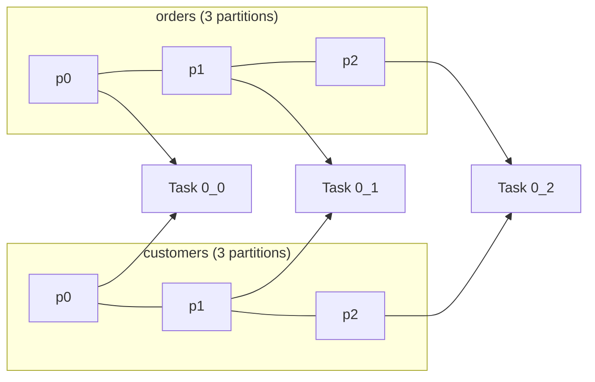
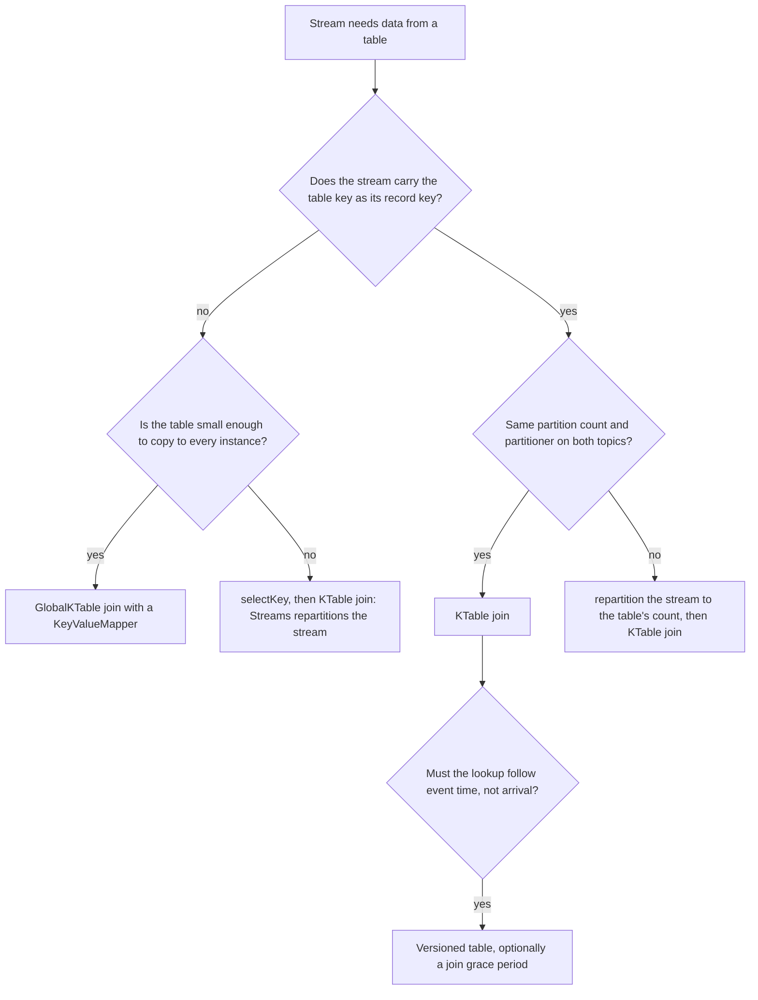

# Lesson 11. Stream-Table Joins and Co-Partitioning

**Mission link:** Stage 5 opens the join half of the mission: choosing a join for two inputs, making them co-partitioned or saying why a GlobalKTable avoids the need, and predicting what the join emits. The stream-table join is the one most applications start with, because it is how an event gets enriched with current reference data.
**Primary source:** [Docs: "Joining", Streams DSL, Apache Kafka 4.3](https://kafka.apache.org/43/streams/developer-guide/dsl-api/#joining)
**Prerequisites:** [Lesson 10](0010-late-data-grace-periods-and-suppression.md), [Lesson 4](0004-stateless-operations-and-repartitioning.md), [KTable](../GLOSSARY.md), [Co-partitioning](../GLOSSARY.md), [GlobalKTable](../GLOSSARY.md)

## Warm-up

1. ▢ Name every internal topic this creates, and say what makes each one appear: `orders.selectKey((k, v) -> v.customerId()).groupByKey().count()`.

<details markdown="1"><summary>Check</summary>

Two. A repartition topic, because `selectKey` marks the stream for repartitioning and the stateful `groupByKey().count()` after it has to see every record of a customer in one task. A changelog topic, for the state store that holds the counts.

</details>

2. ▢ A task reads records with timestamps 10, 40 and 25, in that order. What is its stream time after each one?

<details markdown="1"><summary>Check</summary>

10, 40, 40. Stream time is the largest timestamp seen so far and never moves backward, so the record at 25 is out of order and leaves it at 40.

</details>

3. ▢ A tumbling window covers minutes 0 to 5 and has a grace period of 1 minute. A record for that window arrives when stream time is at minute 7. Accepted or dropped?

<details markdown="1"><summary>Check</summary>

Dropped. Stream time has passed the window end plus the grace period (minute 6), so the window is closed and the record is a late record.

</details>

## Know this

### A stream-table join is a lookup per stream record

A **[KStream](../GLOSSARY.md)**-**[KTable](../GLOSSARY.md)** join enriches each record of the stream with the table's current value for the same key. Two methods exist, `join` (inner) and `leftJoin`; there is no outer stream-table join ([Joining](https://kafka.apache.org/43/streams/developer-guide/dsl-api/#joining)).

```java
KStream<String, Order> orders = builder.stream("orders");          // keyed by customer ID
KTable<String, Customer> customers = builder.table("customers");   // keyed by customer ID

KStream<String, EnrichedOrder> enriched =
    orders.leftJoin(customers, (order, customer) -> EnrichedOrder.of(order, customer));
```

The asymmetry is the whole lesson. The [KStream-KTable join section](https://kafka.apache.org/43/streams/developer-guide/dsl-api/#kstream-ktable-join) states the rules:

- **Only stream records trigger the join.** A table record only updates the table's local state; it emits nothing, and it never revisits a result already emitted.
- **An inner join emits only on a match.** A stream record whose key is absent from the table produces nothing.
- **A left join always emits.** With no match the joiner is called with `null` for the table side.
- **A stream record with a `null` value is ignored**, and for the inner join so is one with a `null` key.
- **A table [tombstone](../GLOSSARY.md) deletes the key** from the table's state and does not trigger the join.

The result is a KStream keyed like the stream, because each output is the enriched version of one stream event.

### Worked example: orders meet customer tiers

One key, `c1`, and records processed in this order:

| Step | Input | `join` emits | `leftJoin` emits |
|---|---|---|---|
| 1 | order `o1` | | `(o1, null)` |
| 2 | customer `c1` = gold | | |
| 3 | order `o2` | `(o2, gold)` | `(o2, gold)` |
| 4 | customer `c1` = silver | | |
| 5 | order `o3` | `(o3, silver)` | `(o3, silver)` |
| 6 | customer `c1` = tombstone | | |
| 7 | order `o4` | | `(o4, null)` |

Read step 4 twice. The customer was upgraded after `o2` was enriched, and `o2`'s result stays `gold` forever. A stream-table join answers "what did the table say when this event was processed", not "what does the table say now". If downstream needs the second answer, it needs a table-table join, lesson 12.

### Which version of the table a stream record sees

By default a table is **unversioned**: it holds one value per key, the one with the largest offset, so a stream record joins whatever the table holds at the moment the record is processed ([Using timestamp-based semantics for table processors](https://kafka.apache.org/43/streams/developer-guide/dsl-api/)). That moment depends on processing order across the two topics. A task reading both picks records in timestamp order when it has data buffered from both, and `max.task.idle.ms` (default 0) decides how long it waits when one side has none: at 0 it waits to fetch data already on the brokers but not for producers to send more ([Configuring a Streams Application](https://kafka.apache.org/43/streams/developer-guide/config-streams/)). So when you replay history the join is close to timestamp-correct, and in live traffic a table update produced a second after the order it should have enriched arrives too late for it.

A **versioned table** fixes the lookup by time instead of by arrival. Materialize the table with a versioned store and each stream record joins the latest table value whose timestamp is less than or equal to the stream record's own timestamp:

```java
KTable<String, Customer> customers = builder.table("customers",
    Materialized.as(Stores.persistentVersionedKeyValueStore("customers-versioned", Duration.ofDays(7))));

orders.join(customers, EnrichedOrder::of,
    Joined.<String, Order, Customer>with(keySerde, orderSerde, customerSerde)
          .withGracePeriod(Duration.ofSeconds(30)));
```

The second argument to the store is its history retention. A stream record older than that is dropped by `join` and joined with `null` by `leftJoin`. The grace period, which requires a versioned table, makes the stream side wait that long before looking up, so a table update with an earlier timestamp that arrives a little late is still found ([KStream-KTable join](https://kafka.apache.org/43/streams/developer-guide/dsl-api/#kstream-ktable-join)). It is the same idea as a window's [grace period](../GLOSSARY.md) in lesson 10, and the same trade: correctness for latency.

### Co-partitioning: why the two topics must agree

A join runs inside one **[task](../GLOSSARY.md)**, and a task owns one partition number of each input. Task 2 reads partition 2 of `orders` and partition 2 of `customers`, and its local copy of the table holds only the customers in that partition. An order for `c1` finds `c1` only if both topics put `c1` in the same partition number. That requirement is **[co-partitioning](../GLOSSARY.md)**, and the docs state it in two parts ([Join co-partitioning requirements](https://kafka.apache.org/43/streams/developer-guide/dsl-api/#join-co-partitioning-requirements)):

1. Both input topics have the same number of partitions.
2. Every application writing to them uses the same partitioning strategy, so a key lands on the same partition number in both: the same `partitioner.class` for plain producers, the same `StreamPartitioner` for Streams sinks. Default settings everywhere satisfy this.



**What Streams checks, and what it cannot.** During partition assignment it compares the partition counts of the topics in each join, and a mismatch stops the application with a `TopologyException` reading "Topics not co-partitioned" (the docs still call it `TopologyBuilderException`; the 4.3 source throws `TopologyException`, see [`CopartitionedTopicsEnforcer`](https://github.com/apache/kafka/blob/4.3/streams/src/main/java/org/apache/kafka/streams/processor/internals/assignment/CopartitionedTopicsEnforcer.java)). It cannot check the partitioner. If one producer hashes keys differently, or serializes the same key to different bytes (the default partitioner hashes the serialized key, see the Kafka track's [topic and partition design sheet](../../kafka/reference/topic-and-partition-design.md)), the app starts, runs, and silently misses matches: the inner join drops records, the left join emits `null` for customers that exist.

### Fixing it: repartition the stream

When counts differ, repartition one side inside the app. The docs recommend repartitioning the side with fewer partitions up to the larger count, and for a stream-table join repartitioning the stream, because repartitioning a KTable can add a second state store:

```java
KStream<String, Order> ordersRepartitioned = orders.repartition(
    Repartitioned.<String, Order>as("orders-by-customer").withNumberOfPartitions(12));
ordersRepartitioned.join(customers, EnrichedOrder::of);
```

When the stream simply has the wrong key, you do not need to size anything. `orders.selectKey((k, v) -> v.customerId()).join(customers, ...)` makes Streams write a **[repartition topic](../GLOSSARY.md)** before the join, and Streams creates it with the table topic's partition count. The partitioner is still yours to keep consistent.

### GlobalKTable: no co-partitioning, a full copy everywhere

A **[GlobalKTable](../GLOSSARY.md)** is read from every partition of its topic by every instance, so each instance holds the whole table ([GlobalKTable](https://kafka.apache.org/43/streams/developer-guide/dsl-api/)). Three things follow:

- **No co-partitioning.** Any task can look up any key.
- **A join on any field.** A `KeyValueMapper` derives the lookup key from the stream record, so the stream need not be keyed by it.
- **A full copy on every instance**, with the storage, network and broker load of reading the whole topic on each one.

```java
GlobalKTable<String, Country> countries = builder.globalTable("countries");

KStream<String, EnrichedOrder> enriched = orders.join(countries,
    (orderKey, order) -> order.countryCode(),          // KeyValueMapper: which table key to look up
    (order, country) -> EnrichedOrder.of(order, country));
```

Two behaviours differ from a KTable join ([KStream-GlobalKTable join](https://kafka.apache.org/43/streams/developer-guide/dsl-api/#kstream-globalktable-join)). The global table is **fully bootstrapped** on every start or restart: it reads all data in its topic available at that moment, and processing begins only after. And it has **no notion of time**: there is no event-time synchronization between table updates and stream records, so a stream record joins whatever the global table holds when it is processed, and a versioned lookup or a join grace period is not available. A KTable cannot be joined to a GlobalKTable at all.



### Predict, then run

Create two topics with mismatched partition counts and a minimal app that joins them, against a local broker:

```bash
kafka-topics.sh --bootstrap-server localhost:9092 --create --topic orders --partitions 3
kafka-topics.sh --bootstrap-server localhost:9092 --create --topic customers --partitions 4
```

```java
StreamsBuilder builder = new StreamsBuilder();
KStream<String, String> orders = builder.stream("orders");
KTable<String, String> customers = builder.table("customers");
orders.join(customers, (o, c) -> o + " for " + c).to("enriched");
Topology topology = builder.build();
System.out.println(topology.describe());
new KafkaStreams(topology, props).start();
```

Before running it, predict: does it fail at `builder.build()`, at `describe()`, or after `start()`; and does any record get joined first? Then run it and read the log. The topology is built and described without complaint, because building it never contacts the broker and so knows no partition counts. The failure comes at the first partition assignment after `start()`, with "Topics not co-partitioned", before any record is processed. Recreate `customers` with 3 partitions and it starts.

## Practice

1. ▢ In a KStream-KTable join, which side's records produce output, and what does a record on the other side do?

<details markdown="1"><summary>Check</summary>

Only stream records produce output. A table record updates the table's local state and emits nothing, so a result already emitted for an earlier stream record is never revised.

</details>

2. ▢ Which statement about co-partitioning checks in Kafka Streams is true?

    - a) Streams compares partition counts and cannot compare the producers' partitioners
    - b) Streams compares the producers' partitioners and cannot compare partition counts
    - c) Streams compares both of them when the topology is built
    - d) Streams compares neither and leaves the whole check to operators

<details markdown="1"><summary>Check</summary>

**a)** Partition counts are compared during partition assignment, and a mismatch stops the app. (b) is backwards: the partitioner is the part Streams cannot see, because it lives in whichever application wrote the topic. (c) is wrong on timing: building a topology contacts no broker, so no counts are known then. (d) is wrong because the count check does exist.

</details>

3. ▢ Same key throughout, processed in this order, with `leftJoin` against an unversioned table: customer = bronze; order `o1`; customer = gold; customer = platinum; order `o2`; customer = tombstone; order `o3`. List every output, then say which change if the join were `join`.

<details markdown="1"><summary>Hint</summary>

Only orders produce output, and each one sees the table as it stands at that step.

</details>

<details markdown="1"><summary>Check</summary>

`(o1, bronze)`, `(o2, platinum)`, `(o3, null)`. The two table updates between `o1` and `o2` emit nothing, and `gold` never appears in the output at all. With `join`, `o3` produces nothing, because the tombstone removed the key and an inner join emits only on a match. The first two outputs are unchanged.

</details>

4. ▢ A left join of `payments` (6 partitions) with a `customers` KTable (6 partitions) emits `null` for about a third of payments, though every customer exists in the table topic. The app started cleanly. `payments` is produced by a Python service; `customers` by a Java service. What do you suspect, and how do you confirm it?

<details markdown="1"><summary>Hint</summary>

Partition counts match, and that is the only thing Streams checked. Ask what else must match for a key to land on the same partition number.

</details>

<details markdown="1"><summary>Check</summary>

The two producers do not place the same key on the same partition: a Python client whose default partitioner uses a different hash function from the Java client's, or the same customer ID serialized to different bytes (a string on one side, JSON with quotes or a schema prefix on the other). Confirm by producing or looking up one known key on each topic and comparing the partition numbers (the console consumer can print partition with `--property print.partition=true`). Fix by making the producers agree, or repartition `payments` inside the app with `selectKey` or `repartition()` so Streams' own partitioner places it.

</details>

5. ▢ Interleave lesson 4: `orders` is keyed by order ID with 8 partitions, `customers` has 12. The topology is `orders.selectKey((k, v) -> v.customerId()).join(customers, EnrichedOrder::of)`. Which internal topics does it create, how many partitions does the new repartition topic get, and why does the partition mismatch not stop the app?

<details markdown="1"><summary>Check</summary>

A repartition topic for the rekeyed orders, created with 12 partitions to match `customers`, and a changelog topic for the `customers` table's state store (unless `topology.optimization` includes `reuse.ktable.source.topics`, which reads the source topic back instead). The join reads the repartition topic, not `orders`, so the co-partitioned pair is the repartition topic and `customers`, and Streams sized one to match the other.

</details>

6. ▢ An app enriches 50,000 clickstream events a second with two tables: `countries` (250 rows, updated a few times a year) and `users` (400 million rows, 300 GB, updated constantly), across 20 instances. For each table choose KTable or GlobalKTable, and name what the other choice would cost.

<details markdown="1"><summary>Check</summary>

`countries` as a GlobalKTable: a few kilobytes copied 20 times costs nothing, and the clickstream need not be keyed by country, so no repartition topic. `users` as a KTable, co-partitioned with clicks keyed by user ID (repartitioning the clicks if needed): as a GlobalKTable each of the 20 instances would hold all 300 GB, read the whole constantly updated topic, and bootstrap all of it before processing on every restart. The KTable's price is co-partitioning, possibly a repartition topic, and a join that only works on the record key.

</details>

## Real-world reps

- [ ] Today: run this lesson's predict-then-run against a local broker. Write your prediction down first, then find the exact log line and the moment it appears.
- [ ] Find a stream-table join in a codebase you can read. Write down the partition count of both topics and which service produces each, and say whether anything other than defaults could break co-partitioning.
- [ ] Tomorrow: replay the worked example's seven steps through your own `leftJoin` (a console producer into both topics is enough) and compare the output with the table in this lesson. Then add a table update with an earlier timestamp than the order before it and see which value the order picks up.

## Going further

- [Joins](../reference/joins.md)
- [Docs: "Joining", Streams DSL, Apache Kafka 4.3](https://kafka.apache.org/43/streams/developer-guide/dsl-api/#joining)
- [Docs: "Configuring a Streams Application", Apache Kafka 4.3](https://kafka.apache.org/43/streams/developer-guide/config-streams/), for `max.task.idle.ms`
- [Topic and partition design](../../kafka/reference/topic-and-partition-design.md), the Kafka track's sheet on how a key reaches a partition
- [Resources](../RESOURCES.md)

---

Not landing? Reread the primary source at the top, since this lesson compresses it and compression is where understanding leaks. Check the [glossary](../GLOSSARY.md) for any term that felt slippery.

If the lesson itself is unclear rather than the material, that is a defect: [open an issue](https://github.com/TokenCemetery/teach/issues).
