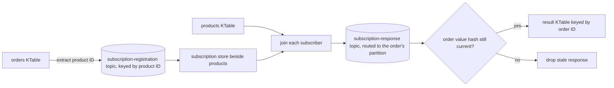

# Lesson 12. Stream-Stream and Table-Table Joins

**Mission link:** This closes stage 5 and the join success bullet: with the stream-table joins of lesson 11 and the two shapes here, you can pick a join for any two inputs and predict its output record by record, including the late, unmatched and deleted cases where predictions usually go wrong.
**Primary source:** [Docs: "Joining", Streams DSL, Apache Kafka 4.3](https://kafka.apache.org/43/streams/developer-guide/dsl-api/#joining)
**Prerequisites:** [Lesson 11](0011-stream-table-joins-and-co-partitioning.md), [Lesson 10](0010-late-data-grace-periods-and-suppression.md), [Co-partitioning](../GLOSSARY.md), [Foreign-key join](../GLOSSARY.md)

## Warm-up

1. ▢ In a stream-table `leftJoin`, the table's value for `c1` changes from gold to silver after order `o2` was enriched. What happens to `o2`'s result?

<details markdown="1"><summary>Check</summary>

Nothing. Only stream records trigger a stream-table join, so the table update emits nothing and `o2`'s result stays `gold`.

</details>

2. ▢ What does a state store's changelog topic let Kafka Streams do when the instance holding the store dies?

<details markdown="1"><summary>Check</summary>

Rebuild the store on another instance by replaying the compacted changelog, which records every update to the store. That replay is restoration.

</details>

3. ▢ How does a sliding window in Kafka Streams differ from a hopping window in where its boundaries come from?

<details markdown="1"><summary>Check</summary>

A sliding window is defined by the largest time difference between records and is created at record timestamps. A hopping window has fixed boundaries aligned to the epoch and advances by a fixed step.

</details>

## Know this

### Two streams join only inside a window

A [KStream](../GLOSSARY.md)-KStream join pairs events from two streams with the same key whose timestamps are close. It is always windowed: without a window, the state each side keeps while it waits for the other would grow without bound ([KStream-KStream join](https://kafka.apache.org/43/streams/developer-guide/dsl-api/#kstream-kstream-join)). The window is a `JoinWindows`:

```java
JoinWindows window = JoinWindows.ofTimeDifferenceAndGrace(Duration.ofMinutes(10), Duration.ofMinutes(2))
                                .before(Duration.ZERO);

KStream<String, Attribution> attributed = impressions.leftJoin(clicks,
    (impression, click) -> Attribution.of(impression, click),
    window,
    StreamJoined.with(Serdes.String(), impressionSerde, clickSerde));
```

`JoinWindows` is a sliding window aligned to each record: a left record at time `t` matches right records from `t - before` to `t + after` ([JoinWindows](https://kafka.apache.org/43/javadoc/org/apache/kafka/streams/kstream/JoinWindows.html)). `ofTimeDifferenceAndGrace(10 min, 2 min)` sets both to 10 minutes; `.before(Duration.ZERO)` then keeps only clicks at or after the impression, which is what "a click within 10 minutes of the impression" means. The grace period works as in lesson 10: a record later than the window end plus grace is rejected. `ofTimeDifferenceWithNoGrace` sets it to zero.

**Both sides are buffered.** Each side writes its records into its own window [state store](../GLOSSARY.md), with a changelog, and each new record on either side probes the other side's store and emits one result per match, so one record can produce several. The stores keep records for the window size (`before + after`) plus grace, so a long window over a busy stream is a large store ([`KStreamImplJoin`](https://github.com/apache/kafka/blob/4.3/streams/src/main/java/org/apache/kafka/streams/kstream/internals/KStreamImplJoin.java) sets that retention). The output is a plain `KStream<K, ...>`, not a windowed key, and the inputs must be [co-partitioned](../GLOSSARY.md) exactly as in lesson 11.

**Inner, left and outer.** All three exist. The difference is the unmatched record: inner never emits it, left emits a left record with `null` for the right side, and outer emits unmatched records from either side. And an unmatched record cannot be known to be unmatched until no partner can arrive any more. So in current versions **left and outer results for unmatched records are emitted only after the window plus grace has passed**; the deprecated `JoinWindows.of(...).grace(...)` API emitted them eagerly, producing spurious `null` results that a later match contradicted ([Joining](https://kafka.apache.org/43/streams/developer-guide/dsl-api/#kstream-kstream-join)).

That "after" has a mechanism worth knowing, because tests trip on it. Unmatched records wait in a third store, and Streams checks it when a later record, of any key in the same task, moves **[stream time](../GLOSSARY.md)** forward. A record that arrives into an idle task waits until something else does. The check is also throttled to roughly once per second of wall-clock time by an internal setting ([`KStreamKStreamJoin`](https://github.com/apache/kafka/blob/4.3/streams/src/main/java/org/apache/kafka/streams/kstream/internals/KStreamKStreamJoin.java)), so in a fast replay an unmatched result can appear on a later record than the window arithmetic says. It never appears earlier.

### Worked example: attributing clicks to impressions

The window above: a click matches an impression if it comes 0 to 10 minutes after it, with 2 minutes of grace. One ad, `ad7`, records processed in timestamp order, a few seconds of wall-clock time apart:

| Step | Minute | Impression (left) | Click (right) | `join` | `leftJoin` | `outerJoin` |
|---|---|---|---|---|---|---|
| 1 | 0 | `I1` | | | | |
| 2 | 4 | | `C1` | `[I1, C1]` | `[I1, C1]` | `[I1, C1]` |
| 3 | 7 | | `C2` | `[I1, C2]` | `[I1, C2]` | `[I1, C2]` |
| 4 | 15 | `I2` | | | | |
| 5 | 30 | `I3` | | | `[I2, null]` | `[I2, null]` |
| 6 | 31 | | `C3` | `[I3, C3]` | `[I3, C3]` | `[I3, C3]` |
| 7 | 50 | | `C4` | | | |
| 8 | 70 | `I4` | | | | `[null, C4]` |

- Step 3: `I1` joins a second click. A stream-stream join emits one result per pair.
- Step 5: `I2`'s window ends at minute 25 and its grace at 27. Nothing said so until `I3` moved stream time to 30; only then is `[I2, null]` final.
- Step 7: `C4` has no impression in the 10 minutes before it. `leftJoin` never reports it, since it is a right record; `outerJoin` does, but only after stream time passes minute 52, which here first happens at step 8.
- Steps 1 and 8: `I1` was matched, so it never yields `[I1, null]`. `I4` is still waiting when the table ends.

### Two tables join on every update

A [KTable](../GLOSSARY.md)-KTable join is non-windowed and behaves like a relational join kept current: both tables are materialized, and **an update on either side** looks up the other side and emits a new result for the key ([KTable-KTable equi-join](https://kafka.apache.org/43/streams/developer-guide/dsl-api/#ktable-ktable-equi-join)). The result is itself a KTable, a changelog of the join, so a result can be replaced and deleted. Inner, left and outer all exist, and co-partitioning is required.

Deletes are where predictions go wrong. A [tombstone](../GLOSSARY.md) on an input forwards a tombstone to the result only if the key is currently in the result. In a left join, a right tombstone triggers the join and a left tombstone does not; in an outer join, either can. One key, record cache disabled so every update is visible:

| Step | Left | Right | `join` | `leftJoin` | `outerJoin` |
|---|---|---|---|---|---|
| 1 | `A` | | | `[A, null]` | `[A, null]` |
| 2 | | `a` | `[A, a]` | `[A, a]` | `[A, a]` |
| 3 | | `b` | `[A, b]` | `[A, b]` | `[A, b]` |
| 4 | tombstone | | tombstone | tombstone | `[null, b]` |
| 5 | | tombstone | | | tombstone |

Step 3 is the contrast with lesson 11: the right side changed and the result followed it. With the record cache on, steps 2 and 3 may collapse into one update, exactly as KTable aggregations did in lesson 6. If you join versioned tables, an out-of-order update (an older timestamp than one already seen for the key) is ignored and triggers nothing.

### Foreign-key joins: a table that points at another

Often the left table is keyed by one thing and refers to another: orders keyed by order ID, each naming a product ID. A **[foreign-key join](../GLOSSARY.md)** joins them without rekeying the orders:

```java
KTable<String, Order> orders = builder.table("orders");        // key: order ID
KTable<String, Product> products = builder.table("products");  // key: product ID

KTable<String, OrderLine> lines = orders.join(products,
    order -> order.productId(),                                // foreign-key extractor
    (order, product) -> OrderLine.of(order, product),
    TableJoined.as("order-product"));
```

The join predicate is `foreignKeyExtractor(leftValue) == rightKey`, the result is keyed by the left key, and only inner and left exist ([KTable-KTable foreign-key join](https://kafka.apache.org/43/streams/developer-guide/dsl-api/#ktable-ktable-foreign-key-join)). Co-partitioning is not required, because Streams moves the data itself through internal topics, as KIP-213 designs it ([KIP-213](https://cwiki.apache.org/confluence/display/KAFKA/KIP-213+Support+non-key+joining+in+KTable)):



Each order sends a subscription to the partition that owns its product; the products side keeps them in a subscription store and answers each one; the answer travels back to the order's partition, where a hash of the order's value discards a response that an order update has already overtaken. In the 4.3 source the topics are `<application.id>-<name>-subscription-registration-topic` and `<application.id>-<name>-subscription-response-topic` when you pass `TableJoined.as(name)`, and `KTABLE-FK-JOIN-SUBSCRIPTION-REGISTRATION-<n>-topic` and `...-RESPONSE-<n>-topic` when you do not, plus a subscription store with its changelog ([`KTableImpl`](https://github.com/apache/kafka/blob/4.3/streams/src/main/java/org/apache/kafka/streams/kstream/internals/KTableImpl.java)). That is two topics and a store more than a co-partitioned join costs, which is the price of not rekeying.

The fan-out runs one way. An order update produces at most one result; a product update produces one result for **every order that references it**. Record cache off:

| Step | Input | `join` emits | `leftJoin` emits |
|---|---|---|---|
| 1 | order `o1` → `p1` | | `(o1, null)` |
| 2 | product `p1` = Kettle | `(o1, Kettle)` | `(o1, Kettle)` |
| 3 | order `o2` → `p1` | `(o2, Kettle)` | `(o2, Kettle)` |
| 4 | product `p1` = Electric kettle | `(o1, Electric kettle)`, `(o2, Electric kettle)` | the same two |
| 5 | order `o1` → `p9`, absent | tombstone for `o1` | `(o1, null)` |
| 6 | order `o2` = tombstone | tombstone for `o2` | tombstone for `o2` |

Step 5 matches the documented behaviour: the old result is no longer valid, so the inner join must delete it. Records whose extractor returns `null` are ignored by the inner join; the docs suggest a sentinel value if you need to join on a missing key.

### Predict, then run

Build the click attribution join above with `ofTimeDifferenceAndGrace(Duration.ofMinutes(10), Duration.ofMinutes(2)).before(Duration.ZERO)` and `leftJoin`, then produce steps 1 to 6 of the worked example into two topics with explicit event timestamps: a few lines of Java that send `new ProducerRecord<>(topic, null, timestamp, key, value)` are enough. Before running, predict two things: on which input record `[I2, null]` appears, and what you see if you send all six records within one second. Then run it twice, once slowly and once fast. Slowly, it appears while `I3` is processed. Fast, it can appear later or not at all until another record arrives, because of the wall-clock throttle; and whatever the speed, it never appears before stream time passes minute 27.

## Practice

1. ▢ Why is every KStream-KStream join windowed?

<details markdown="1"><summary>Check</summary>

Each side must keep its records in a store while it waits for partners from the other side. Without a window that store would grow without bound, so the window bounds how long a record waits and how long the store keeps it.

</details>

2. ▢ Which pair of inputs supports an outer join in Kafka Streams?

    - a) KStream with KTable, and KStream with GlobalKTable
    - b) KStream with KStream, and KTable with KTable
    - c) KTable with KTable through a foreign key
    - d) KTable with GlobalKTable, and KStream with KTable

<details markdown="1"><summary>Check</summary>

**b)** Both equi-joins of like with like support outer. (a) is wrong: stream-table and stream-global-table joins have only inner and left, because only the stream side triggers. (c) is wrong: foreign-key joins have inner and left only. (d) is wrong twice: KTable with GlobalKTable is not supported at all, and stream-table has no outer.

</details>

3. ▢ Window: `JoinWindows.ofTimeDifferenceAndGrace(Duration.ofMinutes(5), Duration.ofMinutes(1))`, symmetric. One key, processed in timestamp order with wall-clock seconds between records: left `A` at minute 0, right `x` at 3, left `B` at 10, right `y` at 20, left `C` at 30. List what `join`, `leftJoin` and `outerJoin` emit, and on which input each result appears.

<details markdown="1"><summary>Hint</summary>

An unmatched record is final only once stream time passes its own timestamp plus the window on its side plus the grace. Work out that moment for `B` and for `y`, then find the first record that moves stream time past it.

</details>

<details markdown="1"><summary>Check</summary>

`join`: `[A, x]`, on `x`. `leftJoin`: `[A, x]` on `x`, then `[B, null]` on `y`. `B` could match right records from minute 5 to 15, so it is final once stream time passes 10 + 5 + 1 = 16, and `y` moves stream time to 20. It does not matter that `y` is a right record: both sides share the store of unmatched records. `outerJoin`: the same two, plus `[null, y]` on `C`, because `y` could match left records up to minute 25 and is final once stream time passes 20 + 5 + 1 = 26. `C` itself is still waiting.

</details>

4. ▢ Two KTables, one key, record cache disabled. In order: right = `x`; left = `A`; right = `y`; left = tombstone. List the outputs of `leftJoin` and of `outerJoin`.

<details markdown="1"><summary>Hint</summary>

Both sides trigger a table-table join, but a left join has nothing to emit while the left side is empty. A tombstone reaches the result only if the key is in the result.

</details>

<details markdown="1"><summary>Check</summary>

`leftJoin`: nothing for `x` (no left value yet), `[A, x]`, `[A, y]`, then a tombstone. `outerJoin`: `[null, x]`, `[A, x]`, `[A, y]`, then `[null, y]`, because the right side still holds `y` and an outer join keeps a right-only row.

</details>

5. ▢ Interleave lesson 10: a click join uses `JoinWindows.ofTimeDifferenceWithNoGrace(Duration.ofMinutes(10))`. Clicks reach Kafka up to two minutes late because of mobile buffering. What goes wrong, and what is the cost of fixing it?

<details markdown="1"><summary>Check</summary>

With zero grace, a click arriving after stream time has passed its impression's window end is rejected as late, so legitimate clicks are silently lost, and a `leftJoin` reports those impressions as `[I, null]`. Fix with `ofTimeDifferenceAndGrace(Duration.ofMinutes(10), Duration.ofMinutes(2))` or a little more. The cost: both window stores keep records two minutes longer, and every unmatched result is held back two minutes more.

</details>

6. ▢ A foreign-key join enriches 50 million orders with 20,000 products. The product team bulk-updates the description of every product once a night. Estimate what the join emits that night, name the internal topics it writes through, and say what you would change if downstream only needs product descriptions at order time.

<details markdown="1"><summary>Check</summary>

One result per order referencing an updated product: all 50 million, in one burst, written through the subscription-response topic and the result's downstream topic, with the subscription-registration topic untouched because no order changed. If downstream only needs the description as it was when the order was placed, it does not need a result kept current: an order stream joined to the products table, lesson 11, emits once per order and ignores product updates. If the KTable result is needed, the record cache and commit interval of lesson 6 can collapse repeats per key, but not this fan-out.

</details>

## Real-world reps

- [ ] Today: run this lesson's predict-then-run slowly and fast, with your two predictions written down first. Note the input record on which `[I2, null]` appeared each time.
- [ ] Call `describe()` on a topology with one foreign-key join, with and without `TableJoined.as(...)`, and find the two subscription topics and the subscription store in each.
- [ ] Tomorrow: take a join in a codebase you can read and write its output for a five-record input by hand, including one delete or one unmatched record. Then check it against the semantics tables in the primary source.

## Going further

- [Joins](../reference/joins.md)
- [Docs: "Joining", Streams DSL, Apache Kafka 4.3](https://kafka.apache.org/43/streams/developer-guide/dsl-api/#joining), whose three semantics tables are worth working through row by row
- [Javadoc: "JoinWindows", Apache Kafka 4.3](https://kafka.apache.org/43/javadoc/org/apache/kafka/streams/kstream/JoinWindows.html)
- [KIP-213: Support non-key joining in KTable](https://cwiki.apache.org/confluence/display/KAFKA/KIP-213+Support+non-key+joining+in+KTable), for the subscription protocol and the out-of-order problem the hash solves
- [Resources](../RESOURCES.md)

---

Not landing? Reread the primary source at the top, since this lesson compresses it and compression is where understanding leaks. Check the [glossary](../GLOSSARY.md) for any term that felt slippery.

If the lesson itself is unclear rather than the material, that is a defect: [open an issue](https://github.com/TokenCemetery/teach/issues).
