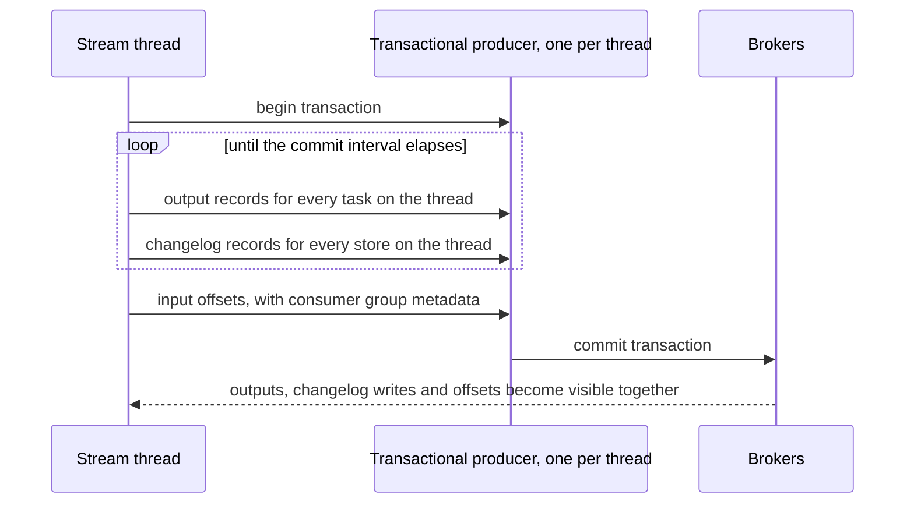

# Lesson 13. Exactly-Once in Kafka Streams

**Mission link:** Stage 6 opens with the first half of its success bullet: saying what `exactly_once_v2` guarantees and what it leaves out. The mission asks for an app that gives the right answer when records arrive twice; this lesson is where that holds, and where it stops holding.
**Primary source:** [Docs: "Configuring a Streams Application", Apache Kafka 4.3](https://kafka.apache.org/43/streams/developer-guide/config-streams/), the `processing.guarantee` and `commit.interval.ms` entries and the resiliency recommendations
**Prerequisites:** [Lesson 12](0012-stream-stream-and-table-table-joins.md), [Lesson 6](0006-aggregations-ktables-and-the-record-cache.md), [Exactly-once processing](../GLOSSARY.md), [Commit interval](../GLOSSARY.md), the Kafka track's [delivery guarantees sheet](../../kafka/reference/delivery-guarantees.md)

## Warm-up

1. ▢ Why does a KTable count emit fewer updates than it receives records, and which two settings decide how many fewer?

<details markdown="1"><summary>Check</summary>

The record cache collapses consecutive updates to the same key before they are forwarded and written to the changelog. Its size, `statestore.cache.max.bytes`, and the commit interval, `commit.interval.ms`, decide it: the cache is flushed on every commit.

</details>

2. ▢ In a windowed `leftJoin`, when is a left record with no match emitted as `[left, null]`?

<details markdown="1"><summary>Check</summary>

Only after the window plus grace has passed for it, when a later record in the same task moves stream time past that point. Before that, a partner could still arrive.

</details>

3. ▢ From the Kafka track: a plain consumer commits its offset after processing each batch. Which guarantee is that, and what does a crash between processing and committing cause?

<details markdown="1"><summary>Check</summary>

At least once. The batch is processed again after the restart, so its effects happen twice. Commit ordering alone cannot do better; exactly-once needs a transaction that makes the processing and the commit one unit.

</details>

## Know this

### Where duplicates come from under at-least-once

A [stream thread](../GLOSSARY.md) runs a loop: read input records, update [state stores](../GLOSSARY.md) (each update also written to the store's [changelog topic](../GLOSSARY.md)), send output records, and every [commit interval](../GLOSSARY.md) commit the input offsets. Under the default `processing.guarantee=at_least_once` those are separate writes, and `commit.interval.ms` defaults to 30,000 ms ([Configuring a Streams Application](https://kafka.apache.org/43/streams/developer-guide/config-streams/)). A crash between two commits leaves the outputs and changelog writes of up to 30 seconds of work on the brokers, with the offsets still pointing before them.

### Worked example: a click counter crashes

A thread counts clicks per user. Since its last commit it has processed 500 clicks: the counts in its store, the changelog and the output topic all reflect them. Then the process is killed before the next commit.

| | `at_least_once` | `exactly_once_v2` |
|---|---|---|
| The 500 output updates already sent | Visible to every consumer | Part of an open transaction, which is aborted, never committed |
| The 500 changelog updates | Kept; restoration replays them | Aborted with the same transaction; restoration skips them |
| Input offsets | Still at the last commit | Still at the last commit |
| After the restart | The 500 clicks are reprocessed on top of a store that already counted them: those users are over-counted, and downstream sees each update twice | The 500 clicks are reprocessed on a store restored to the last commit: every count is right, and a `read_committed` consumer sees each update once |

The at-least-once column is not only duplicate output. The state itself is wrong, because the changelog kept updates whose input offsets were never committed.

### What `exactly_once_v2` puts in one transaction

Set `processing.guarantee=exactly_once_v2`, which needs brokers at 2.5 or newer. The Core Concepts page states what it makes atomic: commits on the input topic offsets, updates to the state stores, and writes to the output topics, so each input record's effect lands exactly once in the output topics and in the state ([Core Concepts: Processing Guarantees](https://kafka.apache.org/43/streams/core-concepts/)). The mechanism is a Kafka transaction:



Three details matter in practice:

- **One transaction per thread, not per task.** Version 2 gives each stream thread a single transactional producer covering all its tasks, where the original design needed one per input partition; that is KIP-447, and it is why v2 is cheaper ([KIP-447](https://cwiki.apache.org/confluence/display/KAFKA/KIP-447%3A+Producer+scalability+for+exactly+once+semantics)). The consequence: an abort rolls back every task on that thread.
- **Fencing comes from the consumer group.** The offsets are sent with the consumer group's metadata, so an instance that lost its tasks in a rebalance but has not noticed (a zombie) cannot commit for them. The rebalance mechanics are in the Kafka track's [consumer groups sheet](../../kafka/reference/consumer-groups-and-rebalancing.md).
- **Old values are gone.** `exactly_once` (version 1) is no longer supported from 4.0 ([Upgrade Guide](https://kafka.apache.org/43/streams/upgrade-guide/)), and the generated configuration reference accepts only `at_least_once` and `exactly_once_v2` ([Kafka Streams Configs](https://kafka.apache.org/43/configuration/kafka-streams-configs/)). The developer guide's prose still calls `exactly_once` and `exactly_once_beta` deprecated; the generated list is the one built from the code.

The transaction protocol itself, markers, the coordinator, and what `read_committed` waits for, is the Kafka track's ground: see its [delivery guarantees sheet](../../kafka/reference/delivery-guarantees.md) rather than a rederivation here.

### What it needs and what it costs

**Downstream consumers must read committed data.** Enabling EOS configures Streams' own consumers with `isolation.level=read_committed` and its producers with idempotence ([Configuring a Streams Application](https://kafka.apache.org/43/streams/developer-guide/config-streams/)). Any other consumer of the output topic keeps the client default, `read_uncommitted`, and sees aborted records. The guarantee ends at the first consumer that did not opt in.

**Replication factor 3, `min.insync.replicas=2`.** The configuration page is blunt: EOS works technically at any replication factor, but below 3 it "effectively voids EOS", and it recommends 3 with `min.insync.replicas=2` for every topic involved: `__transaction_state`, `__consumer_offsets`, the app's internal topics and the user topics. For internal topics that means setting Streams' `replication.factor` to 3 and passing `topic.min.insync.replicas=2` (the page's example uses `StreamsConfig.topicPrefix(TopicConfig.MIN_IN_SYNC_REPLICAS_CONFIG)`). By default EOS also needs at least three brokers, because the transaction state log is configured for production; a single-broker development cluster needs `transaction.state.log.replication.factor` and `transaction.state.log.min.isr` lowered.

**Latency is the commit interval.** Output becomes visible to `read_committed` consumers only when its transaction commits. That is why EOS changes the default `commit.interval.ms` from 30,000 to 100 ms ([Kafka Streams Configs](https://kafka.apache.org/43/configuration/kafka-streams-configs/)). Raising it means fewer transactions and longer waits downstream; lowering it means more commits and more transaction overhead. A side effect from lesson 6: the record cache flushes on every commit, so a KTable aggregation under EOS forwards far more intermediate updates than it did at 30 seconds.

**An unclean failure costs a full restoration.** After a crash under EOS, the local state of the affected tasks cannot be trusted to match the last commit, so Kafka Streams wipes those stores and rebuilds them from the changelog. The 4.3 upgrade guide says this is unchanged in 4.3: stores "are still wiped and fully restored from the changelog", with KIP-1035's per-store offsets laying the ground for KIP-892 to avoid it later ([Upgrade Guide](https://kafka.apache.org/43/streams/upgrade-guide/)). So a large store under EOS turns every crash into a long [restoration](../GLOSSARY.md); lesson 15 is about shortening it.

### What it cannot cover

The transaction covers writes to the Kafka cluster the app reads from and writes to. Nothing else can join it ([Exactly-once processing](../GLOSSARY.md)):

- **A REST call in `foreach` or a processor.** If the transaction aborts after the call, the input is reprocessed and the call is made again.
- **A database write from a processor.** Same: the row is written on the first attempt and again on the retry.
- **An email, an SMS, a payment.** Anything that happens in the world happens once per attempt.
- **A write to a different Kafka cluster.** It is outside this cluster's transaction coordinator.
- **A duplicate produced upstream.** An event the source producer sent twice sits at two offsets; EOS processes both, exactly once each.

The remedies all move the duplicate-handling to the far side: an idempotent write keyed by something stable (an upsert on the record key, or an idempotency key the payment provider honours), or writing the intent to an output topic and letting one consumer that deduplicates act on it. The same reasoning appears in the warehouses track's [loading sheet](../../warehouses/reference/loading.md), which shows that offsets deduplicate a source position, never a business event.

### Predict, then run

Run a small counting app with `processing.guarantee=exactly_once_v2` that writes its counts as strings to a `counts` topic, against a cluster of three brokers or one with the transaction log settings lowered. Feed it a steady stream of input, and in two terminals read the output with each isolation level:

```bash
kafka-console-consumer.sh --bootstrap-server localhost:9092 --topic counts \
  --consumer-property isolation.level=read_committed
kafka-console-consumer.sh --bootstrap-server localhost:9092 --topic counts \
  --consumer-property isolation.level=read_uncommitted
```

Before you `kill -9` the app mid-stream and restart it, predict: which terminal shows a count update twice, and which shows the counts arriving in small bursts rather than one by one. Then do it. The `read_uncommitted` terminal shows updates from the aborted transaction and then the same updates again after reprocessing. The `read_committed` terminal shows each update once, in bursts every 100 ms or so, because it sees nothing until a transaction commits. The app's log on restart shows the affected stores being restored from their changelogs.

## Practice

1. ▢ Name the three things `exactly_once_v2` commits atomically, and what unit of the app commits them together.

<details markdown="1"><summary>Check</summary>

The consumed input offsets, the changelog writes for state store updates, and the output records, in one Kafka transaction per stream thread, covering every task on that thread.

</details>

2. ▢ Which effect does `exactly_once_v2` cover?

    - a) An HTTP call made inside a foreach action
    - b) A changelog write for a count's state store
    - c) A row a processor inserts into a database
    - d) A record the app writes to another cluster

<details markdown="1"><summary>Check</summary>

**b)** Changelog writes go to the same cluster inside the thread's transaction. (a) and (c) are side effects outside Kafka: an abort and retry repeats them. (d) is Kafka, but another cluster's, so it cannot join this cluster's transaction.

</details>

3. ▢ An EOS app writes to `alerts`. A dashboard service consumes `alerts` with an untouched consumer configuration. The app crashes mid-transaction and restarts. What does the dashboard show, and what one setting fixes it?

<details markdown="1"><summary>Hint</summary>

Ask which isolation level a consumer has when nobody set one, and what that level does with records from an aborted transaction.

</details>

<details markdown="1"><summary>Check</summary>

Duplicate alerts. The default `isolation.level` is `read_uncommitted`, so the dashboard reads the records of the aborted transaction and then the same alerts again once the input is reprocessed. Set `isolation.level=read_committed` on the dashboard's consumer. Streams sets it only for its own consumers.

</details>

4. ▢ Interleave lesson 6: a team switches a KTable count from at-least-once to `exactly_once_v2` and changes nothing else. Downstream traffic from the count's output topic rises sharply. Why, and what are the two levers to bring it down?

<details markdown="1"><summary>Check</summary>

EOS lowered the default `commit.interval.ms` from 30 s to 100 ms, and the record cache flushes on every commit, so far fewer updates per key are collapsed before being forwarded. Raise `commit.interval.ms` explicitly, trading latency for fewer updates, or put `suppress()` after the count where only final or rate-limited results are needed.

</details>

5. ▢ A payments app runs with `exactly_once_v2`. Its processor calls the card provider's charge API for each `PaymentRequested` record and writes a `PaymentCharged` record. After a rebalance, some customers are charged twice, but `PaymentCharged` has no duplicates for `read_committed` readers. Explain both halves, and fix it.

<details markdown="1"><summary>Hint</summary>

Separate what was inside the transaction from what was not, and ask what an aborted transaction does to each.

</details>

<details markdown="1"><summary>Check</summary>

The rebalance aborted an open transaction (or fenced a zombie), so the input was reprocessed. `PaymentCharged` from the aborted attempt was never committed, so committed readers see it once. The API call is outside Kafka, so it ran once per attempt. Fix by passing an idempotency key derived from the payment's stable ID, so the provider ignores the repeat, or by moving the call out of the topology: write `PaymentRequested` downstream and let one consumer that deduplicates on the payment ID make the call.

</details>

6. ▢ Reviewing an EOS app's deployment, you find its internal topics at replication factor 2 and `min.insync.replicas=1` cluster-wide, on a five-broker cluster. The author says EOS is on, so data is safe. What do you say, citing what?

<details markdown="1"><summary>Check</summary>

EOS is only as strong as the writes it commits. With `min.insync.replicas=1`, a write acknowledged by one replica can be lost if that broker fails, transactions and changelogs included, and then the "exactly once" state and output are wrong after recovery. The configuration page says a replication factor below 3 effectively voids EOS and recommends 3 with `min.insync.replicas=2` for all topics: `__transaction_state`, `__consumer_offsets`, internal and user topics. Set Streams' `replication.factor` to 3 and `topic.min.insync.replicas` to 2, and check the broker-side topics too.

</details>

## Real-world reps

- [ ] Today: run this lesson's predict-then-run, with your prediction for each terminal written down before the `kill -9`.
- [ ] Find a Streams app you can read and list every place it causes an effect outside its own Kafka cluster: `foreach`, processors calling clients, a second cluster. For each, say what happens on an abort and retry.
- [ ] Tomorrow: check the isolation level of every consumer of one EOS app's output topics. Count how many are on the default.

## Going further

- [Configuration](../reference/configuration.md)
- [Delivery guarantees](../../kafka/reference/delivery-guarantees.md), the Kafka track's sheet on idempotence, transactions and `read_committed`
- [Docs: "Core Concepts", Apache Kafka 4.3](https://kafka.apache.org/43/streams/core-concepts/), the Processing Guarantees section
- [KIP-447: Producer scalability for exactly once semantics](https://cwiki.apache.org/confluence/display/KAFKA/KIP-447%3A+Producer+scalability+for+exactly+once+semantics), for how one producer per thread is fenced safely
- [Paper: "Consistency and Completeness: Rethinking Distributed Stream Processing in Apache Kafka", Wang et al., SIGMOD (2021)](https://dl.acm.org/doi/10.1145/3448016.3457556), the Kafka Streams team's account of how exactly-once and out-of-order handling fit together
- [Resources](../RESOURCES.md)

---

Not landing? Reread the primary source at the top, since this lesson compresses it and compression is where understanding leaks. Check the [glossary](../GLOSSARY.md) for any term that felt slippery.

If the lesson itself is unclear rather than the material, that is a defect: [open an issue](https://github.com/TokenCemetery/teach/issues).
