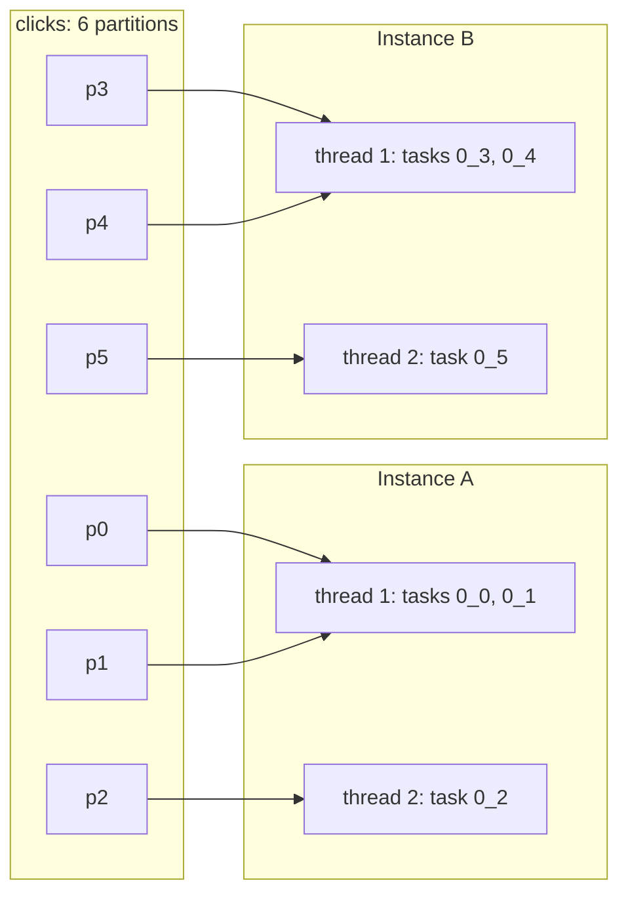

# Lesson 14. Tasks, Threads and Scaling Out

**Mission link:** The sizing half of the mission's guarantees bullet: sizing an app's tasks, threads, instances and standby replicas for a stated recovery time. This lesson does the first three from partition counts and a measured throughput; lesson 15 adds the standby replicas and the recovery time.
**Primary source:** [Docs: "Architecture", Apache Kafka 4.3](https://kafka.apache.org/43/streams/architecture/)
**Prerequisites:** [Lesson 13](0013-exactly-once-in-kafka-streams.md), [Task](../GLOSSARY.md), [Sub-topology](../GLOSSARY.md), [Stream thread](../GLOSSARY.md)

## Warm-up

1. ▢ A topology reads `clicks`, calls `selectKey` to key each click by page, then `groupByKey().count()`. How many sub-topologies does `describe()` show, and which internal topics does the app create?

<details markdown="1"><summary>Check</summary>

Two sub-topologies. The key change marks the stream for repartitioning, so the first sub-topology ends by writing a repartition topic and the second starts by reading it. The count adds a state store with its changelog topic. Two internal topics: one repartition topic, one changelog topic.

</details>

2. ▢ Under `processing.guarantee=exactly_once_v2`, which three things does one Kafka transaction commit together, and what is the default commit interval?

<details markdown="1"><summary>Check</summary>

The input offsets, the writes to changelog topics, and the writes to output topics. The commit interval defaults to 100 ms under exactly-once, against 30000 ms under at-least-once.

</details>

## Know this

### Partitions become tasks

Kafka Streams cuts each [sub-topology](../GLOSSARY.md) into [tasks](../GLOSSARY.md), one per input partition, and gives each task a fixed list of partitions to read. "The assignment of partitions to tasks never changes", so a task is a fixed unit of parallelism: it owns its partitions, its copy of the sub-topology's processors and its [state stores](../GLOSSARY.md) ([Architecture](https://kafka.apache.org/43/streams/architecture/)). A task ID is the sub-topology number and the partition number, written like `1_3` ([TaskId](https://kafka.apache.org/43/javadoc/org/apache/kafka/streams/processor/TaskId.html)).

Three rules give you the count:

- **One sub-topology:** its task count is the largest partition count among its input topics. A sub-topology reading two [co-partitioned](../GLOSSARY.md) topics of 12 partitions has 12 tasks, each reading partition *n* of both.
- **Several sub-topologies:** add them up. Each sub-topology has its own tasks, and a [repartition topic](../GLOSSARY.md) is the input of the sub-topology after it.
- **A repartition topic's partition count** is derived from the upstream topics unless you set it with `repartition(Repartitioned.numberOfPartitions(n))` ([KStream javadoc](https://kafka.apache.org/43/javadoc/org/apache/kafka/streams/kstream/KStream.html)). So warm-up 1's app on a 12-partition `clicks` topic has 12 + 12 = 24 tasks.

### Threads run tasks, instances run threads

A [stream thread](../GLOSSARY.md) runs one or more tasks. `num.stream.threads` sets how many threads one instance starts, and its default is 1 ([Kafka Streams Configs](https://kafka.apache.org/43/configuration/kafka-streams-configs/)). Threads share no state, so starting another thread or another instance "merely amounts to replicating the topology and having it process a different subset of Kafka partitions" ([Architecture](https://kafka.apache.org/43/streams/architecture/)).

Every thread has its own consumer in the application's group, so a thread is what joins the group, not an instance. The assignor, `StreamsPartitionAssignor` on the classic protocol, spreads all tasks over all threads of all instances, balancing load against keeping stateful tasks where their state already is. Configuring a different partition assignor does nothing, since Streams ignores it ([Architecture](https://kafka.apache.org/43/streams/architecture/)); `task.assignor.class` only picks the algorithm used inside it, which lesson 15 covers.



### What caps parallelism

A task runs on one thread at a time, so the total task count is the most threads that can have work. The documentation states it for the simple case: with one input topic of 5 partitions you can run up to 5 instances, and "the 'excess' app instances will launch but remain idle", taking over only when a busy instance goes down ([Architecture](https://kafka.apache.org/43/streams/architecture/)). With several sub-topologies the ceiling is the sum of their tasks, but the input topic's partition count is still what sets it, since repartition topics follow it by default.

Two consequences follow:

- **Partition count is decided when the topic is created, and it is the ceiling forever after.** Raising it later moves keys to new partitions, which for a stateful app also separates each key from the task holding its state. The Kafka track's [Topic and Partition Design](../../kafka/reference/topic-and-partition-design.md) sheet covers why both directions are one-way doors.
- **Skew is not fixed by threads.** A hot key lives in one partition, so one task carries it and one thread runs that task ([Running Streams Applications](https://kafka.apache.org/43/streams/developer-guide/running-app/)).

### Adding and removing capacity

**Instances.** Start another instance with the same [application ID](../GLOSSARY.md) and it joins the group; some tasks move to it, and for a stateful task the state moves too, rebuilt from its [changelog topic](../GLOSSARY.md). Stop an instance and the others take its tasks the same way ([Running Streams Applications](https://kafka.apache.org/43/streams/developer-guide/running-app/)). Lesson 15 is about the cost of that move.

**Threads at run time.** `KafkaStreams#addStreamThread()` starts one more thread in a running instance and `removeStreamThread()` stops one, each causing a rebalance that redistributes tasks. A thread can be added only while the client is `RUNNING` or `REBALANCING`. The [record cache](../GLOSSARY.md) is shared: when the thread count changes, each thread's share is resized so the total stays within `statestore.cache.max.bytes` ([KafkaStreams javadoc](https://kafka.apache.org/43/javadoc/org/apache/kafka/streams/KafkaStreams.html)). Adding a thread is also how you replace one that died without restarting the instance ([Architecture](https://kafka.apache.org/43/streams/architecture/)).

### Worked example: sizing from partitions and per-task throughput

`payments` has 24 partitions with evenly spread keys, and peaks at 48,000 records a second. The topology has one sub-topology, so 24 tasks. A load test shows one stream thread saturates its core at 8,000 records a second, whatever mix of tasks it runs. You want threads at 60 percent or less at peak, so 4,800 records a second each.

1. **Per task at peak:** 48,000 ÷ 24 = 2,000 records a second.
2. **Tasks per thread:** 4,800 ÷ 2,000 = 2.4, so at most 2 whole tasks per thread.
3. **Threads:** 24 tasks ÷ 2 = 12 threads.
4. **Instances:** on 4-core hosts with `num.stream.threads=4`, 12 ÷ 4 = 3 instances.
5. **One instance lost:** 8 threads carry 24 tasks, 3 each, so 6,000 records a second, 75 percent of a core. Below saturation, so lag does not grow, but above your target. Run a fourth instance if the target must hold during a failure.
6. **Ceiling:** 24 threads. A seventh 4-thread instance would bring 28 threads, and 4 of them would sit idle.

The throughput number is the one you cannot look up: it comes from a load test of your own topology, serdes and store. If you later add a key change, the second sub-topology brings its own 24 tasks, and the same threads now run 48.

### Predict, then run

Create `clicks` with 6 partitions and run the warm-up's count without the key change, `builder.stream("clicks").groupByKey().count()`, with `num.stream.threads=2`. Print each thread's tasks once the client is running:

```java
streams.setStateListener((newState, oldState) -> {
    if (newState == KafkaStreams.State.RUNNING) {
        streams.metadataForLocalThreads().forEach(t ->
            System.out.println(t.threadName() + " active=" + t.activeTasks().stream()
                .map(task -> task.taskId().toString()).toList()));
    }
});
```

Before starting anything, predict: how many tasks, how they split over one instance's two threads, how they split after a second instance starts, and what a fourth instance's threads print. Keep each partition under 10,000 records so lesson 15's warmup mechanism does not delay the move.

One sub-topology on 6 partitions gives 6 tasks, `0_0` to `0_5`. One instance prints 3 per thread. With a second instance, 4 threads share 6 tasks, two threads with 2 and two with 1. With four instances there are 8 threads for 6 tasks, so two threads print `active=[]`, and which two is the assignor's choice.

## Practice

1. ▢ A sub-topology reads `orders` (6 partitions) and `orders-backfill` (10 partitions) through one `builder.stream(List.of(...))` call, and a second sub-topology reads a repartition topic created with 6 partitions. How many tasks does the app have?

<details markdown="1"><summary>Check</summary>

Sixteen. The first sub-topology takes the larger of its input partition counts, 10, so tasks `0_0` to `0_9`; tasks `0_6` to `0_9` read only from `orders-backfill`. The second sub-topology has 6 tasks, `1_0` to `1_5`.

</details>

2. ▢ What caps the number of stream threads in an application that can have work at once?

    - a) The number of instances in the group
    - b) The total number of tasks across sub-topologies
    - c) The num.stream.threads value on the first instance
    - d) The core count of the broker hosts

<details markdown="1"><summary>Check</summary>

**b)** A task runs on one thread at a time, so threads beyond the task count stay idle. (a) is wrong: instances only host threads, and extra instances idle too. (c) is wrong: each instance sets its own thread count, and none caps the group. (d) is wrong: the brokers do not run the processing, the application's instances do.

</details>

3. ▢ Interleave lesson 6: an instance runs 4 threads over 12 stateful tasks with the default `statestore.cache.max.bytes`. You call `addStreamThread()` twice. Predict how the tasks split afterwards, each thread's cache share, and what a downstream consumer of a KTable's updates might notice.

<details markdown="1"><summary>Hint</summary>

The cache total is per instance, not per thread.

</details>

<details markdown="1"><summary>Check</summary>

After the rebalance, 12 tasks over 6 threads, 2 each. The 10 MiB total stays the same, so each thread's share drops from 2.5 MiB to about 1.7 MiB. A smaller cache collapses fewer updates to the same key before a commit, so downstream may see more intermediate KTable updates than before.

</details>

4. ▢ `events` has 30 evenly loaded partitions and peaks at 90,000 records a second through a one-sub-topology app. A thread saturates at 12,000 records a second and the target is 75 percent at peak. Hosts have 4 cores and run 4 threads. How many instances do you need so that the target still holds after losing one?

<details markdown="1"><summary>Hint</summary>

Work out the rate per task first, then the most tasks one thread may carry, then check the failure case with tasks spread as evenly as whole tasks allow.

</details>

<details markdown="1"><summary>Check</summary>

Per task: 90,000 ÷ 30 = 3,000 records a second. The target is 9,000 a thread, so at most 3 tasks per thread, and 30 ÷ 3 = 10 threads, which 3 instances (12 threads) cover. Losing one leaves 8 threads for 30 tasks, so some threads carry 4: 12,000 records a second, saturated, and lag grows. With 4 instances, losing one leaves 12 threads, at most 3 tasks each, 9,000 a second. Four instances.

</details>

5. ▢ A team's lag is growing, so they scale a one-thread-per-instance app from 6 to 12 instances. The input topic has 8 partitions and the topology one sub-topology. Lag barely moves, and 4 instances log no active tasks. Explain what happened, and name the two ways to get more throughput.

<details markdown="1"><summary>Hint</summary>

Count tasks before counting instances.

</details>

<details markdown="1"><summary>Check</summary>

There are only 8 tasks, so only 8 threads can work: going from 6 to 12 instances added 2 working threads, and the other 4 instances idle until a busy one fails. The two ways out: make each task faster (cheaper serdes, less work per record, a better store configuration), or raise the partition count, which is a one-way door that moves keys away from their state, so a stateful app needs a planned migration rather than a quick `kafka-topics --alter`.

</details>

## Real-world reps

- [ ] Today: run this lesson's predict-then-run with one instance, then two, then four, and write down your prediction before each start.
- [ ] For an app you run or can read, count its tasks from `describe()` and the partition counts of its input topics, then compare with the total thread count across its instances. Note how many threads are idle.
- [ ] Tomorrow: load-test one stream thread on your own topology until it saturates, and redo this lesson's worked example with your numbers.

## Going further

- [Configuration](../reference/configuration.md)
- [Docs: "Architecture", Apache Kafka 4.3](https://kafka.apache.org/43/streams/architecture/)
- [Docs: "Running Streams Applications", Apache Kafka 4.3](https://kafka.apache.org/43/streams/developer-guide/running-app/)
- [Topic and Partition Design](../../kafka/reference/topic-and-partition-design.md), in the Kafka track: choosing the partition count that becomes this app's ceiling
- [Consumer Groups and Rebalancing](../../kafka/reference/consumer-groups-and-rebalancing.md), in the Kafka track: the group each stream thread joins
- [Resources](../RESOURCES.md)

---

Not landing? Reread the primary source at the top, since this lesson compresses it and compression is where understanding leaks. Check the [glossary](../GLOSSARY.md) for any term that felt slippery.

If the lesson itself is unclear rather than the material, that is a defect: [open an issue](https://github.com/TokenCemetery/teach/issues).
