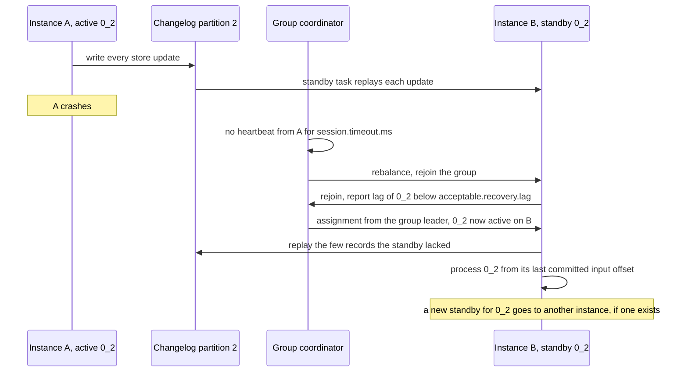

# Lesson 15. Rebalancing, Restoration and Standby Replicas

**Mission link:** Completes the sizing in the mission's guarantees bullet: lesson 14 sized tasks, threads and instances for throughput, and this lesson sizes standby replicas for a stated recovery time, the time a moved task cannot process.
**Primary source:** [Docs: "Running Streams Applications", Apache Kafka 4.3](https://kafka.apache.org/43/streams/developer-guide/running-app/)
**Prerequisites:** [Lesson 14](0014-tasks-threads-and-scaling-out.md), [Restoration](../GLOSSARY.md), [Standby replica](../GLOSSARY.md), [Warmup replica](../GLOSSARY.md)

## Warm-up

1. ▢ An instance holding a count store dies. How does another instance rebuild that store, and what is the topic it reads called?

<details markdown="1"><summary>Check</summary>

It replays the store's changelog topic, a compacted internal topic named from the application ID and the store name with the suffix `-changelog`, into a fresh local store before the task processes anything.

</details>

2. ▢ An app has 24 tasks on 3 instances of 4 threads each. One instance stops. Where do its tasks go, and what caps how many threads could take them?

<details markdown="1"><summary>Check</summary>

Its 8 tasks are spread over the 8 remaining threads on the other two instances. The total of 24 tasks caps useful threads; it is not the limit here, since only 8 threads remain.

</details>

## Know this

### What a rebalance does to a task

On the classic protocol each [stream thread](../GLOSSARY.md) is a consumer in the group named by the [application ID](../GLOSSARY.md), so a rebalance starts whenever a thread joins, leaves, or misses its session timeout. Since 2.4 the rebalance is cooperative: only the [tasks](../GLOSSARY.md) that move are closed and revoked, and every other task keeps processing through it ([Upgrade Guide](https://kafka.apache.org/43/streams/upgrade-guide/), KIP-429). The Kafka track's [Consumer Groups and Rebalancing](../../kafka/reference/consumer-groups-and-rebalancing.md) sheet covers the protocol itself.

A stateless task moves for free. A stateful task cannot process on its new instance until its [state store](../GLOSSARY.md) is complete there, which is [restoration](../GLOSSARY.md) ([Running Streams Applications](https://kafka.apache.org/43/streams/developer-guide/running-app/)):

- **No local copy:** the [changelog topic](../GLOSSARY.md) is replayed from the earliest offset to the current one.
- **A local copy exists:** it is replayed from the offset last checkpointed for that copy, which is usually far less.

### Estimating restoration time

Restoration time is the records to replay divided by the rate this instance replays them:

```text
restore time ≈ records in the task's changelog partitions ÷ measured restore rate
```

Both numbers have to be measured, not looked up. The record count is larger than the key count, because compaction never touches the active segment and lags behind on the rest (the Kafka track's lesson on retention and compaction explains why). The rate depends on record size, the store and the disk. Two ways to see them:

- A `StateRestoreListener` set with `KafkaStreams#setGlobalStateRestoreListener` is told the starting and ending offset of each restoration, and the total restored at the end ([StateRestoreListener javadoc](https://kafka.apache.org/43/javadoc/org/apache/kafka/streams/processor/StateRestoreListener.html)).
- The store-level `restore-rate` metric, recorded at the `debug` level ([Streams Monitoring](https://kafka.apache.org/43/operations/monitoring/#streams-monitoring)).

Worked example: a task's changelog partition holds 36 million records and a test instance replays 60,000 a second. 36,000,000 ÷ 60,000 = 600 seconds, ten minutes in which that task's keys produce no output. A failed instance adds its detection time on top: the classic protocol notices a crash only when the consumer's `session.timeout.ms`, 45 seconds by default, runs out ([Consumer Configs](https://kafka.apache.org/43/configuration/consumer-configs/)). Ten minutes and forty-five seconds is the recovery time to compare with what the mission states.

### Standby replicas

A [standby replica](../GLOSSARY.md) is a standby task on another instance that keeps its own copy of a task's stores current by reading the changelog, without processing input. When the active task moves, Streams prefers the instance holding the standby, so only the few records the standby had not yet read are replayed ([Configuring a Streams Application](https://kafka.apache.org/43/streams/developer-guide/config-streams/)).

| Setting | Default | What to know |
|---|---|---|
| `num.standby.replicas` | 0 | 1 is the documented recommendation for high availability |
| Instances needed | | n standbys need n + 1 instances, or the extra copies have nowhere to go |
| Disk | | Each standby is another full copy: with 1 standby, twice the space |

Since 2.6, a stateful task is only ever assigned to an instance with a caught-up copy of its state if such an instance exists ([Architecture](https://kafka.apache.org/43/streams/architecture/)). A standby is what makes such an instance likely to exist when one fails. In the worked example, one standby turns ten minutes of restoration into a fraction of a second, and the 45-second detection becomes the whole recovery time.



Under at-least-once, records A processed after its last commit are processed again by B, so their output appears twice; lesson 13 covers what exactly-once changes about that.

### Warmup replicas and the high-availability assignor

Adding an instance raises a different problem: the new instance has no state at all, so moving a task to it at once would stop that task for a full restoration. The high-availability task assignor of KIP-441, the default `task.assignor.class`, avoids that ([Configuring a Streams Application](https://kafka.apache.org/43/streams/developer-guide/config-streams/)):

1. It assigns each stateful active task only to the most caught-up instances. Any instance within `acceptable.recovery.lag` offsets of the changelog end counts as caught up.
2. Where it wants a task to move, it first places a [warmup replica](../GLOSSARY.md) on the destination, an extra standby that restores in the background while the task stays active where it is.
3. Every `probing.rebalance.interval.ms` it triggers a probing rebalance, and any warmup now caught up becomes the active task. Probing stops once the assignment is balanced.

| Setting | Default | Effect |
|---|---|---|
| `acceptable.recovery.lag` | 10000 | Lag, in offsets, still counted as caught up. Should mean well under a minute of restoring. `Long.MAX_VALUE` disables warmups |
| `max.warmup.replicas` | 2 | Warmup replicas assigned at once, which throttles the extra broker traffic |
| `probing.rebalance.interval.ms` | 600000 (10 minutes) | Longest wait before a probing rebalance; at least 1 minute |

Defaults are from [Kafka Streams Configs](https://kafka.apache.org/43/configuration/kafka-streams-configs/), which also gives the consequence: tasks can migrate at most at `max.warmup.replicas ÷ probing.rebalance.interval.ms`, two tasks per ten minutes by default. Scale-out costs no downtime, and it is slow. The one exception to the no-downtime rule is a task with no caught-up instance anywhere: it is assigned anyway and blocks on restoration, which is why the documentation recommends standbys when availability matters ([Running Streams Applications](https://kafka.apache.org/43/streams/developer-guide/running-app/)).

### Static membership for rolling restarts

A rolling restart under dynamic membership costs two rebalances per instance: its tasks move away when it leaves, and some move back when it returns. Static membership removes both. Each instance sets a unique `group.instance.id`, which Streams turns into a distinct ID for each thread's consumer (KIP-345), and a `session.timeout.ms` longer than a restart takes. The returning instance rejoins as the same member, keeps its tasks, and replays only from its local checkpoints ([KIP-345](https://cwiki.apache.org/confluence/display/KAFKA/KIP-345%3A+Introduce+static+membership+protocol+to+reduce+consumer+rebalances)).

The cost is the mirror image: a static member that really crashed is noticed only when that longer session timeout expires. It also only helps if the local state survives the restart. `state.dir` defaults to a directory under `java.io.tmpdir`, so a container whose temporary directory is not on a persistent volume restores everything on every start.

### The streams rebalance protocol

`group.protocol=streams` (default `classic`) moves assignment from a client acting as leader to the broker's group coordinator, which computes it continuously for a streams group. It is generally available for a core feature set since 4.2, and needs brokers and clients at 4.2 or later ([Streams Rebalance Protocol](https://kafka.apache.org/43/streams/developer-guide/streams-rebalance-protocol/)). Read its limits before recommending it:

| Under `group.protocol=streams` | Status |
|---|---|
| Assignor | Sticky only. No high-availability assignor, so no warmup replicas and no rack-aware assignment |
| `acceptable.recovery.lag`, `max.warmup.replicas`, `probing.rebalance.interval.ms`, `task.assignor.class` | Ignored |
| `num.standby.replicas`, `session.timeout.ms`, `heartbeat.interval.ms` | Ignored on the client; set per group with `kafka-configs.sh`, for example `streams.num.standby.replicas=1` |
| Static membership | Rejected |
| Regex subscriptions | Not supported |
| A significant topology change, such as a new source topic or a different number of sub-topologies | Needs a new streams group |
| Migration from classic | Offline only: stop every member, then convert; committed offsets are kept |

So the new protocol trades this lesson's two tools for scale-out and rolling restarts, warmups and static membership, against faster broker-driven rebalances. Standbys remain.

### Predict, then run

Run two instances of a counting app with `num.standby.replicas=1`, and fill its input with about a million records per partition. Add a listener to both:

```java
streams.setGlobalStateRestoreListener(new StateRestoreListener() {
    @Override
    public void onRestoreStart(TopicPartition tp, String store, long start, long end) {
        System.out.printf("%s %s: restoring offsets %d to %d%n", store, tp, start, end);
    }
    @Override
    public void onBatchRestored(TopicPartition tp, String store, long batchEnd, long restored) { }
    @Override
    public void onRestoreEnd(TopicPartition tp, String store, long total) {
        System.out.printf("%s %s: restored %d records%n", store, tp, total);
    }
});
```

Predict, before you `kill -9` instance A: how long until B processes A's tasks, and how many records B's listener reports. Then set `num.standby.replicas=0`, restart both, wait for them to settle, and predict again. With a standby, expect about 45 seconds of nothing, then a near-empty restoration. Without one, the same 45 seconds followed by the full changelog.

## Practice

1. ▢ Name the three settings that tune the high-availability assignor's warmups, with their defaults.

<details markdown="1"><summary>Check</summary>

`acceptable.recovery.lag`, 10000 offsets; `max.warmup.replicas`, 2; `probing.rebalance.interval.ms`, 600000 (10 minutes).

</details>

2. ▢ Which of these does an app lose by switching to `group.protocol=streams` in 4.3?

    - a) Standby replicas set per streams group
    - b) Static membership with a client group.instance.id
    - c) Interactive queries against local state stores
    - d) Listing groups with the kafka-streams-groups.sh tool

<details markdown="1"><summary>Check</summary>

**b)** Setting a group instance ID is rejected under the streams protocol. (a) is wrong: standbys remain, configured per group with `kafka-configs.sh`. (c) is wrong: interactive queries are supported. (d) is wrong: `kafka-streams-groups.sh` is the tool built for streams groups.

</details>

3. ▢ A task's changelog partition holds 30 million records and restores at 50,000 records a second. Estimate the recovery time when its instance crashes with no standby, and again with one standby lagging 3,000 records. Which setting then dominates?

<details markdown="1"><summary>Check</summary>

No standby: 30,000,000 ÷ 50,000 = 600 seconds of restoration, plus 45 seconds for the session timeout, about 10 minutes 45 seconds. One standby: 3,000 records take well under a second, so about 45 seconds, and `session.timeout.ms` dominates. Lowering it speeds detection at the cost of evicting instances that only paused, such as during a long garbage collection.

</details>

4. ▢ Interleave lesson 14: an app has 48 stateful tasks on 3 instances and you add a fourth, keeping the defaults. Each moving task's state takes about 4 minutes to warm up. Predict how long until the assignment is balanced, and whether any task stops processing meanwhile.

<details markdown="1"><summary>Hint</summary>

Balanced means 12 tasks on the new instance. The configuration reference gives the maximum migration rate as a ratio of two settings.

</details>

<details markdown="1"><summary>Check</summary>

12 tasks must move, at most 2 at a time, and a warmup becomes active only at a probing rebalance, every 10 minutes. Each pair is warm well within the interval, so the pace is 2 per 10 minutes: about an hour across 6 probing rebalances. No task stops, because each stays active on its old instance until its warmup has caught up. To go faster, raise `max.warmup.replicas` (more broker traffic at once) or lower `probing.rebalance.interval.ms` (no lower than 1 minute).

</details>

5. ▢ A team restarts its 6 instances one at a time for each deploy, on Kubernetes, with default settings. Every restart triggers rebalances, and the restarted pod spends minutes restoring before it does any work. Find the two causes and the fix for each.

<details markdown="1"><summary>Hint</summary>

Ask what the group sees when a pod goes away and comes back, and where the pod's local state lives.

</details>

<details markdown="1"><summary>Check</summary>

First, dynamic membership: each departure and return is a membership change, so tasks move away and back. Set a unique `group.instance.id` per instance and a `session.timeout.ms` longer than a restart, so the pod rejoins as the same member with the same tasks. Second, the restored state was lost: `state.dir` defaults to a directory under `java.io.tmpdir`, which a new pod does not keep, so every task restores from the earliest changelog offset. Point `state.dir` at a persistent volume. A standby per task also bounds the damage if a pod's state is lost anyway.

</details>

## Real-world reps

- [ ] Today: run this lesson's predict-then-run, with and without a standby, and write down both predictions before you kill anything.
- [ ] For an app you run, find its largest changelog partition and its measured restore rate, compute the no-standby recovery time, and compare it with what its users would tolerate.
- [ ] Tomorrow: add a fourth instance to the two-instance test app with default settings and watch which tasks move and when. Then set `probing.rebalance.interval.ms=60000` and repeat.

## Going further

- [Configuration](../reference/configuration.md)
- [Docs: "Running Streams Applications", Apache Kafka 4.3](https://kafka.apache.org/43/streams/developer-guide/running-app/)
- [KIP: "KIP-441: Smooth Scaling Out for Kafka Streams", Apache Kafka](https://cwiki.apache.org/confluence/display/KAFKA/KIP-441%3A+Smooth+Scaling+Out+for+Kafka+Streams)
- [Docs: "Streams Rebalance Protocol", Apache Kafka 4.3](https://kafka.apache.org/43/streams/developer-guide/streams-rebalance-protocol/)
- [Consumer Groups and Rebalancing](../../kafka/reference/consumer-groups-and-rebalancing.md), in the Kafka track: cooperative rebalancing and static membership for any consumer
- [Resources](../RESOURCES.md)

---

Not landing? Reread the primary source at the top, since this lesson compresses it and compression is where understanding leaks. Check the [glossary](../GLOSSARY.md) for any term that felt slippery.

If the lesson itself is unclear rather than the material, that is a defect: [open an issue](https://github.com/TokenCemetery/teach/issues).
