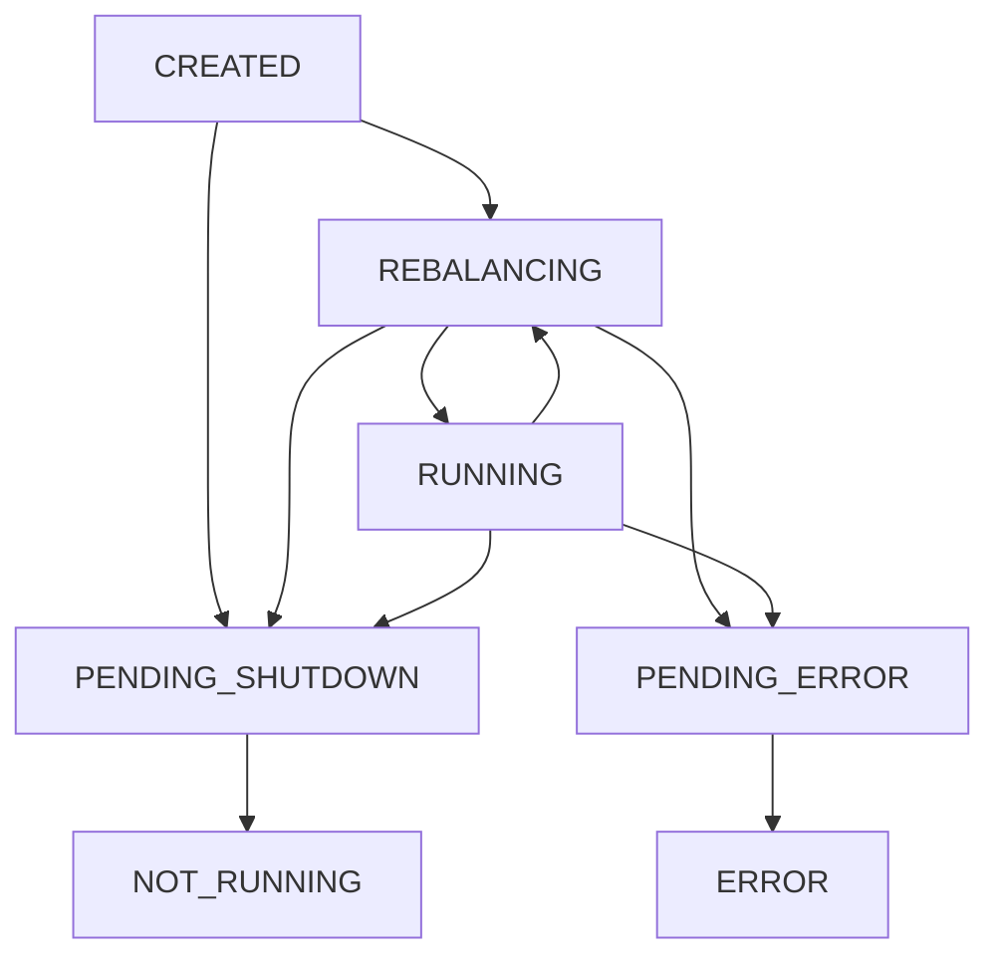

# Lesson 17. Operating and Monitoring a Streams App

**Mission link:** Closes the operating half of the mission's testing bullet: lesson 16 proved a topology correct without a broker, and this lesson tells you, from states, metrics and exception handlers, whether the deployed app is still computing the right answer and what it does when a record breaks it.
**Primary source:** [Docs: "Streams Monitoring", Apache Kafka 4.3](https://kafka.apache.org/43/operations/monitoring/#streams-monitoring)
**Prerequisites:** [Lesson 16](0016-testing-with-topologytestdriver.md), [Stream thread](../GLOSSARY.md), [Task](../GLOSSARY.md), [Interactive query](../GLOSSARY.md)

## Warm-up

1. ▢ A `TopologyTestDriver` test sets `commit.interval.ms` to 30000 and expects the record cache to collapse ten updates to one key into one output. What does the test see, and why?

<details markdown="1"><summary>Check</summary>

Ten outputs, or as many as the driver forwards: the driver processes records synchronously and flushes after each one, so the commit interval and the cache size have no effect in a driver test. The collapsing only happens in a deployed app.

</details>

2. ▢ A task's changelog partition holds 24 million records and an instance restores 40,000 a second. How long is that task unable to process after it moves to an instance with no local copy?

<details markdown="1"><summary>Check</summary>

24,000,000 ÷ 40,000 = 600 seconds, ten minutes, plus the time it took the group to notice the old owner was gone.

</details>

3. ▢ A windowed count has a grace period of 2 minutes. A record arrives whose window ended 5 minutes before the current stream time. What happens to it, and where would you see that it happened?

<details markdown="1"><summary>Check</summary>

It is a late record: stream time is past the window end plus the grace period, so the window is closed and the record is dropped. It does not appear in any output; it is counted in the task's dropped-records metric, which this lesson puts on the alert list.

</details>

## Know this

### A client is in one of seven states

A `KafkaStreams` instance, the client, is always in exactly one `KafkaStreams.State` ([KafkaStreams.State javadoc](https://kafka.apache.org/43/javadoc/org/apache/kafka/streams/KafkaStreams.State.html)):



The javadoc states the rules a health check depends on:

- `RUNNING` drops to `REBALANCING` whenever any [stream thread](../GLOSSARY.md) is in the middle of a rebalance, and returns to `RUNNING` only when every thread is running, meaning every active [task](../GLOSSARY.md) has finished [restoration](../GLOSSARY.md). Standby tasks do not count.
- `PENDING_SHUTDOWN` and `PENDING_ERROR` are transitory: the client is closing its resources. Neither is recoverable; only a restart brings the instance back to `RUNNING`.
- If every stream thread dies, or the global stream thread dies, the client goes to `ERROR` on its own.

So `REBALANCING` is normal and `ERROR` is terminal. An instance stuck in `REBALANCING` for ten minutes after a deploy is usually restoring state (lesson 15), not broken.

Each stream thread has a state of its own, kept in the internal `StreamThread.State` enum: `CREATED`, `STARTING`, `PARTITIONS_REVOKED`, `PARTITIONS_ASSIGNED`, `RUNNING`, `PENDING_SHUTDOWN` and `DEAD` ([StreamThread source, 4.3](https://github.com/apache/kafka/blob/4.3/streams/src/main/java/org/apache/kafka/streams/processor/internals/StreamThread.java)). You read it through `KafkaStreams#metadataForLocalThreads()`, whose `ThreadMetadata#threadState()` returns it as a string, or through the thread-level `state` metric.

### Listening for state changes and thread deaths

Two hooks must be set before `start()`, and both throw `IllegalStateException` afterwards ([KafkaStreams javadoc](https://kafka.apache.org/43/javadoc/org/apache/kafka/streams/KafkaStreams.html)):

```java
KafkaStreams streams = new KafkaStreams(topology, props);

streams.setStateListener((newState, oldState) ->
    log.info("Streams state {} -> {}", oldState, newState));

streams.setUncaughtExceptionHandler(exception -> {
    if (exception.getCause() instanceof RecordTooLargeException) {
        return StreamThreadExceptionResponse.SHUTDOWN_CLIENT;
    }
    return StreamThreadExceptionResponse.REPLACE_THREAD;
});

streams.start();
```

The handler sees any exception that escapes a stream thread, from a bug in Kafka Streams to a `NullPointerException` in your processor, and answers with one of three `StreamThreadExceptionResponse` values ([StreamThreadExceptionResponse javadoc](https://kafka.apache.org/43/javadoc/org/apache/kafka/streams/errors/StreamsUncaughtExceptionHandler.StreamThreadExceptionResponse.html)):

| Response | Effect | Use when |
|---|---|---|
| `REPLACE_THREAD` | The failed thread is replaced by a new one | The failure was transient, such as a broker timeout |
| `SHUTDOWN_CLIENT` | This instance shuts down | The instance itself is broken: its disk, its memory, its config |
| `SHUTDOWN_APPLICATION` | Every instance of the application is asked to shut down | Continuing anywhere would write wrong results |

If you set no handler, 4.3 answers `SHUTDOWN_CLIENT` ([KafkaStreams source, 4.3](https://github.com/apache/kafka/blob/4.3/streams/src/main/java/org/apache/kafka/streams/KafkaStreams.java)). Watch `REPLACE_THREAD` with a record that always fails: the new thread resumes from the last committed offset, meets the same record, and fails again. The instance never reaches `ERROR`; it loops.

### Three exception handlers, for three places a record breaks

The uncaught exception handler is the last resort. Three earlier handlers decide what happens to one bad record, and each answers with `Response.resume()` or `Response.fail()`, optionally carrying records for a dead letter queue ([Kafka Streams Configs](https://kafka.apache.org/43/configuration/kafka-streams-configs/), [Configuring a Streams Application](https://kafka.apache.org/43/streams/developer-guide/config-streams/)):

| Setting | Called when | Default in 4.3 | Built-in alternative |
|---|---|---|---|
| `deserialization.exception.handler` | A source record's bytes fail its [Serde](../GLOSSARY.md) | `LogAndFailExceptionHandler` | `LogAndContinueExceptionHandler` |
| `processing.exception.handler` | Your processor code throws for a record | `LogAndFailProcessingExceptionHandler` | `LogAndContinueProcessingExceptionHandler` |
| `production.exception.handler` | A write to an output or internal topic fails, or its serializer throws | `DefaultProductionExceptionHandler` (fails) | A custom handler; `RETRY` is valid only for a retriable exception |

The `default.`-prefixed names of the first and third are deprecated since 4.0. The developer guide's table gives `LogAndContinueExceptionHandler` as the deserialization default; the generated reference and the source both say `LogAndFailExceptionHandler`, and the generated reference is the one to trust.

A fail response throws, so the thread dies and the uncaught exception handler decides what comes next. A resume response skips the record and counts it in the task's `dropped-records` metric (the 4.3 source records deserialization skips, processing skips and late window records on that one sensor).

Since 4.2, setting `errors.dead.letter.queue.topic.name` makes the built-in handlers attach a copy of the failed source record, raw key and value, to their response for that topic (KIP-1034, [Upgrade Guide](https://kafka.apache.org/43/streams/upgrade-guide/)). A custom handler builds its own dead letter records and the setting is ignored for it, and global stores get no dead letter queue at all. Read the 4.3 source of the built-in handlers before relying on the setting: the fail handlers attach the record too and then fail, so a dead letter topic does not by itself keep the app running. Pair it with a continue handler.

### The metrics worth alerting on

Every metric is reachable over JMX and from `KafkaStreams#metrics()`, which also includes the embedded consumers' and producers' metrics. `metrics.recording.level` decides which are recorded: `INFO` by default, `DEBUG` adds most task, processor and store metrics, and `TRACE` adds the rest at a real cost ([Kafka Streams Configs](https://kafka.apache.org/43/configuration/kafka-streams-configs/)). The list below needs only `INFO` except where it says so ([Streams Monitoring](https://kafka.apache.org/43/operations/monitoring/#streams-monitoring)):

| Question | Metric | Level and MBean type | Alert when |
|---|---|---|---|
| Is the instance alive? | `state`, or `client-state` as a number | Client, `stream-metrics` | Not `RUNNING` or `REBALANCING`, or `REBALANCING` far longer than a restore takes |
| Did threads die? | `alive-stream-threads`, `failed-stream-threads` | Client, `stream-metrics` | Alive below `num.stream.threads`, or failed rising |
| Is it keeping up? | `records-lag-max` | Consumer, `consumer-fetch-manager-metrics` | Rising for longer than a burst lasts |
| Is it doing work? | `process-rate` | Thread, `stream-thread-metrics` | Zero while input is arriving |
| Are commits slow? | `commit-latency-avg`, `commit-latency-max` | Thread, `stream-thread-metrics` | Rising: often slow brokers or large transactions under exactly-once |
| Is data being lost? | `dropped-records-total`, `dropped-records-rate` | Task, `stream-task-metrics` | Any increase you did not plan for |
| How stale is the output? | `record-e2e-latency-avg`, `record-e2e-latency-max` | Processor node, on source and terminal nodes | Above the freshness the consumers of the output need |
| How long will restoration take? | `restore-rate`, `restore-latency-avg` | State store, `DEBUG` | Rate too low for the recovery time you sized for |
| Is RocksDB eating memory? | `block-cache-usage`, `size-all-mem-tables` | State store, RocksDB properties | Off-heap use near the container limit |

Two notes the table cannot carry. `records-lag-max` is computed from the consumer's current position, not from the committed offset, so it can read lower than the group lag a broker-side tool reports. And `record-e2e-latency` compares the record timestamp with the wall clock when the node finishes it, so a [timestamp extractor](../GLOSSARY.md) that reads an old business date makes it look huge without anything being slow. Diagnose lag in the order the Kafka track's [consumer lag sheet](../../kafka/reference/consumer-groups-and-rebalancing.md#consumer-lag) gives before blaming throughput.

### Worked example: the instance that kept losing threads

An app runs 2 instances of 4 threads. The lag alert fires for half of the input partitions. The dashboard shows:

| Metric | Instance A | Instance B |
|---|---|---|
| `state` | `RUNNING` | `RUNNING`, with short drops to `REBALANCING` every minute |
| `alive-stream-threads` | 4 | 3 or 4, changing |
| `failed-stream-threads` | 0 | 57, rising by about one a minute |
| `process-rate` | Normal | Near zero on the thread that keeps being replaced |

Read it as a chain. Rising `failed-stream-threads` with a steady `alive-stream-threads` means threads die and are replaced, so the handler returns `REPLACE_THREAD`. Each replacement triggers a rebalance, so the client flaps to `REBALANCING`. The same partition stalls each time, so one record kills every thread that owns it. The log names it: a `NullPointerException` from the processor, which the default `LogAndFailProcessingExceptionHandler` turned into a thread death.

The fix has two parts. Now: set `processing.exception.handler` to `LogAndContinueProcessingExceptionHandler` with a dead letter topic, so the record is skipped, copied for inspection and counted in `dropped-records-total`. Then: fix the processor, replay the dead letter records, and alert on `dropped-records-rate` so the next skip is seen rather than silently absorbed.

### A health endpoint and a data endpoint

An [interactive query](../GLOSSARY.md) reads a running app's [state store](../GLOSSARY.md) from inside the process, so the same small HTTP server can answer two different questions ([Interactive Queries](https://kafka.apache.org/43/streams/developer-guide/interactive-queries/)):

```java
// Liveness: restart the process only when it cannot recover by itself.
boolean live = streams.state() != KafkaStreams.State.ERROR
            && streams.state() != KafkaStreams.State.NOT_RUNNING;

// Readiness: serve queries only when every active task is restored.
boolean ready = streams.state() == KafkaStreams.State.RUNNING;

// Data: read a count from the local store.
ReadOnlyKeyValueStore<String, Long> counts = streams.store(
    StoreQueryParameters.fromNameAndType("order-counts", QueryableStoreTypes.keyValueStore()));
Long count = counts.get(customerId);
```

Two traps. Tying liveness to `RUNNING` makes the orchestrator kill an instance that is merely restoring, which restarts the restoration. And `store()` throws `InvalidStateStoreException` while the instance is not in a queryable state, during a rebalance for instance, so the data endpoint must return a retryable error rather than a 500. A key held by another instance is found with `queryMetadataForKey`, which needs `application.server` set on every instance; the forwarding RPC is yours to write.

### The operator tools

Which tool describes the group depends on the rebalance protocol (lesson 15):

| Protocol | Describe the group | What you see |
|---|---|---|
| Streams (`group.protocol=streams`) | `kafka-streams-groups.sh --bootstrap-server host:9092 --describe --group <application.id> --state`, `--members` or `--offsets` | Group state (`Empty`, `Not Ready`, `Assigning`, `Reconciling`, `Stable`, `Dead`), epochs, each member's current and target assignment, input and repartition topic lag |
| Classic (the default) | `kafka-consumer-groups.sh --bootstrap-server host:9092 --describe --group <application.id>` | Members, partitions and committed-offset lag of the consumer group named by the [application ID](../GLOSSARY.md) |

Sources: [Kafka Streams Groups Tool](https://kafka.apache.org/43/streams/developer-guide/kafka-streams-group-sh/), [Application Reset Tool](https://kafka.apache.org/43/streams/developer-guide/app-reset-tool/). Both tools also reset offsets, which is lesson 20's subject. A streams group in `Not Ready` has a missing source or internal topic, and every member gets an empty assignment until it exists ([Streams Rebalance Protocol](https://kafka.apache.org/43/streams/developer-guide/streams-rebalance-protocol/)).

### Predict, then run

Run any small app from earlier lessons against a local broker, with a `Long` value Serde on its input topic and no exception handler settings. Produce one record whose value is the text `oops`. Predict, before you look: the client state a minute later, and the values of `failed-stream-threads` and `dropped-records-total`.

Then set `deserialization.exception.handler` to `LogAndContinueExceptionHandler`, restart, produce `oops` again, and predict the same three values. The first run should end in `ERROR`, with `failed-stream-threads` at 1 and `dropped-records-total` at 0: the default handler fails, the thread that met the record dies, and an unset uncaught handler closes the whole client to `ERROR`, stopping its healthy threads too. The second should stay `RUNNING` with `dropped-records-total` at 1, the only trace that a record was lost.

## Practice

1. ▢ Name the three responses a `StreamsUncaughtExceptionHandler` can return, and the one 4.3 uses when no handler is set.

<details markdown="1"><summary>Check</summary>

`REPLACE_THREAD`, `SHUTDOWN_CLIENT` and `SHUTDOWN_APPLICATION`. With no handler set, 4.3 shuts the client down (`SHUTDOWN_CLIENT`).

</details>

2. ▢ Which statement about the `dropped-records` metric is true?

    - a) It is recorded only at `DEBUG`, so production never sees it
    - b) It counts records a continue handler skipped and late window records
    - c) It counts records the producer retried before they finally reached Kafka
    - d) It is a client-level total across every task the instance ran

<details markdown="1"><summary>Check</summary>

**b)** Skipped records and records dropped as late both land on the task's dropped-records sensor. (a) is wrong: the monitoring page names `dropped-records-*` as an exception among task metrics, recorded at `info`. (c) is wrong: a retried record is not dropped. (d) is wrong: it is a task-level metric, tagged by thread and task.

</details>

3. ▢ An app sets `REPLACE_THREAD` for every exception. A record in partition 7 makes the processor throw. Predict `state`, `alive-stream-threads` and `failed-stream-threads` over the next ten minutes, and what happens to output for partition 7.

<details markdown="1"><summary>Hint</summary>

Ask where the replacement thread starts reading partition 7 from.

</details>

<details markdown="1"><summary>Check</summary>

The replacement starts from the last committed offset, before the bad record, so it fails on the same record. `failed-stream-threads` climbs steadily, `alive-stream-threads` stays near `num.stream.threads` because each death is replaced, and `state` flaps between `RUNNING` and `REBALANCING`. Partition 7 produces no output and its lag grows. Other partitions keep working, which is why this hides well: nothing reaches `ERROR`.

</details>

4. ▢ Interleave lesson 15. After every deploy, the readiness probe fails for about eight minutes and the load balancer sends no queries to the new instance. The client state is `REBALANCING` throughout. What is happening, and what would shorten it?

<details markdown="1"><summary>Check</summary>

The instance is restoring its active tasks' stores from their changelogs, and the client stays `REBALANCING` until every active task is restored, so readiness, correctly, stays false. A standby replica on the instance that takes the tasks over, or a persistent state directory that survives the deploy, leaves only a short tail of the changelog to replay. Measure it with `restore-rate` at `DEBUG` or a restore listener before and after.

</details>

5. ▢ A team sets `errors.dead.letter.queue.topic.name=orders-dlq` and nothing else, then produces a malformed record. The record appears in `orders-dlq`, and the instance still ends in `ERROR`. Explain both halves.

<details markdown="1"><summary>Hint</summary>

Check which deserialization handler is in force, and what it returns.

</details>

<details markdown="1"><summary>Check</summary>

The deserialization handler is still the default `LogAndFailExceptionHandler`. In 4.3 it attaches the dead letter record to its response, which is why the record reaches `orders-dlq`, and then returns fail. The thread dies, no uncaught handler is set, so the client shuts down and ends in `ERROR`. To keep running, also set `deserialization.exception.handler` to `LogAndContinueExceptionHandler`.

</details>

## Real-world reps

- [ ] Today: run the predict-then-run twice, with the default handler and with the continue handler, and write down your three predictions each time before you look.
- [ ] Open JConsole or your metrics backend on a running Streams app and find `alive-stream-threads`, `records-lag-max`, `dropped-records-total` and `record-e2e-latency-max` by their MBean names. Note which are missing at the current recording level.
- [ ] Tomorrow: write the alert rules for one app you run, one line per row of the metrics table, each with its threshold and the action the on-call person takes.
- [ ] Describe that app's group with `kafka-streams-groups.sh` or `kafka-consumer-groups.sh`, whichever matches its protocol, and compare the lag with `records-lag-max`.

## Going further

- [Operations](../reference/operations.md)
- [Docs: "Streams Monitoring", Apache Kafka 4.3](https://kafka.apache.org/43/operations/monitoring/#streams-monitoring)
- [Docs: "Configuring a Streams Application", Apache Kafka 4.3](https://kafka.apache.org/43/streams/developer-guide/config-streams/)
- [Docs: "Interactive Queries", Apache Kafka 4.3](https://kafka.apache.org/43/streams/developer-guide/interactive-queries/)
- [Docs: "Kafka Streams Groups Tool", Apache Kafka 4.3](https://kafka.apache.org/43/streams/developer-guide/kafka-streams-group-sh/)
- [Diagnosing Incidents](../../../architecture/distributed-systems/reference/diagnosing-incidents.md), for working from symptoms to cause when the metrics disagree
- [Resources](../RESOURCES.md)

---

Not landing? Reread the primary source at the top, since this lesson compresses it and compression is where understanding leaks. Check the [glossary](../GLOSSARY.md) for any term that felt slippery.

If the lesson itself is unclear rather than the material, that is a defect: [open an issue](https://github.com/TokenCemetery/teach/issues).
