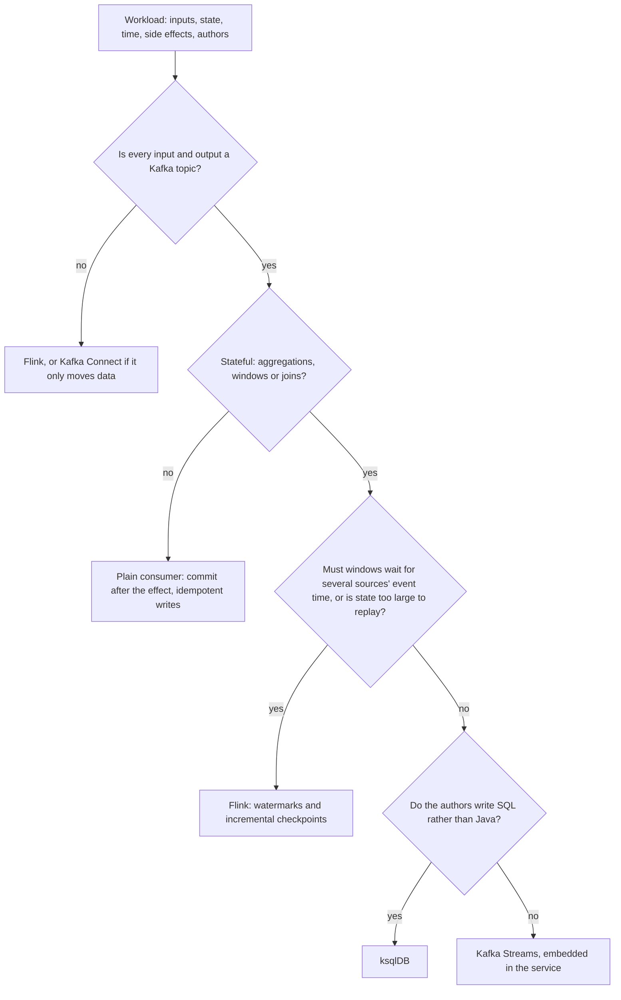

# Lesson 18. When Kafka Streams Is the Wrong Tool

**Mission link:** Opens the judgment bullet of the mission, deciding between Kafka Streams, a plain consumer, Flink and ksqlDB for a workload: everything the arc taught about state, time, guarantees and recovery becomes the evidence for one placement call, including the cases where "use Streams, it is on Kafka" is the wrong answer.
**Primary source:** [Docs: "Stateful Stream Processing", Apache Flink](https://nightlies.apache.org/flink/flink-docs-stable/docs/concepts/stateful-stream-processing/)
**Prerequisites:** [Lesson 17](0017-operating-and-monitoring-a-streams-app.md), [Exactly-once processing](../GLOSSARY.md), [Restoration](../GLOSSARY.md), [Stream time](../GLOSSARY.md)

## Warm-up

1. ▢ An app under `exactly_once_v2` calls a payment API from a `foreach` for each record. An instance crashes after the call and before its transaction commits. What happens to the payment?

Check

The transaction aborts, the record is processed again after the task moves, and the API is called a second time. Exactly-once covers only effects that are writes to the same Kafka cluster; the call is outside the transaction.

2. ▢ What advances stream time in a Kafka Streams task, and what does it close?

Check

Only a record with a newer timestamp than any the task has seen; it never moves backward and never moves on wall-clock time alone. It closes windows (at window end plus grace) and fires stream-time punctuators.

3. ▢ A store's changelog holds 2 billion records and restores at 50,000 a second. How long is the task unavailable after it moves to an instance with no copy?

Check

2,000,000,000 ÷ 50,000 = 40,000 seconds, a little over 11 hours, unless a standby replica already holds the state.

## Know this

### State the workload before naming a tool

"It is on Kafka, so use Kafka Streams" names a tool first. Five facts about the workload decide the call instead, and each one can overturn it:

- **Where it reads and writes.** Kafka in and Kafka out, or a database, an object store, a queue or an API on either side.
- **State.** None, a bounded amount per key, or terabytes that would take hours to replay.
- **Time.** Per-record work, windows over one input, or windows that must wait for the slowest of several sources.
- **Side effects.** Writes to Kafka only, or calls to systems a Kafka transaction cannot reach.
- **Who writes and runs it.** Java developers who deploy services, analysts who write SQL, or a platform team that already runs a processing cluster.

### Kafka Streams: stateful work embedded in your app, Kafka in and out

Kafka Streams is a library: an application that embeds it runs its own consumers, producers and local [state stores](../GLOSSARY.md), and nothing else needs deploying ([Architecture](https://kafka.apache.org/43/streams/architecture/)). It is the right tool when input and output are Kafka topics, the work is stateful (aggregations, windows, joins), and the team deploys ordinary JVM services. It buys [exactly-once processing](../GLOSSARY.md) across reads, state and writes in one transaction, state you can serve with an [interactive query](../GLOSSARY.md), and no cluster beyond Kafka. It costs [internal topics](../GLOSSARY.md) on your brokers, [restoration](../GLOSSARY.md) time proportional to the changelog, and a library inside every instance you operate.

### A plain consumer: stateless per-record work with side effects

When each record is handled on its own (validate it, call an API, write a row) and the effect lands outside Kafka, Streams adds machinery and protects nothing. Its exactly-once guarantee stops at the Kafka cluster, and the DSL guide says of a sink that writes to an external system that delivery semantics are then your responsibility, recommending Kafka Connect instead ([Streams DSL](https://kafka.apache.org/43/streams/developer-guide/dsl-api/)). A plain consumer that commits its offset only after the side effect succeeds, with an idempotent write on the other end, gives at-least-once delivery and no duplicate effect, with fewer moving parts. The Kafka track's [Delivery Guarantees](../../kafka/reference/delivery-guarantees.md) sheet covers that consumer leg. If the effect is just copying records into a database or a search index, Kafka Connect is the plainer still.

### Flink: a cluster built for event time, large state and many systems

Apache Flink is a separate runtime: a JobManager and one or more TaskManagers that you, or a managed service, operate ([Flink Architecture](https://nightlies.apache.org/flink/flink-docs-stable/docs/concepts/flink-architecture/)). What that cluster buys, from Flink's own pages:

- **Event time across sources.** Flink tracks progress with watermarks that flow with the data, and an operator with several inputs takes the minimum of its inputs' event times ([Timely Stream Processing](https://nightlies.apache.org/flink/flink-docs-stable/docs/concepts/time/)). A Kafka Streams task has [stream time](../GLOSSARY.md), the largest timestamp it has seen, plus a [grace period](../GLOSSARY.md) you choose. When completeness has to mean "every source has passed 10:00", watermarks express it and stream time does not.
- **Large state with incremental checkpoints.** Flink snapshots operator state with checkpoint barriers into a durable state backend and recovers every operator from the last completed checkpoint; with RocksDB, checkpoints can be incremental, recording only the changes since the last one ([Stateful Stream Processing](https://nightlies.apache.org/flink/flink-docs-stable/docs/concepts/stateful-stream-processing/), [State Backends](https://nightlies.apache.org/flink/flink-docs-stable/docs/ops/state/state_backends/)). Kafka Streams rebuilds a store by replaying its changelog, so recovery time grows with the changelog unless standby replicas hold a copy (lesson 15).
- **Sources and sinks beyond Kafka.** The Flink project maintains connectors for Kinesis, Pulsar, Cassandra, MongoDB, Elasticsearch, file systems, JDBC and more ([Connectors overview](https://nightlies.apache.org/flink/flink-docs-stable/docs/connectors/datastream/overview/)). Kafka Streams reads and writes Kafka only.

The cost is the cluster: its deployment, its checkpoint storage, its upgrades through savepoints, and the people who know how to run it. For a per-key count on one Kafka topic, that cost buys nothing Kafka Streams lacks.

### ksqlDB: the same runtime, written in SQL

ksqlDB's engine parses SQL statements and builds the corresponding Kafka Streams topologies, which run on ksqlDB servers that expose a REST API ([How it works, ksqlDB](https://docs.ksqldb.io/en/latest/operate-and-deploy/how-it-works/)). Its own comparison puts it plainly: ksqlDB is easier to use and Kafka Streams is more flexible. It is the right tool when the people writing the logic know SQL rather than Java and the work fits SQL over Kafka topics, with Java user-defined functions for the rest. Because it compiles to Kafka Streams, it inherits every cost this arc counted: repartition and changelog topics, restoration, co-partitioning. What it adds is a server to run and a narrower set of formats (Avro, Protobuf, JSON, JSON_SR and CSV, against any format at all in a Streams app). The page is Confluent's own documentation, so read its comparison as the vendor's framing.

### When "use Streams for everything on Kafka" is wrong

The usual answer is right for the usual workload: stateful computation from Kafka topics to Kafka topics, owned by a team that ships JVM services. It is wrong in recognisable cases:

- **The work is per record and the effect is outside Kafka.** A plain consumer with commit-after-effect and idempotent writes, or a Connect sink.
- **Completeness depends on several sources' event time.** Flink's watermarks say when all inputs have passed a time; stream time and grace only bound lateness per task.
- **State is too large to replay.** Terabytes of changelog mean hours of restoration on every move without standbys, and doubled disk with them; incremental checkpoints are the design built for it.
- **An input or output is not Kafka.** Adding a Connect pipeline on each side to keep Streams in the middle is two more systems.
- **The authors write SQL, not Java.** ksqlDB, or Flink SQL if a Flink cluster already exists.

The reverse mistake is as common: choosing Flink "because it is more powerful" for a windowed count from one topic to another, and paying for a cluster to do what a library inside the existing service would.

### Worked example: three workloads, three answers

| Workload | Facts that decide | Call | What the call costs |
|---|---|---|---|
| Send a webhook for each `order-shipped` event | Stateless, effect outside Kafka | Plain consumer, commit after a 2xx, idempotency key on the webhook | Retries and the idempotency key are your code |
| Fraud score per card over a 10-minute window, Kafka in and out, 40 GB of state | Stateful, one source, state restores in minutes with a standby | Kafka Streams | Internal topics, standbys doubling the disk |
| Join clickstream from Kafka with ad impressions from Kinesis, hourly windows that must wait for both, 3 TB of state | Two systems, completeness across sources, state too large to replay | Flink | A cluster to run, checkpoint storage, savepoint upgrades |

### Predict, then run

Write the webhook workload twice against a local broker and a local HTTP server that logs every call: once as a Streams app with `exactly_once_v2` calling the server from `foreach`, once as a plain consumer that calls the server and then commits. In each, kill the process with `kill -9` right after the call, restart it, and count the calls the server logged for that record. Predict both counts before running. Both should log the call twice: exactly-once did not stop the duplicate, which is the argument for the simpler tool plus an idempotency key on the receiving side.

## Practice

1. ▢ Name the five facts about a workload this lesson states before choosing a tool.

Check

Where it reads and writes, how much state it keeps, what notion of time it needs, which side effects it has, and who writes and runs it. A choice that ignores one of them can be overturned by it.

2. ▢ A service must update a customer's row in Postgres for every `address-changed` event on a Kafka topic. A colleague proposes a Kafka Streams app with `exactly_once_v2` "so every update happens exactly once". Argue the call.

Hint

Ask where the effect lands and what the Streams transaction can reach.

Check

The effect lands in Postgres, outside the Kafka transaction, so `exactly_once_v2` does not make the update happen once: a crash between the write and the commit replays it. The work is stateless and per record. A plain consumer that writes with an upsert keyed on customer and event version, then commits, gives the same outcome with less machinery; a JDBC sink connector gives it with none of your code.

3. ▢ Which statement about ksqlDB matches its own documentation?

    - a) It runs its own engine that replaces Kafka Streams entirely
    - b) It compiles SQL statements into Kafka Streams topologies to run
    - c) It reads and writes any format a Streams app handles
    - d) It runs inside your service with no server to deploy

Check

**b)** The engine parses SQL and builds Kafka Streams topologies. (a) is the opposite: it is built on Kafka Streams. (c) is wrong: it lists Avro, Protobuf, JSON, JSON_SR and CSV, while Streams takes any format. (d) is wrong: it runs on ksqlDB servers with a REST API.

4. ▢ Interleave lesson 15. A team's session-window app holds 2 TB of state across 48 tasks and runs one standby per task. Their recovery target is 5 minutes. Compare what recovery costs them in Kafka Streams with what it would cost in Flink.

Hint

Count the disk each design needs, and say what is replayed when a task moves.

Check

In Kafka Streams the standbys meet the target only while they stay current, and they double local disk to about 4 TB across the instances; a move without a current standby replays that task's changelog, about 42 GB per task on average, far past 5 minutes at typical restore rates. In Flink, recovery reloads every operator from the last completed checkpoint in the state backend, and incremental checkpoints keep each one small. Flink's cost is the cluster and the checkpoint storage; at this state size that may be cheaper than doubled disk and replay risk, which is the case where the usual answer flips.

5. ▢ A platform architect wants every new streaming job on Flink "so we standardise on one tool". The next job is a per-merchant count over 1-hour tumbling windows from one Kafka topic to another, about 2 GB of state, owned by a Java service team with no Flink experience. Defend a call, and name what it costs.

Check

Kafka Streams, embedded in the team's service: Kafka in and out, one source, small state that restores in seconds to minutes, and a team that already deploys JVM services. It costs internal topics on the brokers (the window store's changelog, plus a repartition topic if the key changes on the way to merchant) and a library the team must learn to operate. The standardisation argument is real but it trades a cluster, its storage and its expertise for a job that needs none of them; record that trade explicitly rather than letting "one tool" decide it.

## Real-world reps

- [ ] Today: for one streaming workload you know, write the five facts in one line each and run them through the flowchart. Note where your current tool disagrees, and why.
- [ ] Run the predict-then-run twice, Streams and plain consumer, and write down the call counts you predicted before looking at the server log.
- [ ] Tomorrow: read the "Recovery" and "Savepoints" sections of Flink's stateful stream processing page, and write two sentences on what replaces changelog restoration there and what replaces a reset.

## Going further

- [Topology Review](../reference/topology-review.md)
- [Docs: "Stateful Stream Processing", Apache Flink](https://nightlies.apache.org/flink/flink-docs-stable/docs/concepts/stateful-stream-processing/)
- [Docs: "Timely Stream Processing", Apache Flink](https://nightlies.apache.org/flink/flink-docs-stable/docs/concepts/time/)
- [Docs: "How it works", ksqlDB](https://docs.ksqldb.io/en/latest/operate-and-deploy/how-it-works/)
- [Docs: "Architecture", Apache Kafka 4.3](https://kafka.apache.org/43/streams/architecture/)
- [Delivery Guarantees](../../kafka/reference/delivery-guarantees.md), for the plain consumer's commit-after-effect pattern
- [Resources](../RESOURCES.md)

---

Not landing? Reread the primary source at the top, since this lesson compresses it and compression is where understanding leaks. Check the [glossary](../GLOSSARY.md) for any term that felt slippery.

If the lesson itself is unclear rather than the material, that is a defect: [open an issue](https://github.com/TokenCemetery/teach/issues).
