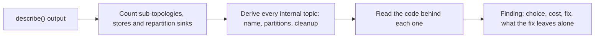

# Lesson 19. Reviewing Someone Else's Topology

**Mission link:** The mission asks you to review someone else's topology and to say from it what internal topics, state and recovery it will cost before it reaches production; this lesson works one review end to end, so that each finding names the choice, its cost in topics, disk, latency or correctness, the fix, and what the fix leaves alone.
**Primary source:** [Docs: "Streams DSL", Apache Kafka 4.3](https://kafka.apache.org/43/streams/developer-guide/dsl-api/)
**Prerequisites:** [Lesson 18](0018-when-kafka-streams-is-the-wrong-tool.md), [Repartition topic](../GLOSSARY.md), [Sub-topology](../GLOSSARY.md), [Suppression](../GLOSSARY.md)

## Warm-up

1. ▢ Which operation marks a stream for repartitioning: `mapValues` or `map`? What does the next `groupByKey` then do?

<details markdown="1"><summary>Check</summary>

`map`, because it may change the key. The next `groupByKey` writes the records to a repartition topic and reads them back in a new sub-topology. `mapValues` cannot change the key, so it marks nothing.

</details>

2. ▢ A windowed count is built with `TimeWindows.ofSizeWithNoGrace(Duration.ofMinutes(5))`. A record arrives one second after stream time has passed its window's end. What happens to it?

<details markdown="1"><summary>Check</summary>

It is dropped as late: with no grace the window closes at its end, so any record that arrives after stream time passes it is discarded and counted in `dropped-records-total`.

</details>

3. ▢ Which client state should an alert treat as terminal, and which as normal for a while after a deploy?

<details markdown="1"><summary>Check</summary>

`ERROR` is terminal: only a restart recovers it. `REBALANCING` is normal while active tasks restore their stores, and can last minutes when state is large.

</details>

## Know this

### Review from the describe output, then the code

A review that starts from the code finds style. One that starts from `Topology#describe()` finds what the topology will cost, because the description lists every [sub-topology](../GLOSSARY.md), every store and every topic a sink writes ([Topology javadoc](https://kafka.apache.org/43/javadoc/org/apache/kafka/streams/Topology.html)). The order:



State every cost in its own unit: internal topics and their partitions, bytes written to Kafka per input record, local disk and off-heap memory per instance, added latency, or wrong output. A reviewer who writes "this feels heavy" has not reviewed.

### The topology under review

An `orders-app` counts orders per order ID and sends an alert with each region's 5-minute order count. `orders` has 12 partitions, `customers` 6 partitions and 3 GB, and the app runs on 4 instances with `exactly_once_v2`:

```java
GlobalKTable<String, String> customers = builder.globalTable("customers");
KStream<String, String> orders = builder.stream("orders");

KStream<String, String> cleaned = orders
    .map((orderId, csv) -> KeyValue.pair(orderId, csv.trim()));

cleaned
    .groupByKey()
    .count()
    .toStream()
    .to("order-event-counts");

cleaned
    .join(customers,
          (orderId, csv) -> csv.split(",")[0],
          (csv, customer) -> csv + "," + customer)
    .selectKey((orderId, csv) -> csv.split(",")[3])
    .groupByKey()
    .windowedBy(TimeWindows.ofSizeWithNoGrace(Duration.ofMinutes(5)))
    .count(Materialized.with(Serdes.String(), Serdes.Long()))
    .suppress(Suppressed.untilWindowCloses(Suppressed.BufferConfig.unbounded()))
    .toStream()
    .foreach((window, count) -> alerts.post(window.key(), count));
```

Its `describe()` output, printed by Kafka Streams 4.3.1:

```text
Topologies:
   Sub-topology: 0 for global store (will not generate tasks)
    Source: KSTREAM-SOURCE-0000000001 (topics: [customers])
      --> KTABLE-SOURCE-0000000002
    Processor: KTABLE-SOURCE-0000000002 (stores: [customers-STATE-STORE-0000000000])
      --> none
      <-- KSTREAM-SOURCE-0000000001
  Sub-topology: 1
    Source: KSTREAM-SOURCE-0000000003 (topics: [orders])
      --> KSTREAM-MAP-0000000004
    Processor: KSTREAM-MAP-0000000004 (stores: [])
      --> KSTREAM-LEFTJOIN-0000000012, KSTREAM-FILTER-0000000008
      <-- KSTREAM-SOURCE-0000000003
    Processor: KSTREAM-LEFTJOIN-0000000012 (stores: [])
      --> KSTREAM-KEY-SELECT-0000000013
      <-- KSTREAM-MAP-0000000004
    Processor: KSTREAM-KEY-SELECT-0000000013 (stores: [])
      --> KSTREAM-FILTER-0000000018
      <-- KSTREAM-LEFTJOIN-0000000012
    Processor: KSTREAM-FILTER-0000000008 (stores: [])
      --> KSTREAM-SINK-0000000007
      <-- KSTREAM-MAP-0000000004
    Processor: KSTREAM-FILTER-0000000018 (stores: [])
      --> KSTREAM-SINK-0000000017
      <-- KSTREAM-KEY-SELECT-0000000013
    Sink: KSTREAM-SINK-0000000007 (topic: KSTREAM-AGGREGATE-STATE-STORE-0000000005-repartition)
      <-- KSTREAM-FILTER-0000000008
    Sink: KSTREAM-SINK-0000000017 (topic: KSTREAM-AGGREGATE-STATE-STORE-0000000015-repartition)
      <-- KSTREAM-FILTER-0000000018

  Sub-topology: 2
    Source: KSTREAM-SOURCE-0000000009 (topics: [KSTREAM-AGGREGATE-STATE-STORE-0000000005-repartition])
      --> KSTREAM-AGGREGATE-0000000006
    Processor: KSTREAM-AGGREGATE-0000000006 (stores: [KSTREAM-AGGREGATE-STATE-STORE-0000000005])
      --> KTABLE-TOSTREAM-0000000010
      <-- KSTREAM-SOURCE-0000000009
    Processor: KTABLE-TOSTREAM-0000000010 (stores: [])
      --> KSTREAM-SINK-0000000011
      <-- KSTREAM-AGGREGATE-0000000006
    Sink: KSTREAM-SINK-0000000011 (topic: order-event-counts)
      <-- KTABLE-TOSTREAM-0000000010

  Sub-topology: 3
    Source: KSTREAM-SOURCE-0000000019 (topics: [KSTREAM-AGGREGATE-STATE-STORE-0000000015-repartition])
      --> KSTREAM-AGGREGATE-0000000016
    Processor: KSTREAM-AGGREGATE-0000000016 (stores: [KSTREAM-AGGREGATE-STATE-STORE-0000000015])
      --> KTABLE-SUPPRESS-0000000020
      <-- KSTREAM-SOURCE-0000000019
    Processor: KTABLE-SUPPRESS-0000000020 (stores: [KTABLE-SUPPRESS-STATE-STORE-0000000021])
      --> KTABLE-TOSTREAM-0000000022
      <-- KSTREAM-AGGREGATE-0000000016
    Processor: KTABLE-TOSTREAM-0000000022 (stores: [])
      --> KSTREAM-FOREACH-0000000023
      <-- KTABLE-SUPPRESS-0000000020
    Processor: KSTREAM-FOREACH-0000000023 (stores: [])
      --> none
      <-- KTABLE-TOSTREAM-0000000022
```

One trap before counting: the inner join with the [GlobalKTable](../GLOSSARY.md) prints as `KSTREAM-LEFTJOIN`. The node name is a generated label, not the join's semantics; the code says `join`. Confirm a surprising node name against the code before writing it up.

### Step 1: count the internal topics

Two repartition sinks and three stores in task-generating sub-topologies give five [internal topics](../GLOSSARY.md). The global store reads `customers` itself and gets no changelog. Each name is prefixed with the [application ID](../GLOSSARY.md):

| Internal topic | Kind | Partitions | Cleanup |
|---|---|---|---|
| `...STATE-STORE-0000000005-repartition` | Repartition | 12 | `delete`, retention `-1`, purged by Streams after commit |
| `...STATE-STORE-0000000005-changelog` | Key-value changelog | 12 | `compact` |
| `...STATE-STORE-0000000015-repartition` | Repartition | 12 | `delete`, retention `-1`, purged by Streams after commit |
| `...STATE-STORE-0000000015-changelog` | Window changelog | 12 | `delete,compact`, retention the window store's plus 24 hours |
| `...KTABLE-SUPPRESS-STATE-STORE-0000000021-changelog` | Suppression buffer changelog | 12 | Compacted, as a key-value changelog |

Cleanup policies are from [Managing Streams Application Topics](https://kafka.apache.org/43/streams/developer-guide/manage-topics/). A repartition topic without a partition count of its own takes the largest partition count among its upstream sub-topology's source topics, here `orders` with 12 ([RepartitionTopics source, 4.3](https://github.com/apache/kafka/blob/4.3/streams/src/main/java/org/apache/kafka/streams/processor/internals/RepartitionTopics.java)), and each changelog has one partition per task of its sub-topology. Five topics, 60 partitions, on brokers the team may not own.

### Finding 1: a `map` that only changes the value

Choice: `map` rewrites the value and returns the same key. The DSL guide is explicit that `map` marks the stream for repartitioning and that `mapValues` does not ([Streams DSL](https://kafka.apache.org/43/streams/developer-guide/dsl-api/)), so `groupByKey` writes every order to `...0000000005-repartition` and reads it back in sub-topology 2.

Cost: one internal topic of 12 partitions, every order produced and consumed a second time (inside the transaction, under exactly-once), one more network round trip of latency on the count, and a sub-topology whose 12 tasks exist only to undo the move. The join branch is not affected in kind: its `selectKey` changes the key to region, so that repartition is real.

Fix: `mapValues(csv -> csv.trim())`. The count then runs in sub-topology 1 next to the source.

What the fix leaves alone: the counts, and, as it happens, the count store's name, since its number was assigned before the operators that disappear. What it changes: in a 4.3.1 run the window store and its repartition topic renumber from `0000000015` to `0000000012` and the suppression buffer from `0000000021` to `0000000018`, so a rolling deploy would start them empty. Lesson 20 is how to ship it.

### Finding 2: a window with no grace on out-of-order data

Choice: `ofSizeWithNoGrace`. Cost: correctness. Every record that arrives after stream time has passed its window's end is dropped, counted only in `dropped-records-total`, so the region count is low whenever orders arrive out of order across the 12 partitions feeding the repartition topic. Fix: `ofSizeAndGrace(Duration.ofMinutes(5), grace)`, with `grace` taken from a measured `record-lateness-max` (a task metric at `DEBUG`) rather than guessed. What the fix leaves alone: on-time records. What it costs: every alert is delayed by the grace period, because suppression waits for the window to close.

### Finding 3: an unbounded suppression buffer

Choice: `untilWindowCloses(BufferConfig.unbounded())`. The DSL guide's own example uses it and says production code can cap the buffer's memory instead. Cost: heap that grows with the number of open windows times regions, until the instance runs out of memory, plus a changelog that replays all of it on restoration. Fix: `BufferConfig.maxRecords(n).shutDownWhenFull()`, the strict bound `untilWindowCloses` accepts ([Suppressed javadoc](https://kafka.apache.org/43/javadoc/org/apache/kafka/streams/kstream/Suppressed.html)), with `n` sized from the region count and the windows open at once, and an alert on `suppression-buffer-size-max`. What the fix leaves alone: the one-result-per-window guarantee. What it changes: a full buffer becomes a clean shutdown with a named cause instead of an out-of-memory kill.

### Finding 4: an external call from `foreach`

Choice: `alerts.post(...)` inside the topology. Cost: duplicates. `exactly_once_v2` commits Kafka writes atomically and nothing else, so an alert sent before a crash is sent again when the task replays (lesson 13); the DSL guide puts delivery semantics to external systems on you. Fix: `.to("region-alerts")` with the window and region in the key, and a small consumer or connector that posts each alert with that key as an idempotency key. What the fix leaves alone: when alerts are produced. What it adds: one output topic, which other teams can now also read.

### Finding 5: generated names on every stateful part

Choice: no `Grouped`, `Materialized` or `Named` anywhere. Cost: every future edit upstream of a store, Finding 1's fix included, renames that store, its changelog and the repartition topics, which a rolling deploy cannot carry (lesson 20). Fix: `Grouped.as(...)` on each grouping, `Materialized.as(...)` on each count, `Suppressed.withName(...)` on the suppression, and `ensure.explicit.internal.resource.naming=true` so a new unnamed store fails the build. Adding names to this running app is itself a rename, so it ships together with Finding 1 in one planned change.

### Finding 6: the global table, checked and fine

`customers` is a GlobalKTable: every instance reads all 6 partitions, keeps the full 3 GB, and bootstraps it on startup before processing ([GlobalKTable javadoc](https://kafka.apache.org/43/javadoc/org/apache/kafka/streams/kstream/GlobalKTable.html)). Four instances hold 12 GB in all, and a restart re-reads at most 3 GB from Kafka. At this size that buys a join with no [co-partitioning](../GLOSSARY.md) and no repartition. Write "checked, fine at 3 GB; revisit past the size an instance can bootstrap within the restart time you accept" and move on. A review that flags everything teaches the team to ignore reviews.

### The checks this topology did not trigger

Two more costs belong on every review, and this app happens to avoid them:

- **A foreign-key join** adds a subscription-registration topic, a subscription-response topic and a subscription store with its changelog; a 4.3.1 `describe()` of `orders.join(customers, foreignKeyExtractor, joiner)` on two `KTable`s shows all of them. Each left-side update becomes a message to the right side and a response back (KIP-213).
- **RocksDB memory** is off-heap, per store instance, and unbounded by default. Here: 12 key-value store instances and 12 window stores, each window store made of several RocksDB segments, spread over 4 instances, plus each instance's global store. Ask for the bounded-memory `RocksDBConfigSetter` from [Memory Management](https://kafka.apache.org/43/streams/developer-guide/memory-mgmt/) and the `block-cache-usage` metric on the dashboard.

### Predict, then run

Copy the reviewed code into a `TopologyTestDriver` test with `application.id=orders-app`, pipe one customer and two orders 10 minutes apart, then print `driver.producedTopicNames()`. Before running, write down every topic you expect it to list. It should list the output topic `order-event-counts` and the five internal topics from Step 1, with the `orders-app-` prefix. Then change `map` to `mapValues` and predict which names disappear and which change their numbers. In a 4.3.1 run the `0000000005` repartition topic disappears, the count's changelog keeps `0000000005`, and the window and suppression topics renumber to `0000000012` and `0000000018`: four internal topics, three of them under new names.

## Practice

1. ▢ Name the three stateless operations the DSL guide says mark a stream for repartitioning, and the value-only alternative for two of them.

<details markdown="1"><summary>Check</summary>

`map`, `flatMap` and `selectKey`. `mapValues` replaces `map` and `flatMapValues` replaces `flatMap` when the key does not change. `selectKey` exists to change the key, so it has no value-only form; if the key really changes, the repartition is the price of the next grouping or join.

</details>

2. ▢ Count the internal topics and their partitions for this description, assuming `input` has 8 partitions.

    ```text
    Sub-topology: 0
      Source: KSTREAM-SOURCE-0000000000 (topics: [input])
      Processor: KSTREAM-KEY-SELECT-0000000001 (stores: [])
      Processor: KSTREAM-FILTER-0000000005 (stores: [])
      Sink: KSTREAM-SINK-0000000004 (topic: KSTREAM-AGGREGATE-STATE-STORE-0000000002-repartition)
    Sub-topology: 1
      Source: KSTREAM-SOURCE-0000000006 (topics: [KSTREAM-AGGREGATE-STATE-STORE-0000000002-repartition])
      Processor: KSTREAM-AGGREGATE-0000000003 (stores: [KSTREAM-AGGREGATE-STATE-STORE-0000000002])
      Processor: KTABLE-TOSTREAM-0000000007 (stores: [])
      Sink: KSTREAM-SINK-0000000008 (topic: output)
    ```

<details markdown="1"><summary>Hint</summary>

Count the sinks that write to a `-repartition` topic, then the stores, and size each from its sub-topology.

</details>

<details markdown="1"><summary>Check</summary>

Two: the repartition topic `...0000000002-repartition` with 8 partitions (the largest upstream source count) and the store's changelog `...0000000002-changelog` with 8 partitions (one per task of sub-topology 1). `output` is a user topic and is not counted.

</details>

3. ▢ Which finding in this lesson's review costs correctness rather than resources?

    - a) The `map` that writes every order to an extra topic
    - b) The windowed count that drops orders arriving out of order
    - c) The global table that copies all customers to every instance
    - d) The unbounded buffer that grows heap until memory runs out

<details markdown="1"><summary>Check</summary>

**b)** Records dropped as late make the counts wrong with no error. (a) costs a topic, traffic and latency; the counts stay right. (c) costs disk and startup time, and was judged fine. (d) costs memory and ends in a crash, which is loud, not a wrong answer. Finding 4's duplicate alerts are the other correctness cost.

</details>

4. ▢ Interleave lesson 12. A teammate's topology joins `orders` (a KTable keyed by order ID) to `customers` (a KTable keyed by customer ID) on `customerId` from the order value, with a foreign-key join. Name the internal topics it adds, and say why the two tables need not be co-partitioned.

<details markdown="1"><summary>Check</summary>

A subscription-registration topic, a subscription-response topic and the changelog of the subscription store, on top of the two tables' own stores. Kafka Streams ensures co-partitioning for the join internally: each order's subscription is sent, keyed by customer ID, to the partition that holds that customer, and the response is routed back to the order's partition, which is exactly what the two extra topics carry.

</details>

5. ▢ Write Finding 3 as one review comment, in the form choice, cost, fix, what the fix leaves alone.

<details markdown="1"><summary>Check</summary>

Choice: `suppress(untilWindowCloses(BufferConfig.unbounded()))`. Cost: heap grows with open windows times regions until the instance is killed for memory, and the buffer's changelog makes restoration replay all of it. Fix: `BufferConfig.maxRecords(n).shutDownWhenFull()` with `n` sized from regions and windows open at once, plus an alert on `suppression-buffer-size-max`. Leaves alone: exactly one final count per region and window.

</details>

## Real-world reps

- [ ] Today: run the predict-then-run, write down the topics you expect before printing `producedTopicNames()`, then repeat it after changing `map` to `mapValues`.
- [ ] Print `describe()` for one topology you did not write, count its internal topics and their partitions, and write the table from Step 1 for it.
- [ ] Tomorrow: write two findings for that topology in the form choice, cost, fix, what the fix leaves alone, and one "checked, fine" with the number that makes it fine.

## Going further

- [Topology Review](../reference/topology-review.md)
- [Docs: "Streams DSL", Apache Kafka 4.3](https://kafka.apache.org/43/streams/developer-guide/dsl-api/)
- [Javadoc: "Topology", Apache Kafka 4.3](https://kafka.apache.org/43/javadoc/org/apache/kafka/streams/Topology.html)
- [Docs: "Managing Streams Application Topics", Apache Kafka 4.3](https://kafka.apache.org/43/streams/developer-guide/manage-topics/)
- [Docs: "Memory Management", Apache Kafka 4.3](https://kafka.apache.org/43/streams/developer-guide/memory-mgmt/)
- [KIP: "KIP-213 Support non-key joining in KTable", Apache Kafka](https://cwiki.apache.org/confluence/display/KAFKA/KIP-213+Support+non-key+joining+in+KTable)
- [Resources](../RESOURCES.md)

---

Not landing? Reread the primary source at the top, since this lesson compresses it and compression is where understanding leaks. Check the [glossary](../GLOSSARY.md) for any term that felt slippery.

If the lesson itself is unclear rather than the material, that is a defect: [open an issue](https://github.com/TokenCemetery/teach/issues).
