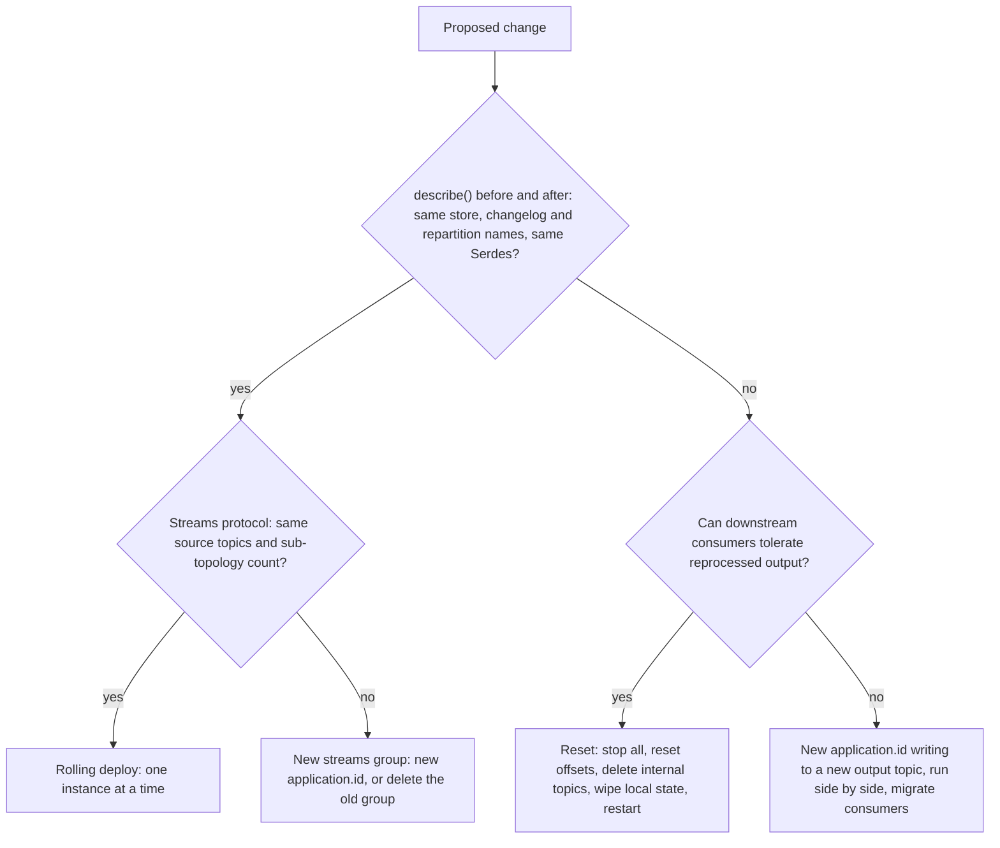

# Lesson 20. Changing a Topology Others Depend On

**Mission link:** The mission ends at changing a running topology without breaking its state or its downstream consumers; this lesson carries Lesson 19's fixes through a running app, and closes on the habit a senior engineer is trusted for: settling a disputed claim from the documentation and `describe()` output instead of from memory.
**Primary source:** [Docs: "Naming Operators in a Kafka Streams DSL Application", Apache Kafka 4.3](https://kafka.apache.org/43/streams/developer-guide/dsl-topology-naming/)
**Prerequisites:** [Lesson 19](0019-reviewing-someone-elses-topology.md), [Application ID](../GLOSSARY.md), [Changelog topic](../GLOSSARY.md), [Repartition topic](../GLOSSARY.md)

## Warm-up

1. ▢ What does changing `application.id` do to a running app's state?

<details markdown="1"><summary>Check</summary>

It starts the app from nothing: a new consumer group with no committed offsets, new internal topics under the new prefix, and a new local state directory. The old topics and offsets still exist, unused.

</details>

2. ▢ In Lesson 19's review, why did Finding 1's fix (`map` to `mapValues`) have to be shipped as a planned change rather than a normal deploy?

<details markdown="1"><summary>Check</summary>

Removing the repartition shifted the generated numbers of later operators, so the window store, its repartition topic and the suppression buffer got new names. A rolling deploy would start them empty under the new names, silently losing their state.

</details>

3. ▢ Name the four parts of a review finding.

<details markdown="1"><summary>Check</summary>

The choice, what it costs (in topics, disk, memory, latency or correctness), the fix, and what the fix leaves alone.

</details>

## Know this

### Who depends on a running topology

Two kinds of dependent can break, and only one of them is visible in the code:

- **The app's own past.** Its state stores, their [changelog topics](../GLOSSARY.md), its [repartition topics](../GLOSSARY.md) and its committed input offsets are all found by name: the [application ID](../GLOSSARY.md) plus a store or operator name. Change a name and the new version finds nothing, starts empty and says nothing.
- **Everyone downstream.** Consumers of its output topics depend on their key, value format, partitioning and meaning; clients of its [interactive queries](../GLOSSARY.md) depend on store names. They are other teams, and the change reaches them as errors or, worse, as different numbers.

### Generated names shift when an operator is inserted

The DSL numbers every operator in the order it is built, and a store or repartition topic with no name of its own takes its name from that number. The naming guide shows the consequence with a count, then the same count after a filter is added before it ([Naming Operators](https://kafka.apache.org/43/streams/developer-guide/dsl-topology-naming/)). Kafka Streams 4.3.1 prints, for `stream.groupByKey().count()`:

```text
Processor: KSTREAM-AGGREGATE-0000000002 (stores: [KSTREAM-AGGREGATE-STATE-STORE-0000000001])
```

and, after inserting `.filter((k, v) -> v != null && v.length() >= 6)` before `groupByKey()`:

```text
Processor: KSTREAM-AGGREGATE-0000000003 (stores: [KSTREAM-AGGREGATE-STATE-STORE-0000000002])
```

The store, and with it the changelog `<application.id>-KSTREAM-AGGREGATE-STATE-STORE-...-changelog`, has a new name. The guide's verdict: you cannot do a rolling redeploy of that change, and the counts must be recomputed with the reset tool, because the new changelog topic is empty. Processor names shift too, but the guide calls them stateless: they live in memory and nothing persists under them.

### Name everything that persists

The fix is to give every stateful part a name of its own, so inserting an operator leaves it alone. The guide's table, with `Repartitioned` added for `repartition()` ([Repartitioned javadoc](https://kafka.apache.org/43/javadoc/org/apache/kafka/streams/kstream/Repartitioned.html)):

| Resource | Named with |
|---|---|
| Aggregation repartition topic | `Grouped.as("by-region")` |
| Stream-stream join repartition topics and stores | `StreamJoined` |
| Stream-table join repartition topic | `Joined` |
| Store and changelog of an aggregation or table-table join | `Materialized.as("region-counts")` |
| Suppression buffer | `Suppressed.withName("final-region-counts")` |
| Explicit repartition | `Repartitioned.as("orders-by-customer")` |
| Stateless operators | `Named.as("drop-invalid")` |

With `Grouped.as("by-region")` and `Materialized.as("region-counts")`, a 4.3.1 `describe()` shows the repartition topic `by-region-repartition` and the store `region-counts` unchanged when a filter is inserted before the `selectKey`; only stateless processor numbers move.

`ensure.explicit.internal.resource.naming=true` makes Kafka Streams refuse to build a topology with any generated store, changelog or repartition name ([Kafka Streams Configs](https://kafka.apache.org/43/configuration/kafka-streams-configs/)). In a 4.3.1 run the check fired when the `StreamsBuilder` was created with the setting, as `new StreamsBuilder(new TopologyConfig(new StreamsConfig(props)))`, and not with a plain `new StreamsBuilder()`, so construct it that way and let a unit test catch the next unnamed store. With the setting off, the same check logs a warning that lists every unnamed resource, which is a free review aid.

### Naming a running app is itself a rename

Adding `Materialized.as("region-counts")` to a deployed app moves its state from the generated name to the new one, so the naming guide says to shut every instance down and reset. There is a cheaper move it does not mention: name each resource with the name it already has. `Materialized.as("KSTREAM-AGGREGATE-STATE-STORE-0000000002")` and `Grouped.as("KSTREAM-AGGREGATE-STATE-STORE-0000000002")` reproduce the generated store and `...-repartition` names exactly, and a 4.3.1 `describe()` shows them unchanged after a filter is inserted upstream. The names are ugly and the trick is unpromised by the documentation, so prove it with `describe()` before and after, on your version, before relying on it.

### Other changes that break state

| Change | What breaks | Evidence |
|---|---|---|
| Insert or remove an operator upstream of an unnamed store or repartition | State under the old names is abandoned | Naming guide; `describe()` before and after |
| Change `application.id` | Everything: offsets, internal topics, local state | Glossary; the ID prefixes all three |
| Change a store's key or value Serde | Restored changelog records no longer deserialize, or deserialize wrongly | The changelog holds the old format |
| Add partitions to an input topic | Repartition and changelog topics keep their old count; Kafka Streams stops with `Existing internal topic ... has invalid partitions` | [InternalTopicManager source, 4.3](https://github.com/apache/kafka/blob/4.3/streams/src/main/java/org/apache/kafka/streams/processor/internals/InternalTopicManager.java) |
| Add a source topic or change the number of sub-topologies, on the streams protocol | The streams group cannot carry it; a new group must be created | [Streams Rebalance Protocol](https://kafka.apache.org/43/streams/developer-guide/streams-rebalance-protocol/) |

Upgrading the library is a topology change too. The [Upgrade Guide](https://kafka.apache.org/43/streams/upgrade-guide/) gives the rolling path to 4.3 (two bounces with `upgrade.from` when coming from 3.4 or older), warns that 4.3 keeps each store's changelog offset inside the store so a downgrade to 4.2 needs the state directory wiped, and points 4.3.0 users at 4.3.1 for a RocksDB native memory leak (KAFKA-20616).

### Downstream consumers: the output topic is a contract

An output topic's key, value format, partition count and meaning are what other teams built on. Changing the key moves records to different partitions and breaks any downstream join that relied on [co-partitioning](../GLOSSARY.md); changing the value Serde breaks their deserializers; changing what a count means breaks nothing loudly and every report quietly. Schema Registry's compatibility types catch some format changes, and the Kafka track's [ecosystem sheet](../../kafka/reference/ecosystem.md#the-compatibility-types-and-who-upgrades-first) says who has to upgrade first for each. The safe sequence is the one any shared interface uses: write the new shape to a new topic (`order-event-counts-v2`) beside the old, move consumers one at a time, and delete the old topic when nobody reads it.

### Choosing how to ship the change



A reset uses `kafka-streams-groups.sh` on the streams protocol and `kafka-streams-application-reset.sh` on the classic one, with every instance stopped and a `--dry-run` first ([Kafka Streams Groups Tool](https://kafka.apache.org/43/streams/developer-guide/kafka-streams-group-sh/), [Application Reset Tool](https://kafka.apache.org/43/streams/developer-guide/app-reset-tool/)):

```bash
# Streams protocol: rewind input, then drop the group and its internal topics
kafka-streams-groups.sh --bootstrap-server host:9092 --group orders-app \
  --reset-offsets --all-input-topics --to-earliest --dry-run
kafka-streams-groups.sh --bootstrap-server host:9092 --group orders-app \
  --reset-offsets --all-input-topics --to-earliest --execute

# Classic protocol: rewinds input and deletes internal topics in one tool
kafka-streams-application-reset.sh --bootstrap-server host:9092 \
  --application-id orders-app --input-topics orders --dry-run
```

Two things neither tool does, both from the reset tool's page: it does not reset output topics, so downstream consumers will see every result again, and it does not delete local state, so call `KafkaStreams#cleanUp()` or delete the state directory on every machine before restarting.

### Worked example: shipping Lesson 19's fixes

The fixes rename stores (Finding 1), add names everywhere (Finding 5), move alerts to a new `region-alerts` topic (Finding 4), and change window grace (Finding 2). `describe()` before and after differ in store and repartition names, and the sub-topology count drops from four to three. `order-event-counts` keeps its key, format and meaning, but its consumers would see every count again after a reset, and a dashboard team sums that topic. So the change ships as a new application: `orders-app-v2` with every resource named, reading `orders` from the earliest offset, writing `order-event-counts-v2` and `region-alerts`. When v2's counts match v1's for a full day, consumers move to `-v2` one by one, and v1 is stopped and its group deleted with its internal topics. The cost is a second copy of the state during the overlap; the benefit is that no consumer sees a result twice and no state is lost silently.

### Settling a disputed claim from the source

Two engineers argue in a review thread: "adding a filter is always safe, it is stateless" against "never touch a deployed topology". Both argue from memory. The method:

1. **Write the claim so it can be false.** "Inserting a filter leaves every store, changelog and repartition name unchanged."
2. **Find the primary source and quote it.** The naming guide shows exactly that insertion renaming the store, and says the change cannot be rolled out without a reset.
3. **Test it where the truth is visible.** Print `describe()` before and after on your version. The guide's own prose names the first store `0000000002` while its printed description, and a 4.3.1 run, show `0000000001`; the output is the evidence, the prose is a summary of it.
4. **State the precise answer.** A filter is safe for state when it sits after every stateful operator, or when every stateful resource has an explicit name. It is never automatically safe for meaning: a filter added before a named count keeps the old state, which still includes records the new filter would have excluded.

Post the quoted sentence, both `describe()` outputs and the precise answer in the thread, and the dispute ends.

### Predict, then run

Build `stream.groupByKey().count().toStream().to("output")` and print `describe()`. Predict the store name after each of three edits, then run each: a `filter` inserted before `groupByKey()`, a `mapValues` inserted after `toStream()`, and the first edit again with `Materialized.as("counts")`. The first should renumber the store, the second should leave it alone, and the third should show `counts` whatever you insert upstream.

## Practice

1. ▢ Which names does the naming guide call "stateful", and why does that word matter when you change a topology?

<details markdown="1"><summary>Check</summary>

State store names, and through them changelog topic names, and repartition topic names. They matter because something persists under them, in Kafka and on disk; a processor name only labels an in-memory node, so its shift harms nothing.

</details>

2. ▢ Rename-safety exercise. A deployed app is `stream.selectKey((k, v) -> v.region()).groupByKey().count().toStream().to("region-counts")`, with no names. A teammate inserts `.filter((k, v) -> v != null)` directly after `stream`. Using `describe()` before and after, say which persisted names change, and give two ways to make the same edit safe.

<details markdown="1"><summary>Hint</summary>

Count the operators built before the store in each version. In a 4.3.1 run the store was `0000000002` before.

</details>

<details markdown="1"><summary>Check</summary>

Both persisted names change. Before: repartition topic `KSTREAM-AGGREGATE-STATE-STORE-0000000002-repartition` and store `KSTREAM-AGGREGATE-STATE-STORE-0000000002`. After, in a 4.3.1 run: both become `...0000000003`, so a rolling deploy starts the count empty. Safe ways: pin the current names, `Grouped.as("KSTREAM-AGGREGATE-STATE-STORE-0000000002")` and `Materialized.as("KSTREAM-AGGREGATE-STATE-STORE-0000000002")`, and confirm with `describe()` that both names are unchanged after the filter; or ship real names (`by-region`, `region-counts`) through a reset or a new application ID. Either way the old counts include null-valued records the new filter excludes.

</details>

3. ▢ Which statement about `kafka-streams-application-reset.sh` matches its documentation?

    - a) It resets input offsets and deletes the app's output topics too
    - b) It deletes internal topics but leaves output topics and local state
    - c) It wipes local state on every machine that ran an instance
    - d) It can run safely while the application instances are still running

<details markdown="1"><summary>Check</summary>

**b)** It resets input offsets and deletes internal topics; output topics and local state are left to you. (a) is wrong: output topics are never reset, so downstream sees results again. (c) is wrong: you call `KafkaStreams#cleanUp()` or delete the state directory yourself. (d) is wrong: all instances must be stopped first.

</details>

4. ▢ Interleave lesson 14. An app's input topic `orders` grows from 12 to 24 partitions so the app can scale out. Predict what happens at the next start, and plan the change.

<details markdown="1"><summary>Hint</summary>

Ask what partition count the existing repartition and changelog topics were created with.

</details>

<details markdown="1"><summary>Check</summary>

The existing internal topics still have 12 partitions while the topology now requires 24, so Kafka Streams stops with an `Existing internal topic ... has invalid partitions` error. Adding partitions also moves keys to new partitions, so per-key state would be in the wrong task even if it started. Plan it as a reset or a new application ID that rebuilds state at 24 partitions, and tell downstream consumers that output keys may now come from different partitions in a different order.

</details>

5. ▢ A colleague says the reset tool is unnecessary for a store rename: "just deploy, the new store will fill up from the input". Settle it from the sources.

<details markdown="1"><summary>Check</summary>

The new store fills only from records read after the deploy, because the committed input offsets are unchanged; everything before them is not reread. The naming guide says the renamed changelog contains no data and that the reset tool is needed to recompute. Quote it, show `describe()` with the old and new store names, and the store fills from history only after a reset, or under a new application ID that reads from the earliest offset.

</details>

## Real-world reps

- [ ] Today: run the predict-then-run, writing your three predictions down before each `describe()`.
- [ ] For one topology you own, set `ensure.explicit.internal.resource.naming=true` on a `StreamsBuilder` built with `TopologyConfig` in a unit test, and list every resource the failure names.
- [ ] Tomorrow: take a change you plan for that topology, print `describe()` before and after, and decide with the flowchart whether it rolls, resets or ships as a new application ID.
- [ ] Find one claim about Kafka Streams your team repeats from memory, quote the page that settles it, and test it with `describe()` or a driver test.

## Going further

- [Topology Review](../reference/topology-review.md)
- [Docs: "Naming Operators in a Kafka Streams DSL Application", Apache Kafka 4.3](https://kafka.apache.org/43/streams/developer-guide/dsl-topology-naming/)
- [Docs: "Upgrade Guide and API Changes", Apache Kafka 4.3](https://kafka.apache.org/43/streams/upgrade-guide/)
- [Docs: "Application Reset Tool", Apache Kafka 4.3](https://kafka.apache.org/43/streams/developer-guide/app-reset-tool/)
- [Docs: "Kafka Streams Groups Tool", Apache Kafka 4.3](https://kafka.apache.org/43/streams/developer-guide/kafka-streams-group-sh/)
- [Article: "Questioning the Lambda Architecture", Jay Kreps, O'Reilly (2014)](https://www.oreilly.com/radar/questioning-the-lambda-architecture/), for running a new version beside the old by replaying the log
- [Resources](../RESOURCES.md)

---

Not landing? Reread the primary source at the top, since this lesson compresses it and compression is where understanding leaks. Check the [glossary](../GLOSSARY.md) for any term that felt slippery.

If the lesson itself is unclear rather than the material, that is a defect: [open an issue](https://github.com/TokenCemetery/teach/issues).
