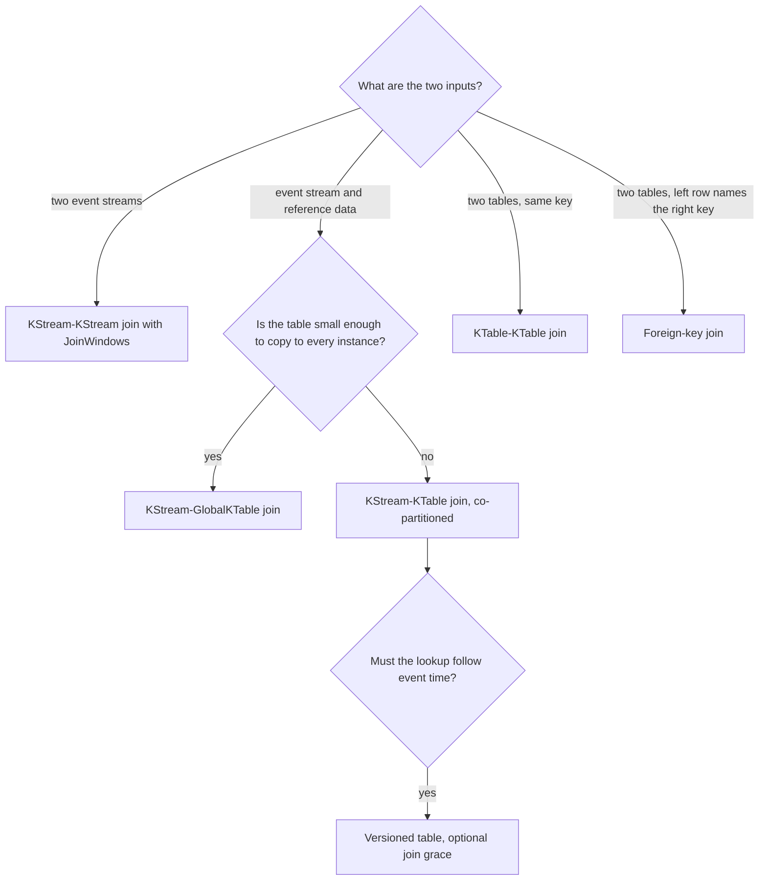

# Joins

Stage 5 compressed for lookup. [Lesson 11](../lessons/0011-stream-table-joins-and-co-partitioning.md) covers stream-table and GlobalKTable joins and co-partitioning; [lesson 12](../lessons/0012-stream-stream-and-table-table-joins.md) covers windowed stream-stream joins, table-table joins and foreign-key joins.

Semantics were read from the Apache Kafka 4.3 documentation and, where the docs are silent, the 4.3 source. Each row names its page; check it for your version.

## The join matrix

| Left | Right | Windowed | Inner | Left | Outer | Co-partitioning | What triggers output | Result |
|---|---|---|---|---|---|---|---|---|
| KStream | KStream | Yes, `JoinWindows` | Yes | Yes | Yes | Required | A record on either side, once per match in the window | `KStream` |
| KTable | KTable | No | Yes | Yes | Yes | Required | An update on either side | `KTable` |
| KTable | KTable, foreign key | No | Yes | Yes | No | Not required | A left update (at most one result); a right update (one result per left row referencing it) | `KTable`, left key |
| KStream | KTable | No | Yes | Yes | No | Required | Stream records only | `KStream` |
| KStream | GlobalKTable | No | Yes | Yes | No | Not required | Stream records only | `KStream` |
| KTable | GlobalKTable | | No | No | No | | Not supported | |

Page: [Joining](https://kafka.apache.org/43/streams/developer-guide/dsl-api/#joining).

## Choosing a join



## Stream-stream joins

| Item | Value | Page |
|---|---|---|
| Window | `JoinWindows.ofTimeDifferenceWithNoGrace(d)` or `ofTimeDifferenceAndGrace(d, grace)`; `.before(...)` and `.after(...)` make it asymmetric | [JoinWindows](https://kafka.apache.org/43/javadoc/org/apache/kafka/streams/kstream/JoinWindows.html) |
| Match condition | `left.ts - before <= right.ts <= left.ts + after`, same key | [JoinWindows](https://kafka.apache.org/43/javadoc/org/apache/kafka/streams/kstream/JoinWindows.html) |
| Window size | `before + after` | [JoinWindows source](https://github.com/apache/kafka/blob/4.3/streams/src/main/java/org/apache/kafka/streams/kstream/JoinWindows.java) |
| State | One window store per side, each with a changelog, retention window size plus grace; left and outer add a store for unmatched records | [KStreamImplJoin source](https://github.com/apache/kafka/blob/4.3/streams/src/main/java/org/apache/kafka/streams/kstream/internals/KStreamImplJoin.java) |
| Output per record | One result per matching record on the other side | [KStream-KStream join](https://kafka.apache.org/43/streams/developer-guide/dsl-api/#kstream-kstream-join) |
| Output timestamp | The larger of the two input timestamps | [KStreamKStreamJoin source](https://github.com/apache/kafka/blob/4.3/streams/src/main/java/org/apache/kafka/streams/kstream/internals/KStreamKStreamJoin.java) |
| Unmatched, left and outer | Emitted only after the window plus grace has passed, when a later record in the task moves stream time past it, checked at most about once per wall-clock second | [KStream-KStream join](https://kafka.apache.org/43/streams/developer-guide/dsl-api/#kstream-kstream-join), [KStreamKStreamJoin source](https://github.com/apache/kafka/blob/4.3/streams/src/main/java/org/apache/kafka/streams/kstream/internals/KStreamKStreamJoin.java) |
| Deprecated `JoinWindows.of(...).grace(...)` | Emits unmatched results eagerly, so a later match contradicts them | [KStream-KStream join](https://kafka.apache.org/43/streams/developer-guide/dsl-api/#kstream-kstream-join) |

## Stream-table lookups: which table value a record sees

| Table | Lookup | Late table update | Page |
|---|---|---|---|
| KTable, unversioned (default) | Latest by offset, at the moment the stream record is processed | Missed by stream records already processed | [Timestamp-based semantics](https://kafka.apache.org/43/streams/developer-guide/dsl-api/) |
| KTable, versioned store | Latest with timestamp at or before the stream record's | Found if within the join grace period (`Joined.withGracePeriod`, versioned tables only) | [KStream-KTable join](https://kafka.apache.org/43/streams/developer-guide/dsl-api/#kstream-ktable-join) |
| Stream record older than the versioned history retention | | `join` drops it; `leftJoin` joins it with `null` | [KStream-KTable join](https://kafka.apache.org/43/streams/developer-guide/dsl-api/#kstream-ktable-join) |
| GlobalKTable | Whatever it holds when the record is processed; no event-time synchronization | Missed | [KStream-GlobalKTable join](https://kafka.apache.org/43/streams/developer-guide/dsl-api/#kstream-globalktable-join) |

Processing order across the two inputs of a task follows timestamps when data from both is buffered. `max.task.idle.ms`, default 0, waits for data already on the brokers but not for producers to send more ([Configuring a Streams Application](https://kafka.apache.org/43/streams/developer-guide/config-streams/)).

## Nulls and tombstones

| Join | Null key or value on a stream input | Tombstone on a table input |
|---|---|---|
| KStream-KTable | Ignored (inner: key or value; left: value) | Deletes the key; triggers nothing |
| KStream-GlobalKTable | Ignored (inner: key or value; left: value) | Deletes the key; triggers nothing |
| KStream-KStream | Ignored (inner: key or value; left and outer: value) | |
| KTable-KTable inner | | Forwards a tombstone if the key is in the result |
| KTable-KTable left | | A right tombstone triggers the join; a left tombstone forwards a tombstone if the key is in the result |
| KTable-KTable outer | | Either side may trigger; a tombstone reaches the result only if the key is in it |
| Foreign key | Inner join ignores a left row whose extractor returns `null`; use a sentinel to join on missing | Left tombstone forwards a tombstone if the key is in the result |

Page: [Joining](https://kafka.apache.org/43/streams/developer-guide/dsl-api/#joining).

## Co-partitioning

| | |
|---|---|
| Required for | KStream-KStream, KTable-KTable, KStream-KTable |
| Not required for | KStream-GlobalKTable, foreign-key joins (Streams co-partitions its own internal topics) |
| Requirement 1 | Same number of partitions on both input topics |
| Requirement 2 | Same partitioning strategy in every writer: the same `partitioner.class`, the same `StreamPartitioner` |
| Checked by Streams | Partition counts, during partition assignment; a mismatch throws `TopologyException` "Topics not co-partitioned" (the docs say `TopologyBuilderException`) |
| Not checked | The partitioner, and whether writers serialize the same key to the same bytes |
| Symptom of a partitioner mismatch | The app runs; inner joins drop records, left joins emit `null` for keys that exist |
| Fix | Repartition the side with fewer partitions up to the larger count; for stream-table, repartition the stream |
| Stream with the wrong key | `selectKey(...)` before the join: Streams writes a repartition topic sized to the other side |

Pages: [Join co-partitioning requirements](https://kafka.apache.org/43/streams/developer-guide/dsl-api/#join-co-partitioning-requirements), [CopartitionedTopicsEnforcer source](https://github.com/apache/kafka/blob/4.3/streams/src/main/java/org/apache/kafka/streams/processor/internals/assignment/CopartitionedTopicsEnforcer.java).

```java
// SMALLER is a KStream
stream.repartition(Repartitioned.<K, V>as("name").withNumberOfPartitions(n));
// SMALLER is a KTable
table.toStream().repartition(Repartitioned.<K, V>as("name").withNumberOfPartitions(n)).toTable();
```

## KTable or GlobalKTable

| | KTable | GlobalKTable |
|---|---|---|
| Partitions held per instance | Its assigned ones | All |
| Co-partitioning | Required | Not required |
| Lookup key | The stream's record key | Any field, through a `KeyValueMapper` |
| Time | Versioned lookup and join grace available | No notion of time |
| Start-up | Restores its assigned stores | Bootstraps the whole topic before processing starts, on every start |
| Cost | Repartition topic if keys or counts differ | Full copy, and a full read of the topic, on every instance |

Page: [GlobalKTable](https://kafka.apache.org/43/streams/developer-guide/dsl-api/), [KStream-GlobalKTable join](https://kafka.apache.org/43/streams/developer-guide/dsl-api/#kstream-globalktable-join).

## Foreign-key join internals

| Resource | Name with `TableJoined.as(name)` | Generated name |
|---|---|---|
| Subscription topic, keyed by foreign key, to the right side | `<application.id>-<name>-subscription-registration-topic` | `<application.id>-KTABLE-FK-JOIN-SUBSCRIPTION-REGISTRATION-<n>-topic` |
| Response topic, back to the left key's partition | `<application.id>-<name>-subscription-response-topic` | `<application.id>-KTABLE-FK-JOIN-SUBSCRIPTION-RESPONSE-<n>-topic` |
| Subscription store on the right side, with changelog | `<name>-subscription-store` | `KTABLE-FK-JOIN-SUBSCRIPTION-STATE-STORE-<n>` |

A hash of the left value travels with each subscription, and a response whose hash no longer matches the current left value is dropped, so a rapidly changing foreign key cannot produce a stale result. Pages: [KTableImpl source](https://github.com/apache/kafka/blob/4.3/streams/src/main/java/org/apache/kafka/streams/kstream/internals/KTableImpl.java), [KIP-213](https://cwiki.apache.org/confluence/display/KAFKA/KIP-213+Support+non-key+joining+in+KTable).

## Traps worth checking

- A stream-table join expected to revise past results when the table changes. It never does; that needs a table-table join.
- Two topics with equal partition counts written by clients with different partitioners or key serializations.
- A KTable repartitioned to fix co-partitioning, adding a second store, where repartitioning the stream would do.
- A GlobalKTable over a large, fast-changing topic, copied and bootstrapped on every instance.
- `JoinWindows.ofTimeDifferenceWithNoGrace` on inputs that arrive out of order, silently losing matches.
- A test of a left or outer stream-stream join that expects `[left, null]` before a later record moves stream time, or within the same wall-clock second.
- A foreign-key join whose right side is updated in bulk, fanning out one result per referencing left row.

## Sources

- [Docs: "Joining", Streams DSL, Apache Kafka 4.3](https://kafka.apache.org/43/streams/developer-guide/dsl-api/#joining)
- [Javadoc: "JoinWindows", Apache Kafka 4.3](https://kafka.apache.org/43/javadoc/org/apache/kafka/streams/kstream/JoinWindows.html)
- [Docs: "Configuring a Streams Application", Apache Kafka 4.3](https://kafka.apache.org/43/streams/developer-guide/config-streams/)
- [KIP: "KIP-213 Support non-key joining in KTable", Apache Kafka](https://cwiki.apache.org/confluence/display/KAFKA/KIP-213+Support+non-key+joining+in+KTable)
- [Source: Kafka Streams 4.3, `org.apache.kafka.streams.kstream.internals`](https://github.com/apache/kafka/tree/4.3/streams/src/main/java/org/apache/kafka/streams/kstream/internals)
- [Resources](../RESOURCES.md)
