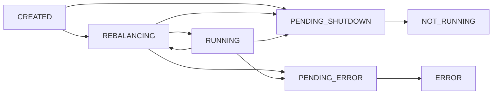

# Operations

Stage 7's operating half compressed for lookup. [Lesson 17](../lessons/0017-operating-and-monitoring-a-streams-app.md) covers states, handlers, metrics, health endpoints and the operator tools; [lesson 15](../lessons/0015-rebalancing-restoration-and-standby-replicas.md) covers the restoration time the restore metrics measure.

Values were read from the Apache Kafka 4.3 documentation and, where named, the 4.3 source. Each row names its page; check it for the current value.

## Client states

`KafkaStreams.State`, read with `KafkaStreams#state()` or the client `state` metric ([KafkaStreams.State javadoc](https://kafka.apache.org/43/javadoc/org/apache/kafka/streams/KafkaStreams.State.html)).

| State | Meaning | Health check |
|---|---|---|
| `CREATED` | Built, `start()` not called | Not ready |
| `REBALANCING` | At least one thread is rebalancing or restoring active tasks | Live, not ready |
| `RUNNING` | Every thread running, every active task restored | Live and ready |
| `PENDING_SHUTDOWN` | `close()` called, releasing resources | Shutting down |
| `NOT_RUNNING` | Closed cleanly | Not live |
| `PENDING_ERROR` | Closing after a fatal error; not recoverable | Not live |
| `ERROR` | All stream threads or the global thread died; only a restart recovers | Not live |

## Stream thread states

Internal `StreamThread.State`, read through `KafkaStreams#metadataForLocalThreads()` and `ThreadMetadata#threadState()`, or the thread `state` metric ([StreamThread source, 4.3](https://github.com/apache/kafka/blob/4.3/streams/src/main/java/org/apache/kafka/streams/processor/internals/StreamThread.java)).

| State | Meaning |
|---|---|
| `CREATED` | Thread object built |
| `STARTING` | Thread started, joining the group |
| `PARTITIONS_REVOKED` | Giving up tasks in a rebalance |
| `PARTITIONS_ASSIGNED` | Received tasks, restoring their state |
| `RUNNING` | Processing |
| `PENDING_SHUTDOWN` | Closing |
| `DEAD` | Stopped |

## Hooks set before `start()`

| Hook | What it does | Page |
|---|---|---|
| `setStateListener(listener)` | Called with the new and old client state on every transition | [KafkaStreams javadoc](https://kafka.apache.org/43/javadoc/org/apache/kafka/streams/KafkaStreams.html) |
| `setUncaughtExceptionHandler(handler)` | Decides what happens when an exception escapes a stream thread | [KafkaStreams javadoc](https://kafka.apache.org/43/javadoc/org/apache/kafka/streams/KafkaStreams.html) |
| `setGlobalStateRestoreListener(listener)` | Told the offsets and progress of every store restoration | [KafkaStreams javadoc](https://kafka.apache.org/43/javadoc/org/apache/kafka/streams/KafkaStreams.html) |

| Uncaught handler response | Effect | Trap |
|---|---|---|
| `REPLACE_THREAD` | A new thread replaces the failed one | A record that always fails kills every replacement; the client never reaches `ERROR` |
| `SHUTDOWN_CLIENT` | This instance closes to `ERROR`; the default when no handler is set | Its tasks move to the other instances, which may then fail on the same record |
| `SHUTDOWN_APPLICATION` | Every instance is asked to shut down | Sent through a stream thread; from the global thread with none alive, the client only closes to `ERROR` |

Sources: [StreamThreadExceptionResponse javadoc](https://kafka.apache.org/43/javadoc/org/apache/kafka/streams/errors/StreamsUncaughtExceptionHandler.StreamThreadExceptionResponse.html), [KafkaStreams source, 4.3](https://github.com/apache/kafka/blob/4.3/streams/src/main/java/org/apache/kafka/streams/KafkaStreams.java).

## Exception handlers

| Setting | Called when | Default | Continue instead with |
|---|---|---|---|
| `deserialization.exception.handler` | A source record fails its Serde | `LogAndFailExceptionHandler` | `LogAndContinueExceptionHandler` |
| `processing.exception.handler` | Processor code throws for a record | `LogAndFailProcessingExceptionHandler` | `LogAndContinueProcessingExceptionHandler` |
| `production.exception.handler` | A write or its serializer fails | `DefaultProductionExceptionHandler` (fails) | A custom handler; `RETRY` only for retriable exceptions |
| `errors.dead.letter.queue.topic.name` | Since 4.2: built-in handlers attach the failed record's raw key and value for this topic | `null` | Pair with a continue handler; the fail handlers attach the record and still fail |
| `processing.exception.handler.global.enabled` | Applies the processing handler to global stores; deprecated, to become always on in 5.0 | `false` | `true`; global stores get no dead letter queue |

A handler answers `Response.resume()` or `Response.fail()`, each optionally carrying dead letter records. Resume skips the record and counts it in `dropped-records`; fail kills the thread and hands over to the uncaught handler. The `default.`-prefixed handler names are deprecated since 4.0. Sources: [Kafka Streams Configs](https://kafka.apache.org/43/configuration/kafka-streams-configs/) (trust it over the developer guide's table for the deserialization default), [Configuring a Streams Application](https://kafka.apache.org/43/streams/developer-guide/config-streams/), [Upgrade Guide](https://kafka.apache.org/43/streams/upgrade-guide/) (KIP-1034).

## Metrics to alert on

`metrics.recording.level`: `INFO` (default), `DEBUG`, `TRACE`. All rows are `INFO` unless marked. Source: [Streams Monitoring](https://kafka.apache.org/43/operations/monitoring/#streams-monitoring).

| Metric | Level, MBean type | Watch for |
|---|---|---|
| `state`, `client-state` | Client, `stream-metrics` | Anything but `RUNNING`, or `REBALANCING` longer than a restore takes |
| `alive-stream-threads` | Client, `stream-metrics` | Below `num.stream.threads` |
| `failed-stream-threads` | Client, `stream-metrics` | Any increase |
| `records-lag-max` | Consumer, `consumer-fetch-manager-metrics` | Sustained growth; computed from the current position, not the committed offset |
| `process-rate`, `process-total` | Thread, `stream-thread-metrics` | Zero while input arrives |
| `commit-latency-avg`, `commit-latency-max` | Thread, `stream-thread-metrics` | Rising, especially under exactly-once |
| `poll-latency-avg`, `process-latency-avg` | Thread, `stream-thread-metrics` | Where a slow loop spends its time |
| `dropped-records-total`, `dropped-records-rate` | Task, `stream-task-metrics` | Any unplanned increase: skipped bad records and late window records |
| `record-lateness-max` | Task, `DEBUG` | Sizing a grace period from data |
| `record-e2e-latency-avg`, `-max` | Processor node (source and terminal nodes) | Output older than its consumers accept |
| `restore-rate`, `restore-latency-avg` | State store, `DEBUG` | Too slow for the recovery time you sized for |
| `suppression-buffer-size-max`, `suppression-buffer-count-max` | Suppression buffer, `DEBUG` | Growth toward the buffer's bound |
| `block-cache-usage`, `size-all-mem-tables`, `estimate-num-keys` | RocksDB properties, recorded when read | Off-heap memory near the container limit |
| `tasks-revoked-latency-max`, `tasks-assigned-latency-max` | Thread; streams protocol only | Slow rebalance callbacks |

## Health and data endpoints

| Endpoint | Condition | Why |
|---|---|---|
| Liveness | `state()` is not `ERROR` or `NOT_RUNNING` | Restarting a restoring instance restarts its restoration |
| Readiness | `state()` is `RUNNING` | Every active task is restored and queryable |
| Data | `store(StoreQueryParameters.fromNameAndType(name, type))`, then `get(key)` | Throws `InvalidStateStoreException` when not queryable: return a retryable error |
| Routing | `queryMetadataForKey(store, key, serializer)` | Needs `application.server` on every instance; the forwarding RPC is yours |

Sources: [Interactive Queries](https://kafka.apache.org/43/streams/developer-guide/interactive-queries/), [KafkaStreams javadoc](https://kafka.apache.org/43/javadoc/org/apache/kafka/streams/KafkaStreams.html).

## Operator tools

| Task | Streams protocol (`group.protocol=streams`) | Classic protocol |
|---|---|---|
| List groups | `kafka-streams-groups.sh --list` | `kafka-consumer-groups.sh --list` |
| Group state and epochs | `kafka-streams-groups.sh --describe --group <app.id> --state --verbose` | `kafka-consumer-groups.sh --describe --group <app.id> --state` |
| Members and assignments | `--describe --group <app.id> --members --verbose` | `kafka-consumer-groups.sh --describe --group <app.id> --members` |
| Lag | `--describe --group <app.id> --offsets` (input and repartition topics) | `kafka-consumer-groups.sh --describe --group <app.id>` |
| Rewind input | `--reset-offsets --all-input-topics --to-earliest --dry-run`, then `--execute`; instances stopped | `kafka-streams-application-reset.sh --application-id <app.id> --input-topics ... --dry-run` |
| Drop internal topics | `--delete --group <app.id> --internal-topics ...` | The reset tool deletes them by default |
| Wipe local state | `KafkaStreams#cleanUp()` or delete the state directory, on every machine | Same |

Streams group states: `Empty`, `Not Ready` (a source or internal topic is missing; members get empty assignments), `Assigning`, `Reconciling`, `Stable`, `Dead`. Sources: [Kafka Streams Groups Tool](https://kafka.apache.org/43/streams/developer-guide/kafka-streams-group-sh/), [Application Reset Tool](https://kafka.apache.org/43/streams/developer-guide/app-reset-tool/), [Streams Rebalance Protocol](https://kafka.apache.org/43/streams/developer-guide/streams-rebalance-protocol/).

## Diagnostic order

1. Client `state` and `alive-stream-threads`: is the instance up, and are all threads alive?
2. `failed-stream-threads`: rising with alive steady means `REPLACE_THREAD` is looping on one record. Read the log for the exception.
3. `records-lag-max` per instance: one instance or all? One points at that instance or its partitions; all points at input rate or the brokers.
4. `process-rate` against the input rate, then `commit-latency-*` and `poll-latency-*` for where the time goes.
5. `dropped-records-total`: is data being lost while everything looks green?
6. `REBALANCING` for long: restoration. Check `restore-rate` and the standby count (lesson 15).
