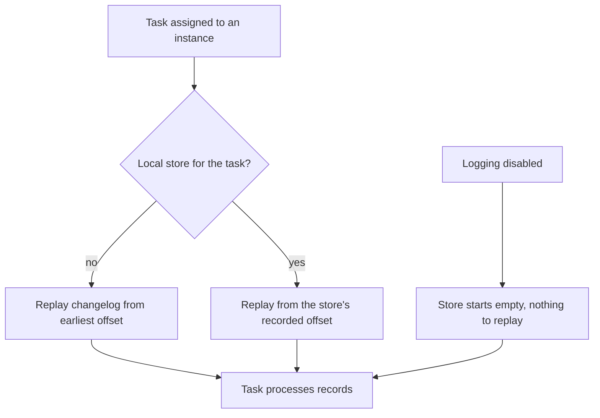

# State Stores

Stage 3 compressed for lookup. [Lesson 5](../lessons/0005-state-stores-and-changelog-topics.md) covers store types, changelog topics and restoration; [lesson 6](../lessons/0006-aggregations-ktables-and-the-record-cache.md) covers aggregations, KTable updates and the record cache; [lesson 7](../lessons/0007-the-processor-api.md) covers custom processors, their stores and punctuators.

Defaults and names were read from the Apache Kafka 4.3 documentation and javadoc. Each row names its page; check it for the current value.

## Store shapes

| Shape | Holds | DSL operations that create it | `Stores` supplier | Page |
|---|---|---|---|---|
| Key-value | One value per key | Unwindowed `count`, `reduce`, `aggregate`; a materialized `table()` | `persistentKeyValueStore`, `persistentTimestampedKeyValueStore`, `inMemoryKeyValueStore` | [Processor API](https://kafka.apache.org/43/streams/developer-guide/processor-api/) |
| Window | One value per key per window | `windowedBy(TimeWindows...)` or `SlidingWindows` aggregations | `persistentWindowStore`, `persistentTimestampedWindowStore`, `inMemoryWindowStore` | [Stores javadoc](https://kafka.apache.org/43/javadoc/org/apache/kafka/streams/state/Stores.html) |
| Session | One value per key per session | `windowedBy(SessionWindows...)` aggregations | `persistentSessionStore`, `inMemorySessionStore` | [Stores javadoc](https://kafka.apache.org/43/javadoc/org/apache/kafka/streams/state/Stores.html) |
| Versioned key-value | Several timestamped versions per key, within history retention | Opt in by passing a versioned supplier | `persistentVersionedKeyValueStore` (RocksDB only; no caching, no interactive queries) | [Processor API](https://kafka.apache.org/43/streams/developer-guide/processor-api/) |

KTables store timestamps by default. Header-aware variants (`...WithHeaders`) exist for persistent timestamped key-value, timestamped window and session stores.

## RocksDB or in-memory

| | RocksDB | In-memory | Page |
|---|---|---|---|
| Data in | Local disk under `state.dir` | JVM heap | [Processor API](https://kafka.apache.org/43/streams/developer-guide/processor-api/) |
| Capacity | Larger than memory; bounded by disk | Bounded by heap | [Processor API](https://kafka.apache.org/43/streams/developer-guide/processor-api/) |
| DSL default | Yes (`dsl.store.suppliers.class`) | `Materialized.withStoreType(Materialized.StoreType.IN_MEMORY)` | [Configuring a Streams Application](https://kafka.apache.org/43/streams/developer-guide/config-streams/), [Materialized javadoc](https://kafka.apache.org/43/javadoc/org/apache/kafka/streams/kstream/Materialized.html) |
| Restart on the same host | Replays changelog from the store's recorded offset | Replays the whole changelog | [Running Streams Applications](https://kafka.apache.org/43/streams/developer-guide/running-app/) |
| Memory to tune | Off-heap block cache and memtables per store, via `rocksdb.config.setter` | Heap and GC | [Memory Management](https://kafka.apache.org/43/streams/developer-guide/memory-mgmt/) |
| Pick when | Almost always | No usable local disk, or disk wiped between restarts anyway, and the state is small | [Processor API](https://kafka.apache.org/43/streams/developer-guide/processor-api/) |

## Configuring a store

| Want | DSL (`Materialized`) | Processor API (`StoreBuilder`) |
|---|---|---|
| Name it (and its changelog) | `Materialized.as("name")` | The supplier's name, `Stores.persistentKeyValueStore("name")` |
| Serdes | `.withKeySerde(...)`, `.withValueSerde(...)`; never `with(...)` after `as(...)`, which drops the name | `Stores.keyValueStoreBuilder(supplier, keySerde, valueSerde)` |
| Engine | `.withStoreType(Materialized.StoreType.IN_MEMORY)` or `as(supplier)` | Choose the supplier |
| Logging | On by default; `.withLoggingDisabled()`, `.withLoggingEnabled(Map)` | On by default; same two methods |
| Caching | On by default; `.withCachingDisabled()` | Off by default; `.withCachingEnabled()` |
| Window or session retention | `.withRetention(Duration)`; default window size plus grace | The supplier's `retentionPeriod` |

Pages: [Materialized javadoc](https://kafka.apache.org/43/javadoc/org/apache/kafka/streams/kstream/Materialized.html), [StoreBuilder javadoc](https://kafka.apache.org/43/javadoc/org/apache/kafka/streams/state/StoreBuilder.html), [Processor API](https://kafka.apache.org/43/streams/developer-guide/processor-api/). The `StoreBuilder` caching default is from the 4.3 source, [`AbstractStoreBuilder`](https://github.com/apache/kafka/blob/4.3/streams/src/main/java/org/apache/kafka/streams/state/internals/AbstractStoreBuilder.java); the Memory Management page words it ambiguously.

## Changelog topics

Name: `<application.id>-<store name>-changelog`. An unnamed DSL store gets a generated name such as `KSTREAM-AGGREGATE-STATE-STORE-0000000001`, which shifts when operators are added upstream.

| Store | `cleanup.policy` | Retention | Page |
|---|---|---|---|
| Key-value | `compact` | Not time-based | [Managing Streams Application Topics](https://kafka.apache.org/43/streams/developer-guide/manage-topics/) |
| Window, session | `compact,delete` | Store retention plus `windowstore.changelog.additional.retention.ms` (default 86,400,000, 1 day) | [Managing Streams Application Topics](https://kafka.apache.org/43/streams/developer-guide/manage-topics/), [Configuring a Streams Application](https://kafka.apache.org/43/streams/developer-guide/config-streams/) |
| Versioned key-value | `compact` | `min.compaction.lag.ms` set to history retention plus 24 hours | [Managing Streams Application Topics](https://kafka.apache.org/43/streams/developer-guide/manage-topics/) |
| Source KTable with `reuse.ktable.source.topics` | No changelog; the input topic is reused | The input topic's own settings | [Configuring a Streams Application](https://kafka.apache.org/43/streams/developer-guide/config-streams/) |

Example: a 5-minute tumbling window with no grace gives a changelog retention of 300,000 + 86,400,000 = 86,700,000 ms.

| Setting | Default | Effect | Page |
|---|---|---|---|
| `replication.factor` | `-1` (broker default) | Replication of changelog and repartition topics; 3 recommended | [Configuring a Streams Application](https://kafka.apache.org/43/streams/developer-guide/config-streams/) |
| `withLoggingDisabled()` | Logging on | No changelog: no fault tolerance, no standby replicas; a moved task starts empty | [Processor API](https://kafka.apache.org/43/streams/developer-guide/processor-api/) |
| `withLoggingEnabled(Map)` | Empty map | Extra topic configs for this store's changelog; unrecognized keys ignored | [StoreBuilder javadoc](https://kafka.apache.org/43/javadoc/org/apache/kafka/streams/state/StoreBuilder.html) |
| `topology.optimization` | `none` | `reuse.ktable.source.topics`, `merge.repartition.topics`, `single.store.self.join`, or `all`; only applied when the same properties are passed to `StreamsBuilder.build(props)` | [Configuring a Streams Application](https://kafka.apache.org/43/streams/developer-guide/config-streams/) |

## The record cache

| Setting | Default | Effect | Page |
|---|---|---|---|
| `statestore.cache.max.bytes` | 10,485,760 (10 MiB) per instance | Split evenly over stream threads (C/T each); 0 disables caching. Replaces deprecated `cache.max.bytes.buffering` | [Configuring a Streams Application](https://kafka.apache.org/43/streams/developer-guide/config-streams/) |
| `commit.interval.ms` | 30,000 at-least-once; 100 under `exactly_once_v2` | Flushes the cache at every commit | [Configuring a Streams Application](https://kafka.apache.org/43/streams/developer-guide/config-streams/) |

| Behaviour | DSL store | Processor API store | Page |
|---|---|---|---|
| Compacts writes to the store and changelog | Yes | Yes, when caching is enabled | [Memory Management](https://kafka.apache.org/43/streams/developer-guide/memory-mgmt/) |
| Compacts records forwarded downstream | Yes | No: every `forward` goes through | [Memory Management](https://kafka.apache.org/43/streams/developer-guide/memory-mgmt/) |
| Flushes when | The commit interval passes or LRU eviction under pressure, whichever is first | Same | [Memory Management](https://kafka.apache.org/43/streams/developer-guide/memory-mgmt/) |
| In `TopologyTestDriver` | No effect: behaves as cache 0 and a commit after every record | Same | [TopologyTestDriver javadoc](https://kafka.apache.org/43/javadoc/org/apache/kafka/streams/TopologyTestDriver.html) |

Seven updates to three keys inside one commit interval: 7 output records with the cache off, 3 with it on.

## Aggregations

| Operation | On a grouped stream | On a grouped table | Page |
|---|---|---|---|
| `count()` | Null keys or values ignored | Tombstones remove the record's contribution | [Streams DSL](https://kafka.apache.org/43/streams/developer-guide/dsl-api/#stateful-transformations) |
| `reduce` | Adder; first value is the initial aggregate | Adder and subtractor | [Streams DSL](https://kafka.apache.org/43/streams/developer-guide/dsl-api/#stateful-transformations) |
| `aggregate` | Initializer and adder; result type may differ | Initializer, adder and subtractor | [Streams DSL](https://kafka.apache.org/43/streams/developer-guide/dsl-api/#stateful-transformations) |

Grouped table calls: insert, adder only; update, subtractor with the old value then adder with the new (order guaranteed only when both map to the same key); tombstone, subtractor only; a subtractor returning null removes the key.

| Grouping | Repartitions | Page |
|---|---|---|
| `KStream#groupByKey()` | Only if the stream was marked by an earlier key change (`selectKey`, `map`, `flatMap`, `process`) | [Streams DSL](https://kafka.apache.org/43/streams/developer-guide/dsl-api/#stateful-transformations) |
| `KStream#groupBy()` | Always | [Streams DSL](https://kafka.apache.org/43/streams/developer-guide/dsl-api/#stateful-transformations) |
| `KTable#groupBy()` | Always | [Streams DSL](https://kafka.apache.org/43/streams/developer-guide/dsl-api/#stateful-transformations) |

## Processor API stores and punctuators

| Item | Rule | Page |
|---|---|---|
| Attach | `builder.addStateStore(storeBuilder)` then `process(supplier, "name")`, or return builders from `ConnectedStoreProvider#stores()` | [Processor API](https://kafka.apache.org/43/streams/developer-guide/processor-api/) |
| Access | `context.getStateStore("name")` in `init`; one shard per task, never shared | [ProcessingContext javadoc](https://kafka.apache.org/43/javadoc/org/apache/kafka/streams/processor/api/ProcessingContext.html) |
| Iterators | Close every one (try-with-resources) or memory leaks | [Processor API](https://kafka.apache.org/43/streams/developer-guide/processor-api/) |
| `close()` | Do not close stores; do not write to Kafka | [Processor javadoc](https://kafka.apache.org/43/javadoc/org/apache/kafka/streams/processor/api/Processor.html) |
| Supplier | `get()` returns a new processor each call; a shared instance throws `IllegalArgumentException` | [Processor API](https://kafka.apache.org/43/streams/developer-guide/processor-api/) |
| `process()` | Key-changing: marks the stream for repartitioning; never repartitions its own input | [KStream javadoc](https://kafka.apache.org/43/javadoc/org/apache/kafka/streams/kstream/KStream.html) |
| `processValues()` | Key fixed: no repartition downstream; cannot forward from a punctuator | [KStream javadoc](https://kafka.apache.org/43/javadoc/org/apache/kafka/streams/kstream/KStream.html) |

| | `PunctuationType.STREAM_TIME` | `PunctuationType.WALL_CLOCK_TIME` |
|---|---|---|
| Clock | Largest record timestamp seen by the task | System time, checked as the loop polls |
| Without input | Never fires | Fires |
| When one record jumps stream time forward | Fires once, with the new stream time | Unaffected by record timestamps |
| On reprocessing | Matches the original run | Depends on replay speed |
| In `TopologyTestDriver` | Fired by `pipeInput` | Fired by `advanceWallClockTime` |

Pages: [Processor API](https://kafka.apache.org/43/streams/developer-guide/processor-api/), [PunctuationType javadoc](https://kafka.apache.org/43/javadoc/org/apache/kafka/streams/processor/PunctuationType.html), [Testing a Streams Application](https://kafka.apache.org/43/streams/developer-guide/testing/).

## Local state directory

| Item | Value | Page |
|---|---|---|
| `state.dir` default | `${java.io.tmpdir}/kafka-streams`; move it to a persistent volume | [Configuring a Streams Application](https://kafka.apache.org/43/streams/developer-guide/config-streams/) |
| Layout | `<state.dir>/<application.id>/<sub-topology>_<partition>/rocksdb/<store>`; window stores in `<task>/<store>/` segments | Observed on a 4.3 run |
| `state.cleanup.delay.ms` | 600,000 (10 minutes) before a migrated task's state is deleted | [Configuring a Streams Application](https://kafka.apache.org/43/streams/developer-guide/config-streams/) |
| Changelog offset (4.3) | Stored inside RocksDB, durable on memtable flush or clean close; downgrading to 4.2 needs the directory wiped | [Memory Management](https://kafka.apache.org/43/streams/developer-guide/memory-mgmt/), [Upgrade Guide](https://kafka.apache.org/43/streams/upgrade-guide/) |

## Restoration

- The task processes nothing until every store of it is restored ([Running Streams Applications](https://kafka.apache.org/43/streams/developer-guide/running-app/)).
- Restore time scales with the changelog partition's size after compaction; standby replicas (`num.standby.replicas`, default 0, 1 recommended) keep a copy current to avoid it ([Architecture](https://kafka.apache.org/43/streams/architecture/)).
- Observe it with `KafkaStreams#setGlobalStateRestoreListener` and a `StateRestoreListener` (`onRestoreStart`, `onBatchRestored`, `onRestoreEnd`).

## Traps worth checking

- A count or balance stored with `withLoggingDisabled()`: correct until the first failover, then silently restarted from zero.
- `state.dir` left at its default in a container, turning every restart into a full restore.
- An in-memory store holding a large state, restored in full on every deploy.
- `reuse.ktable.source.topics` on an input topic with `cleanup.policy=delete`, so restored instances lose keys that running ones still hold.
- `topology.optimization` set but `build()` called without the properties, so nothing is optimized.
- `Materialized.as("name").with(keySerde, valueSerde)`, which drops the name and falls back to a generated one.
- A consumer summing a KTable's output records instead of reading them as a table.
- A unit test asserting the number of output records, which `TopologyTestDriver` reports without caching.
- A processor store that nothing ever deletes from.
- `process()` where `processValues()` would do, adding a repartition topic downstream.
- A wall-clock punctuator compared against event timestamps, which expires everything during a replay.

## Sources

- [Docs: "Processor API", Apache Kafka 4.3](https://kafka.apache.org/43/streams/developer-guide/processor-api/)
- [Docs: "Memory Management", Apache Kafka 4.3](https://kafka.apache.org/43/streams/developer-guide/memory-mgmt/)
- [Docs: "Managing Streams Application Topics", Apache Kafka 4.3](https://kafka.apache.org/43/streams/developer-guide/manage-topics/)
- [Docs: "Running Streams Applications", Apache Kafka 4.3](https://kafka.apache.org/43/streams/developer-guide/running-app/)
- [Docs: "Configuring a Streams Application", Apache Kafka 4.3](https://kafka.apache.org/43/streams/developer-guide/config-streams/)
- [Docs: "Streams DSL", Apache Kafka 4.3](https://kafka.apache.org/43/streams/developer-guide/dsl-api/)
- [Docs: "Architecture", Apache Kafka 4.3](https://kafka.apache.org/43/streams/architecture/)
- [Javadoc: "TopologyTestDriver", Apache Kafka 4.3](https://kafka.apache.org/43/javadoc/org/apache/kafka/streams/TopologyTestDriver.html)
- [Resources](../RESOURCES.md)
