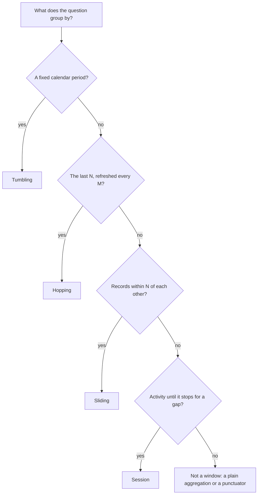

# Time and Windows

Stage 4 compressed for lookup: [lesson 8](../lessons/0008-event-time-processing-time-and-stream-time.md) (the clocks, timestamp extractors and stream time), [lesson 9](../lessons/0009-windowed-aggregations.md) (the four window types, windowed keys and retention) and [lesson 10](../lessons/0010-late-data-grace-periods-and-suppression.md) (grace periods, late records and final results).

Defaults and method names were read from the Apache Kafka 4.3 documentation, javadoc and source. Each row names its page; check it for the current value.

## The clocks

| Clock | What it measures | Where it comes from | Page |
|---|---|---|---|
| Event time | When the event happened at its source | The producer's record timestamp under `CreateTime`, or a payload field read by a custom extractor | [Core Concepts](https://kafka.apache.org/43/streams/core-concepts/) |
| Ingestion time | When a broker appended the record | The record timestamp under `LogAppendTime`, set by the broker | [Core Concepts](https://kafka.apache.org/43/streams/core-concepts/) |
| Processing time | The wall clock when the processor handles the record | `WallclockTimestampExtractor`, or `currentSystemTimeMs()` in a processor | [Core Concepts](https://kafka.apache.org/43/streams/core-concepts/) |
| Stream time | The largest record timestamp a task has seen, the current record included | Derived by Streams from extracted timestamps; per task, preserved across restarts and task migration | [ProcessingContext](https://kafka.apache.org/43/javadoc/org/apache/kafka/streams/processor/api/ProcessingContext.html) |

Stream time only moves forward, and only when a record arrives. It is what closes windows, evicts suppression buffers and fires stream-time punctuators. Flink's equivalent progress signal is a watermark, which Kafka Streams does not have: see [Timely Stream Processing](https://nightlies.apache.org/flink/flink-docs-stable/docs/concepts/time/).

## Record timestamps

| Setting | Scope | Values | Page |
|---|---|---|---|
| `log.message.timestamp.type` | Broker | `CreateTime` (default), `LogAppendTime` | [Configuring a Streams Application](https://kafka.apache.org/43/streams/developer-guide/config-streams/) |
| `message.timestamp.type` | Topic | `CreateTime`, `LogAppendTime` | [Configuring a Streams Application](https://kafka.apache.org/43/streams/developer-guide/config-streams/) |
| `default.timestamp.extractor` | Streams app | `FailOnInvalidTimestamp` (default) | [Kafka Streams Configs](https://kafka.apache.org/43/configuration/kafka-streams-configs/) |
| `Consumed#withTimestampExtractor` | One source topic | Any `TimestampExtractor` | [Consumed](https://kafka.apache.org/43/javadoc/org/apache/kafka/streams/kstream/Consumed.html) |

### Built-in extractors

| Extractor | Returns | On a negative timestamp |
|---|---|---|
| `FailOnInvalidTimestamp` | Record timestamp | Throws; the app stops |
| `LogAndSkipOnInvalidTimestamp` | Record timestamp | Logs a warning; record dropped |
| `UsePartitionTimeOnInvalidTimestamp` | Record timestamp | Uses the partition's highest timestamp so far; throws if none |
| `WallclockTimestampExtractor` | `System.currentTimeMillis()` | Not applicable; gives processing-time semantics |

A custom extractor implements `long extract(ConsumerRecord<Object, Object> record, long partitionTime)`, must be stateless, and must return epoch milliseconds. A negative return skips the record silently; an exception stops the app. Its value can become the timestamp of changelog and output records, which brokers use for retention and log rolling. Page: [TimestampExtractor](https://kafka.apache.org/43/javadoc/org/apache/kafka/streams/processor/TimestampExtractor.html).

### Timestamps on output records

| Produced by | Timestamp |
|---|---|
| Stateless operations, `flatMap` included | Input record's |
| `forward()` in a processor | Input record's, unless set with `Record#withTimestamp` |
| A punctuator | The task's current internal time |
| An aggregation | Maximum of the contributing input timestamps, per key, per window if windowed |
| Stream-stream or table-table join | `max(left.ts, right.ts)` |
| Stream-table join | The stream record's |

Page: [Core Concepts](https://kafka.apache.org/43/streams/core-concepts/).

## The four window types

| Window | Constructor | Boundaries | A record falls in | Answers |
|---|---|---|---|---|
| Tumbling | `TimeWindows.ofSizeWithNoGrace(size)`, `ofSizeAndGrace(size, grace)` | Epoch-aligned `[N * size, N * size + size)`, end exclusive | Exactly one window | How much in each fixed period? |
| Hopping | Tumbling plus `.advanceBy(advance)`, advance < size | Epoch-aligned, starting every `advance`, end exclusive | `size / advance` windows, when it divides | The total over the last N, refreshed every M? |
| Sliding | `SlidingWindows.ofTimeDifferenceWithNoGrace(diff)`, `ofTimeDifferenceAndGrace(diff, grace)` | Aligned to record timestamps, both ends inclusive | One window per distinct combination of records within `diff` | Did any span of length N contain this? |
| Session | `SessionWindows.ofInactivityGapWithNoGrace(gap)`, `ofInactivityGapAndGrace(gap, grace)` | Per key, from first to last record of a burst | One session, which grows or merges as records arrive | How long was each burst, and what was in it? |

Pages: [Streams DSL: Windowing](https://kafka.apache.org/43/streams/developer-guide/dsl-api/#windowing), [TimeWindows](https://kafka.apache.org/43/javadoc/org/apache/kafka/streams/kstream/TimeWindows.html), [SlidingWindows](https://kafka.apache.org/43/javadoc/org/apache/kafka/streams/kstream/SlidingWindows.html), [SessionWindows](https://kafka.apache.org/43/javadoc/org/apache/kafka/streams/kstream/SessionWindows.html).

### Worked example to check yourself against

One key, records at 12, 16, 19 and 27 seconds:

| Window | Windows and counts |
|---|---|
| Tumbling, size 10 | `[10,20)`: 3; `[20,30)`: 1 |
| Hopping, size 10, advance 5 | `[5,15)`: 1; `[10,20)`: 3; `[15,25)`: 2; `[20,30)`: 1; `[25,35)`: 1 |
| Sliding, difference 5 | `[7,12]`: 1; `[11,16]`: 2; `[12.001,17.001]`: 1; `[14,19]`: 2; `[16.001,21.001]`: 1; `[22,27]`: 1 |
| Session, gap 5 | `[12,19]`: 3; `[27,27]`: 1; a late record at 23 merges them into `[12,27]`: 5 |

## Windowed results

| Item | Detail | Page |
|---|---|---|
| Shape | `groupByKey()` or `groupBy(...)`, then `windowedBy(...)`, then `count()`, `reduce()` or `aggregate()` | [Streams DSL](https://kafka.apache.org/43/streams/developer-guide/dsl-api/#windowing) |
| Result type | `KTable<Windowed<K>, V>`; `key()` is the original key, `window().start()` and `end()` in ms | [Windowed](https://kafka.apache.org/43/javadoc/org/apache/kafka/streams/kstream/Windowed.html) |
| Writing to a topic | Map the key with `toStream((wk, v) -> ...)`, or use `WindowedSerdes.timeWindowedSerdeFrom(type, sizeMs)` or `sessionWindowedSerdeFrom(type)` | [WindowedSerdes](https://kafka.apache.org/43/javadoc/org/apache/kafka/streams/kstream/WindowedSerdes.html) |
| Session `aggregate()` | Takes a `Merger` as well as an initializer and an aggregator | [SessionWindowedKStream](https://kafka.apache.org/43/javadoc/org/apache/kafka/streams/kstream/SessionWindowedKStream.html) |
| Session merge downstream | A tombstone for each absorbed session, then the merged session | [4.3 source](https://github.com/apache/kafka/blob/4.3/streams/src/main/java/org/apache/kafka/streams/kstream/internals/KStreamSessionWindowAggregate.java) |
| Store retention | `Materialized#withRetention`; default window size plus grace; shorter than size plus grace throws `IllegalArgumentException`. The DSL guide's "one day" default is out of date | [Materialized](https://kafka.apache.org/43/javadoc/org/apache/kafka/streams/kstream/Materialized.html), [4.3 source](https://github.com/apache/kafka/blob/4.3/streams/src/main/java/org/apache/kafka/streams/kstream/internals/WindowStoreMaterializer.java) |

## Grace periods and closing

There is no default grace: `...WithNoGrace` means zero, `...AndGrace` sets it ([KIP-633](https://cwiki.apache.org/confluence/display/KAFKA/KIP-633%3A+Deprecate+24-hour+Default+Grace+Period+for+Windowed+Operations+in+Streams)). A window closes at window end plus grace, in stream time.

| Window | Accepts a record while | Page |
|---|---|---|
| Tumbling, hopping | window end > stream time − grace | [4.3 source](https://github.com/apache/kafka/blob/4.3/streams/src/main/java/org/apache/kafka/streams/kstream/internals/KStreamWindowAggregate.java) |
| Sliding | stream time ≤ window end + grace | [SlidingWindows](https://kafka.apache.org/43/javadoc/org/apache/kafka/streams/kstream/SlidingWindows.html) |
| Session | merged session end + gap + grace ≥ stream time | [4.3 source](https://github.com/apache/kafka/blob/4.3/streams/src/main/java/org/apache/kafka/streams/kstream/internals/KStreamSessionWindowAggregate.java) |

A record for a closed window is dropped: a warning, "Skipping record for expired window", and one more on the task's `dropped-records-total`. An out-of-order record inside grace is counted and the window emits a correction.

| Duration | Decides | Must be |
|---|---|---|
| Grace | How long a window accepts out-of-order records | Your choice: how far behind stream time a record may arrive and still count |
| Retention | How long a window stays in the store and queryable | At least size plus grace; longer never reopens a window |

## When results are emitted

| Mechanism | Emits | Works on | Page |
|---|---|---|---|
| Default | Every update, thinned by the record cache on each commit | Any KTable | [Memory Management](https://kafka.apache.org/43/streams/developer-guide/memory-mgmt/) |
| `suppress(Suppressed.untilWindowCloses(strictBuffer))` | One final result per key per window, at window close | Windowed KTables | [Suppressed](https://kafka.apache.org/43/javadoc/org/apache/kafka/streams/kstream/Suppressed.html) |
| `suppress(Suppressed.untilTimeLimit(duration, buffer))` | Latest value per key once `duration` of stream time has passed since its first buffered update | Any KTable | [Suppressed](https://kafka.apache.org/43/javadoc/org/apache/kafka/streams/kstream/Suppressed.html), [KIP-328](https://cwiki.apache.org/confluence/display/KAFKA/KIP-328%3A+Ability+to+suppress+updates+for+KTables) |
| `windowedBy(...).emitStrategy(EmitStrategy.onWindowClose())` | One final result per window, at window close, from the window store; no extra buffer or changelog | Time-windowed (tumbling, hopping, sliding) and session-windowed aggregations | [EmitStrategy](https://kafka.apache.org/43/javadoc/org/apache/kafka/streams/kstream/EmitStrategy.html), [KIP-825](https://cwiki.apache.org/confluence/display/KAFKA/KIP-825%3A+introduce+a+new+API+to+control+when+aggregated+results+are+produced) |

### Suppression buffer configs

| Config | When full | Strict | Accepted by `untilWindowCloses` |
|---|---|---|---|
| `BufferConfig.unbounded()` | Never; may end in `OutOfMemoryError` | Yes | Yes |
| `maxRecords(n)` or `maxBytes(n)`, then `.shutDownWhenFull()` | Shuts the app down | Yes | Yes |
| `maxRecords(n)` or `maxBytes(n)`, then `.emitEarlyWhenFull()` | Emits the oldest early; duplicates possible | No | No |

The buffer has a changelog unless `withLoggingDisabled()`, which loses it on a rebalance. Page: [Suppressed.BufferConfig](https://kafka.apache.org/43/javadoc/org/apache/kafka/streams/kstream/Suppressed.BufferConfig.html).

## Metrics

| Metric | Level | Scope | Tells you |
|---|---|---|---|
| `dropped-records-total`, `dropped-records-rate` | info | Task | Records dropped, late ones included |
| `record-lateness-avg`, `record-lateness-max` | debug | Task | Stream time minus record timestamp |
| `suppression-emit-rate`, `suppression-emit-total` | debug | Suppression node | Final or rate-limited results sent on |
| `suppression-buffer-size-*`, `suppression-buffer-count-*` | debug | Suppression buffer | How close the buffer is to its bound |
| `emit-final-records-total`, `emit-final-latency-max` | debug | Windowed aggregation node | Results emitted by `onWindowClose` |

Page: [Streams Monitoring](https://kafka.apache.org/43/operations/monitoring/#streams-monitoring).

## Traps worth checking

- `WallclockTimestampExtractor` chosen to dodge bad producer clocks: every replay and every catch-up after an outage produces different windows.
- `CreateTime` assumed to be event time when the producer never sets the timestamp, so it records send time.
- A window that never emits a final result because its partition went quiet: stream time stops with the last record.
- A test that pipes a few records and expects a final result, without a later record to push stream time past window end plus grace.
- One far-future timestamp, which jumps a task's stream time and closes every open window on it.
- `ofSizeWithNoGrace` on data that is ever out of order: every record behind a window's end is dropped.
- Retention raised in the hope of accepting later records: retention keeps windows, grace accepts records.
- A session-windowed result consumed by something that ignores tombstones, which keeps counting merged sessions.
- `emitEarlyWhenFull()` in a pipeline whose consumer assumes each window arrives once.

## Sources

- [Docs: "Core Concepts", Apache Kafka 4.3](https://kafka.apache.org/43/streams/core-concepts/)
- [Docs: "Configuring a Streams Application", Apache Kafka 4.3](https://kafka.apache.org/43/streams/developer-guide/config-streams/)
- [Docs: "Streams DSL", Apache Kafka 4.3](https://kafka.apache.org/43/streams/developer-guide/dsl-api/)
- [Javadoc: "TimeWindows", Apache Kafka 4.3](https://kafka.apache.org/43/javadoc/org/apache/kafka/streams/kstream/TimeWindows.html)
- [Javadoc: "Suppressed", Apache Kafka 4.3](https://kafka.apache.org/43/javadoc/org/apache/kafka/streams/kstream/Suppressed.html)
- [Javadoc: "EmitStrategy", Apache Kafka 4.3](https://kafka.apache.org/43/javadoc/org/apache/kafka/streams/kstream/EmitStrategy.html)
- [Docs: "Streams Monitoring", Apache Kafka 4.3](https://kafka.apache.org/43/operations/monitoring/#streams-monitoring)
- [KIP: "KIP-328: Ability to suppress updates for KTables", Apache Kafka](https://cwiki.apache.org/confluence/display/KAFKA/KIP-328%3A+Ability+to+suppress+updates+for+KTables)
- [KIP: "KIP-450: Sliding Window Aggregations in the DSL", Apache Kafka](https://cwiki.apache.org/confluence/display/KAFKA/KIP-450%3A+Sliding+Window+Aggregations+in+the+DSL)
- [KIP: "KIP-633: Deprecate 24-hour Default Grace Period for Windowed Operations in Streams", Apache Kafka](https://cwiki.apache.org/confluence/display/KAFKA/KIP-633%3A+Deprecate+24-hour+Default+Grace+Period+for+Windowed+Operations+in+Streams)
- [KIP: "KIP-825: introduce a new API to control when aggregated results are produced", Apache Kafka](https://cwiki.apache.org/confluence/display/KAFKA/KIP-825%3A+introduce+a+new+API+to+control+when+aggregated+results+are+produced)
- [Resources](../RESOURCES.md)
