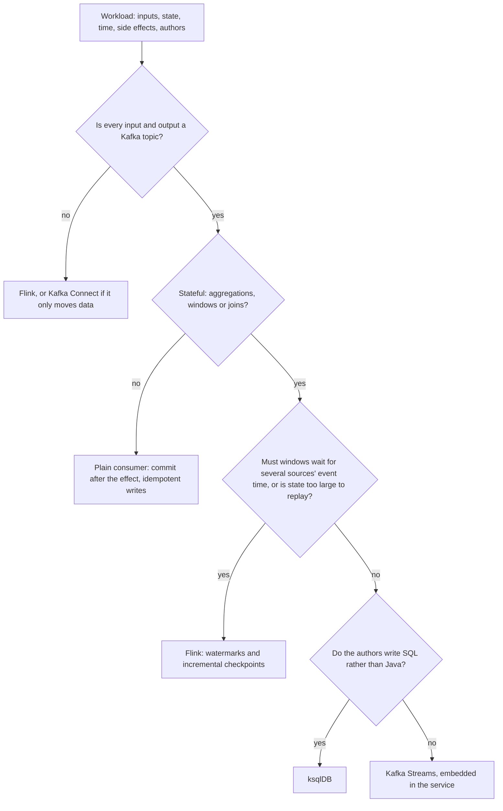
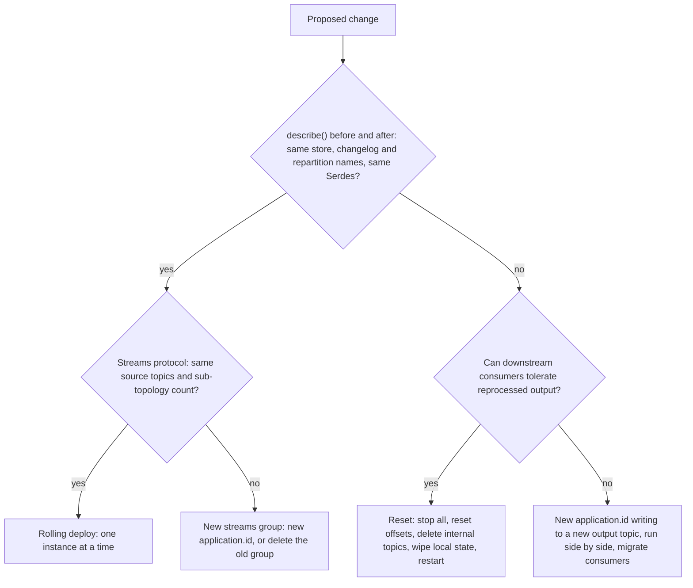

# Topology Review

Stage 8 compressed for lookup. [Lesson 18](../lessons/0018-when-kafka-streams-is-the-wrong-tool.md) covers choosing between Kafka Streams, a plain consumer, Flink and ksqlDB, [lesson 19](../lessons/0019-reviewing-someone-elses-topology.md) works a review from `describe()` output, and [lesson 20](../lessons/0020-changing-a-topology-others-depend-on.md) covers changing a running topology; this sheet is the checklist, the decision and the change table.

Kafka Streams values come from the Apache Kafka 4.3 documentation and, where a row says so, a 4.3.1 run or the 4.3 source. Check the named page for the current value.

## Review order

1. Print `Topology#describe()`.
2. Count sub-topologies (ignore the global one for tasks), stores and sinks that write to `-repartition` topics.
3. Derive every internal topic: name, partitions, cleanup policy.
4. Read the code behind each internal topic and each store.
5. Write each finding as: choice, cost (topics, bytes per record, disk, memory, latency or correctness), fix, what the fix leaves alone.
6. Say "checked, fine at this size" for what you looked at and did not flag.

## Counting internal topics

| Source of the topic | Name | Partitions | Cleanup |
|---|---|---|---|
| Grouping or join after a key-changing operation | `<app.id>-<name>-repartition` | Largest source partition count upstream, unless set with `Repartitioned` | `delete`, retention `-1`, purged by Streams after commit |
| Key-value store (aggregation, table) | `<app.id>-<store>-changelog` | One per task of its sub-topology | `compact` |
| Window store | `<app.id>-<store>-changelog` | One per task | `delete,compact`, retention the store's plus 24 hours |
| Suppression buffer | `<app.id>-<name>-store-changelog`, or a generated name | One per task | Compacted, as a key-value changelog |
| Foreign-key join | Subscription-registration and subscription-response topics, plus the subscription store's changelog | Registration topic co-partitioned with the right side, response topic with the left | As above |
| GlobalKTable | None: each instance reads the source topic in full | Not applicable | Not applicable |

Sources: [Managing Streams Application Topics](https://kafka.apache.org/43/streams/developer-guide/manage-topics/), [RepartitionTopics source, 4.3](https://github.com/apache/kafka/blob/4.3/streams/src/main/java/org/apache/kafka/streams/processor/internals/RepartitionTopics.java), [KIP-213](https://cwiki.apache.org/confluence/display/KAFKA/KIP-213+Support+non-key+joining+in+KTable), and 4.3.1 `describe()` output. `TopologyTestDriver#producedTopicNames()` lists the internal topics a test run actually wrote.

## Checklist

### Topics and repartitioning

| Check | What it costs when wrong |
|---|---|
| `mapValues` and `flatMapValues` where the key does not change, not `map` and `flatMap` | A repartition topic, every record written and read again, one more hop of latency |
| `groupByKey` when the key is already right, not `groupBy` | `groupBy` always repartitions |
| No `selectKey` that sets the key it already had | A repartition for nothing |
| Joins whose inputs are co-partitioned, or a GlobalKTable where one side is small | Runtime failure on mismatched partition counts, or wrong joins on mismatched partitioners |
| `topology.optimization=all` passed to both the config and `StreamsBuilder#build(props)` | Duplicate repartition topics that merging would remove |

Source: [Streams DSL](https://kafka.apache.org/43/streams/developer-guide/dsl-api/), [Kafka Streams Configs](https://kafka.apache.org/43/configuration/kafka-streams-configs/).

### Time and correctness

| Check | What it costs when wrong |
|---|---|
| Every window has a grace period chosen from measured `record-lateness-max` | `ofSizeWithNoGrace` drops every out-of-order record after the window end, counted only in `dropped-records` |
| `suppress(untilWindowCloses(...))` uses `maxRecords(n).shutDownWhenFull()` or `maxBytes(n).shutDownWhenFull()` | `unbounded()` grows heap until the instance is killed |
| No external calls from `foreach`, `peek` or a processor | Duplicate side effects on every replay, even under `exactly_once_v2` |
| Exception handlers set on purpose, with a dead letter topic and an alert on `dropped-records-rate` | Defaults kill the thread on one bad record |

Sources: [TimeWindows javadoc](https://kafka.apache.org/43/javadoc/org/apache/kafka/streams/kstream/TimeWindows.html), [Suppressed javadoc](https://kafka.apache.org/43/javadoc/org/apache/kafka/streams/kstream/Suppressed.html), [Streams DSL](https://kafka.apache.org/43/streams/developer-guide/dsl-api/), [Kafka Streams Configs](https://kafka.apache.org/43/configuration/kafka-streams-configs/).

### State and memory

| Check | What it costs when wrong |
|---|---|
| Every store, repartition topic and suppression buffer has an explicit name | The next upstream edit renames it and a rolling deploy loses its state |
| `ensure.explicit.internal.resource.naming=true`, with the `StreamsBuilder` built from a `TopologyConfig` | A new unnamed store slips through review |
| GlobalKTable size times instance count fits disk and the restart time you accept | Every instance holds and bootstraps the whole topic |
| Foreign-key joins are needed, not a co-partitioned key join | Two extra topics and a message round trip per left-side update |
| A bounded-memory `RocksDBConfigSetter` and `block-cache-usage` on the dashboard | Off-heap memory per store instance, unbounded by default |
| Standby replicas sized for the stated recovery time | Changelog replay on every move |

Sources: [Naming Operators](https://kafka.apache.org/43/streams/developer-guide/dsl-topology-naming/), [GlobalKTable javadoc](https://kafka.apache.org/43/javadoc/org/apache/kafka/streams/kstream/GlobalKTable.html), [Memory Management](https://kafka.apache.org/43/streams/developer-guide/memory-mgmt/), [Configuring a Streams Application](https://kafka.apache.org/43/streams/developer-guide/config-streams/).

## The tool decision

| Tool | Right when | What it costs | Source |
|---|---|---|---|
| Plain consumer | Stateless, per record, effect outside Kafka | Retries, idempotency and commit order are your code | [Delivery Guarantees](../../kafka/reference/delivery-guarantees.md) |
| Kafka Streams | Stateful, Kafka in and out, a team that ships JVM services | Internal topics, changelog restoration, a library in every instance | [Architecture](https://kafka.apache.org/43/streams/architecture/) |
| Flink | Event time across sources, very large state, non-Kafka sources or sinks | A JobManager and TaskManagers to run, checkpoint storage, savepoint upgrades | [Stateful Stream Processing](https://nightlies.apache.org/flink/flink-docs-stable/docs/concepts/stateful-stream-processing/), [Timely Stream Processing](https://nightlies.apache.org/flink/flink-docs-stable/docs/concepts/time/) |
| ksqlDB | SQL authors, work that fits SQL over Kafka topics | Everything Kafka Streams costs, plus servers to run and fewer formats | [How it works, ksqlDB](https://docs.ksqldb.io/en/latest/operate-and-deploy/how-it-works/) |

When the usual "use Streams for everything on Kafka" is wrong: per-record work with external effects; completeness across several sources; state too large to replay; a non-Kafka input or output; SQL authors. When "use Flink, it is more powerful" is wrong: a stateful job from one Kafka topic to another, with small state, owned by a team with no cluster.

## Changing a running topology

| Change | Safe for state with a rolling deploy? | Why |
|---|---|---|
| Add or remove an operator downstream of every stateful operator | Yes | No stateful name is built after it |
| Add or remove an operator upstream of an unnamed store or repartition | No | Generated numbers shift; store, changelog and repartition names change |
| The same, with every stateful resource explicitly named | Yes for state | Names are fixed; old state still reflects the old logic |
| Name a deployed app's resources with new names | No | It is a rename: reset or a new application ID |
| Pin a deployed app's current generated names with `Materialized.as` and `Grouped.as` | Yes, if `describe()` before and after shows identical names | Verified on 4.3.1; not promised by the documentation |
| Change `application.id` | No | New group, new internal topics, empty local state |
| Change a store's key or value Serde | No | The changelog holds the old format |
| Add partitions to an input topic | No | Internal topics keep the old count: `Existing internal topic ... has invalid partitions` |
| Add a source topic or change the sub-topology count, streams protocol | No | A new streams group is required |
| Change an output topic's key, Serde or meaning | State yes, consumers no | Write a new topic beside the old and migrate consumers |

Sources: [Naming Operators](https://kafka.apache.org/43/streams/developer-guide/dsl-topology-naming/), [Streams Rebalance Protocol](https://kafka.apache.org/43/streams/developer-guide/streams-rebalance-protocol/), [InternalTopicManager source, 4.3](https://github.com/apache/kafka/blob/4.3/streams/src/main/java/org/apache/kafka/streams/processor/internals/InternalTopicManager.java), [Upgrade Guide](https://kafka.apache.org/43/streams/upgrade-guide/).

| Naming class | Names |
|---|---|
| `Grouped` | Aggregation repartition topic |
| `StreamJoined` | Stream-stream join repartition topics and stores |
| `Joined` | Stream-table join repartition topic |
| `Materialized` | Aggregation and table-table join store and changelog |
| `Suppressed.withName` | Suppression node and its buffer store, `<name>-store` |
| `Repartitioned` | `repartition()` topic, and its partition count |
| `Named` | Stateless processors |

### How to ship it

A reset does not touch output topics, so consumers see every result again, and does not delete local state: call `KafkaStreams#cleanUp()` or delete the state directory on every machine ([Application Reset Tool](https://kafka.apache.org/43/streams/developer-guide/app-reset-tool/)).

## Claims to settle from the source, not from memory

| Claim | What the source shows |
|---|---|
| "Adding a filter is always safe" | Upstream of an unnamed store it renames the store and its changelog, and the change cannot be rolled out ([Naming Operators](https://kafka.apache.org/43/streams/developer-guide/dsl-topology-naming/)); downstream of every stateful operator, or with explicit names, state is kept |
| "The new store will fill from the input" | Only from offsets after the deploy; the renamed changelog is empty, and recomputing needs the reset tool ([Naming Operators](https://kafka.apache.org/43/streams/developer-guide/dsl-topology-naming/)) |
| "Exactly-once makes our webhook fire once" | It commits Kafka writes only; external effects repeat on replay ([Streams DSL](https://kafka.apache.org/43/streams/developer-guide/dsl-api/)) |
| "The default deserialization handler skips bad records" | It fails: `LogAndFailExceptionHandler` ([Kafka Streams Configs](https://kafka.apache.org/43/configuration/kafka-streams-configs/)); the developer guide's table says otherwise |
| "Setting a dead letter topic keeps the app running" | The built-in fail handlers attach the dead letter record and still fail (4.3 source); pair it with a continue handler |
| "That node says LEFTJOIN, so it is a left join" | A stream-GlobalKTable inner join prints as `KSTREAM-LEFTJOIN` in 4.3.1; read the code |
