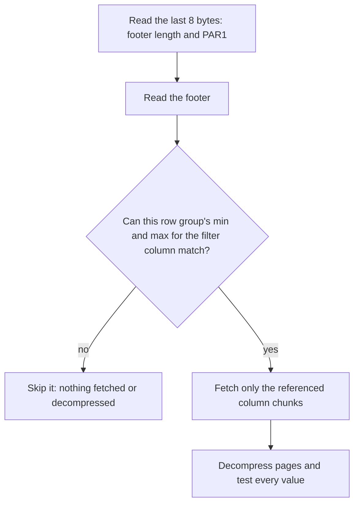

# Lesson 2. Inside a Columnar File

**Mission link:** Lesson 1 said a column store reads only the columns a query references. This lesson adds the second saving, skipping rows by metadata, and opens the one file format you can inspect byte by byte, since every warehouse's own format follows the same shape.
**Primary source:** [Docs: "File Format", Apache Parquet](https://parquet.apache.org/docs/file-format/)
**Prerequisites:** [Lesson 1](0001-row-stores-and-column-stores.md), [Row group](../GLOSSARY.md), [Column chunk](../GLOSSARY.md)

## Warm-up

1. ▢ A 1 TB table has 200 columns of equal width. A query references 4 of them. Roughly how many bytes does a column store read, and how many does a row store read with no useful index?

<details markdown="1"><summary>Check</summary>

Column store: 4 ÷ 200 × 1 TB = 20 GB, before compression. Row store: every page, so the whole table and its page and tuple overhead, a little over 1 TB. The ratio comes from how many columns the query references, not how many rows it returns.

</details>

2. ▢ Why does `SELECT * FROM orders WHERE order_id = 81723` read more from a column store than from a row store with an index on `order_id`?

<details markdown="1"><summary>Check</summary>

The row store descends a few index pages and reads one heap page holding the whole row. The column store keeps each column in a separate place, so `SELECT *` needs at least one read per column.

</details>

## Know this

### A file is row groups, a row group is column chunks

Parquet keeps the column layout but first cuts the rows into horizontal slices. The [specification](https://parquet.apache.org/docs/file-format/) lays a file out like this:

- A 4-byte magic number, `PAR1`.
- One or more **[row groups](../GLOSSARY.md)**, each a range of rows. Inside a row group, each column is stored as one contiguous **[column chunk](../GLOSSARY.md)**: all of column 1 for those rows, then all of column 2, and so on.
- Each column chunk is split into **pages**, the smallest unit that is compressed and decoded, each with its own small header.
- A **footer**: the file metadata, then a 4-byte length of that metadata, then `PAR1` again.

A query reading three columns fetches three column chunks per row group, which is lesson 1's saving, and a row's values all sit in one row group. The project's [configuration guidance](https://parquet.apache.org/docs/file-format/configurations/) recommends large row groups, 512 MB to 1 GB, and 8 KB pages.

### The footer is a map with statistics

The footer goes last because "file metadata is written after the data to allow for single pass writing", and it is read first: "readers are expected to first read the file metadata to find all the column chunks they are interested in" ([File Format](https://parquet.apache.org/docs/file-format/)). A reader fetches the last 8 bytes, learns the footer's length, fetches the footer, and only then decides what else to read.

For every column chunk in every row group, the footer records where the chunk starts, how many bytes it takes, how many values it holds, and, optionally, statistics: the minimum value, the maximum value and the null count (the `Statistics` structure in the format's [Thrift definition](https://github.com/apache/parquet-format/blob/master/src/main/thrift/parquet.thrift)). Two details matter. Statistics are optional, so a file written without them gives a reader nothing to skip on. And a writer may shorten a long string's minimum or maximum to a value that still bounds it, so a bound is guaranteed to hold but is not always an actual value in the chunk.

The footer is small. The million-row file in this lesson's rep is 15.4 MB with a footer of 4.5 kB.

### Skipping a row group

Given `WHERE order_id BETWEEN 250000 AND 259999`, the reader compares the filter with each row group's `order_id` minimum and maximum. A row group whose maximum is below 250000, or whose minimum is above 259999, cannot contain a matching row. It is skipped: its chunks are never fetched and never decompressed. This is [pruning](../GLOSSARY.md).

Statistics prove absence, never presence. A row group whose range overlaps the filter may still hold no matching row, and the reader must decompress its chunk and test each value to find out.



### Worked example: the same file, written two ways

A 100 GB Parquet dataset has 50 columns and 200 row groups of 500 MB, covering 200 days of events. A query references 3 columns and filters on one `event_date`.

**Written in date order.** Each row group covers about one day, so its `event_date` minimum and maximum are that day. About 1 row group overlaps the filter. The reader fetches 3 of its 50 chunks: 500 MB × 3 ÷ 50 = 30 MB.

**Written in arrival order, with late data mixed in.** Every row group holds some events from early days and some from late ones, so every minimum is near day 1 and every maximum near day 200. No row group can be ruled out. The reader fetches 3 chunks from all 200: 100 GB × 3 ÷ 50 = 6 GB.

Same format, same query, 200 times the bytes. Statistics help only when each row group spans a narrow range of the filtered column, which the write order decides. Lesson 8 makes that a design decision.

### The same shape in each warehouse

Each platform keeps per-block minimum and maximum values and prunes on them, under its own name. Snowflake records, for every [micro-partition](../GLOSSARY.md), the range of values of each column and the number of distinct values, and skips micro-partitions that cannot match ([Micro-partitions and data clustering](https://docs.snowflake.com/en/user-guide/tables-clustering-micropartitions)). Redshift stores columns in 1 MB blocks and keeps each block's minimum and maximum as a [zone map](../GLOSSARY.md); its documentation's example skips up to 98 percent of blocks for a one-month filter over five years of date-sorted data ([Sort keys](https://docs.aws.amazon.com/redshift/latest/dg/t_Sorting_data.html)). BigQuery uses "the filter expression and the block metadata to prune the blocks scanned", and only scanned blocks count toward bytes processed ([Introduction to clustered tables](https://cloud.google.com/bigquery/docs/clustered-tables)).

### Predict, then run

Write a file with a fixed row group size, in DuckDB ([Parquet Files](https://duckdb.org/docs/stable/data/parquet/overview)):

```sql
COPY (
  SELECT i AS order_id,
         i % 5000 AS customer_id,
         round((i * 7919 % 100000) / 100.0, 2) AS amount,
         'note ' || i AS note
  FROM range(1000000) t(i)
) TO 'orders.parquet' (FORMAT parquet, ROW_GROUP_SIZE 100000);
```

Before running anything else, predict: how many row groups the file has; roughly what `order_id` minimum and maximum row group 2 has; and what `amount` minimum and maximum every row group has. Then look:

```sql
SELECT row_group_id, row_group_num_rows, path_in_schema, stats_min, stats_max
FROM parquet_metadata('orders.parquet')
WHERE path_in_schema IN ('order_id', 'amount')
ORDER BY path_in_schema, row_group_id;
```

Now predict how many of the row groups each of these reads, and run both under `EXPLAIN ANALYZE`:

```sql
SELECT sum(amount) FROM 'orders.parquet' WHERE order_id BETWEEN 250000 AND 259999;
SELECT sum(amount) FROM 'orders.parquet' WHERE amount > 999;
```

When this lesson was checked with DuckDB 2.0, the file had 10 row groups (DuckDB rounded the size up to 100,352 rows); row group 2 held `order_id` 200704 to 301055; every row group's `amount` ran from about 0 to 999.99. The scan box reported `Row Groups Scanned: 1 / 10` for the first query and `10 / 10` for the second, even though the second matches only 990 rows. `order_id` was written in order; `amount` was not.

## Practice

1. ▢ List the parts of a Parquet file from its first byte to its last, and say which one a reader fetches first.

<details markdown="1"><summary>Check</summary>

`PAR1`, the row groups (each holding one column chunk per column, each chunk made of pages), the file metadata, its 4-byte length, `PAR1`. The reader fetches the end first: the length and magic number, then the footer, because the footer says where every chunk is and what its statistics are.

</details>

2. ▢ A file's footer shows these `event_date` statistics. Predict which row groups `WHERE event_date = DATE '2026-03-10'` must read.

    - row group 0: 2026-03-01 to 2026-03-07
    - row group 1: 2026-03-06 to 2026-03-12
    - row group 2: 2026-03-08 to 2026-03-31
    - row group 3: 2026-03-13 to 2026-03-20

<details markdown="1"><summary>Hint</summary>

For each row group, ask only whether the date could lie between its minimum and maximum.

</details>

<details markdown="1"><summary>Check</summary>

Row groups 1 and 2. Both ranges include 10 March, so neither can be ruled out, though either, or both, may turn out to contain no such row. Row groups 0 and 3 are skipped. Overlapping ranges like 1 and 2 are the cost of data written slightly out of order.

</details>

3. ▢ What can a reader conclude from a column chunk's minimum and maximum?

    - a) That some row in the chunk matches whenever the filter value falls inside the range
    - b) That no row in the chunk matches whenever the filter value falls outside the range
    - c) How many rows in the chunk match, by interpolating between the minimum and maximum
    - d) Which page inside the chunk holds the match, from where the value sits in the range

<details markdown="1"><summary>Check</summary>

**b)** Statistics prove absence only. (a) is wrong: a value inside the range may be in no row, so the chunk must still be read and tested. (c) is wrong: two bounds say nothing about how values are distributed between them. (d) is wrong: chunk statistics describe the whole chunk, not where inside it a value sits.

</details>

4. ▢ On this lesson's `orders.parquet`, `SELECT * FROM 'orders.parquet' WHERE order_id = 123456` read 1.5 MB to return one row, out of a 15.3 MB file. Explain both numbers from lessons 1 and 2.

<details markdown="1"><summary>Check</summary>

The footer let the reader skip 9 of 10 row groups, since only one has a range containing 123456: that is why it read about a tenth of the file. Within the remaining row group, `SELECT *` needs all four columns, so it fetched all four chunks, about 1.5 MB, to return roughly 30 bytes. A row store with an index on `order_id` would read a few 8 kB pages. Pruning narrows the rows; it does not change lesson 1's cost of assembling a whole row from separate columns.

</details>

5. ▢ A team's Parquet files filter well on `event_date` but `WHERE status = 'refunded'` reads every row group, though only 0.1 percent of rows are refunded. Statistics are present. Why?

<details markdown="1"><summary>Hint</summary>

Write down what the `status` minimum and maximum of a typical row group would be, given values such as `cancelled`, `paid`, `refunded` and `shipped`.

</details>

<details markdown="1"><summary>Check</summary>

Every row group holds some cancelled and some shipped orders, so every chunk's minimum is `cancelled` and its maximum `shipped`, and `refunded` sorts between them. Rarity does not help: statistics prune only when the value is absent from whole row groups.

</details>

6. ▢ A 60 GB dataset has 120 row groups and 40 equal-width columns. A query references 4 columns and its filter's value appears in 6 row groups. Predict the bytes read with statistics, and without them.

<details markdown="1"><summary>Check</summary>

Each row group is 500 MB, and each chunk 500 MB ÷ 40 = 12.5 MB. With statistics: 6 row groups × 4 chunks × 12.5 MB = 300 MB. Without: 120 × 4 × 12.5 MB = 6 GB. Column selection cut 60 GB to 6 GB; pruning cut 6 GB to 300 MB. The two savings multiply.

</details>

## Real-world reps

- [ ] Today: run this lesson's predict-then-run in DuckDB, writing your predictions down before each query.
- [ ] Tomorrow: rewrite the file with `ORDER BY amount` inside the `COPY`, predict the `amount` statistics and the `Row Groups Scanned` for `amount > 999`, then check.
- [ ] Export a real table you work with to Parquet (most warehouses and DuckDB can), and run `parquet_metadata` on it. Find one column whose statistics would prune and one whose would not.
- [ ] If you have Snowflake, open the query profile of a filtered query and compare its partitions scanned with its partitions total.

## Going further

- [Columnar Storage and Execution](../reference/columnar-storage-and-execution.md)
- [Docs: "File Format", Apache Parquet](https://parquet.apache.org/docs/file-format/)
- [Docs: "Parquet Files", DuckDB](https://duckdb.org/docs/stable/data/parquet/overview)
- [Docs: "Micro-partitions and data clustering", Snowflake](https://docs.snowflake.com/en/user-guide/tables-clustering-micropartitions)
- [Docs: "Sort keys", Amazon Redshift](https://docs.aws.amazon.com/redshift/latest/dg/t_Sorting_data.html)
- [Resources](../RESOURCES.md)

---

Not landing? Reread the primary source at the top, since this lesson compresses it and compression is where understanding leaks. Check the [glossary](../GLOSSARY.md) for any term that felt slippery.

If the lesson itself is unclear rather than the material, that is a defect: [open an issue](https://github.com/TokenCemetery/teach/issues).
