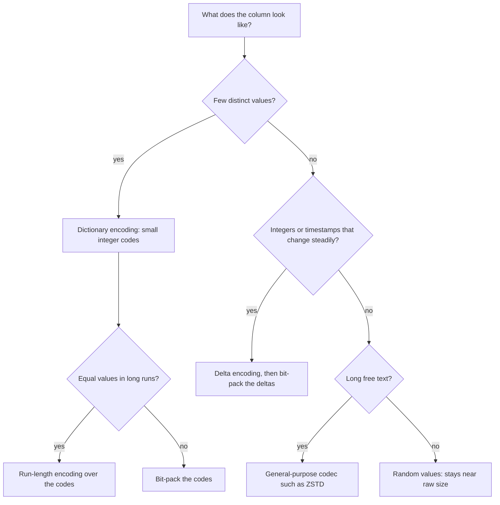

# Lesson 3. Encoding and Compression

**Mission link:** Stage 2 opens on what happens inside a column chunk: a column store reads fewer bytes than a row store partly because it reads fewer columns, and partly because each column it does read is a fraction of its raw size, which is the second half of predicting the bytes a query scans.
**Primary source:** [Paper: "The Design and Implementation of Modern Column-Oriented Database Systems", Abadi, Boncz, Harizopoulos, Idreos and Madden, Foundations and Trends in Databases (2013)](https://www.cs.umd.edu/~abadi/papers/abadi-column-stores.pdf)
**Prerequisites:** [Lesson 2](0002-inside-a-columnar-file.md), [Column chunk](../GLOSSARY.md), [Dictionary encoding](../GLOSSARY.md)

## Warm-up

1. ▢ A table has 200 columns of roughly equal width and holds 1 TB. A query references 3 of them. About how many bytes does a column store read, and about how many does a row store read for the same query?

<details markdown="1"><summary>Check</summary>

About 15 GB (3/200 of 1 TB) from the column store, against the whole 1 TB from the row store, which has to fetch every page because each page holds all 200 columns of its rows. The ratio is the fraction of columns referenced, not the fraction of rows returned.

</details>

2. ▢ What is a column chunk, and what does its statistics block let a reader do before decompressing anything?

<details markdown="1"><summary>Check</summary>

A column chunk is the values of one column for one row group, stored together. Its statistics hold at least the minimum and maximum value, so a reader evaluating `WHERE amount > 1000` against a chunk whose maximum is 400 skips the chunk without fetching or decompressing it.

</details>

## Know this

### Why one column compresses better than a row

Compression works on redundancy, and the survey puts the reason plainly: values from the same column tend to resemble each other far more than values from different columns do ([Abadi et al., section 4.2](https://www.cs.umd.edu/~abadi/papers/abadi-column-stores.pdf)). A row store's page interleaves a name, a timestamp, a country code and a price, so a compressor sees noise. A column chunk holds a million country codes in a row, all the same type, often from a short list. Two things follow. The patterns repeat within one page, and the encoding can be chosen for the type: an integer column and a string column get different treatment. Redshift's documentation states the same consequence: because a block holds one column's values, it can use "a compression scheme selected specifically for the column data type" ([Docs: "Columnar storage", Amazon Redshift](https://docs.aws.amazon.com/redshift/latest/dg/c_columnar_storage_disk_mem_mgmnt.html)).

Column stores favour light encodings over heavy ones. The survey's point is that the goal is query speed, not the smallest file, so schemes that produce fixed-width arrays the CPU can loop over beat schemes like Lempel-Ziv that win on ratio and cost more to decode.

### The four encodings to know

- **[Dictionary encoding](../GLOSSARY.md):** store each distinct value once, and replace every value with a small integer code. Suits a column with few distinct values: country, status, product category. Eight countries need 3 bits per code instead of a string per row.
- **[Run-length encoding](../GLOSSARY.md):** store a run of identical values as the value and a count. Suits a column where equal values sit next to each other, which mostly means a sorted one. The survey's example replaces 42 consecutive `'M'` values with one triple.
- **Delta encoding:** store the difference from the previous value instead of the value. Suits integers and timestamps that change steadily: an auto-increment ID, an event time in arrival order. The survey's frame of reference variant stores 1003, 1001, 1007 as a base of 1000 plus 3, 1, 7.
- **Bit-packing:** store each integer in exactly as many bits as the largest one in the block needs. It rarely stands alone; it is what makes dictionary codes and deltas small once the other encodings have produced small integers.

They stack. Parquet's dictionary encoding writes the codes with its run-length and bit-packing hybrid, and its delta encoding bit-packs the deltas in small blocks ([Docs: "Encodings", Apache Parquet](https://parquet.apache.org/docs/file-format/data-pages/encodings/)). A dictionary that grows too large falls back to plain encoding, which is why a high-cardinality string column often shows `PLAIN`.

General-purpose compression (Snappy, ZSTD, LZO) then runs over the encoded bytes. It catches redundancy the encodings left, mostly in long free text, and adds little to a column the encodings already shrank.



### Why sorting shrinks a table

Sorting creates runs. A `country` column in arrival order switches value almost every row, so its dictionary codes still cost 3 bits each. Sorted by country, it becomes eight long runs across the whole file, one or two per row group, and run-length encoding stores each in a few bytes. Sorting by time does the same for a timestamp column: every delta becomes small and nearly equal, and bit-packing a block of identical deltas costs almost nothing. The catch is that only the leading sort column gets perfect runs. A second sort column is ordered only within each value of the first, so it compresses better than random and worse than the leader.

BigQuery takes this far enough to reorder rows inside its storage format to lengthen runs, and its engineers describe finding the best order as NP-complete and approximating it ([Blog: "Inside Capacitor, BigQuery's next-generation columnar storage format", Google Cloud](https://cloud.google.com/blog/products/bigquery/inside-capacitor-bigquerys-next-generation-columnar-storage-format)). Stage 4 returns to sorting for a different payoff, tighter zone maps; this lesson's payoff is size.

### Predict, then run

DuckDB writes Parquet and prints each column chunk's encoding and size, so the effect is observable on a laptop ([Docs: "Parquet Files", DuckDB](https://duckdb.org/docs/stable/data/parquet/overview)). Predict first: for each of the four columns below, will sorting by `created_at` shrink it a lot, a little, or not at all?

```sql
CREATE TABLE orders AS
SELECT i AS order_id,
       TIMESTAMP '2026-01-01' + to_seconds(i) AS created_at,
       ['DE','FR','GB','US','JP','BR','IN','UZ'][1 + (hash(i) % 8)::INT] AS country,
       round(random() * 500, 2) AS amount
FROM range(1000000) t(i);

COPY (SELECT * FROM orders ORDER BY random())
  TO 'shuffled.parquet' (FORMAT parquet, PARQUET_VERSION v2);
COPY (SELECT * FROM orders ORDER BY created_at)
  TO 'by_time.parquet' (FORMAT parquet, PARQUET_VERSION v2);
COPY (SELECT * FROM orders ORDER BY country, created_at)
  TO 'by_country.parquet' (FORMAT parquet, PARQUET_VERSION v2);

SELECT path_in_schema, encodings, sum(total_compressed_size) AS stored_bytes
FROM parquet_metadata('shuffled.parquet')
GROUP BY ALL ORDER BY 1;
```

One run printed these stored sizes. Exact figures move between DuckDB releases; the ratios are the lesson.

| Column | Encoding chosen | Shuffled | Sorted by `created_at` | Sorted by `country, created_at` |
|---|---|---|---|---|
| `order_id` | `DELTA_BINARY_PACKED` | 2.6 MB | 542 bytes | 0.8 MB |
| `created_at` | `DELTA_BINARY_PACKED` | 5.1 MB | 648 bytes | 1.7 MB |
| `country` | `RLE_DICTIONARY` | 380 KB | 380 KB | 490 bytes |
| `amount` | `BYTE_STREAM_SPLIT` | 7.1 MB | 7.1 MB | 7.1 MB |

The arithmetic checks out. One million 3-bit country codes is 375,000 bytes, which is the shuffled size. One million IDs shuffled have deltas up to about a million, so about 21 bits each, 2.6 MB; sorted, every delta is 1 and the column nearly vanishes. `amount` is random to the cent, so no ordering gives it runs or small deltas and it stays near its raw 8 MB.

### Operating on compressed data

The fastest decompression is none. An engine that understands the encoding can answer some questions on the encoded form directly ([Abadi et al., section 4.3](https://www.cs.umd.edu/~abadi/papers/abadi-column-stores.pdf)). `SUM` over a run of 1,000 copies of 42 is one multiplication. `WHERE country = 'UZ'` looks up `'UZ'` in the dictionary once, then compares small integers. The survey reports that compression without this rarely buys more than a factor of three, and with it more than an order of magnitude on sorted columns.

### How the three platforms expose it

| | What you control | What the documentation says |
|---|---|---|
| BigQuery | Nothing directly; ordering through clustering | Each column is stored separately, and redundancy within a column allows techniques "such as run-length encoding" ([Docs: "BigQuery storage overview", Google Cloud](https://cloud.google.com/bigquery/docs/storage_overview)) |
| Snowflake | Nothing directly; ordering through a clustering key | Snowflake "automatically determines the most efficient compression algorithm for the columns in each micro-partition" ([Docs: "Micro-partitions and data clustering", Snowflake](https://docs.snowflake.com/en/user-guide/tables-clustering-micropartitions)) |
| Redshift | A per-column `ENCODE`, or `ENCODE AUTO`, the default | `RAW`, `AZ64`, `BYTEDICT`, `DELTA`, `RUNLENGTH`, `ZSTD` and others, each per 1 MB block; `BYTEDICT` string scans evaluate predicates on the compressed data ([Docs: "Compression encodings", Amazon Redshift](https://docs.aws.amazon.com/redshift/latest/dg/c_Compression_encodings.html)) |

One billing trap. BigQuery's [on-demand pricing](../GLOSSARY.md) sizes bytes processed from each column's data type, not from its compressed size ([Docs: "BigQuery pricing", Google Cloud](https://cloud.google.com/bigquery/pricing)). Better compression makes an on-demand query faster, not cheaper. On Snowflake and Redshift, where compute time is the bill, faster is cheaper.

## Practice

1. ▢ Name the encoding that suits each column best: `order_status` with five values; `event_time` in arrival order; `review_text`, free-form paragraphs; `sensor_reading`, a noisy float.

<details markdown="1"><summary>Check</summary>

`order_status`: dictionary encoding, with run-length encoding on top if the table is sorted by it. `event_time`: delta encoding with bit-packed deltas. `review_text`: a general-purpose codec such as ZSTD, since there is no small set of values to put in a dictionary. `sensor_reading`: nothing helps much; high-entropy values stay near raw size. Reaching for run-length encoding on an unsorted column is the common miss: it needs adjacent repeats, not just few distinct values.

</details>

2. ▢ In the run above, `country` stored 380 KB shuffled and 490 bytes sorted by country, under the same encoding name. Explain both numbers.

<details markdown="1"><summary>Hint</summary>

Work out how many bits one code needs for eight values, then count the runs in a sorted row group.

</details>

<details markdown="1"><summary>Check</summary>

Shuffled, the dictionary codes switch nearly every row, so each of the million codes is bit-packed at 3 bits: 375,000 bytes plus a tiny dictionary. Sorted, each row group holds one or two long runs, and the run-length part of Parquet's hybrid stores each run as a value and a count, a few bytes per run. The encoding name did not change; the shape of the data did.

</details>

3. ▢ Which statement best explains why a column chunk compresses better than a row-store page?

    - a) Column stores use stronger general-purpose codecs than row stores
    - b) Adjacent values share one type and often repeat or change slowly
    - c) Column chunks are smaller, and small inputs compress better overall
    - d) Row stores cannot compress pages, because rows must stay updatable

<details markdown="1"><summary>Check</summary>

**b)** Redundancy between neighbouring values is what every encoding exploits, and only a column layout puts like values next to each other. (a) has it backwards: column stores favour lighter encodings, chosen for decode speed. (c) is false: a chunk holds many rows of one column, and more input with the same pattern compresses better, not worse. (d) is false: row stores do compress, just less effectively, because a page mixes types.

</details>

4. ▢ A file sorted by `country` answers `SELECT sum(amount) WHERE country = 'UZ'`. Lesson 2's statistics and this lesson's encodings both make it cheaper. Say what each one saves.

<details markdown="1"><summary>Check</summary>

The statistics let the reader skip every row group whose `country` minimum and maximum exclude `'UZ'`; sorted, that is all but one or two of them, so those chunks are never fetched. The encodings shrink what is still read: the `country` chunks are a few runs each, and the filter can run on the dictionary code. Sorting feeds both, which is why stage 4 returns to it.

</details>

5. ▢ A team sorts a large BigQuery table by its most common filter column, and its stored size halves. They expect their on-demand query bill to halve too. Are they right?

<details markdown="1"><summary>Hint</summary>

Ask what BigQuery measures when it counts bytes processed: the stored bytes, or something else.

</details>

<details markdown="1"><summary>Check</summary>

No. BigQuery on-demand sizes bytes processed from each referenced column's data type, so better compression does not lower it. Queries may run faster, and if the sort is declared as clustering, filters on that column can prune blocks, which does cut bytes billed. The saving comes from skipping blocks, not from shrinking them. On Snowflake or Redshift the faster run would cut the bill, because compute time is what they charge for.

</details>

## Real-world reps

- [ ] Run the DuckDB script above with your own prediction written down first, then add a fifth column of your choice and predict its encoding before you check.
- [ ] Take any Parquet file from your own work and run `parquet_metadata` over it. Find the column with the worst ratio of stored size to row count and say why it resists encoding.
- [ ] Tomorrow: on a Redshift cluster you can reach, run `ANALYZE COMPRESSION` on one table, or on Snowflake or BigQuery find the stored size of one table, and say which of its columns you expect to dominate that size and why.

## Going further

- [Columnar Storage and Execution](../reference/columnar-storage-and-execution.md)
- [Paper: "The Design and Implementation of Modern Column-Oriented Database Systems", Abadi, Boncz, Harizopoulos, Idreos and Madden, Foundations and Trends in Databases (2013)](https://www.cs.umd.edu/~abadi/papers/abadi-column-stores.pdf), sections 4.2 and 4.3
- [Docs: "File Format", Apache Parquet](https://parquet.apache.org/docs/file-format/), and its encodings page for the exact byte layouts
- [Course: "CMU 15-721 Advanced Database Systems", Andy Pavlo, Carnegie Mellon University (Spring 2024)](https://15721.courses.cs.cmu.edu/spring2024/), lectures 2 and 3 on data formats and encoding
- [Resources](../RESOURCES.md)

---

Not landing? Reread the primary source at the top, since this lesson compresses it and compression is where understanding leaks. Check the [glossary](../GLOSSARY.md) for any term that felt slippery.

If the lesson itself is unclear rather than the material, that is a defect: [open an issue](https://github.com/TokenCemetery/teach/issues).
