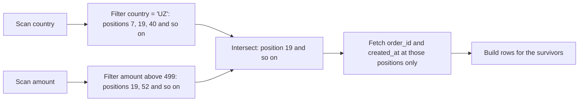

# Lesson 4. Vectorized Execution and Late Materialization

**Mission link:** Stage 2 closes on what a column engine does with the bytes it reads: once a query's columns are on the CPU, processing them a batch at a time and building rows only at the end is why the same scan runs faster there, and why `SELECT *` undoes most of it.
**Primary source:** [Paper: "The Design and Implementation of Modern Column-Oriented Database Systems", Abadi, Boncz, Harizopoulos, Idreos and Madden, Foundations and Trends in Databases (2013)](https://www.cs.umd.edu/~abadi/papers/abadi-column-stores.pdf)
**Prerequisites:** [Lesson 3](0003-encoding-and-compression.md), [Vectorized execution](../GLOSSARY.md), [Late materialization](../GLOSSARY.md)

## Warm-up

1. ▢ Which encoding suits a timestamp column stored in arrival order, and why does sorting a table by that column make it almost free to store?

<details markdown="1"><summary>Check</summary>

Delta encoding with bit-packed deltas. Sorted, consecutive timestamps differ by small, nearly equal amounts, so each block of deltas packs into a handful of bits per value, or close to none when every delta is the same.

</details>

2. ▢ Give one query an engine can answer from run-length encoded data without decompressing it.

<details markdown="1"><summary>Check</summary>

`SUM` or `COUNT` over a column: a run of 1,000 copies of 42 contributes 42 × 1,000 to the sum and 1,000 to the count, one multiplication instead of a thousand additions. An equality filter on a dictionary-encoded column is the other classic case: look the constant up once, then compare integer codes.

</details>

3. ▢ A file's row groups each record a minimum and maximum per column. What does a reader do with them before decompressing anything?

<details markdown="1"><summary>Check</summary>

It compares the filter against each column chunk's minimum and maximum and skips every row group that cannot contain a match. That is pruning, and it decides which bytes are fetched at all.

</details>

## Know this

### Row at a time: the Volcano iterator

The textbook executor is the Volcano iterator, which the survey also calls tuple-at-a-time pipelining: every operator exposes `next()`, and each call returns one row, pulled from its child's `next()` ([Abadi et al., section 4.1](https://www.cs.umd.edu/~abadi/papers/abadi-column-stores.pdf)). It is elegant and keeps intermediate results small. Its cost is per row. For `SELECT avg(amount) FROM orders WHERE country = 'UZ'` over a million rows, the scan, the filter and the aggregate each make about a million calls, and each call is an indirect jump, a type check and a branch the CPU cannot predict, wrapped around one comparison or one addition. The CPU spends more on the calling than on the data.

### A vector at a time

[Vectorized execution](../GLOSSARY.md) keeps the same pull-based plan and changes one thing: `next()` returns a vector of N values from one column instead of one row. The survey gives N = 1000 as typical in VectorWise, sized so a vector fits in the L1 cache. DuckDB uses 2,048, and its setting `standard_vector_size` prints the value.

The survey lists what that buys, and three of the reasons carry the rest:

- **Interpretation overhead falls by a factor of N.** A million rows in vectors of 1,000 means about a thousand calls per operator, not a million. On a compute-heavy benchmark query the survey reports up to two orders of magnitude.
- **Tight loops over arrays.** The work inside a call is a plain loop over a fixed-width array, which compilers turn into SIMD instructions that compare or add several values per instruction.
- **Cache locality.** One vector of one column stays in cache while every operator in the pipeline works on it.

Lesson 3's encodings feed this directly: a column of dictionary codes is exactly the dense fixed-width array these loops want.

### Late materialization

A column store holds one row's values in as many places as it has columns, and a result has to be returned as rows. The question is when to stitch them together. **Early materialization** reads the referenced columns, builds rows at once, and runs ordinary row operators on them. [Late materialization](../GLOSSARY.md) keeps columns apart as long as possible ([Abadi et al., section 4.4](https://www.cs.umd.edu/~abadi/papers/abadi-column-stores.pdf)). It evaluates each predicate on its own column and produces a list of positions, the row offsets that passed. It intersects position lists from different predicates, then fetches the other columns only at the surviving positions.



The survey gives four reasons it wins. Rows that fail a filter are never built at all. Values stay compressed until the end, so operating on compressed data, which building rows would force the engine to undo, survives. Each cache line carries only the column being worked on. And fixed-width columns stay fixed-width, where a row with one string in it is variable-width as a whole.

It is not free, and the survey names when it loses: predicates that pass most rows, on many columns. Then the engine computes and intersects large position lists only to fetch nearly every value anyway, and building rows up front would have been cheaper.

### What `SELECT *` costs

Take lesson 1's table again: 200 columns, 1 TB, roughly 5 GB per column. A query that needs 3 columns reads about 15 GB; `SELECT *` reads all 1 TB, about 67 times as much. Three costs stack:

1. **Bytes scanned.** Every column's chunks are fetched from every block that pruning could not skip. On BigQuery on-demand that is the bill, and adding `LIMIT` does not reduce it: Google's guidance is that `LIMIT` on a `SELECT *` query "does not affect the amount of data read" ([Docs: "Optimize query computation", Google Cloud](https://cloud.google.com/bigquery/docs/best-practices-performance-compute)).
2. **Decoding.** Every surviving value of all 200 columns is decompressed, where a 3-column query decodes 3.
3. **Row building.** Late materialization delays building rows; `SELECT *` still builds them 200 columns wide for every survivor, and ships them to the client.

Late materialization softens the second and third costs when a filter is selective. It cannot touch the first, because pruning works per block, and every block that might hold a survivor must be read for every column the query names.

### Predict, then run

Reuse `by_country.parquet` from lesson 3. DuckDB's `EXPLAIN ANALYZE` prints a **Data Read** total for a Parquet scan ([Docs: "Parquet Files", DuckDB](https://duckdb.org/docs/stable/data/parquet/overview)). Predict the ranking of these four, then run each with `EXPLAIN ANALYZE` in front:

```sql
SELECT order_id FROM 'by_country.parquet';
SELECT country, sum(amount) FROM 'by_country.parquet' GROUP BY country;
SELECT * FROM 'by_country.parquet';
SELECT * FROM 'by_country.parquet' WHERE country = 'UZ' AND amount > 499;
```

One run read about 0.8 MB, 7.0 MB, 9.5 MB and 1.3 MB. The aggregate costs nearly as much as `SELECT *` because `amount` is the column that resists encoding. The filtered `SELECT *` returned 257 rows from a million and still read all four columns of the 2 row groups out of 9 that pruning could not skip.

### How the three platforms expose it

| | Execution model | What to read |
|---|---|---|
| BigQuery | Not documented at operator level; on-demand bills every referenced column | `SELECT * EXCEPT (col, ...)` and table preview instead of exploratory `SELECT *` ([Docs: "Optimize query computation", Google Cloud](https://cloud.google.com/bigquery/docs/best-practices-performance-compute)) |
| Snowflake | Not documented at operator level; only referenced columns of each micro-partition are scanned | [Docs: "Micro-partitions and data clustering", Snowflake](https://docs.snowflake.com/en/user-guide/tables-clustering-micropartitions); lecture 19 of the CMU course goes inside the engine |
| Redshift | Compiled query code, with a precompiled SIMD-vectorized scan that filters after zone maps and uses late materialization, then row-at-a-time joins and aggregation | [Paper: "Amazon Redshift Re-invented", Armenatzoglou et al., SIGMOD (2022)](https://www.amazon.science/publications/amazon-redshift-re-invented); "Avoid using `select *`" in [Docs: "Query design best practices", Amazon Redshift](https://docs.aws.amazon.com/redshift/latest/dg/c_designing-queries-best-practices.html) |

Redshift is the reminder that vectorizing is not the only way out of Volcano's overhead: it generates and compiles C++ for each query, which removes the per-row calls a different way, and vectorizes only the scan.

## Practice

1. ▢ A plan of scan, filter and aggregate runs over 10 million rows. About how many `next()` calls does it make under Volcano iteration, and about how many with vectors of 1,000?

<details markdown="1"><summary>Check</summary>

About 30 million under Volcano, 10 million per operator, against about 30,000 vectorized, 10,000 per operator: fewer by the vector size. The data work is the same; what disappears is the per-call overhead around it.

</details>

2. ▢ Which statement describes late materialization?

    - a) The engine builds full rows first, then filters them in one pass
    - b) The engine defers reading a column until the client requests it
    - c) The engine filters columns separately and builds rows for survivors
    - d) The engine caches finished rows so repeat queries skip the scan

<details markdown="1"><summary>Check</summary>

**c)** Predicates run on their own columns, produce positions, and only surviving positions are fetched from the other columns and stitched into rows. (a) is early materialization, the thing late materialization replaces. (b) confuses it with lazy loading in an application; the engine reads what the plan needs. (d) describes a result cache, which stage 7 covers.

</details>

3. ▢ Before running it, predict whether `SELECT * FROM 'by_country.parquet' WHERE amount > 499` reads more or less than the filtered query in the run above, which also had `country = 'UZ'`.

<details markdown="1"><summary>Hint</summary>

Ask which column's statistics can prune row groups here, given what the file is sorted by.

</details>

<details markdown="1"><summary>Check</summary>

More, close to the full 9.5 MB. `amount` is random, so every row group's minimum and maximum span nearly 0 to 500 and none can be skipped. The `country` predicate is what pruned 7 of 9 row groups before, because the file is sorted by country. Late materialization still keeps row building to the few hundred survivors, but the bytes read follow pruning, not selectivity.

</details>

4. ▢ Connect lesson 3 to this one: why does building rows early throw away the benefit of operating on compressed data?

<details markdown="1"><summary>Check</summary>

A row holds one value from each column, so building it means decoding each column's value at that position: run-length runs, dictionary codes and delta blocks all become plain values. After that, a filter or sum can no longer work on a run or a code. Late materialization keeps the column encoded through the filters and decodes only survivors.

</details>

5. ▢ A query filters a 40-column table with `WHERE a > 0 AND b > 0 AND c > 0`, and each predicate passes 95 percent of rows. A colleague expects late materialization to make it fast. What do you expect, and why?

<details markdown="1"><summary>Hint</summary>

Count how many positions each predicate produces, and how many rows are built at the end.

</details>

<details markdown="1"><summary>Check</summary>

Little or no gain, possibly a loss. Each predicate yields a position list of nearly every row, the intersection is nearly every row, and the engine then fetches almost every value of the referenced columns anyway. This is the case the survey names where early materialization wins, since it skips all the position bookkeeping.

</details>

6. ▢ An analyst runs `SELECT * FROM events LIMIT 100` on an unclustered BigQuery table of 200 columns and 1 TB, under on-demand pricing, to see what the data looks like. What is billed, and what should they do instead?

<details markdown="1"><summary>Check</summary>

About 1 TB: every column is referenced, and `LIMIT` does not reduce bytes read on an unclustered table. The table preview shows rows without billing a query. When a query is needed, naming the columns, or `SELECT * EXCEPT` for the wide ones, cuts the bytes scanned to those columns.

</details>

## Real-world reps

- [ ] Run the four `EXPLAIN ANALYZE` queries above with your predicted ranking written down first, then add one filtered query of your own whose Data Read you predict before running it.
- [ ] Find the widest table you query at work, count its columns, and look up one recurring query against it that uses `SELECT *`. Estimate the share of its bytes scanned that a named column list would remove.
- [ ] Tomorrow: on BigQuery, dry-run the same query once as `SELECT *` and once with three named columns, and compare the bytes each would process. On Snowflake or Redshift, compare bytes scanned for the two in the query profile.

## Going further

- [Columnar Storage and Execution](../reference/columnar-storage-and-execution.md)
- [Paper: "The Design and Implementation of Modern Column-Oriented Database Systems", Abadi, Boncz, Harizopoulos, Idreos and Madden, Foundations and Trends in Databases (2013)](https://www.cs.umd.edu/~abadi/papers/abadi-column-stores.pdf), sections 4.1 and 4.4, including the worked late materialization plan in figure 4.1
- [Paper: "Amazon Redshift Re-invented", Armenatzoglou et al., SIGMOD (2022)](https://www.amazon.science/publications/amazon-redshift-re-invented), section 2 on code generation and vectorized scans
- [Course: "CMU 15-721 Advanced Database Systems", Andy Pavlo, Carnegie Mellon University (Spring 2024)](https://15721.courses.cs.cmu.edu/spring2024/), lectures 6 and 7 on vectorized execution and code generation
- [Resources](../RESOURCES.md)

---

Not landing? Reread the primary source at the top, since this lesson compresses it and compression is where understanding leaks. Check the [glossary](../GLOSSARY.md) for any term that felt slippery.

If the lesson itself is unclear rather than the material, that is a defect: [open an issue](https://github.com/TokenCemetery/teach/issues).
