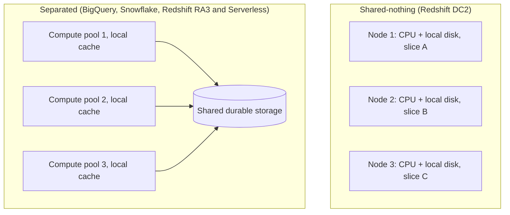

# Lesson 5. Separating Storage from Compute

**Mission link:** Stage 3 opens here: before you can size or isolate compute on any of the three platforms, you have to know what each one keeps apart between the tables and the machines that read them, and what that separation costs you on every cold read.
**Primary source:** [Paper: "Dremel: A Decade of Interactive SQL Analysis at Web Scale", Melnik et al., VLDB (2020)](https://www.vldb.org/pvldb/vol13/p3461-melnik.pdf)
**Prerequisites:** [Lesson 4](0004-vectorized-execution-and-late-materialization.md), [Storage and compute separation](../GLOSSARY.md), [Bytes scanned](../GLOSSARY.md)

## Warm-up

1. ▢ A table has 200 columns of roughly equal width and a query references 3 of them. Roughly what fraction of the table does a column store read, and why does a row store read more?

Check

About 3/200, or 1.5%, because a column store keeps each column's values together and fetches only the referenced column chunks. A row store keeps whole rows together on a page, so fetching any column of a row fetches all 200 of them.

2. ▢ What lets a columnar reader skip a whole row group without decompressing it?

Check

The per-chunk statistics in the file's metadata, chiefly the minimum and maximum of each column chunk. If the filter's range cannot overlap a chunk's min and max, no row in that row group can match, so the reader prunes it.

3. ▢ In one sentence, what does late materialization delay, and until when?

Check

It delays assembling full rows until the filters and joins have run on column data alone, so only the values that survive are stitched into rows.

## Know this

### Where the data lives decides what compute can do

A classic parallel warehouse is **shared-nothing**: each node owns a disjoint slice of every table on its own disks, and a query runs as the same plan on every node over its local slice. That is fast, because every read is local, but it welds storage to compute. Adding storage means adding nodes, and adding nodes means moving data onto them. One cluster is one pool of compute, so every workload that reads the data shares it.

The Dremel authors describe exactly this trap at Google: with replicated data on local disks, "storage and processing were coupled in an intimate way", the serving system could not be resized without shifting data around, and scaling storage meant buying CPU too ([Dremel 2020](https://www.vldb.org/pvldb/vol13/p3461-melnik.pdf), section 3.1). **Storage and compute separation** is the answer all three platforms converged on: table data lives in shared, durable storage that belongs to no compute, and compute is a fleet that reads it over the network.

### BigQuery: storage, compute and shuffle all apart

BigQuery stores tables in its columnar format on distributed storage, apart from the compute that queries them, and replicates them across zones ([BigQuery storage overview](https://cloud.google.com/bigquery/docs/storage_overview)). The paper names the pieces: the storage is Colossus, Google's distributed file system, and the format is Capacitor ([Dremel 2020](https://www.vldb.org/pvldb/vol13/p3461-melnik.pdf), sections 3.1 and 6).

Compute is handed out as **slots**, abstract units of CPU and memory that the scheduler grants to a query's stages; the paper calls them "the core customer-visible concept of resource management in BigQuery" (section 5.1). BigQuery went one step further than the others and disaggregated memory too. Intermediate results between stages go to a separate in-memory **shuffle tier**, not to the workers' own RAM. That change cut shuffle latency by an order of magnitude, and because a finished shuffle is a checkpoint, the scheduler can take workers away from a running query and give them to another (sections 3.2 and 5.2). That is why a BigQuery query has no fixed size: it uses as many slots as it is granted.

### Snowflake: three layers

Snowflake documents three layers ([Key concepts and architecture](https://docs.snowflake.com/en/user-guide/intro-key-concepts)):

- **Database storage.** Loaded data is reorganized into a compressed columnar format and kept in the cloud provider's object storage as **micro-partitions**.
- **Query processing.** A **virtual warehouse** is an independent compute cluster that "doesn't share compute resources with other virtual warehouses", so one has no effect on another's performance.
- **Cloud services.** Metadata, query parsing and optimization, and access control, run by Snowflake on its own instances.

Snowflake calls the result a hybrid: shared-disk because every warehouse sees one central copy of the data, shared-nothing because within a warehouse each node caches a portion of the data locally while it runs. That cache is real, and it is temporary: "This cache is dropped when the warehouse is suspended" ([Warehouse considerations](https://docs.snowflake.com/en/user-guide/warehouses-considerations)).

### Redshift: shared-nothing, then managed storage

Redshift began as shared-nothing, and its DC2 nodes still are: each node stores its slice of the data on local NVMe SSD, so more data means more nodes ([Redshift provisioned clusters](https://docs.aws.amazon.com/redshift/latest/mgmt/working-with-clusters.html)). RA3 nodes, and the newer Graviton-based RG nodes, use **Redshift Managed Storage** (RMS): every commit is persisted to Amazon S3, and each compute node keeps its working set on large local SSDs as a cache ([Amazon Redshift Re-invented](https://www.amazon.science/publications/amazon-redshift-re-invented), section 3). The paper's consequence is the one that matters: because compute nodes are "practically stateless", resizing becomes a metadata operation instead of a data move. You size RA3 compute for the work and pay for managed storage separately.

**Redshift Serverless** puts the same managed storage under compute measured in Redshift Processing Units (RPUs), each providing 16 GB of memory, that scale automatically and are billed only while queries run ([Serverless billing](https://docs.aws.amazon.com/redshift/latest/mgmt/serverless-billing.html)).

### What separation buys

- **Independent scaling.** Storage grows without buying CPU, and compute grows or shrinks without moving data.
- **Isolation.** Several compute pools read the same tables: two Snowflake virtual warehouses, two BigQuery reservations, or a Redshift cluster plus its concurrency-scaling clusters or a data-sharing consumer. A heavy load job on one pool cannot steal CPU from a dashboard on another.
- **Pausing compute.** With no compute attached, the data still exists. A Snowflake warehouse auto-suspends when idle ([Overview of warehouses](https://docs.snowflake.com/en/user-guide/warehouses-overview)), a paused RA3 cluster stops on-demand billing, Serverless bills nothing while no query runs, and BigQuery on-demand has no compute of yours sitting idle at all.

### What separation costs

Every read that is not cached crosses the network. When Google first moved Dremel onto its distributed file system, the authors saw "an order-of-magnitude performance degradation" and spent years on storage format, metadata and prefetching to win it back ([Dremel 2020](https://www.vldb.org/pvldb/vol13/p3461-melnik.pdf), section 3.1). The platforms' answer is a local cache: Snowflake's warehouse cache, Redshift's SSD tier. A cache must be warmed. A resumed Snowflake warehouse starts empty, and a resized Redshift cluster rehydrates its SSDs, with the paper reporting more than 80% local hits once 20% of rehydration is done.

So column pruning from stage 1 matters more here, not less. On a 1 TB table with 200 equal-width columns, a query naming 3 columns reads about 15 GB. On a cold cache, those 15 GB are pulled from remote storage before any work starts. `SELECT *` would pull the whole terabyte.

### Worked example: the price of a warm cache

A dashboard runs a 20-second query every 5 minutes on a Medium Snowflake warehouse, which bills 4 credits an hour, per second, with a 60-second minimum each time it starts ([Overview of warehouses](https://docs.snowflake.com/en/user-guide/warehouses-overview)).

- **Auto-suspend after 60 seconds.** Each cycle runs about 20 + 60 = 80 seconds, then suspends. 12 cycles an hour is 960 seconds, or 960 / 3600 × 4 ≈ 1.07 credits an hour. Every query starts on a cold cache.
- **Auto-suspend after 10 minutes.** The warehouse never sits idle for 10 minutes, so it never suspends: 4 credits an hour, and every query after the first reads warm data.

Neither is wrong. You are buying cache warmth with credits, and separation is what made that a dial instead of a fixed fact.

### Predict, then run

On a Snowflake trial account, suspend a warehouse, run a selective query against a large sample table twice with `USE_CACHED_RESULT` set to false, and compare `percentage_scanned_from_cache` for the two runs in query history. Predict both numbers first.

## Practice

1. ▢ Name Snowflake's three layers and one thing each one is responsible for.

Check

Database storage holds tables as compressed columnar micro-partitions in cloud object storage. Query processing is the virtual warehouses, independent compute clusters that run queries. Cloud services handles metadata, query parsing and optimization, and access control. If you put caching in the storage layer, look again: the table-data cache lives in each virtual warehouse and dies with it.

2. ▢ A team doubles its data volume but its query load stays flat. Which statement is true?

    - a) On DC2, adding storage means adding nodes, which adds compute too
    - b) On RA3, adding storage means adding nodes, which adds compute too
    - c) On Snowflake, a larger warehouse is needed to hold the extra data
    - d) On BigQuery, more slots must be reserved to store the extra data

Check

**a)** DC2 is shared-nothing, so data lives on node disks and capacity grows only by adding nodes. (b) is the opposite of RA3's point: managed storage grows in S3 without changing node count. (c) confuses the layers: a virtual warehouse holds no table data, only a temporary cache. (d) does the same for BigQuery: slots are compute, and storage is billed separately per GiB per month.

3. ▢ A Snowflake warehouse that auto-suspends after 60 seconds serves a dashboard. Someone raises auto-suspend to 30 minutes and the dashboard gets faster. Predict why, and what happened to the bill.

Hint

Ask what a suspended warehouse loses, besides its running time.

Check

The warehouse stopped suspending between queries, so its local cache of table data survived and later queries read from SSD instead of remote storage. The bill rose, because the warehouse now bills every second it is up, idle or not, rather than only the minute or so around each query. Faster and more expensive is the expected trade, not a bug.

4. ▢ Interleave with lesson 1: on BigQuery, a query over a 1 TB, 200-column table goes from naming 3 columns to `SELECT *`. What happens to bytes scanned, and what extra cost does separation add on top of the bill?

Check

Bytes scanned rises from about 15 GB to about 1 TB, roughly 67 times, and on-demand pricing bills that directly. Because storage is remote, every one of those bytes must also cross the network into slots before work begins, so the query takes longer and holds more slots while it does. Column pruning saves both money and transfer.

5. ▢ A data science team wants heavy experimental queries on the same tables the finance dashboards read, without copying tables and without slowing finance. Say how each platform's separation makes that possible.

Check

Snowflake: give data science its own virtual warehouse; both read the same micro-partitions, and warehouses share no compute. BigQuery: put the data science project in its own reservation, or keep it on on-demand, so its slots come from a different pool. Redshift: on RA3 or Serverless, give the team a separate cluster or workgroup that reads the same managed storage through data sharing, or route its queries to a separate WLM queue on the shared cluster. On DC2 the data lives on the one cluster's disks, so a second compute pool means a second copy.

## Real-world reps

- [ ] Draw the three platforms side by side from memory: where the bytes live, what the compute unit is called, and where the cache sits. Check it against this lesson.
- [ ] Read section 3 of the 2020 Dremel paper and list each thing that got worse when storage moved off local disk and what fixed it.
- [ ] Tomorrow: on a Snowflake trial, run the cold-then-warm experiment from "Predict, then run" and write down the gap between your prediction and `percentage_scanned_from_cache`.

## Going further

- [Platforms Compared](../reference/platforms-compared.md)
- [Paper: "Dremel: A Decade of Interactive SQL Analysis at Web Scale", Melnik et al., VLDB (2020)](https://www.vldb.org/pvldb/vol13/p3461-melnik.pdf)
- [Paper: "Amazon Redshift Re-invented", Armenatzoglou et al., SIGMOD (2022)](https://www.amazon.science/publications/amazon-redshift-re-invented)
- [Docs: "Key concepts and architecture", Snowflake](https://docs.snowflake.com/en/user-guide/intro-key-concepts)
- [Docs: "BigQuery storage overview", Google Cloud](https://cloud.google.com/bigquery/docs/storage_overview)
- [Resources](../RESOURCES.md)

---

Not landing? Reread the primary source at the top, since this lesson compresses it and compression is where understanding leaks. Check the [glossary](../GLOSSARY.md) for any term that felt slippery.

If the lesson itself is unclear rather than the material, that is a defect: [open an issue](https://github.com/TokenCemetery/teach/issues).
