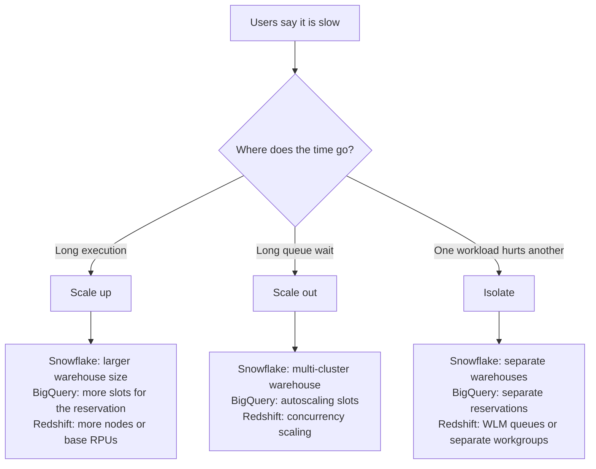

# Lesson 6. Compute Sizing, Concurrency and Workload Isolation

**Mission link:** Separation gave you compute you can resize and duplicate at will; this lesson is choosing which of those to do for a stated workload, so a slow dashboard gets the fix it actually needs and the nightly load stops landing on the analysts' queue.
**Primary source:** [Docs: "Multi-cluster warehouses", Snowflake](https://docs.snowflake.com/en/user-guide/warehouses-multicluster)
**Prerequisites:** [Lesson 5](0005-separating-storage-from-compute.md), [Virtual warehouse](../GLOSSARY.md), [Slot](../GLOSSARY.md)

## Warm-up

1. ▢ Name one thing separating storage from compute buys and one thing it costs.

Check

It buys independent scaling, isolation of several compute pools over one copy of the data, and the ability to pause compute. It costs remote reads on a cold cache, and the time to warm a cache after a resume or resize.

2. ▢ Where does Redshift RA3 keep the authoritative copy of a table, and what are the local SSDs for?

Check

In Redshift Managed Storage, backed by Amazon S3, where every commit is persisted. The local SSDs on each compute node are a cache of the working set, which is why an RA3 resize is a metadata operation rather than a data move.

3. ▢ Interleave with lesson 2: two queries read the same table, one filtering on a narrow date range and one with no filter. Which can more compute speed up the most, and why can't compute fix the other one?

Check

More compute speeds up the unfiltered scan the most, because it is a lot of independent work to split across more workers. The filtered query is already cheap because pruning skipped most blocks; there is little left to parallelize. Compute changes how fast bytes are processed, never how many bytes a query must read.

## Know this

### Two problems that look alike

"The warehouse is slow" means one of two different things, and they have opposite fixes.

- **One query is slow.** Its execution time is long. The fix is **scaling up**: give each query more CPU, memory and parallelism.
- **Many queries are waiting.** Each runs quickly once started, but it sat in a queue first. The fix is **scaling out**: add more copies of the compute so more queries run at once.

Scaling up a queueing workload helps a little, because faster queries leave the queue sooner, but you pay for bigger compute that most small queries cannot use. Scaling out a single slow query does nothing at all, because one query runs on one copy. So read the symptom before choosing the knob: queue time against execution time.

### Snowflake: size is up, clusters are out

Each step in **warehouse size** doubles both the compute per cluster and the credits per hour: an X-Small bills 1 credit an hour, a Medium 4, a Large 8 ([Overview of warehouses](https://docs.snowflake.com/en/user-guide/warehouses-overview)). Resizing a running warehouse does not speed up queries already running; the new resources go to queued and newly submitted ones. The same page warns that "Larger is not necessarily faster for small, basic queries", and that resizing is "primarily intended for improving query performance", not concurrency.

When a warehouse lacks resources for a new query, the query queues. A **multi-cluster warehouse** (an Enterprise Edition feature) adds clusters of the same size to absorb that queue ([Multi-cluster warehouses](https://docs.snowflake.com/en/user-guide/warehouses-multicluster)):

- **Maximized** mode sets minimum equal to maximum and runs every cluster whenever the warehouse runs.
- **Auto-scale** mode starts clusters as queries queue and stops them as load falls. The **Standard** policy, the default, starts a cluster as soon as a query queues; **Economy** starts one only if it estimates at least 6 minutes of work to keep it busy, trading some queueing for fewer credits.

The documentation is blunt about the split: multi-cluster warehouses are for concurrency and "are not as beneficial for improving the performance of slow-running queries or data loading. For these types of operations, resizing the warehouse provides more benefits."

Credits are size times clusters running. A Medium warehouse with up to 3 clusters bills at most 12 credits an hour, and in auto-scale mode only for the seconds each extra cluster actually runs.

### BigQuery: you size the pool, the scheduler sizes the query

You never pick a size for a BigQuery query. It is broken into stages, and the scheduler grants its stages slots from whatever pool the project draws on ([Understand slots](https://cloud.google.com/bigquery/docs/slots)). Under on-demand pricing that pool is shared capacity with a per-project concurrent slot limit. Under capacity pricing it is a **reservation** you create in an edition ([Introduction to BigQuery editions](https://cloud.google.com/bigquery/docs/editions-intro)):

- **Baseline slots** are always allocated to the reservation and always charged.
- **Autoscaling slots** are added, in multiples of 50, only after the baseline and any borrowed idle slots are in use, up to the reservation's maximum. They bill in slot-hours, per second with a one-minute minimum.
- **Assignments** attach projects, or in Enterprise editions folders and whole organizations, to a reservation. This is how you choose whose queries draw on which pool.

Inside a reservation, **fair scheduling** splits slots equally among projects with running queries, then among each project's queries. **Idle slot sharing** lets a reservation borrow another's unused slots, which the owner reclaims as soon as it needs them; a reservation can opt out with `ignore_idle_slots`. When demand exceeds the slots, BigQuery queues units of work rather than whole queries, so an overloaded BigQuery query usually runs slower instead of waiting to start.

### Redshift: queues on a cluster, capacity on Serverless

On a provisioned cluster, more nodes add compute to every query (scaling up the one cluster). Sharing that cluster among workloads is the job of **workload management** ([Workload management](https://docs.aws.amazon.com/redshift/latest/dg/cm-c-implementing-workload-management.html)). AWS recommends automatic WLM, which decides how many queries run at once and how much memory each gets, across up to eight queues. Queries are routed to queues by user group or query group label, and each queue carries a priority. Manual WLM instead fixes each queue's memory and concurrency, which AWS notes leaves resources "statically partitioned and thereby wasted when only a subset of the workloads is running".

**Concurrency scaling** is Redshift's scale-out. When a queue with it enabled has more queries than it can run, eligible queries go to transient extra clusters that read the same data, and those clusters bill only while they run queries ([Concurrency scaling](https://docs.aws.amazon.com/redshift/latest/dg/concurrency-scaling.html)).

**Redshift Serverless** replaces node counts with a **base capacity** in RPUs (128 by default, adjustable in steps), scales above it automatically under load, and caps that with a **max capacity** you set ([Compute capacity for Redshift Serverless](https://docs.aws.amazon.com/redshift/latest/mgmt/serverless-capacity.html)). Separate workgroups are separate pools.

### Isolating ETL from dashboards

The commonest isolation problem is a heavy transformation job landing on the same compute as interactive dashboards. Each platform has a strong form and a weak form.

| Platform | Strong isolation | Weaker, cheaper form |
|---|---|---|
| Snowflake | A separate virtual warehouse per workload, each sized for its own job | One multi-cluster warehouse that both share |
| BigQuery | Separate reservations with their own baselines, assigned per project | One reservation, relying on fair scheduling between projects |
| Redshift | A separate cluster or Serverless workgroup reading shared data | Auto WLM queues with ETL and dashboards at different priorities, plus concurrency scaling on the dashboard queue |

Strong isolation costs idle capacity: two pools each sized for their own peak hold more compute than one pool sized for the combined peak. That is the trade to name when you propose it.

### Worked example: fair scheduling in numbers

A reservation holds 1,000 baseline slots. The ETL project runs 1 large query; the BI project runs 20 dashboard queries. Fair scheduling gives each project 500 slots, so the ETL query gets 500 and each dashboard query about 25 ([Understand slots](https://cloud.google.com/bigquery/docs/slots)). If 10 more projects start a query each, every project's share falls to about 1,000 / 12 ≈ 83 slots, and the ETL job slows to a sixth of its speed with no change to its own SQL. Splitting into an ETL reservation and a BI reservation fixes each side's floor; idle sharing still lets either borrow what the other is not using.

### Predict, then run

In BigQuery, divide a finished job's `total_slot_ms` by its elapsed milliseconds from `INFORMATION_SCHEMA.JOBS` to get its average slots ([JOBS view](https://cloud.google.com/bigquery/docs/information-schema-jobs)). Predict the figure for a large scan run alone and the same scan run beside five others, then run both. In Snowflake, compare `queued_overload_time` with `execution_time` in query history to tell up from out.

## Practice

1. ▢ In one sentence each, what does scaling up fix and what does scaling out fix?

Check

Scaling up fixes a query whose execution is slow, by giving it more CPU, memory and parallelism. Scaling out fixes queries that wait in a queue, by running more of them at once on extra copies of the compute.

2. ▢ A Snowflake warehouse's query history shows dashboard queries with 2 seconds of execution and 40 seconds of `queued_overload_time` at 9 a.m. Which change fits?

    - a) Resize the warehouse from Medium to Large so queries run faster
    - b) Make it multi-cluster in auto-scale mode with a higher maximum
    - c) Lower the auto-suspend time so the warehouse restarts with fresh resources
    - d) Add a clustering key so each dashboard query scans fewer bytes

Check

**b)** The time is queueing, not execution, so the fix is more clusters at the peak, billed only while they run. (a) speeds up a 2-second execution that is not the problem and doubles the rate all day. (c) makes it worse: restarts add cold caches and do nothing for the queue. (d) trims execution time a little, but the queue is 20 times longer than the query.

3. ▢ A BigQuery reservation has 1,000 baseline slots and no idle sharing. Project A runs 1 query, project B runs 4, project C runs 5. Predict roughly how many slots one query in each project gets.

Hint

Split among projects first, then within each project.

Check

Each project gets about 333 slots. A's single query gets about 333, each of B's about 83, and each of C's about 67. Running more queries does not get a project more of the reservation; it only divides that project's share more finely.

4. ▢ Interleave with lesson 5: Snowflake's multi-cluster warehouses and Redshift's concurrency scaling both add compute in seconds without copying any tables. What makes that possible, and what do the first queries on a new cluster pay?

Check

Separation: the tables live in shared storage, cloud object storage for Snowflake and managed storage on S3 for Redshift, so a new cluster can read them immediately. The new cluster's local cache starts empty, so its first queries read from remote storage and run slower than the same queries on a warm cluster.

5. ▢ A nightly transformation job that runs for an hour from 08:30 collides with dashboards that open at 09:00, and the dashboards time out. Propose a fix on each platform and name what it costs.

Check

Snowflake: move the job to its own warehouse, sized up for one large job, and leave the dashboard warehouse small and multi-cluster; the cost is a second warehouse's credits for the hour it runs. BigQuery: put the job's project in its own reservation, or give the BI reservation a baseline the job cannot borrow from; the cost is baseline slots charged whether used or not. Redshift: on a provisioned cluster, route the job to its own WLM queue and enable concurrency scaling on the dashboard queue, or run it on a separate workgroup over shared data; the cost is concurrency-scaling or second-workgroup time. On any platform, moving the job earlier is free, and worth trying first.

## Real-world reps

- [ ] For a warehouse you use, pull a day of query history and sort by queue time against execution time. Write down whether that workload needs up, out, or neither.
- [ ] Write two sentences stating the isolation your team has today between loads and dashboards, and what one collision between them would cost.
- [ ] Tomorrow: without looking, redraw the decision flow from this lesson and fill in each platform's knob, then check it against [Platforms Compared](../reference/platforms-compared.md).

## Going further

- [Platforms Compared](../reference/platforms-compared.md)
- [Docs: "Multi-cluster warehouses", Snowflake](https://docs.snowflake.com/en/user-guide/warehouses-multicluster)
- [Docs: "Understand slots", Google Cloud](https://cloud.google.com/bigquery/docs/slots)
- [Docs: "Introduction to BigQuery editions", Google Cloud](https://cloud.google.com/bigquery/docs/editions-intro)
- [Docs: "Workload management", Amazon Redshift](https://docs.aws.amazon.com/redshift/latest/dg/cm-c-implementing-workload-management.html)
- [Resources](../RESOURCES.md)

---

Not landing? Reread the primary source at the top, since this lesson compresses it and compression is where understanding leaks. Check the [glossary](../GLOSSARY.md) for any term that felt slippery.

If the lesson itself is unclear rather than the material, that is a defect: [open an issue](https://github.com/TokenCemetery/teach/issues).
