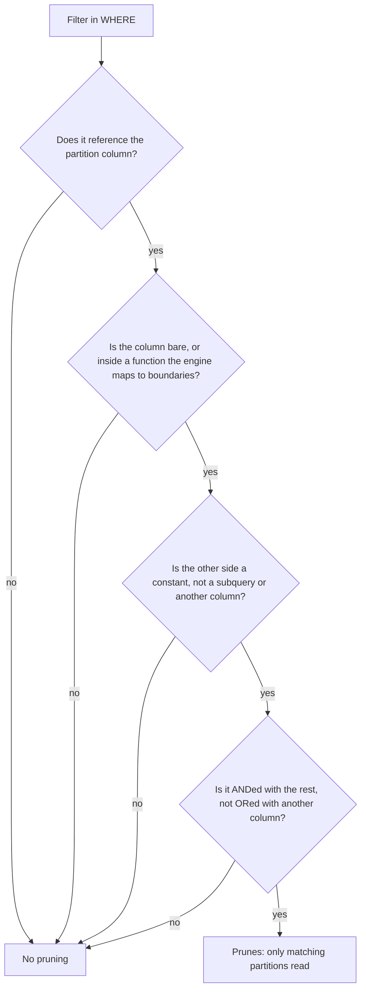

# Lesson 7. Partitioning and Pruning

**Mission link:** Stage 4 opens the physical design half of the mission: choosing a table's layout from its query pattern and showing the scan it saves. Partitioning is the coarsest of those choices and the one whose saving you can read before a query runs.
**Primary source:** [Docs: "Introduction to partitioned tables", Google Cloud](https://cloud.google.com/bigquery/docs/partitioned-tables)
**Prerequisites:** [Lesson 6](0006-compute-sizing-concurrency-and-isolation.md), [Partition](../GLOSSARY.md), [Pruning](../GLOSSARY.md)

## Warm-up

1. ▢ A row group's `event_date` statistics run from 2026-03-01 to 2026-03-31. A query filters `event_date = DATE '2026-03-15'`. What does the reader know about this row group, and what must it do?

<details markdown="1"><summary>Check</summary>

Only that it cannot rule the row group out. Statistics prove absence, never presence, so the reader fetches the referenced column chunks and tests every value. If the range had excluded 15 March, the row group would have been skipped unread.

</details>

2. ▢ On Snowflake, a dashboard's queries are slow at 9 a.m. because they queue behind a nightly transformation still running on the same virtual warehouse. Name the fix that isolates them, and say why it needs no data to move.

<details markdown="1"><summary>Check</summary>

Give the dashboards their own virtual warehouse. Storage and compute are separate, so a second virtual warehouse reads the same tables from shared storage; nothing is copied, and each bills only while it runs.

</details>

## Know this

### A partition is pruning you declared

Lesson 2 showed a reader skipping a row group when its minimum and maximum exclude the filter. Whether that works depends on how the rows happened to be written. A **[partition](../GLOSSARY.md)** removes the luck: you declare a column, usually a date, and the warehouse stores each value range of it as a separate unit. The table's metadata then knows exactly which rows live in which partition, so a filter on that column can skip every partition outside its range without opening it. That skip is **[pruning](../GLOSSARY.md)**, and on a partitioned table it is known before the query starts, which is why the bytes estimate is exact.

### Worked example: seven days out of two years

An `events` table holds 730 days of data, 10 GB a day, 7.3 TB in all, across 60 columns of roughly equal width. A query references 3 columns and asks for the last 7 days.

- **Not partitioned, rows in arrival order:** 7.3 TB × 3 ÷ 60 = 365 GB of **[bytes scanned](../GLOSSARY.md)**.
- **Partitioned by day:** 7 partitions × 10 GB × 3 ÷ 60 = 3.5 GB.

Same query, same answer, about a hundredth of the bytes. Column selection and partition pruning multiply, exactly as column selection and row group skipping did in lesson 2.

### BigQuery: declared partitions of three kinds

BigQuery offers three partitioning schemes ([Introduction to partitioned tables](https://cloud.google.com/bigquery/docs/partitioned-tables)):

- **Time-unit column:** a `DATE`, `TIMESTAMP` or `DATETIME` column, by day, month or year, and by hour for the two timestamp types. Boundaries are in UTC.
- **Ingestion time:** rows go into the partition for the time they were loaded, exposed as the pseudocolumns `_PARTITIONTIME` and, for daily tables, `_PARTITIONDATE`.
- **Integer range:** an `INTEGER` column cut by a start, an end and an interval, such as `customer_id` from 0 to 100,000 in steps of 1,000.

Two special partitions catch what fits nowhere else: `__NULL__` for a null partitioning value, and `__UNPARTITIONED__` for values outside the range. A table option, `require_partition_filter`, makes BigQuery refuse any query that has no filter usable for partition elimination, which turns an accidental full scan into an error instead of a bill. The same page advises against partitions that would average under about 10 GB, and points such tables at clustering, lesson 8, instead.

### Snowflake: partitions you never declare

Snowflake has no `PARTITION BY`. Every table is cut automatically into **[micro-partitions](../GLOSSARY.md)** of 50 to 500 MB of uncompressed data, in the order rows arrive, and Snowflake records for each one the range of values of every column and the number of distinct values ([Micro-partitions and data clustering](https://docs.snowflake.com/en/user-guide/tables-clustering-micropartitions)). Pruning works on those ranges, so on Snowflake every column is a potential partition column, and none is guaranteed to be a good one. A table loaded daily is naturally well ordered by load date; a filter on `customer_id` usually finds that every micro-partition's range spans most customers. The query profile reports partitions scanned against partitions total, which is the number to read.

### Redshift: no declared partitions in its own tables

Redshift's documentation is blunt: it "does not require or support the concept of partitioning data within database objects" ([Distribution styles](https://docs.aws.amazon.com/redshift/latest/dg/c_choosing_dist_sort.html)). Its native tables get the same skipping from the **[sort key](../GLOSSARY.md)**: rows are stored in sort order in 1 MB blocks, each block's minimum and maximum are kept as a **[zone map](../GLOSSARY.md)**, and a range filter on the sort key skips blocks outside it, up to 98 percent of them for one month out of five years of date-sorted data ([Sort keys](https://docs.aws.amazon.com/redshift/latest/dg/t_Sorting_data.html)). Lesson 8 is about choosing that key.

The exception is Redshift Spectrum, which reads files in S3 through external tables. There you do declare partitions: one S3 folder per value, named like `saledate=2026-04-01`, a `PARTITIONED BY` clause on the external table, and an `ALTER TABLE ... ADD PARTITION` for each folder. A filter on the partition key then restricts which folders Spectrum scans ([External tables for Redshift Spectrum](https://docs.aws.amazon.com/redshift/latest/dg/c-spectrum-external-tables.html)), and since Spectrum bills bytes scanned from S3, that is a direct cost saving.

### Filters that silently scan everything

Pruning needs the engine to compare the filter with partition metadata before reading data. Anything that stops it doing that comparison stops the pruning, and the query still returns the right answer, so nothing warns you except the bill.

**A function on the partition column.** BigQuery prunes only when the partitioning column is isolated on one side of a comparison against a constant, or wrapped in one of a short list of functions it can see through, such as `DATE()`, `TIMESTAMP_TRUNC` or `EXTRACT(DATE ...)` ([Querying partitioned tables](https://cloud.google.com/bigquery/docs/querying-partitioned-tables)). `EXTRACT(MONTH FROM ts) = 3` and `ts + INTERVAL 1 DAY > CURRENT_TIMESTAMP()` both scan every partition. Rewrite them as a range on the bare column.

**A cast that changes the comparison.** `CAST(ts AS DATE) = '2025-03-30'` still prunes on BigQuery, because a cast to a date is in the set it understands. `CAST(ts AS STRING) LIKE '2025-03%'` does not: the engine would have to turn every partition boundary into text to know which match. The rule is not "never cast" but "a transformation the engine cannot map back onto partition boundaries hides the column".

**A value that only exists at run time.** A filter whose right side is a subquery, such as `WHERE ts = (SELECT max(ts) FROM ...)`, is not a constant, and BigQuery's documentation lists it among the non-pruning cases. Snowflake says the same: pruning "does not apply to predicates containing a subquery, even when the subquery returns a constant" ([Micro-partitions and data clustering](https://docs.snowflake.com/en/user-guide/tables-clustering-micropartitions)).

**A filter that reaches the fact table only through a join.** `JOIN dim_date d ON f.date_key = d.date_key WHERE d.fiscal_quarter = 'FY27-Q1'` filters the dimension, not the partitioned fact table. Which fact partitions qualify is only known after the dimension is read, so static pruning cannot happen. Redshift's own query guidance says to repeat the filter on the joined table's column even though the result is the same, so the engine can skip that table's blocks before the scan ([Query design best practices](https://docs.aws.amazon.com/redshift/latest/dg/c_designing-queries-best-practices.html)). Some engines prune a join's probe side at run time, but treat that as a bonus you confirm in the plan, not a design you rely on.

**An `OR` with another column.** `WHERE partition_date = '2026-01-01' OR status = 'late'` can match rows in any partition, so BigQuery prunes nothing.



### Predict, then run

A BigQuery dry run reports the bytes a query would process without running it, and is not billed ([Run a query](https://cloud.google.com/bigquery/docs/running-queries)). The public table `bigquery-public-data.wikipedia.pageviews_2025` is partitioned on its `datehour` timestamp. Predict, for each of these, whether the estimate is about one day's partition or the whole year:

```sql
SELECT title, views FROM `bigquery-public-data.wikipedia.pageviews_2025`
WHERE DATE(datehour) = '2025-03-30';

SELECT title, views FROM `bigquery-public-data.wikipedia.pageviews_2025`
WHERE EXTRACT(MONTH FROM datehour) = 3 AND EXTRACT(DAY FROM datehour) = 30;
```

Both select the same rows. The first prunes to one day. The second wraps the column in extractions the engine cannot map to partition boundaries, so its dry run either reports bytes for the whole table, or fails with "without a filter that can be used for partition elimination" if the table requires a partition filter. Either result means the same thing: no pruning.

## Practice

1. ▢ Name the three partitioning schemes BigQuery offers, and the column type each one partitions on.

<details markdown="1"><summary>Check</summary>

Time-unit column: a `DATE`, `TIMESTAMP` or `DATETIME` column. Ingestion time: no column of yours, the load time, exposed as `_PARTITIONTIME` and `_PARTITIONDATE`. Integer range: an `INTEGER` column with a start, an end and an interval.

</details>

2. ▢ Which statement about partitioning on the three platforms is true?

    - a) Redshift native tables declare partitions with a `PARTITION BY` clause on the date
    - b) Snowflake cuts every table into micro-partitions on its own, with no declaration
    - c) BigQuery creates one partition per distinct value of every column in the table
    - d) Spectrum external tables prune by sort key zone maps instead of by S3 folders

<details markdown="1"><summary>Check</summary>

**b)** Snowflake micro-partitions are automatic, in arrival order. (a) is wrong: Redshift native tables have no declared partitions and use sort keys and zone maps. (c) is wrong: BigQuery partitions on one declared column, by time unit, ingestion time or integer range. (d) is wrong: Spectrum partitions are S3 folders named by key and value, added with `ALTER TABLE ... ADD PARTITION`.

</details>

3. ▢ A table is partitioned by day on `order_ts` and holds 1,000 days at 20 GB a day across 40 columns. A query references 2 columns and filters `order_ts >= TIMESTAMP '2026-10-01' AND order_ts < TIMESTAMP '2026-10-11'`. Estimate the bytes scanned, then estimate them again after someone rewrites the filter as `FORMAT_TIMESTAMP('%Y-%m', order_ts) = '2026-10' AND EXTRACT(DAY FROM order_ts) <= 10`.

<details markdown="1"><summary>Hint</summary>

Check the second filter against the list of functions BigQuery can see through, and against whether every predicate in it qualifies.

</details>

<details markdown="1"><summary>Check</summary>

First: 10 partitions × 20 GB × 2 ÷ 40 = 10 GB. Second: `FORMAT_TIMESTAMP` with `%Y-%m` is not one of the formats BigQuery maps to partition boundaries (it accepts `%F`, `%Y-%m-%d` and `%Y%m%d`), and `EXTRACT(DAY ...)` is not either, so no partition is ruled out: 1,000 × 20 GB × 2 ÷ 40 = 1 TB. A hundred times the bytes for the same rows.

</details>

4. ▢ This query runs against a fact table partitioned on `sale_date`, and scans every partition. Explain why, and rewrite it so it prunes.

    ```sql
    SELECT s.store_id, sum(s.amount)
    FROM sales s
    JOIN dim_date d ON s.sale_date = d.calendar_date
    WHERE d.fiscal_quarter = 'FY27-Q1'
    GROUP BY s.store_id;
    ```

<details markdown="1"><summary>Hint</summary>

Ask which table the filter is on, and when the engine learns which `sale_date` values qualify.

</details>

<details markdown="1"><summary>Check</summary>

The filter is on `dim_date`, not on `sales`. Which `sale_date` values qualify is known only after `dim_date` is read, so there is no constant for the planner to compare with partition boundaries before the scan. Add the quarter's literal range to the fact table, keeping the join for any attributes you need: `AND s.sale_date >= DATE '2026-02-01' AND s.sale_date < DATE '2026-05-01'` (with the quarter's real dates). The answer does not change; the scan does.

</details>

5. ▢ Interleave lesson 1: a teammate partitions a 40 GB table by day and expects `SELECT * FROM t WHERE day = '2026-10-01' LIMIT 10` to be cheap. Pruning works. What does the query still read, and which earlier lesson's cost is it paying?

<details markdown="1"><summary>Check</summary>

Every column of that one day's partition. Pruning limited the rows to one partition, but `SELECT *` references all columns, so the column store reads every column chunk in it: lesson 1's cost of assembling whole rows from separate columns. `LIMIT` does not reduce what is read, a point lesson 10 returns to.

</details>

## Real-world reps

- [ ] Today: run the two dry runs in this lesson's predict-then-run and write down your prediction for each before you look.
- [ ] Find the largest table you query. Look up whether it is partitioned, on what, and whether it requires a partition filter (`INFORMATION_SCHEMA.TABLE_OPTIONS` on BigQuery, `SHOW TABLES` and the query profile on Snowflake, `SVV_TABLE_INFO` on Redshift).
- [ ] Tomorrow: take three saved queries against that table and classify each filter with this lesson's flowchart. Rewrite one that does not prune and compare the two dry runs or query profiles.

## Going further

- [Physical Design](../reference/physical-design.md)
- [Docs: "Introduction to partitioned tables", Google Cloud](https://cloud.google.com/bigquery/docs/partitioned-tables)
- [Docs: "Micro-partitions and data clustering", Snowflake](https://docs.snowflake.com/en/user-guide/tables-clustering-micropartitions)
- [Docs: "Sort keys", Amazon Redshift](https://docs.aws.amazon.com/redshift/latest/dg/t_Sorting_data.html)
- [Docs: "Query design best practices", Amazon Redshift](https://docs.aws.amazon.com/redshift/latest/dg/c_designing-queries-best-practices.html)
- [Resources](../RESOURCES.md)

---

Not landing? Reread the primary source at the top, since this lesson compresses it and compression is where understanding leaks. Check the [glossary](../GLOSSARY.md) for any term that felt slippery.

If the lesson itself is unclear rather than the material, that is a defect: [open an issue](https://github.com/TokenCemetery/teach/issues).
