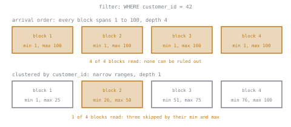

# Lesson 8. Clustering and Sort Keys

**Mission link:** Partitioning prunes on one column at a coarse grain. Clustering and sort keys are how the mission's "choose a layout from the query pattern" reaches the other columns people filter on, and they are where most of a well-designed table's skipped bytes come from.
**Primary source:** [Docs: "Micro-partitions and data clustering", Snowflake](https://docs.snowflake.com/en/user-guide/tables-clustering-micropartitions)
**Prerequisites:** [Lesson 7](0007-partitioning-and-pruning.md), [Clustering key](../GLOSSARY.md), [Sort key](../GLOSSARY.md), [Zone map](../GLOSSARY.md)

## Warm-up

1. ▢ Why does `WHERE EXTRACT(MONTH FROM order_ts) = 3` scan every partition of a table partitioned by day on `order_ts`, while `WHERE order_ts >= '2026-03-01' AND order_ts < '2026-04-01'` prunes?

Check

Pruning compares the filter with partition boundaries before reading data. The range on the bare column maps straight onto those boundaries. `EXTRACT(MONTH ...)` is not a function BigQuery maps back onto them, and a month number matches a day in every year, so no partition can be ruled out.

2. ▢ A Redshift native table has no declared partitions. What does it skip blocks with instead?

Check

Zone maps: the minimum and maximum of each column in each 1 MB block. They prune well on the sort key, because sorting makes each block's range narrow.

## Know this

### Ordering is what makes metadata useful

Every platform keeps a minimum and maximum per column per block, whether Parquet calls the block a row group, Snowflake a micro-partition, or Redshift a 1 MB block with its zone map. Lesson 2 showed those statistics prune only when each block spans a narrow range of the filtered column. Rows in arrival order give narrow ranges on the load date and wide ones on everything else.

A **[clustering key](../GLOSSARY.md)** fixes that for chosen columns: the warehouse stores rows so that equal and nearby values of those columns sit in the same blocks. It builds no lookup structure. It changes where rows live, so the blocks that already exist carry tighter ranges, and a filter rules more of them out.

### Worked example: one customer's orders

A Snowflake `orders` table holds 1 TB of compressed data in 2,000 micro-partitions, across 50 columns. A query references 4 columns and filters `customer_id = 4242`.

- **Arrival order:** customers order every day, so every micro-partition's `customer_id` range runs from near the lowest to near the highest. None can be pruned: 1 TB × 4 ÷ 50 = 80 GB.
- **Clustered on `customer_id`:** each micro-partition holds a narrow band of customers, and one customer's rows fall in one or two of them. Two micro-partitions out of 2,000: 80 GB × 2 ÷ 2,000 = 80 MB.

A thousand times fewer bytes, from the same table with the same rows. The cost is paid elsewhere, as below.

### Measuring it: clustering depth

Snowflake measures how well a table is clustered on given columns with **clustering depth**: "the average depth of overlapping micro-partitions" for those columns ([Micro-partitions and data clustering](https://docs.snowflake.com/en/user-guide/tables-clustering-micropartitions)). Pick a value; count how many micro-partitions' ranges contain it; average over values. In the diagram, the arrival-order table has depth 4 because every block overlaps every other, and the clustered one has depth 1, the floor, where no ranges overlap and clustering cannot improve the table further. Lower is better. `SYSTEM$CLUSTERING_DEPTH` and `SYSTEM$CLUSTERING_INFORMATION` report it, and the documentation warns that depth is not a precise measure: the query profile's partitions scanned is the number that pays.

### Keeping a table clustered costs something

New rows land in new blocks in arrival order, so a clustered table drifts back toward depth that grows with every load. Each platform pays to restore the order differently.

- **Snowflake** runs Automatic Clustering in the background once a table has a clustering key. It is serverless compute billed in credits, and because it rewrites micro-partitions, the replaced ones stay in Time Travel and Fail-safe storage for their retention period, so storage grows too. Snowflake recommends clustering keys for large tables, typically multi-terabyte, whose queries filter on the key and are not dominated by frequent updates ([Clustering keys and clustered tables](https://docs.snowflake.com/en/user-guide/tables-clustering-keys)).
- **BigQuery** reclusters automatically and lists automatic reclustering among its free operations ([Introduction to clustered tables](https://cloud.google.com/bigquery/docs/clustered-tables)). Tables or partitions over about 64 MB are the ones likely to benefit. Because which blocks a filter skips is only known at run time, the dry run cannot give an exact estimate for a clustered table, unlike for a partitioned one.
- **Redshift** loads rows into an unsorted region, and `VACUUM` re-sorts them. A growing unsorted region erodes the zone maps, more so on interleaved keys ([Sort keys](https://docs.aws.amazon.com/redshift/latest/dg/t_Sorting_data.html)). Redshift recommends `SORTKEY AUTO`, under which automatic table optimization chooses the key.

### Compound against interleaved

With more than one column, the order of the columns matters, for the same reason a multicolumn B-tree has a [leftmost-prefix rule](../../../programming/sql/reference/performance.md#the-index-decisions): rows sorted by `(region, customer_id)` keep each region together, and within a region each customer together, but one customer's rows are scattered across every region.

- A **compound** sort key, Redshift's default, sorts by the columns in the order listed. It serves filters on a prefix of the key and helps less as queries filter only on later columns. BigQuery clustering behaves the same way, up to four columns: filters should include the columns "in order starting from the first" ([Introduction to clustered tables](https://cloud.google.com/bigquery/docs/clustered-tables)).
- An **interleaved** sort key, Redshift only, up to eight columns, gives each column equal weight, so a filter on any subset prunes. It is slower to load and to vacuum, needs `VACUUM REINDEX` as value distributions drift, and should never include a column that only grows, such as a date, timestamp or identity column ([Interleaved sort key](https://docs.aws.amazon.com/redshift/latest/dg/t_Sorting_data-interleaved.html)).

### Choosing the columns

Choose by what queries filter on, most frequent first, and by cardinality:

- **Filter frequency** decides whether a column belongs at all. A column nobody filters or joins on gains nothing from ordered storage.
- **Cardinality** decides whether it can prune. Too few distinct values, such as a five-value `status`, and each value still spans a large share of blocks. Too many, such as a nanosecond timestamp, and Snowflake warns the cost of keeping it ordered outweighs the gain; cluster on an expression such as `TO_DATE(ts)` instead.
- **Order** in a multi-column Snowflake key runs from lower to higher cardinality, at most three or four columns.
- **Do not repeat the partition.** On BigQuery, a table partitioned by day already prunes on the date; clustering on it again adds nothing. Cluster on what is filtered within a day.

### Predict, then run

In DuckDB, write the same million orders three ways with `ROW_GROUP_SIZE 100000`: in arrival order, `ORDER BY customer_id`, and `ORDER BY region, customer_id`, where `region` has five values independent of the customer. Predict the row groups scanned out of 10 for `WHERE customer_id = 4242` on each file, then for `WHERE region = 'east'`.

When this lesson was checked with DuckDB 2.0, `customer_id = 4242` scanned 10, 1 and 5 of 10 row groups; `region = 'east'` scanned 10, 10 and 3. The third file is a compound key in miniature: the second column pruned only within each region, so one customer cost one row group per region.

## Practice

1. ▢ A clustering key and an index both speed up a filter. Name the difference in what each one builds.

Check

An index builds a separate, ordered lookup structure beside the table. A clustering key builds nothing extra: it changes where the rows themselves are stored, so the per-block minimum and maximum the warehouse already keeps become narrow enough to prune on.

2. ▢ A Snowflake table's `SYSTEM$CLUSTERING_INFORMATION` on `event_date` reports an average depth of 1.2, and on `account_id` an average depth of 1,850, out of 2,000 micro-partitions. Predict the share of micro-partitions scanned by a filter on one date, and by a filter on one account.

Hint

Depth is how many micro-partitions overlap at a typical value, so it approximates how many a filter on one value must read.

Check

One date: about 1 or 2 micro-partitions out of 2,000. One account: about 1,850, nearly the whole table. The table is loaded daily and is well ordered by date; it is barely ordered by account. If account filters are frequent and the table is large, `account_id` is the clustering candidate, not the date.

3. ▢ Which column is the worst choice for a Redshift interleaved sort key?

    - a) A `region` column with twelve values used in many filters
    - b) A `product_category` column filtered in about half the queries
    - c) An `event_ts` timestamp that only grows as rows are loaded
    - d) A `customer_tier` column joined with filters on other columns

Check

**c)** Redshift's documentation says not to use an interleaved key on monotonically increasing columns such as dates, timestamps or identity columns: new rows skew the interleaving and force frequent `VACUUM REINDEX`. (a), (b) and (d) are ordinary filter columns of moderate cardinality, which is what interleaving is for.

4. ▢ A BigQuery table is clustered by `(country, city, store_id)`. For each filter, say whether clustering prunes well: `country = 'FR'`; `country = 'FR' AND city = 'Lyon'`; `store_id = 812`.

Check

The first two prune well, because they use a prefix of the clustering columns in order. `store_id = 812` alone does not: a store's rows are sorted inside each country and city, so they sit wherever that city's block range falls, with nothing tying block ranges to `store_id` on its own. It is the leftmost-prefix rule applied to storage order.

5. ▢ Interleave lesson 7: a BigQuery team partitions an `events` table by day on `event_ts` and clusters it on `event_ts` too, then complains that queries filtered by `user_id` within a day scan the whole day. What would you change, and why does the current key buy nothing?

Check

Cluster on `user_id`, or on the columns most often filtered within a day, and keep the daily partitioning. Within one day's partition, ordering by the timestamp tightens ranges only on the timestamp, which the partition already pruned; it does nothing for `user_id`, whose values are spread across every block of the day.

6. ▢ A Snowflake table of 300 GB with a clustering key on `order_id` receives a large `UPDATE` touching rows across the whole table every hour, and the credit bill for Automatic Clustering is climbing. What is going on, and what would you check before keeping the key?

Hint

Ask what an hourly update across the table does to the micro-partitions, and what the background service then has to do.

Check

Every update rewrites micro-partitions in arrival order, so the table loses its clustering every hour and Automatic Clustering spends credits restoring it, while the replaced micro-partitions add Time Travel and Fail-safe storage. Check whether queries filter on `order_id` often enough to repay that, whether a table this size needs a key at all (Snowflake points keys at multi-terabyte tables), and compare partitions scanned with and without the key. A key on a frequently churned, small table usually costs more than it saves.

## Real-world reps

- [ ] Today: run this lesson's predict-then-run in DuckDB, writing each prediction down before the query.
- [ ] On a table you use, list the five columns most often in `WHERE` clauses (from query history: `INFORMATION_SCHEMA.JOBS` on BigQuery, `QUERY_HISTORY` on Snowflake, `SYS_QUERY_HISTORY` on Redshift) and note each one's distinct value count.
- [ ] Tomorrow: from that list, propose a clustering key or sort key for the table, in order, and write one sentence per column defending its place. Then check what the table currently uses.
- [ ] If you have Snowflake, run `SYSTEM$CLUSTERING_INFORMATION` on a large table for two columns, predicting which has the lower average depth before you look.

## Going further

- [Physical Design](../reference/physical-design.md)
- [Docs: "Micro-partitions and data clustering", Snowflake](https://docs.snowflake.com/en/user-guide/tables-clustering-micropartitions)
- [Docs: "Clustering keys and clustered tables", Snowflake](https://docs.snowflake.com/en/user-guide/tables-clustering-keys)
- [Docs: "Introduction to clustered tables", Google Cloud](https://cloud.google.com/bigquery/docs/clustered-tables)
- [Docs: "Sort keys", Amazon Redshift](https://docs.aws.amazon.com/redshift/latest/dg/t_Sorting_data.html)
- [Resources](../RESOURCES.md)

---

Not landing? Reread the primary source at the top, since this lesson compresses it and compression is where understanding leaks. Check the [glossary](../GLOSSARY.md) for any term that felt slippery.

If the lesson itself is unclear rather than the material, that is a defect: [open an issue](https://github.com/TokenCemetery/teach/issues).
