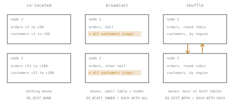

# Lesson 9. Joins and Data Distribution

**Mission link:** Choosing a table's layout includes choosing where its rows live across compute. On a distributed warehouse a join's cost is often not the comparison but the network traffic before it, and the distribution choice decides how much of that there is.
**Primary source:** [Docs: "Data distribution for query optimization", Amazon Redshift](https://docs.aws.amazon.com/redshift/latest/dg/t_Distributing_data.html)
**Prerequisites:** [Lesson 8](0008-clustering-and-sort-keys.md), [Distribution style](../GLOSSARY.md), [Bytes scanned](../GLOSSARY.md)

## Warm-up

1. ▢ A Redshift table has a compound sort key `(region, order_date)`. Does a filter on `order_date` alone prune well? Why?

Check

Not well. A compound key sorts by `region` first, so each date's rows are scattered across every region's stretch of blocks. Zone maps on `order_date` stay wide except within one region. Filters should use a prefix of the key.

2. ▢ What does a Snowflake clustering depth of 1 mean?

Check

No micro-partitions overlap on the measured columns: a filter on one value reads about one micro-partition. It is the floor; clustering cannot improve the table further.

3. ▢ What does a BigQuery slot represent, and who decides how many a query gets?

Check

A share of CPU, memory and network that a query's stages run on. The scheduler grants them, up to what the project's on-demand pool or its reservation holds; the query cannot ask for a number.

## Know this

### Matching rows have to meet

A distributed warehouse spreads each table across many workers: Redshift slices on compute nodes, BigQuery slots, the nodes of a Snowflake virtual warehouse. To join `orders` to `customers` on `customer_id`, each order must be on the same worker as its customer at the moment of comparison. If they already are, the join is local. If not, rows cross the network first, and Redshift's documentation notes that this redistribution "can account for a substantial portion of the cost of a query plan" ([Data distribution for query optimization](https://docs.aws.amazon.com/redshift/latest/dg/t_Distributing_data.html)).

There are three ways for the rows to meet:

- **Co-located:** both tables were already placed by the hash of the join key, so matching rows share a worker. Nothing moves.
- **Broadcast:** a full copy of the smaller side is sent to every worker holding part of the larger side. The bytes moved are the small table times the number of workers.
- **Shuffle**, also called a hash join or redistribution: both sides are rehashed on the join key and each row is sent to the worker that owns its hash. The bytes moved are most of both tables.

### Worked example: bytes on the wire

An 8-node cluster joins `orders` (2 TB, 30 columns) to `customers` (40 GB, 20 columns) on `customer_id`. The query references 3 order columns and 2 customer columns, so a column store moves only those: about 200 GB of orders and 4 GB of customers.

- **Co-located** on `customer_id`: 0 bytes moved.
- **Broadcast customers:** 4 GB × 8 = 32 GB moved.
- **Shuffle both:** about 204 GB moved, most of it crossing between nodes.
- **Broadcast orders**, the planner's worst choice: 200 GB × 8 = 1.6 TB.

The ranking is the whole lesson: co-location beats broadcasting a small side, which beats shuffling, and broadcasting the large side is a mistake a planner makes only on a bad size estimate.

### Redshift: you choose the placement

Redshift is the one of the three that lets you set placement per table, with the **[distribution style](../GLOSSARY.md)** ([Distribution styles](https://docs.aws.amazon.com/redshift/latest/dg/c_choosing_dist_sort.html)):

| Style | Rows placed | Use for |
|---|---|---|
| `KEY` | By the hash of one column, so equal values share a slice | A large table joined often on that column |
| `EVEN` | Round robin, regardless of values | A table that joins nothing, or with no clear key |
| `ALL` | A full copy on every node | A slowly changing table that cannot be co-located with the fact |
| `AUTO` | Chosen by Redshift: `ALL` while small, then `KEY` or `EVEN` as it grows | The default, and the recommended starting point |

Distribute a fact table and the dimension it joins most on the same key, and their join is co-located. A table has only one distribution key, so a fact can be co-located with one dimension; the guidance is to pick the dimension that is largest after filtering, and to give others `ALL` if they are slow-moving ([Choose the best distribution style](https://docs.aws.amazon.com/redshift/latest/dg/c_best-practices-best-dist-key.html)). `ALL` multiplies storage by the node count and slows every load, and small dimensions gain little from it because broadcasting them is cheap anyway.

`EXPLAIN` names the movement on each join step ([Evaluating the query plan](https://docs.aws.amazon.com/redshift/latest/dg/c_data_redistribution.html)):

- `DS_DIST_NONE` and `DS_DIST_ALL_NONE`: nothing moved. Good.
- `DS_DIST_INNER`: the inner table was redistributed, because the outer is already on the join key.
- `DS_BCAST_INNER`: the whole inner table was broadcast to every node.
- `DS_DIST_BOTH`: both tables were redistributed.
- `DS_DIST_ALL_INNER`: the inner table went to a single slice because the outer is `ALL`, so the join ran serially. Never put `ALL` on the outer, large side.

### Skew: when one worker does the work

Distribution has two goals, and the second one is easy to forget: minimize movement, and spread work evenly. A `KEY` column with few distinct values, or one dominant value such as a placeholder customer `-1` holding 30 percent of orders, puts that share on one slice. The query finishes when the busiest slice does, so 32 slices with one holding 30 percent run about ten times slower than an even spread. Filters cause skew too: a table distributed on a date and queried for one narrow date range concentrates the surviving rows on a few slices. Choose a key with high cardinality in the filtered rows, and check a table's skew in `SVV_TABLE_INFO`.

### BigQuery and Snowflake: the planner chooses

Neither BigQuery nor Snowflake exposes a distribution setting. Both store tables in shared storage, so no table "lives on" a node, and both decide for themselves how each join moves rows, from the sizes involved.

BigQuery's query plan names the choice in each stage's steps: `JOIN EACH WITH ALL` is a broadcast, used when one side fits in a single worker's memory, and `JOIN EACH WITH EACH` is a hash join that shuffles both sides ([Query plan and timeline](https://cloud.google.com/bigquery/docs/query-plan-explanation)). Skew shows as a stage whose maximum compute time is far above its average. Its performance guidance adds two habits that make the planner's job easier: put the largest table first, and join on `INT64` rather than `STRING`, since "the wider the join column is, the longer the comparison takes" ([Optimize query computation](https://cloud.google.com/bigquery/docs/best-practices-performance-compute)).

Snowflake's query profile shows each join operator and the bytes sent over the network for the query. Your levers there are the same as on BigQuery: filter both sides before the join so less moves, project fewer columns, and avoid join keys where one value dominates.

### Predict, then run

Redshift's own example joins `sales`, `listing` and `event`. `sales` and `listing` are distributed on `listid`, the key they join on; the join to `event` is on `eventid`, which `sales` is not distributed on. Before reading the documentation's plan, predict the label on the `sales` to `listing` join and on the join to `event`. Then predict how the `event` join's label changes after `event` is switched to `DISTSTYLE ALL`.

The documented plan shows `DS_DIST_NONE` on the co-located `listid` join and `DS_BCAST_INNER` on the joins to `event` and `venue`; after both dimensions move to `ALL`, those become `DS_DIST_ALL_NONE` and the plan's relative cost falls from about 3.27 billion to about 14 thousand ([Evaluating the query plan](https://docs.aws.amazon.com/redshift/latest/dg/c_data_redistribution.html)). Run the same `EXPLAIN` on two tables you own.

## Practice

1. ▢ Name the three ways a distributed warehouse brings matching rows together for a join, and what each moves.

Check

Co-located: nothing moves, because both tables were placed by the join key. Broadcast: the smaller side, copied to every worker. Shuffle: both sides, rehashed on the join key and sent to the worker that owns each hash.

2. ▢ Which Redshift distribution style fits a 5 TB fact table joined most often on `customer_id`?

    - a) `ALL`, so that every node holds the whole fact table
    - b) `EVEN`, so that rows spread round robin over all slices
    - c) `KEY` on `customer_id`, matching its main dimension's key
    - d) `KEY` on `order_date`, since most queries filter on dates

Check

**c)** Distributing the fact and its main dimension on `customer_id` co-locates their join. (a) multiplies 5 TB by the node count and slows every load; `ALL` is for slow-moving dimensions. (b) spreads evenly but forces every join on `customer_id` to move rows. (d) concentrates a narrow date filter on a few slices, which is skew, and does not co-locate the join.

3. ▢ A 16-node cluster joins `page_views` (references 4 columns, 400 GB after projection) to `pages` (references 2 columns, 1 GB after projection) on `page_id`. Neither is distributed on `page_id`. Estimate the bytes moved by broadcasting `pages` and by shuffling both, and say which a planner should pick.

Hint

Broadcast multiplies the side it sends by the number of nodes. Shuffle sends roughly both sides once.

Check

Broadcast `pages`: 1 GB × 16 = 16 GB. Shuffle both: about 401 GB. Broadcast wins by a factor of 25. Shuffling is the right choice only when neither side is small enough that copying it to every node costs less than moving both once.

4. ▢ A Redshift `EXPLAIN` shows `DS_DIST_ALL_INNER` on the join of a large `clicks` table to `campaigns`. `clicks` uses `DISTSTYLE ALL`. Explain what is happening and fix it.

Hint

Ask which side of the join is the outer one, and what `ALL` on that side forces the inner side to do.

Check

Because the outer `clicks` table is copied whole onto every node, Redshift sends the entire inner `campaigns` table to a single slice and runs the join serially there, using one slice instead of the whole cluster. `ALL` belongs on the small inner side, never on the large outer one. Give `clicks` `KEY` distribution on the join column, or `EVEN`, and leave `campaigns` `ALL` or `KEY` on the same column.

5. ▢ A team distributes `orders` on `customer_id`. A query that groups by customer runs ten times longer than the cluster's size suggests, and `SVV_TABLE_INFO` shows high skew. What do you look for in the data, and what are the options?

Check

Look for a dominant value of `customer_id`, typically a placeholder such as `-1`, `0` or null for guest checkouts, holding a large share of rows on one slice. Options: give placeholder rows real distinct keys, distribute on a higher-cardinality column such as `order_id` and accept redistribution for the customer join, or use `EVEN`. Each trades the skew for some data movement.

6. ▢ Interleave lesson 7: on BigQuery, a fact table partitioned by day joins a date dimension filtered to one fiscal quarter, and the plan shows `JOIN EACH WITH EACH` with a large shuffle. Name two changes that shrink what moves, and which earlier mechanism each relies on.

Check

Add the quarter's literal date range on the fact's partition column, so the fact is pruned to about 90 partitions before the join: lesson 7's pruning, which a filter reaching the fact only through the join could not trigger. Reference only the columns the result needs, so each shuffled row is narrower: lesson 1's column selection. With the fact smaller, the planner may also switch to broadcasting the small dimension.

## Real-world reps

- [ ] Today: run `EXPLAIN` (Redshift) or open the execution details (BigQuery) or query profile (Snowflake) of your most expensive join, and write down which side moved and how.
- [ ] On Redshift, query `SVV_TABLE_INFO` for your largest tables and note each one's distribution style and skew. On BigQuery or Snowflake, find one stage or operator whose maximum time is far above its average.
- [ ] Tomorrow: for one fact table, write the distribution or join-filter change you would make, the bytes you expect it to stop moving, and how you would confirm it in the plan.

## Going further

- [Physical Design](../reference/physical-design.md)
- [Docs: "Data distribution for query optimization", Amazon Redshift](https://docs.aws.amazon.com/redshift/latest/dg/t_Distributing_data.html)
- [Docs: "Choose the best distribution style", Amazon Redshift](https://docs.aws.amazon.com/redshift/latest/dg/c_best-practices-best-dist-key.html)
- [Docs: "Optimize query computation", Google Cloud](https://cloud.google.com/bigquery/docs/best-practices-performance-compute)
- [Join strategies on a row store](../../../programming/sql/reference/performance.md#join-strategies): hash, merge and nested loop on one machine, which the warehouse runs on each worker after the rows have met
- [Resources](../RESOURCES.md)

---

Not landing? Reread the primary source at the top, since this lesson compresses it and compression is where understanding leaks. Check the [glossary](../GLOSSARY.md) for any term that felt slippery.

If the lesson itself is unclear rather than the material, that is a defect: [open an issue](https://github.com/TokenCemetery/teach/issues).
