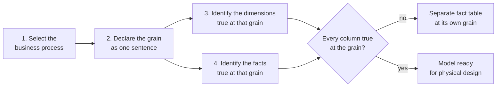

# Lesson 11. Facts, Dimensions and the Grain

**Mission link:** Stage 4 chose a table's physical layout. Stage 5 decides what the tables are, starting with the decision every other one depends on: what exactly one fact row means. A model with the wrong grain double counts however well it is partitioned.
**Primary source:** [Docs: "Declare the Grain", Kimball Group](https://www.kimballgroup.com/data-warehouse-business-intelligence-resources/kimball-techniques/dimensional-modeling-techniques/grain/)
**Prerequisites:** [Lesson 10](0010-the-row-store-advice-that-stops-applying.md), [Grain](../GLOSSARY.md), [Fact table](../GLOSSARY.md), [Dimension table](../GLOSSARY.md)

## Warm-up

1. ▢ A 1 TB table has 200 columns of equal width. A query references 3 of them. Roughly how many bytes does a column store read before any pruning?

<details markdown="1"><summary>Check</summary>

3 ÷ 200 × 1 TB = 15 GB. Bytes scanned follow the columns referenced, not the rows returned or the columns that exist.

</details>

2. ▢ What does a filter need for pruning to skip a partition or block?

<details markdown="1"><summary>Check</summary>

A condition on the column the table is partitioned or clustered by, written so the engine can compare it with each partition's or block's metadata (its value or its min and max) before reading it. A filter on another column, or one that wraps the partition column in a function the engine cannot see through, reads everything.

</details>

3. ▢ Lesson 10 named row-store habits that stop applying. Why is normalizing every repeated attribute into its own table a weaker habit on a columnar warehouse?

<details markdown="1"><summary>Check</summary>

A repeated value in one column compresses to almost nothing under dictionary and run-length encoding, so normalizing saves little storage. Each extra table it creates adds a join, and a distributed join can mean moving rows between nodes, which costs more than the bytes normalizing saved.

</details>

## Know this

### A model is four decisions, made in order

The Kimball Group's design process is four decisions, in this order: select the business process, declare the grain, identify the dimensions, identify the facts ([Four-Step Dimensional Design Process](https://www.kimballgroup.com/data-warehouse-business-intelligence-resources/kimball-techniques/dimensional-modeling-techniques/four-4-step-design-process/)).

A business process is something the organization does that produces measurements, such as taking an order or counting stock. One fact table models one process, not a department and not a report.



### The grain is a sentence

The grain states what exactly one fact table row represents, and it is declared before any dimension or fact is chosen ([Declare the Grain](https://www.kimballgroup.com/data-warehouse-business-intelligence-resources/kimball-techniques/dimensional-modeling-techniques/grain/)). Write it as a sentence a colleague could test against a row:

- Good: "One row per product line on one customer order, as recorded when the order is placed."
- Good: "One row per product per store per day, holding the stock on hand at close."
- Not a grain: "Sales data, daily." It names neither the thing one row is about nor which events become rows.

Kimball recommends the **atomic** grain, the lowest level the process captures, because atomic rows answer questions nobody has asked yet, while a summary grain presupposes them. On a columnar warehouse the usual objection, size, weighs less: queries pay for the columns they read, and partitioning and clustering skip the rows a filter excludes.

### Mixed grain double counts

Every fact in the table must be true at the declared grain, and different grains must not share a table. The failure is quiet: a number that belongs to a coarser grain gets copied onto every finer row, and `SUM` adds the copies.

Here is an order-line table that also carries the order's shipping fee. Predict both sums before you run it. DuckDB runs it as-is, with no warehouse account.

```sql
CREATE TABLE order_lines AS
SELECT * FROM (VALUES
    (1001, 1, 'kettle', 40.00, 9.00),
    (1001, 2, 'mug',     8.00, 9.00),
    (1001, 3, 'teapot', 25.00, 9.00),
    (1002, 1, 'mug',     8.00, 5.00)
) AS t(order_id, line_number, product, line_amount, shipping_fee);

SELECT SUM(line_amount) AS goods, SUM(shipping_fee) AS shipping
FROM order_lines;
```

`goods` is 81.00 and correct, because `line_amount` is true at the line grain. `shipping` comes back as 32.00, but the business charged 14.00: order 1001's fee of 9.00 was counted once per line. Nothing errors.

Two fixes keep the grain honest:

- **A second fact table at the order grain**, one row per order, holding the shipping fee. Line facts and order facts then share dimensions but never share rows.
- **Allocate** the fee down to the lines by a stated rule (3.00 per line, or in proportion to `line_amount`), so the new column is true at the line grain and sums correctly.

### Three kinds of fact table

Kimball names three fact table types, each with its own shape of grain:

| Type | One row per | Rows change after insert? |
|---|---|---|
| Transaction | One event at one instant, such as one order line | No |
| Periodic snapshot | One entity per fixed period, such as one account per day | No, one new row per period, even when nothing happened |
| Accumulating snapshot | One instance of a process with fixed milestones, such as one order from placed to delivered | Yes, the row is updated as each milestone is reached |

The type also decides how a measure adds up ([Additive, Semi-Additive, and Non-Additive Facts](https://www.kimballgroup.com/data-warehouse-business-intelligence-resources/kimball-techniques/dimensional-modeling-techniques/additive-semi-additive-non-additive-fact/)). A sale amount is **additive**: it sums across every dimension. An account balance in a periodic snapshot is **semi-additive**: it sums across accounts but not across days, since adding thirty daily balances gives no balance at all. A ratio such as margin percent is **non-additive**: store its additive parts (revenue, cost) and divide after summing.

### Surrogate keys

A dimension table keys its rows with a surrogate key, a meaningless integer or hash the warehouse assigns, rather than the source system's natural key such as a customer number ([Dimension Surrogate Keys](https://www.kimballgroup.com/data-warehouse-business-intelligence-resources/kimball-techniques/dimensional-modeling-techniques/dimension-surrogate-key/)). Two reasons: lesson 13 will give one customer several rows over time, so the natural key stops being unique; and two source systems can reuse or disagree on natural keys. The date dimension is the usual exception, keyed by the date itself. The fact table stores the surrogate key as its foreign key to each dimension.

How each platform produces one:

- **Snowflake**: an `IDENTITY` (or `AUTOINCREMENT`) column, or a sequence. Values are unique, not gap-free.
- **Redshift**: an `IDENTITY` column. Values are unique but not guaranteed consecutive, since slices assign them in parallel.
- **BigQuery**: no auto-increment column. Use `GENERATE_UUID()`, or a deterministic hash such as `FARM_FINGERPRINT` over the natural key and the row's validity start, which has the advantage of giving the same key when a load is rerun.

### The warehouse will not enforce your grain

A row store would reject a duplicate primary key. None of the three warehouses do. BigQuery states that it does not enforce primary and foreign key constraints, and uses them only to remove or reorder joins ([Primary and foreign keys](https://docs.cloud.google.com/bigquery/docs/primary-foreign-keys)). Redshift calls uniqueness, primary key and foreign key constraints informational, and warns that its planner trusts them, so an invalid one can return wrong results ([Table constraints](https://docs.aws.amazon.com/redshift/latest/dg/t_Defining_constraints.html)). Snowflake enforces `NOT NULL` and `CHECK` on standard tables and treats primary, unique and foreign keys as informational ([Table design considerations](https://docs.snowflake.com/en/user-guide/table-considerations)). So the grain is something you test, after every load:

```sql
SELECT order_id, line_number, COUNT(*) AS rows_at_grain
FROM fact_order_line
GROUP BY order_id, line_number
HAVING COUNT(*) > 1;
```

Any row returned breaks the grain sentence, and every sum over the table is now wrong by an amount you cannot see.

### Conformed dimensions

When the order-line fact and the shipment fact both join to the same customer and product dimensions, with the same keys and the same attribute values, those dimensions are **conformed** ([Conformed Dimensions](https://www.kimballgroup.com/data-warehouse-business-intelligence-resources/kimball-techniques/dimensional-modeling-techniques/conformed-dimension/)). That is what lets a report put revenue and units shipped side by side per region: each fact table is aggregated to region on its own, and the two results line up on the shared attribute (drilling across). Joining two fact tables directly, row to row, mixes their grains and double counts exactly as the shipping fee did.

## Practice

1. ▢ A ride-hailing company wants to analyse completed trips: fare, distance, driver, rider, pickup zone and time. Write the grain sentence for the fact table.

<details markdown="1"><summary>Check</summary>

Something like: "One row per completed trip, recorded when the trip ends." It names the thing (a trip), which trips become rows (completed ones), and when the row is captured. "Trip data by day" fails: it does not say what one row is.

</details>

2. ▢ An order-line fact table also stores `order_discount`, a discount applied to the whole order. Order 77 has four lines and a discount of 10.00. Predict `SUM(order_discount)` for that order, and say which fix you would make.

<details markdown="1"><summary>Hint</summary>

Ask at which grain the discount is true, and how many rows at the finer grain carry a copy of it.

</details>

<details markdown="1"><summary>Check</summary>

40.00: the order-grain value is copied onto all four lines. Either move `order_discount` to a fact table at the order grain, or allocate it to the lines by a stated rule (2.50 each, or in proportion to each line's amount) so the column is true at the line grain.

</details>

3. ▢ A warehouse team records each warehouse's stock on hand for every product at the end of every day. Which fact table type is this?

    - a) A transaction fact table, one row per stock movement
    - b) A periodic snapshot, one row per product per day
    - c) An accumulating snapshot, one row updated per milestone
    - d) A conformed dimension shared across every stock process

<details markdown="1"><summary>Check</summary>

**b)** The grain is an entity per fixed period, and a row is written each day even when the stock did not move. (a) describes the movements that change the stock, a different process and a different table. (c) fits a process with fixed milestones, such as an order moving to delivery, not a daily level. (d) is not a fact table at all.

</details>

4. ▢ The table in item 3 is partitioned by `snapshot_date`. An analyst wants March's closing stock and writes `SUM(stock_on_hand) WHERE snapshot_date BETWEEN '2026-03-01' AND '2026-03-31'`. What is wrong with the answer, and how many of the table's daily partitions does the query read?

<details markdown="1"><summary>Hint</summary>

Stock on hand is a balance. Ask which dimension it cannot be summed across, then apply lesson 7 to the filter.

</details>

<details markdown="1"><summary>Check</summary>

Stock on hand is semi-additive: it sums across products and warehouses, never across days, so this adds 31 daily levels and returns about 31 times the real stock. Filter to `snapshot_date = '2026-03-31'` instead. The original filter prunes to the 31 March partitions; the corrected one prunes to one, so it is both right and cheaper.

</details>

5. ▢ A colleague's `fact_sales` holds one row per order line, plus one extra row per order with `product_key` null and only `shipping_fee` filled in, "so everything is in one table". Name two ways this breaks reports, and redesign it.

<details markdown="1"><summary>Check</summary>

It mixes two grains in one table. `COUNT(*)` over it no longer counts lines, and any query grouping by a product attribute either drops the shipping rows (inner join to the product dimension) or shows them under a null product. Redesign: `fact_order_line` at the line grain and `fact_order` at the order grain, both joined to the same conformed customer and date dimensions, so revenue and shipping can still be reported side by side by drilling across.

</details>

## Real-world reps

- [ ] Pick one business process you know (orders, tickets, payments, deployments) and write its grain sentence. Then list three facts and three dimensions, and check each is true at that sentence.
- [ ] Run the shipping-fee example above in DuckDB, then add `fact_order` at the order grain and confirm the shipping total comes back as 14.00.
- [ ] Tomorrow: find a fact table you can query, write down the columns that should be unique at its grain, and run the `GROUP BY ... HAVING COUNT(*) > 1` test on them. Note what it returns.

## Going further

- [Dimensional Modelling](../reference/dimensional-modelling.md)
- [Docs: "Declare the Grain", Kimball Group](https://www.kimballgroup.com/data-warehouse-business-intelligence-resources/kimball-techniques/dimensional-modeling-techniques/grain/)
- [Docs: "Four-Step Dimensional Design Process", Kimball Group](https://www.kimballgroup.com/data-warehouse-business-intelligence-resources/kimball-techniques/dimensional-modeling-techniques/four-4-step-design-process/)
- [Docs: "Dimensional Modeling Techniques", Kimball Group](https://www.kimballgroup.com/data-warehouse-business-intelligence-resources/kimball-techniques/dimensional-modeling-techniques/)
- [Resources](../RESOURCES.md)

---

Not landing? Reread the primary source at the top, since this lesson compresses it and compression is where understanding leaks. Check the [glossary](../GLOSSARY.md) for any term that felt slippery.

If the lesson itself is unclear rather than the material, that is a defect: [open an issue](https://github.com/TokenCemetery/teach/issues).
