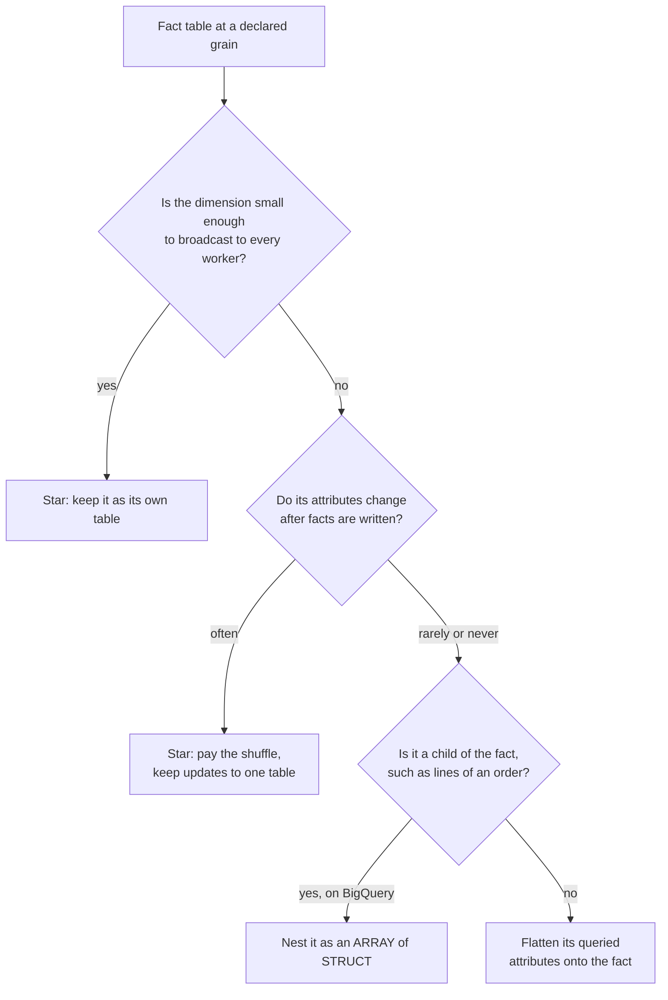

# Lesson 12. Star Schemas, Wide Tables and Nesting

**Mission link:** Lesson 11 decided what one fact row means. This lesson decides how the dimensions reach it: joined, copied onto it, or nested inside it, chosen from the mechanics of stages 1 to 4 rather than from taste.
**Primary source:** [Docs: "Use nested and repeated fields", Google Cloud](https://cloud.google.com/bigquery/docs/nested-repeated)
**Prerequisites:** [Lesson 11](0011-facts-dimensions-and-the-grain.md), [Star schema](../GLOSSARY.md), [Dimension table](../GLOSSARY.md)

## Warm-up

1. ▢ Write a grain sentence for a table of customer support tickets, and name one fact that would break it.

<details markdown="1"><summary>Check</summary>

"One row per ticket, recorded when the ticket is opened." A fact true at another grain breaks it, such as the number of agents on shift that day (one value per day, copied onto every ticket) or each reply's response time (many values per ticket).

</details>

2. ▢ Why does a dimension table key its rows with a surrogate key rather than the source system's customer number?

<details markdown="1"><summary>Check</summary>

One customer can need several dimension rows over time, so the customer number stops being unique, and different source systems can reuse or disagree on it. A key the warehouse assigns stays unique and stable whatever the sources do.

</details>

3. ▢ In lesson 9, what decides whether a distributed join must move the large table's rows between nodes?

<details markdown="1"><summary>Check</summary>

Whether matching rows are already on the same node. If the small side is copied to every node (a broadcast, or Redshift's `DISTSTYLE ALL`) or both sides are distributed on the join key, the large side stays put. Otherwise both sides are hashed on the join key and shuffled.

</details>

## Know this

### One model, four shapes

Take the order-line fact from lesson 11, with a customer dimension and a product dimension. There are four ways to store it:

- **Star schema**: the fact table holds surrogate keys; each dimension is one denormalized table, one join away.
- **Snowflake schema**: each dimension is normalized further, so product joins to category, which joins to department.
- **One wide table**: every dimension attribute the reports need is copied onto every fact row. No joins at query time.
- **Nested**: the fact row carries its child rows or its dimension attributes inside it as `STRUCT` and `ARRAY` columns. BigQuery's own guidance names this as the way to keep relationships without paying for a join ([Use nested and repeated fields](https://cloud.google.com/bigquery/docs/nested-repeated)).

Three mechanics decide between them.

### Mechanic 1: columns a query does not read cost nothing

Lesson 1's rule: a column store reads only the referenced columns. A wide table with 150 columns costs a query that reads 3 of them the same as a 3-column table of the same rows. So width alone is not a reason to avoid a wide table.

It is also not a reason to expect one to be cheaper. Work it through on BigQuery, whose on-demand price is per byte scanned and whose byte counts come from each type's logical size: 8 bytes for `INT64`, 16 for `NUMERIC`, 2 plus the UTF-8 length for `STRING` ([Data type sizes](https://docs.cloud.google.com/bigquery/docs/reference/standard-sql/data-types)). Query: revenue by customer region, over 2 billion order lines, with 5 million customers.

- **Star**: from the fact, `customer_key` (8 bytes) and `amount` (16 bytes): 2 × 10⁹ × 24 = 48 GB. From the dimension, `customer_key` and `region` (about 10 bytes): 5 × 10⁶ × 18 = 90 MB. Total about 48.1 GB.
- **Wide**: `region` (10 bytes) and `amount` (16 bytes) from the one table: 2 × 10⁹ × 26 = 52 GB.

The wide table scans slightly more, because a region string on every row is bigger than an integer key. On Snowflake and Redshift, which bill compute time and compress the repeated string to almost nothing, the two scan about the same. The bytes are not where the shapes differ. The join is.

### Mechanic 2: joins cost shuffles, unless one side is small

A 90 MB dimension is small enough to send whole to every worker. BigQuery calls this a broadcast join ([Optimize query computation](https://cloud.google.com/bigquery/docs/best-practices-performance-compute)); Redshift gets the same effect by storing small dimensions with `DISTSTYLE ALL` ([Data distribution](https://docs.aws.amazon.com/redshift/latest/dg/t_Distributing_data.html)); Snowflake's optimizer chooses broadcast or hash itself. The 2 billion fact rows never move. A star join to small dimensions is cheap, which is why the star remains the default shape.

The join that hurts is large to large: order lines to a 500-million-row customer table, or orders to their own lines. Neither side fits on every worker, so both are hashed on the key and shuffled across the network. That is the case BigQuery's documentation points at when it says joining large tables regularly can be resource intensive. Two shapes remove it:

- **Flatten** the large dimension's few queried attributes onto the fact.
- **Nest** the child rows inside the parent, so an order and its lines are stored together and read without a join. A query reaches the lines with `UNNEST`. The Dremel paper shows why this stays columnar: each leaf field of a nested record is stored as its own column, so `line_items.amount` is read without reading `line_items.product_name` ([Dremel](https://www.vldb.org/pvldb/vol3/R29.pdf)).

Nesting has a price lesson 11 should make you check: the table's grain is now the order, and the lines are a second grain inside it. A query that unnests the lines and also sums an order-level column double counts exactly as the shipping fee did. BigQuery also limits a schema to 15 levels of nested records.

### Mechanic 3: changing a dimension rewrites a wide table

Columnar storage files are written once and replaced, not edited in place: a Snowflake micro-partition is immutable, and a BigQuery or Redshift update likewise writes new blocks for the rows it touches. So the cost of a change depends on how many rows hold the changed value.

Suppose 20,000 customers are reassigned to new sales regions this month, and reports should show the current region (lesson 13 calls this a type 1 change).

- **Star**: update 20,000 rows of a 5-million-row dimension. One small table rewritten.
- **Wide**: update every fact row for those customers. Their orders are spread over every date partition, so the update rewrites blocks across most of the 2-billion-row table.

A wide table suits dimensions that never change after the fact is written, such as the product's name at the time of sale, or a model rebuilt from scratch on every run anyway. It suits badly a dimension whose attributes are corrected often.

### How the platforms expose nesting

BigQuery's `STRUCT` and `ARRAY` columns are typed and stored per leaf field, as the Dremel paper describes. Snowflake (`VARIANT`, `OBJECT`, `ARRAY`) and Redshift (`SUPER`) hold semi-structured values too, but there they are more often how raw data lands than the model's shape; check how each prunes a path inside such a value before designing around it.

### Choosing



A snowflake schema appears nowhere in that tree. The Kimball Group advises avoiding it: a flattened dimension holds the same information, and the extra joins cost query time and make the model harder to read ([Snowflaked Dimensions](https://www.kimballgroup.com/data-warehouse-business-intelligence-resources/kimball-techniques/dimensional-modeling-techniques/snowflake-dimension/)). On a columnar warehouse the storage normalizing saves is mostly already saved by compression.

### Predict, then run

BigQuery's public `thelook_ecommerce` dataset has `order_items` (with `user_id` and `sale_price`) and `users` (with `id` and `country`). Before running anything, predict which columns the first query scans, then compare its dry-run estimate with the second's:

```sql
SELECT u.country, SUM(oi.sale_price) AS revenue
FROM `bigquery-public-data.thelook_ecommerce.order_items` AS oi
JOIN `bigquery-public-data.thelook_ecommerce.users` AS u ON oi.user_id = u.id
GROUP BY u.country;

SELECT oi.status, SUM(oi.sale_price) AS revenue
FROM `bigquery-public-data.thelook_ecommerce.order_items` AS oi
GROUP BY oi.status;
```

A dry run reads no data and is not billed ([Run a query](https://cloud.google.com/bigquery/docs/running-queries)). The difference between the two estimates is the bytes the join added: two columns of `users` and `user_id` of `order_items`, nothing else.

## Practice

1. ▢ A fact table has 1 billion rows. Each query reads `product_key` (`INT64`) and `amount` (`NUMERIC`), joined to a 40,000-row product dimension for `category`. A colleague proposes copying `category` (about 12 characters) onto the fact. Predict the BigQuery bytes scanned per query before and after.

<details markdown="1"><summary>Hint</summary>

Use 8, 16, and 2 plus the string length. The dimension's contribution is a rounding error.

</details>

<details markdown="1"><summary>Check</summary>

Before: 10⁹ × (8 + 16) = 24 GB, plus about 1 MB from the dimension (billed as BigQuery's 10 MB minimum per table referenced). After: 10⁹ × (14 + 16) = 30 GB. Flattening scans more here, and the join it removes was a broadcast of a tiny table that never moved the fact rows. Keep the star.

</details>

2. ▢ When is nesting order lines inside an order row on BigQuery the better shape?

    - a) When lines are always read with their order and rarely change
    - b) When the line table is small enough to broadcast everywhere
    - c) When other fact tables must join to individual lines often
    - d) When the order's attributes are corrected many times daily

<details markdown="1"><summary>Check</summary>

**a)** Nesting removes a large-to-large join, and pays for it when rows change, since each change rewrites the whole order row. (b) is the case where a plain join is already cheap. (c) needs lines as their own table with their own key. (d) makes every correction rewrite an order and all its nested lines.

</details>

3. ▢ A Redshift star schema joins a 3-billion-row fact to a 2,000-row store dimension. The query profile shows the fact rows being redistributed. What would you change, and why does flattening `store_name` onto the fact not need to be the answer?

<details markdown="1"><summary>Hint</summary>

Lesson 9: which side should be copied so that the large side stays where it is?

</details>

<details markdown="1"><summary>Check</summary>

Set the store dimension to `DISTSTYLE ALL` (or let `AUTO` choose it), so every node holds a full copy and the fact joins locally without moving. The join was expensive because of placement, not because a join exists; fixing placement keeps one store row to update instead of millions of fact rows.

</details>

4. ▢ A nested BigQuery `orders` table has `shipping_fee` at the order level and `line_items` as an `ARRAY<STRUCT<product_key INT64, amount NUMERIC>>`. A query computes `SUM(shipping_fee)` and `SUM(li.amount)` after `CROSS JOIN UNNEST(line_items) AS li`. What is wrong?

<details markdown="1"><summary>Check</summary>

Unnesting produces one row per line, so `shipping_fee` is repeated once per line and summed that many times: the mixed-grain double count from lesson 11, now inside one table. Sum `shipping_fee` over orders before unnesting, or in a separate subquery, and sum the lines after.

</details>

## Real-world reps

- [ ] Run the two `thelook_ecommerce` queries as dry runs in the BigQuery console or with `bq query --dry_run`, after writing your predicted byte difference down.
- [ ] Take one fact table you know and list its dimensions with their row counts. Mark each as broadcast-sized or large, and as rarely or often changed, then place it on the decision tree above.
- [ ] Tomorrow: in a schema you can read, find one wide or nested table and name which dimension attribute in it changes most often. Estimate how many rows a change to one value would rewrite.

## Going further

- [Dimensional Modelling](../reference/dimensional-modelling.md)
- [Docs: "Use nested and repeated fields", Google Cloud](https://cloud.google.com/bigquery/docs/nested-repeated)
- [Paper: "Dremel: Interactive Analysis of Web-Scale Datasets", Melnik et al., VLDB (2010)](https://www.vldb.org/pvldb/vol3/R29.pdf)
- [Docs: "Optimize query computation", Google Cloud](https://cloud.google.com/bigquery/docs/best-practices-performance-compute)
- [Docs: "Dimensional Modeling Techniques", Kimball Group](https://www.kimballgroup.com/data-warehouse-business-intelligence-resources/kimball-techniques/dimensional-modeling-techniques/)
- [Resources](../RESOURCES.md)

---

Not landing? Reread the primary source at the top, since this lesson compresses it and compression is where understanding leaks. Check the [glossary](../GLOSSARY.md) for any term that felt slippery.

If the lesson itself is unclear rather than the material, that is a defect: [open an issue](https://github.com/TokenCemetery/teach/issues).
