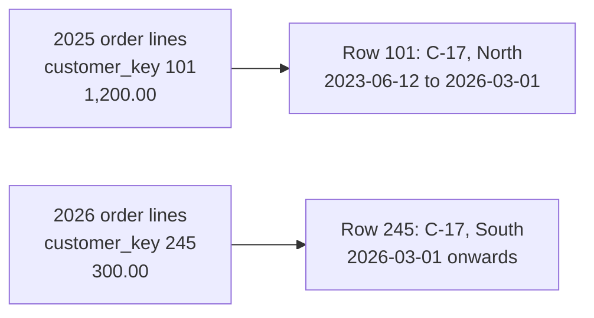

# Lesson 13. Slowly Changing Dimensions

**Mission link:** The mission asks for a model at a stated grain "including how a changing dimension keeps its history". Lessons 11 and 12 built the model; this lesson decides what happens to last year's numbers when a customer moves.
**Primary source:** [Docs: "Type 2: Add New Row", Kimball Group](https://www.kimballgroup.com/data-warehouse-business-intelligence-resources/kimball-techniques/dimensional-modeling-techniques/type-2/)
**Prerequisites:** [Lesson 12](0012-star-schemas-wide-tables-and-nesting.md), [Slowly changing dimension](../GLOSSARY.md), [Surrogate key](../GLOSSARY.md)

## Warm-up

1. ▢ An order-line fact stores the order's shipping fee on every line. What does `SUM(shipping_fee)` return for an order with three lines and a fee of 6.00, and what is the underlying mistake?

<details markdown="1"><summary>Check</summary>

18.00. A fact true at the order grain was stored at the line grain, so it is counted once per line. Mixed grain double counts without raising any error.

</details>

2. ▢ Why is a dimension attribute that is corrected often a poor candidate for flattening onto a wide fact table?

<details markdown="1"><summary>Check</summary>

Columnar blocks are rewritten, not edited in place, and a flattened attribute is copied onto every fact row it describes. One correction then rewrites blocks across every partition holding those rows, where a star schema rewrites one dimension row.

</details>

3. ▢ A fact table is partitioned by `order_date`. Which of these filters prunes: `WHERE order_date >= '2025-01-01'`, or `WHERE EXTRACT(YEAR FROM order_ts) = 2025` on an unpartitioned timestamp column?

<details markdown="1"><summary>Check</summary>

The first: it compares the partitioning column directly with a constant. The second filters a column the table is not partitioned by, so every partition is read.

</details>

## Know this

### The problem: one customer, one move, two years of reports

Customer C-17, Ana, lived in the North region through 2025 and bought 1,200.00 of goods there. On 2026-03-01 she moved to the South and has bought 300.00 since. Last year's "2025 revenue by region" report, as published in January, showed her 1,200.00 under North.

The source now says `region = 'South'`. What the dimension does with that change decides whether rerunning the 2025 report gives the published answer. The Kimball Group numbers the techniques ([Dimensional Modeling Techniques](https://www.kimballgroup.com/data-warehouse-business-intelligence-resources/kimball-techniques/dimensional-modeling-techniques/)); three of them carry almost all real models.

### Type 1: overwrite

The dimension row's `region` is overwritten with `South` ([Type 1: Overwrite](https://www.kimballgroup.com/data-warehouse-business-intelligence-resources/kimball-techniques/dimensional-modeling-techniques/type-1/)). No row is added and history is gone.

Rerun the 2025 report: Ana's 1,200.00 now appears under South. North's 2025 total has dropped by 1,200.00 and South's has risen, for a year in which she never shopped in the South. Every report grouped by region has changed retroactively, and any summary built on the old value must be rebuilt.

Type 1 is right when the old value was simply wrong (a misspelt name, a corrected birth date), or when the business genuinely wants all history restated in today's terms.

### Type 2: add a new row

The current row is closed and a new row is added, with a new surrogate key ([Type 2: Add New Row](https://www.kimballgroup.com/data-warehouse-business-intelligence-resources/kimball-techniques/dimensional-modeling-techniques/type-2/)):

| customer_key | customer_id | region | valid_from | valid_to | is_current |
|---|---|---|---|---|---|
| 101 | C-17 | North | 2023-06-12 | 2026-03-01 | false |
| 245 | C-17 | South | 2026-03-01 | null | true |

Fact rows loaded in 2025 carry `customer_key = 101`; fact rows since the move carry `245`. Rerun the 2025 report and Ana's 1,200.00 is still under North, because the join from those facts lands on the row that was true when they happened. The 300.00 since the move lands under South.



This is why lesson 11 insisted on surrogate keys: `customer_id` C-17 now names two rows, and only the surrogate key says which one a fact belongs to.

The columns type 2 needs, beyond the attributes:

- **Surrogate key**: one per version, the fact table's foreign key.
- **Natural key** (`customer_id`): the same across all versions, to find them all and to count customers.
- **Validity start and end** (`valid_from`, `valid_to`): use a half-open interval, where a row is valid from `valid_from` up to but not including `valid_to`, so the old row's end equals the new row's start and no instant belongs to two rows.
- **Current-row flag** (`is_current`): cheap filtering to today's version. The current row's `valid_to` is either null or a far-future date such as 9999-12-31; pick one per model and say which.

### Type 3: add a column

The dimension gains a `previous_region` column; `region` is overwritten with South and `previous_region` keeps North ([Type 3: Add New Attribute](https://www.kimballgroup.com/data-warehouse-business-intelligence-resources/kimball-techniques/dimensional-modeling-techniques/type-3/)). The 2025 report grouped by `region` restates Ana under South, as type 1 did, but an analyst can group by `previous_region` instead to see the world before the change. It keeps exactly one prior value, for every customer at once, so it suits a single planned reorganization ("show this year under both the old and new territory map"), not a customer who moves three times.

### Point-in-time joins

There are two ways a fact reaches the right version.

**At load time** (preferred). When the fact row is loaded, look up the dimension version whose interval contains the event's timestamp and store its surrogate key. Every later query is a plain equality join on `customer_key`, which a warehouse executes as a hash or broadcast join.

**At query time**, when the facts only carry the natural key (common for raw event tables):

```sql
SELECT d.region, SUM(f.amount) AS revenue
FROM fact_order_line AS f
JOIN dim_customer AS d
  ON  f.customer_id = d.customer_id
  AND f.ordered_at >= d.valid_from
  AND (f.ordered_at < d.valid_to OR d.valid_to IS NULL)
WHERE f.ordered_at >= '2025-01-01' AND f.ordered_at < '2026-01-01'
GROUP BY d.region;
```

The equality on `customer_id` lets the engine hash the join; the range conditions then filter the few versions per customer. Two defects in the dimension break this join silently. **Overlapping** intervals for one customer match a fact twice and double count it, which is a grain violation in the dimension: its grain is "one row per customer per period of validity", and overlap breaks it. **Gaps** match a fact to nothing, and an inner join drops it. Test for overlaps after every load the way lesson 11 tested the fact grain:

```sql
SELECT a.customer_id
FROM dim_customer AS a
JOIN dim_customer AS b
  ON  a.customer_id = b.customer_id
  AND a.customer_key < b.customer_key
  AND a.valid_from < COALESCE(b.valid_to, TIMESTAMP '9999-12-31')
  AND b.valid_from < COALESCE(a.valid_to, TIMESTAMP '9999-12-31');
```

### Types 0, 4 and 6, briefly

**Type 0** never changes an attribute, such as a customer's original signup channel. **Type 4** moves a few fast-changing attributes, such as an age band or a credit score band, into a separate mini-dimension with its own key, so the main dimension does not grow a version on every change. **Type 6** adds to a type 2 row a type 1 column holding today's value on every version (`current_region`), so a report can group by the region at the time or the region now from the same join. The full list is on the Kimball index.

### dbt snapshots: one implementation of type 2

dbt builds a type 2 table from a mutable source with a snapshot ([Snapshots](https://docs.getdbt.com/docs/build/snapshots)). In dbt 1.9 and later it is configured in YAML:

```yaml
snapshots:
  - name: customers_snapshot
    relation: source('crm', 'customers')
    config:
      unique_key: customer_id
      strategy: timestamp
      updated_at: updated_at
```

Each run compares the source to the snapshot. A changed row gets its `dbt_valid_to` set and a new row inserted. The added columns are `dbt_valid_from`, `dbt_valid_to` (null for the current row unless `dbt_valid_to_current` sets a value such as 9999-12-31), `dbt_scd_id` (a unique key per version) and `dbt_updated_at`. The `timestamp` strategy trusts the source's `updated_at`; the `check` strategy compares listed `check_cols` for sources without a reliable timestamp. Rows deleted in the source are ignored by default; the `hard_deletes` setting can close them (`invalidate`) or record them as a new row (`new_record`).

A snapshot sees only the state at each run, so a change made and reverted between runs never appears. And it is raw history keyed by `customer_id`; the dimension facts join to is usually a model built on it, adding the surrogate key and any type 1 or type 6 columns.

## Practice

1. ▢ Under which type does rerunning last year's report by region still give the published numbers?

<details markdown="1"><summary>Check</summary>

Type 2. Last year's facts carry the surrogate key of the version that was current when they happened. Type 1 and type 3 both overwrite the main attribute, so a report grouped by it is restated in today's terms.

</details>

2. ▢ A company redraws its sales territories once, on 1 January, and wants this year's dashboard to show revenue under both the old and new territory for comparison. Which type fits best?

    - a) Type 1, overwriting each territory with the new value
    - b) Type 2, adding a new row for every reassigned customer
    - c) Type 3, keeping the old territory in its own column
    - d) Type 0, keeping each customer's original territory forever

<details markdown="1"><summary>Check</summary>

**c)** One planned change, with both views wanted side by side, is the case type 3 is built for. (a) loses the old territory. (b) would keep it, but a report would have to pick versions by date and could not put old and new side by side for the same sale. (d) never shows the new map.

</details>

3. ▢ A type 2 customer dimension has these rows for C-40: (key 7, valid_from 2025-01-01, valid_to 2025-07-01) and (key 19, valid_from 2025-06-01, valid_to null). An order from C-40 on 2025-06-15 for 50.00 is joined with the query-time point-in-time join above. Predict what it contributes to revenue.

<details markdown="1"><summary>Hint</summary>

Check which intervals contain 2025-06-15.

</details>

<details markdown="1"><summary>Check</summary>

100.00. Both rows contain 2025-06-15, so the order matches twice and is counted twice. The intervals overlap from 2025-06-01 to 2025-07-01; key 7's `valid_to` should have been 2025-06-01, the new row's start. The overlap test above would have returned C-40.

</details>

4. ▢ The same customer dimension is flattened onto a 2-billion-row wide table as `customer_region`, and the business wants type 2 behaviour. What happens on each move, and what is the cheaper design?

<details markdown="1"><summary>Check</summary>

Nothing needs rewriting: under type 2, existing fact rows keep the region true when they were written, and new rows get the new region, so a wide table already behaves like type 2 for that attribute. It is type 1 that hurts a wide table, since restating history rewrites every fact row for the customer. If the business might later want current-region reporting too, keep a star with a type 2 dimension plus a type 6 `current_region` column, so either view is one join and a move updates dimension rows only.

</details>

5. ▢ A dbt snapshot on `customers` uses the `timestamp` strategy and runs nightly. A support agent changes a customer's region at 10:00 and changes it back at 15:00. What does the snapshot record, and what would need to change to capture it?

<details markdown="1"><summary>Hint</summary>

A snapshot compares states at run times, not the changes between them.

</details>

<details markdown="1"><summary>Check</summary>

Nothing: at the nightly run the region equals the previous night's value. Capturing it needs the change history itself, such as change data capture from the source database or an audit table, loaded as events; a more frequent snapshot only narrows the window.

</details>

6. ▢ Write the columns of a type 2 product dimension where `list_price` keeps its history and `product_name` corrections should restate history. Say which column the fact table stores.

<details markdown="1"><summary>Check</summary>

`product_key` (surrogate, one per version), `product_id` (natural key), `product_name` (type 1: overwritten on every version of the product when corrected), `list_price` (type 2: a change adds a version), `valid_from`, `valid_to` (half-open, null or 9999-12-31 for current), `is_current`. The fact stores `product_key`, looked up at load time by `product_id` and the event's timestamp.

</details>

## Real-world reps

- [ ] Find one dimension you use and decide, per attribute, whether it should be type 0, 1, 2 or 3. Write one sentence per attribute saying what a change does to last year's report.
- [ ] Build the Ana example in DuckDB as a two-row type 2 dimension and a three-row fact, run the 2025 region report, then overwrite the region type 1 style in a copy and rerun it. Predict both results first.
- [ ] Tomorrow: run the overlap test on a real type 2 table, or on a dbt snapshot by swapping in `dbt_valid_from` and `dbt_valid_to`, and record how many keys it returns.

## Going further

- [Dimensional Modelling](../reference/dimensional-modelling.md)
- [Docs: "Type 2: Add New Row", Kimball Group](https://www.kimballgroup.com/data-warehouse-business-intelligence-resources/kimball-techniques/dimensional-modeling-techniques/type-2/)
- [Docs: "Snapshots", dbt](https://docs.getdbt.com/docs/build/snapshots)
- [Docs: "Dimensional Modeling Techniques", Kimball Group](https://www.kimballgroup.com/data-warehouse-business-intelligence-resources/kimball-techniques/dimensional-modeling-techniques/)
- [Resources](../RESOURCES.md)

---

Not landing? Reread the primary source at the top, since this lesson compresses it and compression is where understanding leaks. Check the [glossary](../GLOSSARY.md) for any term that felt slippery.

If the lesson itself is unclear rather than the material, that is a defect: [open an issue](https://github.com/TokenCemetery/teach/issues).
