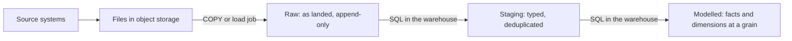

# Lesson 14. ELT and Batch Loading

**Mission link:** Stage 6 opens on the load path the mission asks for: before a load can be made safe to rerun, it has to land somewhere and land quickly, and this lesson is where the data lands and what decides how fast it gets there.
**Primary source:** [Docs: "Preparing your data files", Snowflake](https://docs.snowflake.com/en/user-guide/data-load-considerations-prepare)
**Prerequisites:** [Lesson 13](0013-slowly-changing-dimensions.md), [ELT](../GLOSSARY.md), [Storage and compute separation](../GLOSSARY.md)

## Warm-up

1. ▢ A fact table is partitioned by `order_date`. A query filters on `DATE(created_at)`, a different column. What does the partitioning save that query?

Check

Nothing. Pruning works only when the filter is on the partitioning column in a form the planner can map to partitions. A filter on another column, or a function wrapped around the partitioning column on some platforms, scans every partition.

2. ▢ State the grain of a fact table that records one row per item on each order, as a sentence.

Check

"One row per line item on one order." The grain is a sentence about what one row means, declared before any column is chosen. "Order level, quite detailed" is not a grain.

3. ▢ A customer moves city. Under a type 2 slowly changing dimension, what happens to the dimension table, and what do last year's reports show?

Check

A new row is added for the customer with its own surrogate key and validity dates, and the old row is closed. Last year's facts still point at the old surrogate key, so last year's reports keep showing the old city.

## Know this

### ETL against ELT

ETL transforms data on the way in: an external engine extracts from sources, cleans and reshapes the rows, and loads only the finished result. ELT reverses the last two steps. The warehouse receives the source data in its raw form and the transform runs afterwards, inside the warehouse, as SQL ([ELT](../GLOSSARY.md)).

ETL made sense when the warehouse was the expensive, fixed-size box: every byte stored and every CPU cycle spent there was capacity someone had bought up front, so you kept only clean data in it. Storage and compute separation removed that reason. Table data now sits in shared object storage billed by the byte and by the month, and the compute that reads it is sized, started and stopped on its own ([BigQuery storage overview](https://cloud.google.com/bigquery/docs/storage_overview), [Snowflake key concepts](https://docs.snowflake.com/en/user-guide/intro-key-concepts)). Keeping a raw copy costs storage, which is the cheap half. What it buys is the ability to rerun the transform: when a business rule changes or a bug is found, you rebuild the model from the raw data already in the warehouse instead of asking the source to send everything again.

The load commands themselves push you the same way. A Snowflake `COPY INTO` or Snowpipe statement can reorder, omit and cast columns, but not filter with `WHERE`, `FLATTEN`, join or `GROUP BY`; Snowflake's own advice is to load the raw data first and transform it downstream ([Snowpipe](https://docs.snowflake.com/en/user-guide/data-load-snowpipe-intro)).

### Three layers

ELT leaves data in three layers, whatever a team calls them:

- **Raw**: what the source sent, as it arrived, append-only, plus load metadata such as the file name and load time. Nobody queries it for answers; it is there to rebuild from.
- **Staging**: one table per source entity, with types cast, columns renamed and duplicates removed. Still shaped like the source.
- **Modelled**: facts and dimensions at a declared grain, the tables lessons 11 to 13 designed. This is what dashboards query.

Only the first arrow is a load. Every later arrow is a query the warehouse runs, which is the point of ELT and the subject of lesson 15's idempotent merges.

### Batch loading on each platform

A batch load reads a set of files from object storage and commits them to a table as one unit.

- **BigQuery** runs a **load job** over Cloud Storage URIs, wildcards allowed. The job is atomic, either every record lands or none does. By default load jobs run on a shared pool of slots, and there is no charge for batch loading through that pool; a reservation with dedicated `PIPELINE` slots is how you buy guaranteed load throughput ([Batch loading data](https://cloud.google.com/bigquery/docs/batch-loading-data)). A load job appends by default (`WRITE_APPEND`); `WRITE_TRUNCATE` replaces the table's contents instead.
- **Snowflake** runs `COPY INTO <table>` from a stage, on a virtual warehouse you size. Snowflake records **load metadata** for each table: the name, size and ETag of every file loaded. A second `COPY INTO` over the same stage skips files already loaded, for 64 days. Past that window, a file whose status cannot be determined is skipped by default; `LOAD_UNCERTAIN_FILES = TRUE` loads it while still checking what metadata exists, and `FORCE = TRUE` ignores the metadata and reloads everything, duplicates included ([COPY INTO table](https://docs.snowflake.com/en/sql-reference/sql/copy-into-table)).
- **Redshift** runs `COPY` from an S3 prefix or a manifest, and the work is divided among the cluster's **slices**, the units of a node that each process part of the data. `COPY` appends to whatever the table already holds ([COPY](https://docs.aws.amazon.com/redshift/latest/dg/r_COPY.html)). AWS's advice is one `COPY` over many files, because several concurrent `COPY` commands into one table force a serialized load ([Redshift loading best practices](https://docs.aws.amazon.com/redshift/latest/dg/c_loading-data-best-practices.html)).

Notice which of the three remembers what it loaded. Only Snowflake's `COPY` does. A BigQuery load job or a Redshift `COPY` run twice over the same files appends the rows twice.

### File count and size decide load speed

A load runs in parallel only across units of work it can hand out, and the unit is mostly the file. Too few files leaves compute idle; too many spends the time on per-file overhead. Each platform states the target:

- **Snowflake**: the number of parallel load operations cannot exceed the number of files. Aim for roughly 100 to 250 MB per file, compressed, and do not load very large files, 100 GB or more ([Preparing your data files](https://docs.snowflake.com/en/user-guide/data-load-considerations-prepare)).
- **Redshift**: Parquet, ORC and uncompressed CSV files of 128 MB or more are split automatically. Files that cannot be split, such as gzipped CSV or JSON, should be split by you into files of roughly equal size, 1 MB to 1 GB after compression, with the file count a multiple of the cluster's slice count ([Redshift loading best practices](https://docs.aws.amazon.com/redshift/latest/dg/c_loading-data-best-practices.html)).
- **BigQuery**: a compressed CSV or JSON file can be at most 4 GB. Avro is the preferred format because its blocks can be read in parallel even when compressed, and Parquet and ORC also load in parallel; a Parquet file gzipped as a whole cannot be loaded at all ([Batch loading data](https://cloud.google.com/bigquery/docs/batch-loading-data), [Quotas and limits](https://cloud.google.com/bigquery/quotas#load_jobs)).

Columnar formats help twice. They carry their own types, so the load does not parse text, and their internal compression is per column chunk, so a reader can split them where a gzipped text file has to be read from the first byte.

### A worked example

A nightly export is one 400 GB gzipped CSV file. It fails outright on BigQuery, over the 4 GB compressed limit. Snowflake's docs advise against it and one file gives one parallel load operation. Redshift cannot split gzip, so one slice reads the whole file while every other slice waits.

Re-export it as 1,600 files of 250 MB. That is inside Snowflake's 100 to 250 MB band, under BigQuery's limit, and inside Redshift's 1 MB to 1 GB band. On a Redshift cluster with 64 slices, 1,600 is a multiple of 64, so each slice loads 25 files. Exporting 400,000 files of 1 MB instead would also parallelize, but each file carries fixed overhead, and Snowflake's docs say to aggregate small files for that reason. Exporting Parquet instead of CSV would shrink the files and remove the parsing.

### Predict, then run

On Snowflake, run the same `COPY INTO` over a stage twice. Predict the second result before you run it: it processes zero files, because the load metadata already lists every one. Now load the same files twice with a BigQuery load job in `WRITE_APPEND`, or with Redshift `COPY`, and count the rows: double. That difference is the problem lesson 15 solves.

## Practice

1. ▢ Name the three layers an ELT load leaves behind, and say which one a dashboard should query.

Check

Raw, staging and modelled. Dashboards query the modelled layer: facts and dimensions at a declared grain. Raw exists to rebuild from, and staging is still shaped like the source.

2. ▢ Why did separating storage from compute make ELT the default rather than ETL?

    - a) Object storage made transforming outside the warehouse impossible to schedule reliably
    - b) Raw data now costs only cheap storage, and elastic compute can rerun transforms
    - c) Warehouses stopped accepting cleaned data from external engines after separation arrived
    - d) Column stores compress raw text so well that cleaning it adds nothing

Check

**b)** Keeping raw data costs storage, the cheap half, and compute can be started to rebuild models whenever logic changes. (a) is false: external transforms still run fine, they just give up the raw copy. (c) is false: every platform loads data however it was prepared. (d) mixes up compression with correctness; compression does not type, rename or deduplicate anything.

3. ▢ A Redshift cluster has 4 nodes with 16 slices each. A source exports one 120 GB gzipped JSON file per day. Predict how the `COPY` behaves, then say how you would change the export.

Hint

Ask first whether gzipped JSON can be split, then how many slices that leaves working.

Check

Gzipped JSON cannot be split, so one slice loads the whole file serially and the other 63 sit idle. Re-export as files of roughly equal size between 1 MB and 1 GB compressed, with a count that is a multiple of 64: for example 192 files of about 625 MB, three per slice. Exporting Parquet would also work, since Redshift splits Parquet files of 128 MB or more itself.

4. ▢ An engineer reruns a failed Snowflake `COPY INTO` with `FORCE = TRUE` "to be safe". Half the files had loaded before the failure. What does the table contain afterwards?

Hint

`FORCE` changes what the load metadata is used for.

Check

The half that loaded the first time is now in the table twice. `FORCE` ignores load metadata and reloads every file. A plain rerun without it would have skipped the files already loaded and loaded only the rest, which was the safe choice.

5. ▢ A raw events table on BigQuery is partitioned by ingestion day. An analyst queries it directly, filtering on `event_time`, and asks why the bill is high. Using lesson 7 and this lesson, say what is wrong with both the query and where it runs.

Check

The filter is on `event_time`, not the ingestion-time partitioning column, so nothing is pruned and every partition is scanned. And the raw layer is the wrong place to query: it is untyped, may hold duplicates, and is not shaped for analysis. The analyst should query a modelled table, partitioned on the column people actually filter by.

## Real-world reps

- [ ] List the files behind one real load you own or can see: how many, what format, what compressed size. Compare them with the target for your platform.
- [ ] On a Snowflake trial or a BigQuery sandbox, load a small CSV twice into the same table and count the rows after each load. Write down which platform remembered the file.
- [ ] Tomorrow: sketch a pipeline you know as raw, staging and modelled layers, and mark which arrow is a load and which are queries.

## Going further

- [Loading](../reference/loading.md)
- [Docs: "Preparing your data files", Snowflake](https://docs.snowflake.com/en/user-guide/data-load-considerations-prepare)
- [Docs: "Amazon Redshift best practices for loading data", AWS](https://docs.aws.amazon.com/redshift/latest/dg/c_loading-data-best-practices.html)
- [Docs: "Introduction to loading data", Google Cloud](https://cloud.google.com/bigquery/docs/loading-data)
- [Resources](../RESOURCES.md)

---

Not landing? Reread the primary source at the top, since this lesson compresses it and compression is where understanding leaks. Check the [glossary](../GLOSSARY.md) for any term that felt slippery.

If the lesson itself is unclear rather than the material, that is a defect: [open an issue](https://github.com/TokenCemetery/teach/issues).
