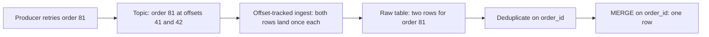

# Lesson 15. Micro-Batch, Streaming and Idempotent Merges

**Mission link:** The mission asks for a load path that can be rerun without duplicating or losing rows; this lesson lands data continuously and then makes the warehouse side of that path idempotent, which is the half no upstream guarantee does for you.
**Primary source:** [Docs: "MERGE", Snowflake](https://docs.snowflake.com/en/sql-reference/sql/merge)
**Prerequisites:** [Lesson 14](0014-elt-and-batch-loading.md), [Micro-batch](../GLOSSARY.md), [Idempotent load](../GLOSSARY.md)

## Warm-up

1. ▢ A Snowflake `COPY INTO` is run twice over the same stage within a week. What does the second run load, and why?

<details markdown="1"><summary>Check</summary>

Nothing. Snowflake keeps load metadata per table, including each file's name and ETag, for 64 days, and `COPY` skips files it has already loaded. Only `FORCE = TRUE` would reload them.

</details>

2. ▢ Why is one 300 GB gzipped CSV file a slow load on every platform, even though the bytes are the same as in 1,200 files of 250 MB?

<details markdown="1"><summary>Check</summary>

A load parallelizes across files, and a gzipped text file cannot be split. One file means one unit of work: one slice on Redshift, one parallel operation on Snowflake, and on BigQuery it exceeds the 4 GB compressed CSV limit and fails.

</details>

3. ▢ In a type 2 slowly changing dimension, what does a load have to do when a tracked attribute changes, beyond inserting a row?

<details markdown="1"><summary>Check</summary>

Close the current row: set its end date and clear its current-row flag. A load that only inserts leaves two rows marked current for the same natural key, which is the dimension's own version of a duplicate.

</details>

## Know this

### Micro-batch: small batches, often

A micro-batch load is a batch load made small and frequent ([Micro-batch](../GLOSSARY.md)). Each batch still commits as one unit, so everything lesson 14 said about files and load metadata still applies.

- **Snowpipe** watches a stage and loads each new file with serverless compute, typically within a minute of learning about it, triggered by cloud storage event notifications or a REST call. Each pipe keeps load metadata for 14 days, keyed by path and file name, and ignores a staged file whose name matches one it has processed, even if the file was modified, and even if the earlier attempt failed ([Snowpipe](https://docs.snowflake.com/en/user-guide/data-load-snowpipe-intro)). So a fixed file needs a new name.
- **Scheduled loads** are a batch job on a timer. On BigQuery the quota of 1,500 load jobs per table per day is enough for a load every five minutes with room for retries ([Batch loading data](https://cloud.google.com/bigquery/docs/batch-loading-data)). On Redshift, a `COPY JOB` loads new files from an S3 path automatically and tracks loaded files by name so each loads once ([COPY JOB](https://docs.aws.amazon.com/redshift/latest/dg/r_COPY-JOB.html)). A plain scheduled `COPY` or BigQuery load job remembers nothing.

For Snowpipe, Snowflake's file advice is the same 100 to 250 MB band, and if that takes longer than a minute to accumulate, write a smaller file once a minute ([Preparing your data files](https://docs.snowflake.com/en/user-guide/data-load-considerations-prepare)).

### Streaming: rows, with offsets

Streaming ingestion commits rows or small groups without staging files. What makes it safe to retry is an **offset**: a position the writer attaches to its rows so the warehouse can tell a retry from new data.

- **BigQuery Storage Write API.** The default stream is at-least-once: a retried append can land twice. An application-created stream of the committed type makes rows readable as soon as they are written, and if the client supplies an offset with each append, the write happens only when that offset matches the stream's next append offset, so a retry of an append that already succeeded is rejected instead of duplicated ([Storage Write API](https://cloud.google.com/bigquery/docs/write-api)). The pending type buffers rows until an atomic commit, a batch load by another route.
- **Snowpipe Streaming.** Rows flow through channels into a table. Named Channels carry an offset token, such as a Kafka partition offset, that Snowflake persists when the rows commit. On restart the client reopens the channel, reads the latest committed offset token, and resumes the source just after it; uncommitted data buffered in Snowflake is discarded on reopen. Elastic Channels are at-least-once with no ordering guarantee. A channel idle for 30 days is deleted with its token ([Snowpipe Streaming](https://docs.snowflake.com/en/user-guide/snowpipe-streaming/data-load-snowpipe-streaming-overview)).
- **Redshift streaming ingestion.** A materialized view consumes a Kinesis stream or a Kafka topic directly, and each refresh reads from the shards or partitions until the view catches up. Redshift guarantees each record is processed once, identified by topic, partition and offset ([Streaming ingestion](https://docs.aws.amazon.com/redshift/latest/dg/materialized-view-streaming-ingestion.html)).

### Why duplicates still arrive

Every guarantee above is about one hop: from a position in the source into the table. It deduplicates by offset. It cannot deduplicate by meaning.

Upstream systems are usually at-least-once. A producer that retries after a lost acknowledgement, or a consumer that commits its offset after processing and crashes in between, can put the same business event into the topic twice at two different offsets. The warehouse then ingests both, exactly once each. How each leg of that path loses or duplicates is in the Kafka track's [delivery guarantees sheet](../../kafka/reference/delivery-guarantees.md); this lesson takes the result as given.

File loads have their own route to the same place: a file re-exported under a new name, Snowflake load metadata older than 64 days, a `FORCE` rerun, or any second run of a BigQuery load job or Redshift `COPY`.



So the warehouse side has to be idempotent on its own, by a business key.

### Pattern 1: deduplicate the batch, then MERGE

Select the batch from the raw table, keep one row per business key, and `MERGE` it into the target on that key.

```sql
MERGE INTO orders AS t
USING (
    SELECT order_id, status, amount, updated_at
    FROM (
        SELECT r.*,
               ROW_NUMBER() OVER (PARTITION BY order_id
                                  ORDER BY updated_at DESC, loaded_at DESC) AS rn
        FROM raw_orders AS r
        WHERE loaded_at >= :batch_start AND loaded_at < :batch_end
    ) AS ranked
    WHERE rn = 1
) AS s
ON t.order_id = s.order_id
WHEN MATCHED AND s.updated_at > t.updated_at THEN
    UPDATE SET status = s.status, amount = s.amount, updated_at = s.updated_at
WHEN NOT MATCHED THEN
    INSERT (order_id, status, amount, updated_at)
    VALUES (s.order_id, s.status, s.amount, s.updated_at);
```

Run it twice and the second run matches every row and changes nothing. The `updated_at` guard also stops an older batch, rerun late, from overwriting a newer value. Redshift's `MERGE` takes no extra condition on `WHEN MATCHED`, and its source subquery may not reference the target, so there the guard moves into a staging step: build the deduplicated batch as a temporary table, delete from it the rows that are not newer than the target's, then merge.

### The duplicate-match trap

Leave out the deduplication and two things go wrong. When a target row matches two source rows, all three platforms refuse: Snowflake errors by default (`ERROR_ON_NONDETERMINISTIC_MERGE` is `TRUE`), BigQuery requires that a merge match at most one source row for each target row ([DML statements](https://cloud.google.com/bigquery/docs/reference/standard-sql/dml-syntax)), and Redshift reports "Found multiple matches to update the same tuple" ([Redshift MERGE](https://docs.aws.amazon.com/redshift/latest/dg/r_MERGE.html)).

The quieter failure comes first. If the key is not in the target yet, nothing matches, and `WHEN NOT MATCHED THEN INSERT` inserts one target row for each copy in the source ([Snowflake MERGE](https://docs.snowflake.com/en/sql-reference/sql/merge)). The first load succeeds and plants the duplicate. Later batches with one row for that key update both copies without complaint, and the error appears only when a batch again carries two copies of a key the target already holds, often days later.

### Pattern 2: overwrite a partition

When a batch maps cleanly onto a partition, such as one day's events, recompute the whole partition from raw and replace it. Rerunning replaces it again with the same rows.

- **BigQuery**: a load or query job with `WRITE_TRUNCATE` aimed at a partition decorator, `events$20261023`, replaces only that partition.
- **Snowflake** and **Redshift**: `DELETE` the day and `INSERT` it again inside one transaction. Snowflake's `INSERT OVERWRITE` truncates the whole table, not a partition, so it is not this pattern.

Partition overwrite needs no key and handles deletes in the source, but the reprocessing window must cover late-arriving data: a row for yesterday that arrives today is lost if only today's partition is rebuilt. dbt names these two patterns as its `merge`, `delete+insert` and `insert_overwrite` incremental strategies ([Incremental models](https://docs.getdbt.com/docs/build/incremental-models)).

### Predict, then run

Load a 1,000-row batch into an empty target with `MERGE`, where 10 order IDs appear twice in the source and there is no deduplication. Predict the row count, then run it: 1,010, with no error. Run the same `MERGE` again and predict: an error, because those 10 target rows now each match two source rows. Add the `ROW_NUMBER()` filter, rebuild the target, and run it twice: 1,000 both times.

## Practice

1. ▢ Snowpipe failed to load `orders_0412.csv` because of a bad row. You fix the file and upload it with the same name. What happens, and why?

<details markdown="1"><summary>Check</summary>

Nothing loads. Snowpipe's load metadata records failed files as well as loaded ones, keyed by path and name, for 14 days, and it ignores a restaged file with a matching name even if its contents changed. Stage the fix under a new name.

</details>

2. ▢ Which statement about streaming ingestion offsets is true?

    - a) Offsets let the warehouse discard a retried append from the same source position
    - b) Offsets let the warehouse discard a business event produced twice by upstream
    - c) Offsets replace the need for any key in the target table design
    - d) Offsets are optional because every default stream is already exactly-once

<details markdown="1"><summary>Check</summary>

**a)** An offset identifies a position in the source, so a retry of the same position is caught. (b) is the common mistake: an event produced twice sits at two offsets, and both are ingested. (c) follows from (b) being false: deduplication by meaning still needs a business key. (d) is false: BigQuery's default stream and Snowflake's Elastic Channels are at-least-once.

</details>

3. ▢ A daily job loads yesterday's file into a BigQuery table with a load job in `WRITE_APPEND`. It failed halfway through a retry storm and was rerun three times. Give two ways to make the job idempotent without changing the source.

<details markdown="1"><summary>Hint</summary>

One way replaces a slice of the table; the other reconciles rows by a key.

</details>

<details markdown="1"><summary>Check</summary>

Partition overwrite: load with `WRITE_TRUNCATE` into the day's partition decorator, so each run replaces that day. Or staging plus merge: load the file into a staging table with `WRITE_TRUNCATE`, deduplicate it on the business key, and `MERGE` into the target. Note that a BigQuery load job is atomic, so the "halfway" failure left no partial rows; the duplicates came from the reruns that succeeded.

</details>

4. ▢ A `MERGE` from a Kafka-fed raw table ran fine for a week, then started failing with "Found multiple matches to update the same tuple" on Redshift. Nothing in the code changed. Explain what happened, then give the fix.

<details markdown="1"><summary>Hint</summary>

Ask what the first `MERGE` did with a key that appeared twice and was not yet in the target.

</details>

<details markdown="1"><summary>Check</summary>

All week, upstream retries put some new orders into a batch twice. Nothing matched those keys, so the `INSERT` branch inserted both copies and the target quietly gained duplicates. Then a retry duplicated an update to an order the target already held: each target row for that order matched two source rows, and the merge refused. Fix forward by deduplicating the source with `ROW_NUMBER()` on the business key, then clean the existing duplicates in the target once.

</details>

5. ▢ Interleave with lesson 13: a type 2 customer dimension is loaded from a CDC stream that is at-least-once. The same address change arrives twice. Without deduplication, what does the dimension end up with, and what does deduplicating on which key prevent?

<details markdown="1"><summary>Check</summary>

Two new versions for one change: the first closes the old row and adds a version, the second closes that version and adds an identical one, so history shows a change that never happened. Deduplicating the batch on the natural key plus the change's source timestamp, and skipping a change whose tracked attributes equal the current row's, makes the rerun a no-op.

</details>

## Real-world reps

- [ ] For one pipeline you know, write down every point where a row could be sent twice: producer retries, consumer restarts, file reruns. Mark which ones an offset catches.
- [ ] Run the predict-then-run `MERGE` above on any of the three platforms with a small table, and record the row count after each run.
- [ ] Tomorrow: pick one incremental load and say which pattern it uses, merge on a key or partition overwrite, and what its reprocessing window is for late data.

## Going further

- [Loading](../reference/loading.md)
- [Docs: "MERGE", Snowflake](https://docs.snowflake.com/en/sql-reference/sql/merge)
- [Docs: "Introduction to the BigQuery Storage Write API", Google Cloud](https://cloud.google.com/bigquery/docs/write-api)
- [Docs: "Snowpipe Streaming", Snowflake](https://docs.snowflake.com/en/user-guide/snowpipe-streaming/data-load-snowpipe-streaming-overview)
- [Docs: "Incremental models", dbt](https://docs.getdbt.com/docs/build/incremental-models)
- [Delivery guarantees, from the Kafka track](../../kafka/reference/delivery-guarantees.md)
- [Resources](../RESOURCES.md)

---

Not landing? Reread the primary source at the top, since this lesson compresses it and compression is where understanding leaks. Check the [glossary](../GLOSSARY.md) for any term that felt slippery.

If the lesson itself is unclear rather than the material, that is a defect: [open an issue](https://github.com/TokenCemetery/teach/issues).
