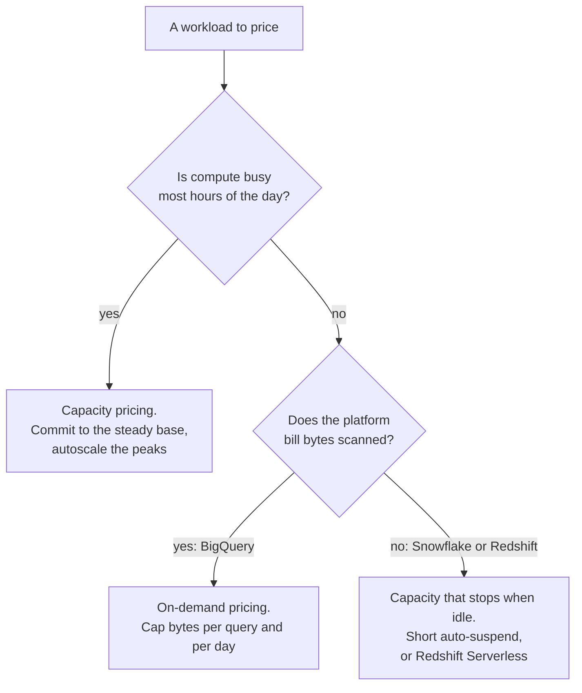

# Lesson 16. How a Warehouse Bills

**Mission link:** The mission asks you to estimate what a workload costs under on-demand and under capacity pricing; before you can estimate anything you need to know what each platform puts a meter on, and the answer is different for every one of the three.
**Primary source:** [Docs: "BigQuery pricing", Google Cloud](https://cloud.google.com/bigquery/pricing)
**Prerequisites:** [Lesson 15](0015-micro-batch-streaming-and-idempotent-merges.md), [On-demand pricing](../GLOSSARY.md), [Capacity pricing](../GLOSSARY.md)

## Warm-up

1. ▢ What is a BigQuery slot, and what is a Snowflake virtual warehouse? Name the one property they share.

Check

A slot is BigQuery's unit of compute, a share of CPU, memory and network that a query's stages run on. A virtual warehouse is Snowflake's named, sized cluster that runs queries. Both are compute held apart from storage: neither owns any table data, which is why compute can be added or removed without moving data (lesson 5).

2. ▢ A table is partitioned by day over two years. A query filters on seven days. Roughly what fraction of the table's partitions does it read?

Check

About 7 out of 730, under 1%, provided the filter is on the partitioning column in a form the planner can prune with (lesson 7). Wrap the column in a function and the fraction can jump back to 100%.

3. ▢ Why does one column of one type compress better than a row?

Check

Its values share a type and usually a narrow range or a small set of distinct values, so dictionary, run-length and delta encoding all have repetition to exploit. A row mixes types side by side, which leaves a general-purpose compressor little to find (lesson 3).

## Know this

### Two meters: what a query reads, or how long compute is held

Every warehouse bill is built from two kinds of meter. **On-demand pricing** charges each query for what it reads, and nothing for how long it ran. **Capacity pricing** charges for compute held over time, and nothing for what the queries on it read. Storage is billed on a third, separate meter on all three platforms, which is the practical payoff of storage and compute separation: the two halves of the bill move independently.

The two compute meters reward opposite habits. Under on-demand pricing, a query that reads 1 TiB costs the same whether it finishes in two seconds or two minutes, so the only lever is [bytes scanned](../GLOSSARY.md). Under capacity pricing, the same query costs whatever share of held compute it occupied, so a slow query on a busy reservation and an idle cluster with no queries at all both cost money. Most cost mistakes come from applying one meter's intuition to the other.

### BigQuery: bytes or slot-hours

BigQuery offers both. By default a project is billed **on demand**: "you are charged for the number of bytes processed by each query", per TiB, with charges "rounded up to the nearest MB, with a minimum 10 MB data processed per table referenced by the query, and with a minimum 10 MB data processed per query" ([BigQuery pricing](https://cloud.google.com/bigquery/pricing)). A monthly free allowance of query bytes applies. On-demand queries share a pool of up to about 2,000 concurrent slots per project, but the slots themselves are not what you pay for.

The **capacity** model bills slot-hours through BigQuery editions: you create a reservation with a baseline and a maximum, the autoscaler adds slots in multiples of 50 between them, and usage "is billed per second with a one-minute minimum duration by default" ([BigQuery pricing](https://cloud.google.com/bigquery/pricing); [Introduction to BigQuery editions](https://cloud.google.com/bigquery/docs/editions-intro)). One-year and three-year slot commitments trade flexibility for a lower rate. Once a project is assigned to a reservation, its queries consume that capacity "and you are not billed for bytes processed".

### Snowflake: credits per second a virtual warehouse runs

Snowflake has no bytes-scanned meter for warehouse queries. A [virtual warehouse](../GLOSSARY.md) burns credits at a rate set by its size: X-Small is 1 credit per hour, and each size up "approximately doubles the computing power and the number of credits billed per full hour" ([Overview of warehouses](https://docs.snowflake.com/en/user-guide/warehouses-overview)). A multi-cluster warehouse bills that rate for each running cluster.

The billing grain is the trap ([Understanding compute cost](https://docs.snowflake.com/en/user-guide/cost-understanding-compute)):

- Credits are billed per second, with a 60-second minimum each time a warehouse is started or resumed.
- Suspending and resuming within the first minute is billed again, because "the 1-minute minimum starts over each time a warehouse is resumed".
- "Warehouses are only billed for credit usage while running", which means **while running, whether or not a query is executing**.

Two smaller meters sit beside it. Serverless features such as automatic clustering and materialized view maintenance bill compute-hours on Snowflake-managed compute. The cloud services layer is charged only for the part of its daily usage that exceeds 10% of that day's warehouse usage.

### Redshift: node-hours, RPU-hours, and Spectrum bytes

A **provisioned** Redshift cluster bills node-hours for every node for as long as the cluster exists, busy or idle. Pausing it suspends that compute billing, and you "only pay for backup storage" while it is paused ([Amazon Redshift provisioned clusters](https://docs.aws.amazon.com/redshift/latest/mgmt/working-with-clusters.html)). Reserved nodes discount a cluster you commit to keep.

**Redshift Serverless** bills RPU-hours: "When queries run, you're billed according to the capacity used in a given duration, in RPU hours on a per-second basis", with a minimum charge of 60 seconds ([Billing for Amazon Redshift Serverless](https://docs.aws.amazon.com/redshift/latest/mgmt/serverless-billing.html)). A workgroup has a base capacity it starts from and a max capacity it can scale to. Two quiet sources of RPU usage are worth knowing: an open transaction left unended keeps using RPUs, and a connection pool's health-check `SELECT 1` is billable activity. Queries from a provisioned cluster to S3 through Redshift Spectrum are the one place Redshift bills [on-demand](../GLOSSARY.md), by bytes scanned.

### Which workload each model rewards

| Workload shape | On-demand bytes | Capacity (slots, credits, RPUs, nodes) |
|---|---|---|
| Spiky, ad-hoc, idle most hours | Pays only for the queries run; idle hours cost nothing | Pays for held compute that sits idle, unless it suspends or scales to zero |
| Steady, high-volume, busy most hours | Every scan is billed again, however often it repeats | Fixed compute absorbs repeated scans; utilization drives the unit cost down |
| A few huge scans | Each is billed in full; a single mistake can be large | Cost is bounded by the compute held; the query just runs longer |
| Many small, selective queries | Each pays at least the 10 MB minimums | Cheap if compute is already running for other work |

The rule underneath: on-demand pricing makes **idle** free and **reading** expensive; capacity pricing makes reading free at the margin and **idle** expensive. A workload that is busy most of the day is what capacity pricing is built for, and one that is quiet most of the day is what on-demand is built for.

### Worked example: the warehouse that never sleeps

A Medium Snowflake warehouse (4 credits per hour) serves a dashboard that refreshes every 5 minutes. Each refresh runs 20 seconds of queries. Over a day that is 288 refreshes.

- **Busy time:** 288 × 20 s = 5,760 s = 1.6 hours, so the queries themselves need 1.6 × 4 = **6.4 credits**.
- **Auto-suspend at 10 minutes:** the gap between refreshes (4 min 40 s) never reaches 10 minutes, so the warehouse never suspends: 24 hours × 4 = **96 credits**. Fifteen times the work done.
- **Auto-suspend at 60 seconds:** each refresh resumes the warehouse, runs 20 s, idles 60 s and suspends. Each cycle bills 80 s, above the 60-second minimum: 288 × 80 s = 23,040 s = 6.4 hours, so **25.6 credits**.

The queries did not change; the bill moved by a factor of almost four on one setting. Idle compute is the classic Snowflake and provisioned-Redshift waste, and it shows up in no query's cost, only in the warehouse's metering. Snowflake's own advice is to match auto-suspend to "the gaps, if any, in your query workload" ([Warehouse considerations](https://docs.snowflake.com/en/user-guide/warehouses-considerations)). Suspending also drops the warehouse's local data cache, so the first queries after a resume can run slower.

On BigQuery on-demand, the same dashboard pays per refresh for the bytes its queries read, and nothing in between; if its results are served from cache, nothing at all.

### Storage: billed apart, and usually the smaller line

All three bill storage per unit of data per month, separately from compute:

- **BigQuery** bills active storage and **long-term** storage, which applies to any table or partition "not modified for 90 consecutive days" at a lower rate with no loss of performance. Each dataset chooses a billing model: **logical** (uncompressed) bytes, where time travel and fail-safe are free, or **physical** (compressed) bytes, where they are billed ([BigQuery pricing](https://cloud.google.com/bigquery/pricing)). Lesson 3's compression is money only under the physical model.
- **Snowflake** bills the compressed size of table data, plus Time Travel and Fail-safe history, plus staged files, at a flat rate per terabyte per month.
- **Redshift** bills Redshift Managed Storage per GB-month on RA3 and Serverless, plus snapshot storage.

Predict, then check: in BigQuery, open a large dataset's details and compare its logical and physical byte counts. Predict the ratio from what you know about its columns (lesson 3), then read it. That ratio decides which storage billing model is cheaper for that dataset.

## Practice

1. ▢ Name the unit each platform meters for compute: BigQuery on demand, BigQuery editions, Snowflake, Redshift provisioned, Redshift Serverless.

Check

BigQuery on demand: bytes processed, billed per TiB. BigQuery editions: slot-hours, per second with a one-minute minimum by default. Snowflake: credits per second a virtual warehouse runs, with a 60-second minimum per start or resume. Redshift provisioned: node-hours for as long as the cluster exists. Redshift Serverless: RPU-hours per second while queries run, with a 60-second minimum.

2. ▢ A BigQuery project on demand runs a query that reads a 2 MB dimension table joined to a 4 MB lookup table. How many bytes are billed?

Hint

Apply the minimum per table referenced before you add anything up.

Check

20 MB. Each table referenced is billed at least 10 MB, so 10 MB + 10 MB, even though only 6 MB was read. The per-query minimum of 10 MB is already exceeded. Many tiny queries against tiny tables cost more than their bytes suggest.

3. ▢ Which workload is the best fit for capacity pricing?

    - a) An analyst team that queries in bursts twice a week
    - b) A nightly batch that runs for twenty minutes only
    - c) Dashboards and pipelines that keep compute busy all day
    - d) A monthly report that scans one very large table

Check

**c)** Capacity pricing charges for compute held over time, so it is cheapest per unit of work when that compute is busy most hours. (a) and (b) leave held compute idle most of the week or day, which is exactly what capacity bills for. (d) is one large scan a month: on demand it is billed once in full, and it is far too brief to keep held compute busy, so it cannot justify capacity on its own.

4. ▢ A Snowflake team sets auto-suspend to 60 seconds on a warehouse that receives a query every 45 seconds, each running 5 seconds. Predict what the setting does to the bill, compared with leaving the warehouse running.

Hint

Compare the gap between queries with the auto-suspend window.

Check

Nothing. The 40-second gap between queries never reaches the 60-second window, so the warehouse never suspends and bills the full day, the same as leaving it running. Auto-suspend saves money only when the workload has gaps longer than the window. Here the levers are batching the queries so real gaps appear, a smaller warehouse size, or moving this load onto a warehouse that is already running for other work.

5. ▢ Your Snowflake bill shows a warehouse metered at 300 credits for a month, but the per-query credits attributed to its queries sum to 70. Where did the other 230 go, and which lesson 6 decision might have caused it?

Check

Idle time. Snowflake's per-query attribution counts only execution and excludes the time a warehouse runs with nothing to do, so the gap between metering and the sum of query costs is the idle share. Lesson 6's isolation decision is a common cause: giving every team its own warehouse keeps queues apart, but each warehouse then idles separately and pays its own 60-second minimum on every resume. Fewer, shared warehouses with short auto-suspend, or a multi-cluster warehouse for concurrency, trades some isolation for less idle time.

6. ▢ A BigQuery dataset is 40 TB logical and 6 TB physical, and its tables are overwritten in full every night. Which storage billing model would you check first, and what would make the cheaper-looking one more expensive?

Check

Physical, since the data compresses about 6.7 to 1. The catch is the nightly overwrite: under the physical model time travel and fail-safe bytes are billed, and a full overwrite every night keeps a window of replaced data in time travel. Measure the time travel bytes before switching; for tables rewritten in full, it can erase much of the compression saving. Overwriting also keeps every table out of long-term storage, which needs 90 days without modification.

## Real-world reps

- [ ] On a platform you can reach, find which pricing model your project, account or workgroup is on, and write down the compute unit it meters and its minimum billing grain.
- [ ] On Snowflake, list every warehouse with its size and auto-suspend setting (`SHOW WAREHOUSES`) and compare each auto-suspend value with the real gaps in its query history.
- [ ] Tomorrow: for one recurring workload you know, write down how many hours a day its compute is actually busy, and say which pricing model its shape rewards, before looking at its bill.

## Going further

- [Cost Model](../reference/cost-model.md)
- [Docs: "BigQuery pricing", Google Cloud](https://cloud.google.com/bigquery/pricing)
- [Docs: "Understanding compute cost", Snowflake](https://docs.snowflake.com/en/user-guide/cost-understanding-compute)
- [Docs: "Billing for Amazon Redshift Serverless", AWS](https://docs.aws.amazon.com/redshift/latest/mgmt/serverless-billing.html)
- [Docs: "Introduction to BigQuery editions", Google Cloud](https://cloud.google.com/bigquery/docs/editions-intro)
- [Resources](../RESOURCES.md)

---

Not landing? Reread the primary source at the top, since this lesson compresses it and compression is where understanding leaks. Check the [glossary](../GLOSSARY.md) for any term that felt slippery.

If the lesson itself is unclear rather than the material, that is a defect: [open an issue](https://github.com/TokenCemetery/teach/issues).
