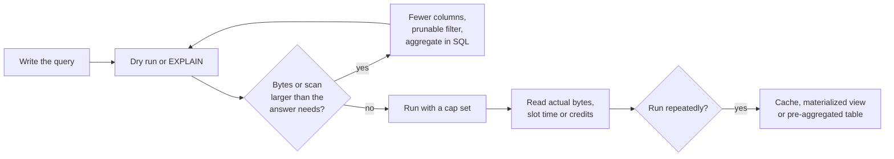

# Lesson 17. Reading and Cutting a Query's Cost

**Mission link:** The mission asks you to cut a workload's cost without changing the answer; this lesson is how to read a query's cost before and after it runs on each platform, and the few changes that shrink it while returning exactly the same rows.
**Primary source:** [Docs: "Optimize query cost", Google Cloud](https://cloud.google.com/bigquery/docs/best-practices-costs)
**Prerequisites:** [Lesson 16](0016-how-a-warehouse-bills.md), [Bytes scanned](../GLOSSARY.md), [Pruning](../GLOSSARY.md)

## Warm-up

1. ▢ Under BigQuery on-demand pricing, what does a query pay for, and what does a Snowflake query pay for?

<details markdown="1"><summary>Check</summary>

BigQuery on demand bills the bytes the query processes, per TiB, with a 10 MB minimum per table referenced and per query. Snowflake has no bytes meter: the query costs the credits its virtual warehouse burns while running, per second, and the warehouse also bills while idle until it suspends (lesson 16).

</details>

2. ▢ A table is partitioned on `DATE(event_ts)`. Which of these filters prunes: `WHERE event_ts >= '2026-09-01'` or `WHERE EXTRACT(MONTH FROM event_ts) = 9`?

<details markdown="1"><summary>Check</summary>

The first. A comparison of the partitioning column against a constant lets the planner rule partitions out from their bounds. Wrapping the column in a function hides the range from the planner, and the second filter scans every partition (lesson 7).

</details>

3. ▢ A 200-column table holds 10 TiB. A query references 3 columns that together hold 1% of its bytes. Roughly how many bytes does a column store read?

<details markdown="1"><summary>Check</summary>

About 0.1 TiB, the three column chunks across every row group, and none of the other 197 columns (lesson 1). A row store would read all 10 TiB.

</details>

## Know this

### Read the cost before the query runs

On BigQuery on demand, cost is bytes, and bytes are knowable in advance. A **dry run** validates the query and returns the bytes it would process; "Dry runs don't use query slots, and you are not charged for performing a dry run" ([Run a query](https://cloud.google.com/bigquery/docs/running-queries)). The console's query validator shows the same figure as you type; `bq query --dry_run` and the API's `dryRun` flag return it to a script. Two caveats: on a clustered table the estimate is an upper bound, because block pruning on the clustering key happens at run time, and on a table with row-level security a dry run always reports 0 bytes.

Under capacity pricing no dry run can price a query in advance, because "the number of slots allocated to a query depends on query complexity, runtime optimization, and resource availability" ([Optimize query cost](https://cloud.google.com/bigquery/docs/best-practices-costs)). Snowflake and Redshift are both capacity platforms, so on them the before-the-run tool is the plan (`EXPLAIN`), which shows what will be scanned and joined, not a price.

### Read the cost after the query ran

Each platform records what a query actually consumed, in its own unit:

| Platform | Where | What to read |
|---|---|---|
| BigQuery | `INFORMATION_SCHEMA.JOBS` | `total_bytes_billed` (on demand), `total_slot_ms` (capacity), `cache_hit` |
| Snowflake | Query profile in Snowsight; `ACCOUNT_USAGE.QUERY_HISTORY` | Bytes scanned, partitions scanned against partitions total, spill to storage |
| Snowflake | `ACCOUNT_USAGE.QUERY_ATTRIBUTION_HISTORY` | `credits_attributed_compute`, excluding idle time |
| Snowflake | `ACCOUNT_USAGE.WAREHOUSE_METERING_HISTORY` | Credits per warehouse per hour, idle time included |
| Redshift Serverless | `SYS_SERVERLESS_USAGE` | `charged_seconds`, the RPU-seconds billed per minute |

The [JOBS view](https://cloud.google.com/bigquery/docs/information-schema-jobs) keeps 180 days of history, so sorting it by `total_bytes_billed` or `total_slot_ms` is how you find the handful of queries that make up most of a BigQuery bill. On Snowflake, partitions scanned against partitions total is the [pruning](../GLOSSARY.md) ratio, and a query's credits rise with the time those partitions take to read. Snowflake's attribution view leaves out idle time, so the gap between it and warehouse metering is the idle waste lesson 16 described.

### Why LIMIT does not cut on-demand cost

`LIMIT` trims the rows returned, after the scan. A column store reads the referenced columns of every partition the filter could not prune, and only then hands rows to `LIMIT`. Google is explicit: "For non-clustered tables, a LIMIT clause won't reduce compute costs" ([Optimize query cost](https://cloud.google.com/bigquery/docs/best-practices-costs)). On a clustered table it can, because "scanning stops when enough blocks are scanned to get the result". To look at a table for free, use the console's table preview or `bq head`, which read no query bytes.

### The levers that keep the answer

Every lever below returns exactly the same result, which is the constraint the mission sets.

1. **Reference fewer columns.** In a column store the bytes are the referenced columns. Replace `SELECT *` with the columns the answer needs; it is the single largest lever on a wide table.
2. **Filter on the partitioning column, in a prunable form.** A half-open range on the raw column (`>= start AND < end`) selects the same rows as a function on it, and lets whole partitions drop out. BigQuery's `require_partition_filter` makes the unprunable form fail instead of scan.
3. **Filter on the clustering key or sort key** so more blocks are skipped (lesson 8). On BigQuery this shows up as fewer bytes billed than the dry run estimated.
4. **Aggregate in the warehouse, not in a notebook.** Pulling raw rows out to sum them elsewhere pays for every byte read and every byte shipped.
5. **Reuse results.** BigQuery caches results for about 24 hours, and when a query is answered from the cache "you are not charged for the query" ([Use cached query results](https://cloud.google.com/bigquery/docs/cached-results)). Snowflake keeps a persisted result for 24 hours, renewed on each reuse up to 31 days, and returns it without executing the query again ([Using persisted query results](https://docs.snowflake.com/en/user-guide/querying-persisted-results)). Both require the query text to match exactly and the underlying tables to be unchanged, and both skip the cache for nondeterministic functions, such as `CURRENT_TIMESTAMP()` on BigQuery or `RANDOM()` on Snowflake.
6. **Pay for an aggregation once.** A materialized view or a pre-aggregated table is computed once and read many times. BigQuery's incremental materialized views add base-table changes automatically and can rewrite a query that never names them ([Introduction to materialized views](https://cloud.google.com/bigquery/docs/materialized-views-intro)); Redshift can also rewrite queries to use one ([Materialized views in Amazon Redshift](https://docs.aws.amazon.com/redshift/latest/dg/materialized-view-overview.html)); Snowflake maintains them with serverless credits in the background ([Working with materialized views](https://docs.snowflake.com/en/user-guide/views-materialized)). Each costs storage plus maintenance, so it pays off only when it is read far more often than its base data changes.



### Worked example: 30 TiB to 10 MB, same answer

An `events` table on BigQuery, billed on demand, holds three years of data: 30 TiB logical, 200 columns, partitioned by `DATE(event_ts)` into about 1,095 daily partitions of equal size. The three columns `event_ts`, `country` and `revenue` together hold 1.2% of the table's bytes. An analyst needs daily revenue by country for September 2026, and the notebook runs:

```sql
SELECT *
FROM analytics.events
WHERE EXTRACT(YEAR FROM event_ts) = 2026
  AND EXTRACT(MONTH FROM event_ts) = 9;
```

and then sums revenue by day and country in the notebook.

**Step 0, as written.** `SELECT *` references all 200 columns, and `EXTRACT` hides the partition range, so nothing is pruned: **30 TiB** billed. Adding `LIMIT 1000` "to be safe" would still bill 30 TiB, and would also change the answer.

**Step 1, name the columns and aggregate in SQL.**

```sql
SELECT DATE(event_ts) AS day, country, SUM(revenue) AS revenue
FROM analytics.events
WHERE EXTRACT(YEAR FROM event_ts) = 2026
  AND EXTRACT(MONTH FROM event_ts) = 9
GROUP BY day, country;
```

Three columns of every partition: 30 TiB × 0.012 = 0.36 TiB, about **369 GiB**. The rows are the ones the notebook summed, so the answer is unchanged.

**Step 2, make the filter prunable.** Replace the two `EXTRACT` predicates with a half-open range on the raw column:

```sql
WHERE event_ts >= TIMESTAMP '2026-09-01'
  AND event_ts <  TIMESTAMP '2026-10-01'
```

Both forms evaluate in UTC, and the partitions are UTC days, so they select exactly the same rows. Now 30 of 1,095 partitions are read: 369 GiB × 30 / 1,095 ≈ **10.1 GiB**, about 1/3,000 of step 0.

**Step 3, pre-aggregate if it runs every day.** A daily table or materialized view of revenue by day and country holds about 30 × 200 = 6,000 rows for the month, a few hundred kilobytes. A query against it is billed the **10 MB** minimum per table referenced. The answer is the same sums, computed once.

Predict, then run: before each step, write down the bytes you expect from the arithmetic above, then take a dry run on a real partitioned table and compare. A gap between your prediction and the dry run is a filter that did not prune, or a column you forgot was referenced.

### Caps that stop a bad query before it bills

Reading costs is after the fact; caps act before. BigQuery's **maximum bytes billed** setting fails a query whose estimate exceeds it "without incurring a charge", and custom daily quotas cap bytes per project or per user. Snowflake **resource monitors** notify, suspend or suspend immediately at a share of a credit quota. Redshift Serverless **usage limits** cap RPU-hours per day, week or month and can turn off user queries; **max capacity** caps how far a workgroup scales. The [Cost Model](../reference/cost-model.md) sheet lists them side by side.

## Practice

1. ▢ Why does adding `LIMIT 10` to a query on a non-clustered BigQuery table not reduce its on-demand cost?

<details markdown="1"><summary>Check</summary>

On-demand bills bytes scanned, and the scan of every referenced column in every unpruned partition happens before `LIMIT` trims the output. `LIMIT` cuts rows returned, not bytes read. Only on a clustered table can it stop the scan early, because blocks are read in clustering order.

</details>

2. ▢ A query's dry run says 2.1 TB on a table clustered by `customer_id`; after it runs, `total_bytes_billed` shows 140 GB. Is the dry run broken?

<details markdown="1"><summary>Hint</summary>

Ask when block pruning on a clustering key is decided.

</details>

<details markdown="1"><summary>Check</summary>

No. On a clustered table the dry run estimate is an upper bound: it accounts for partition pruning, but block pruning on the clustering key is decided while the query runs. The `customer_id` filter skipped most blocks at run time. The same fact means maximum bytes billed can reject a clustered query whose real cost would have been under the cap.

</details>

3. ▢ Which change cuts a BigQuery on-demand query's cost without changing its answer?

    - a) Add a `LIMIT` clause to the end of the query
    - b) Replace `SELECT *` with only the needed columns
    - c) Sample the table with a random `WHERE` filter
    - d) Run it again later so the cache is warm

<details markdown="1"><summary>Check</summary>

**b)** Bytes billed are the referenced columns, so naming fewer columns cuts cost and returns the same values for the columns the answer uses. (a) does not reduce bytes on a non-clustered table and changes the rows returned. (c) changes the answer. (d) does not help on its own: a cache hit needs the identical query text over unchanged tables within about 24 hours, and the first run still pays in full.

</details>

4. ▢ A Snowflake query profile shows 9,800 of 10,000 partitions scanned for a query that filters on `order_date`. Name two causes, one from lesson 7 or 8 and one from the query itself, and say what each fix does to the credits.

<details markdown="1"><summary>Check</summary>

From physical design: the table is not well clustered on `order_date`, so each micro-partition's min and max span most dates and none can be ruled out; a clustering key on `order_date`, or loading in date order, narrows those ranges. From the query: the filter wraps the column, such as `TO_CHAR(order_date, 'YYYY-MM') = '2026-09'`, which can hide the range from pruning; a range on the raw column fixes it. Either fix reads fewer partitions, so the query runs for less time on the warehouse and burns fewer credits; neither changes the result.

</details>

5. ▢ A dashboard query runs 400 times a day over a 2 TiB fact table, grouping by day and region, and the table receives new rows once a night. Rank result caching, a materialized view and a nightly pre-aggregated table by cost on BigQuery on demand, and name the risk each carries.

<details markdown="1"><summary>Check</summary>

All three beat 400 full scans. The cache is free when it hits, but every dashboard filter variation is different query text, the nightly load invalidates it, and the first run each day pays in full. A materialized view is maintained incrementally and BigQuery can route the query to it automatically, at the cost of its storage and refresh; its risk is the limited SQL an incremental view supports. A nightly pre-aggregated table is the cheapest to read and simplest to reason about, but it is another load to keep idempotent (lesson 15) and its freshness is only as good as its schedule. With data that changes once a night, the pre-aggregate or the materialized view wins; the cache is a bonus on top.

</details>

6. ▢ Your team moves from BigQuery on demand to an editions reservation. Which of this lesson's levers still save money, and how would you now see the saving?

<details markdown="1"><summary>Check</summary>

All of them still reduce work, but none now reduces a per-query charge: the bill is slot-hours held by the reservation. Fewer bytes read means fewer slot-milliseconds per query, which lets the same baseline serve more queries and lets the autoscaler add fewer slots. Read the saving in `total_slot_ms` in the JOBS view, and in the reservation's autoscaled slot usage, not in `total_bytes_billed`, which is only populated for on-demand projects.

</details>

## Real-world reps

- [ ] Take one query you or your team ran this week on BigQuery and dry run it as written, then with `SELECT *` replaced by named columns, then with its date filter as a half-open range. Write down the three byte counts.
- [ ] Find your platform's ten most expensive queries of the last week: `total_bytes_billed` or `total_slot_ms` in BigQuery's JOBS view, `credits_attributed_compute` on Snowflake, or `charged_seconds` on Redshift Serverless. Note what the top one has in common with the worked example.
- [ ] Tomorrow: set one cap you do not have yet, maximum bytes billed on a scheduled BigQuery query, a resource monitor on a Snowflake warehouse, or a usage limit on a Redshift Serverless workgroup, and write down what will happen when it trips.

## Going further

- [Cost Model](../reference/cost-model.md)
- [Docs: "Optimize query cost", Google Cloud](https://cloud.google.com/bigquery/docs/best-practices-costs)
- [Docs: "JOBS view", Google Cloud](https://cloud.google.com/bigquery/docs/information-schema-jobs)
- [Docs: "Using persisted query results", Snowflake](https://docs.snowflake.com/en/user-guide/querying-persisted-results)
- [Docs: "Introduction to materialized views", Google Cloud](https://cloud.google.com/bigquery/docs/materialized-views-intro)
- [Resources](../RESOURCES.md)

---

Not landing? Reread the primary source at the top, since this lesson compresses it and compression is where understanding leaks. Check the [glossary](../GLOSSARY.md) for any term that felt slippery.

If the lesson itself is unclear rather than the material, that is a defect: [open an issue](https://github.com/TokenCemetery/teach/issues).
