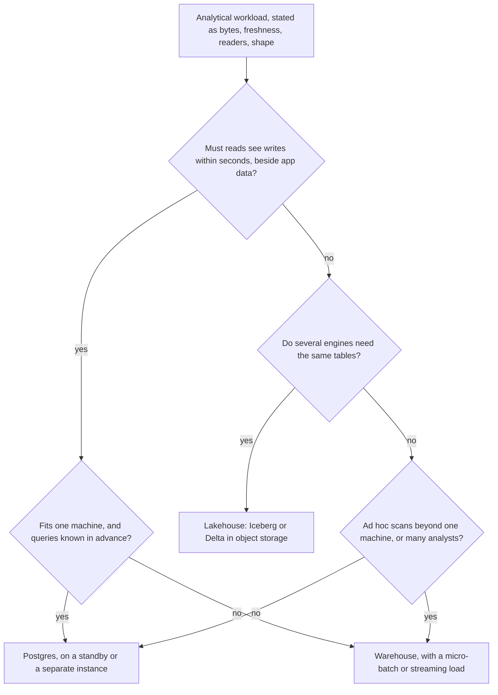

# Lesson 18. Warehouse, Postgres or Lakehouse

**Mission link:** The mission ends at deciding between a warehouse, Postgres and a lakehouse for a workload; this lesson turns everything the arc taught about bytes, compute and bills into that one placement call, including the cases where "put it in the warehouse" is the expensive answer.
**Primary source:** [Paper: "Lakehouse: A New Generation of Open Platforms that Unify Data Warehousing and Advanced Analytics", Armbrust, Ghodsi, Xin and Zaharia, CIDR (2021)](https://www.cidrdb.org/cidr2021/papers/cidr2021_paper17.pdf)
**Prerequisites:** [Lesson 17](0017-reading-and-cutting-a-querys-cost.md), [Lakehouse](../GLOSSARY.md), [Table format](../GLOSSARY.md)

## Warm-up

1. ▢ A query reads 3 columns of a 40-column table. Which layout reads fewer bytes for it, and which layout reads fewer bytes for "fetch order 81723, every column"?

Check

The column store wins the 3-column scan, because it reads only those columns' chunks. The row store wins the single-row lookup, because one page holds the whole row and an index finds it, while a column store has to touch 40 separate column chunks to reassemble one row.

2. ▢ What does on-demand pricing charge for, and what does capacity pricing charge for?

Check

On-demand charges per query for what it reads: bytes scanned on BigQuery. Capacity pricing charges for compute held over time, whatever the queries read: slot reservations, Snowflake credits per second a virtual warehouse runs, Redshift node-hours or RPU-hours.

3. ▢ What does storage and compute separation let you do that a single database server cannot?

Check

Add, remove, resize or isolate compute without moving the data, because the tables live in shared storage that no single compute cluster owns. Two teams can read the same table on separate compute, and compute can stop entirely while the data stays.

## Know this

### State the workload before naming a tool

A placement argument that starts with a product name is a preference. Start with four facts about the workload instead, because each one moves the answer:

- **Bytes per query.** How much column data a typical query has to read after pruning, and how much the whole dataset holds.
- **Freshness.** How old the data may be when someone reads it: seconds, minutes, or yesterday.
- **Readers.** Which engines read the tables: one SQL engine, or SQL plus Spark jobs, Python training code and a second vendor's engine.
- **Query shape and concurrency.** Known, repeated queries from an application, or ad hoc scans from many analysts at once.

### When Postgres is the right analytical store

Postgres is a row store, so an aggregate over 3 of 40 columns reads every column of every row it touches (lesson 1). That cost is real but bounded, and on small data it is often smaller than the cost of a second system.

Worked example: an `orders` table of 200 GB in Postgres, 40 columns of similar width. A monthly revenue-by-region query reads 3 columns.

- Postgres sequential scan: about 200 GB, the whole heap. At a sustained 1 GB/s from storage that is over three minutes.
- A column store: about 3/40 of 200 GB, so 15 GB before compression, and less after it.
- Postgres with a covering index on the three columns: the index-only scan reads the index instead of the heap, which is the row-store answer for a query known in advance. It does nothing for the next ad hoc question. See the index decisions in the SQL track's [performance sheet](../../../programming/sql/reference/performance.md).

Postgres is the right place when the data fits comfortably on one machine, the queries are known and indexable, freshness has to be seconds because the analytics sit beside the transactions that produce them (a per-customer usage page inside the product), and the team already operates Postgres. What it costs: analytical scans compete with transactions on the primary, so they usually move to a standby, where a long query and WAL replay fight each other; the [replication sheet](../../postgres/reference/replication.md) names the settings that decide which one loses.

### When a warehouse is

A warehouse is the right place when ad hoc scans over many rows dominate, the data has outgrown what one machine scans in an acceptable time, many analysts query at once, and one SQL engine is enough. It buys columnar storage (lessons 1 to 4), compute you size and isolate without moving data (lessons 5 and 6), and pruning (lessons 7 and 8). It costs a load path with its own latency (lessons 14 and 15) and a bill that grows with bytes scanned or compute held (lesson 16).

### When a lakehouse is

The lakehouse paper argues from four problems of the two-tier design, a data lake feeding a warehouse: reliability lost in the ETL between them, warehouse data that is stale compared with the lake, limited support for machine learning, and total cost of ownership ([Armbrust et al., CIDR 2021](https://www.cidrdb.org/cidr2021/papers/cidr2021_paper17.pdf)). Its answer is open-format files in object storage with a table format that adds transactions, which is what Delta Lake and Apache Iceberg provide ([Delta Lake, VLDB 2020](https://www.vldb.org/pvldb/vol13/p3411-armbrust.pdf); [Iceberg Table Spec](https://iceberg.apache.org/spec/)).

So a lakehouse is the right place when several engines must read the same tables (Spark for training, a SQL engine for reports), when very large, rarely read history would be expensive to keep inside a warehouse, and when not being tied to one vendor's storage format is a requirement rather than a taste. The Iceberg spec is explicit about one property that matters here: columns in data files are selected by field ID, so a rename does not rewrite or break old files.

What it costs, from the proponents themselves: the paper lists open questions, among them that Delta Lake, Iceberg and Hudi support transactions on one table at a time, and that keeping the transaction log in the object store limits the transaction rate. In practice you also own work a warehouse does for you: compacting small files, expiring snapshots, and running the catalog. The three warehouses can also read open-format files in object storage (Redshift Spectrum, which bills bytes scanned from S3, is one), so "lakehouse or warehouse" is often "which engine owns the write path".

### When "just use a warehouse" is wrong

The usual answer is right for the usual workload: ad hoc analytics over data larger than one machine. It is wrong in three recognisable cases:

- **Small, fresh and app-facing.** Ten gigabytes behind a product page that must show this minute's writes. A warehouse adds a load path, its latency, and a second system to secure and pay for, to answer queries an index already answers.
- **Many tiny queries at high concurrency.** Thousands of per-tenant lookups a minute. A column store is built for few large scans (lesson 1), and each query pays planning and compute overhead that a row-store index lookup does not.
- **The main reader is not SQL.** If most bytes are read by training jobs, copying data into a warehouse and exporting it back out is the two-tier cost the lakehouse paper describes.

The reverse is just as common: "just use Postgres" is wrong once analysts run ad hoc scans against the primary that the application depends on.

### Predict, then run

Take a table you can load into both Postgres and a Parquet file (any public dataset of a few million rows). Before running, predict which reads more: `EXPLAIN (ANALYZE, BUFFERS)` of a 3-column aggregate in Postgres, measured in 8 kB buffers, or DuckDB's `EXPLAIN ANALYZE` of the same aggregate over the Parquet file. Then predict how the gap changes when the query selects every column.

## Practice

1. ▢ Name the four facts about a workload this lesson states before choosing where it goes.

Check

Bytes per query (and dataset size), freshness, which engines read the tables, and the query shape and concurrency. A placement argument missing one of them can be overturned by it.

2. ▢ A 20 GB table feeds a "your usage this month" page inside a SaaS product, read thousands of times an hour per tenant, and must reflect writes from a minute ago. Where does it belong, and what would a warehouse cost here?

Hint

Check the freshness requirement and the query shape against what a column store is built for.

Check

Postgres, ideally a standby or a dedicated instance, with an index on tenant and month. A warehouse would add a load path whose latency fights the one-minute freshness, a second system to secure, and per-query overhead on thousands of tiny lookups, which is the access pattern a column store is worst at.

3. ▢ Which claim about a lakehouse is supported by its own proponents' paper?

    - a) Its table formats give transactions across many tables at once
    - b) It removes all table maintenance work from the engineering team
    - c) Its formats commit transactions on one table at a time
    - d) It always beats a warehouse on cost and query speed

Check

**c)** The CIDR paper lists single-table transactions in Delta Lake, Iceberg and Hudi as an open question. (a) is the opposite of that statement. (b) is false: compaction, snapshot expiry and the catalog become the team's work. (d) overstates the paper, which reports competitive TPC-DS results for one system, not a universal win.

4. ▢ Interleave lesson 7. An analyst proposes moving a 9 TB clickstream table from BigQuery to Postgres "because Postgres is free". Every dashboard filters on the last 7 days. Argue the cost in bytes either way.

Hint

Ask what each store reads for a 7-day filter, and what "free" leaves out.

Check

Partitioned by day in BigQuery, a 7-day query scans roughly 7 days of the referenced columns only, a small fraction of 9 TB. Postgres would read whole rows for those days, and only if the table is partitioned or indexed by date there too; otherwise it reads all 9 TB. "Free" also leaves out the machine big enough to hold 9 TB, its operation, and the transactions it would slow. The fix for a high BigQuery bill on this table is partitioning and named columns, not a move.

5. ▢ A team runs Spark training jobs over three years of events and Snowflake for finance reports over the last quarter. They copy events into Snowflake nightly and export them back to object storage for training. Recommend a placement and name what your recommendation costs.

Check

Keep the events as an Iceberg (or Delta) table in object storage, read directly by Spark, with Snowflake reading the same table or loading only the recent quarter it needs. That removes the copy in and the export out, which is the two-tier cost the paper names. It costs the team table maintenance (compaction, snapshot expiry, a catalog), single-table transactions, and possibly slower SQL over the external table than over native Snowflake storage, which they should measure before committing.

## Real-world reps

- [ ] For one analytical workload you know, write the four facts (bytes per query, freshness, readers, shape) in one line each, then run them through the flowchart above and note where your current placement disagrees.
- [ ] Run the predict-then-run comparison: the same 3-column aggregate with `EXPLAIN (ANALYZE, BUFFERS)` in Postgres and `EXPLAIN ANALYZE` in DuckDB over Parquet, and write down the bytes each read.
- [ ] Tomorrow: read sections 1 and 2 of the lakehouse paper and list one argument you accept and one you would push back on for your own workload, with the reason.

## Going further

- [Schema and Bill Review](../reference/schema-and-bill-review.md)
- [Paper: "Lakehouse: A New Generation of Open Platforms that Unify Data Warehousing and Advanced Analytics", Armbrust, Ghodsi, Xin and Zaharia, CIDR (2021)](https://www.cidrdb.org/cidr2021/papers/cidr2021_paper17.pdf)
- [Paper: "Delta Lake: High-Performance ACID Table Storage over Cloud Object Stores", Armbrust et al., VLDB (2020)](https://www.vldb.org/pvldb/vol13/p3411-armbrust.pdf)
- [Docs: "Iceberg Table Spec", Apache Iceberg](https://iceberg.apache.org/spec/)
- [Resources](../RESOURCES.md)

---

Not landing? Reread the primary source at the top, since this lesson compresses it and compression is where understanding leaks. Check the [glossary](../GLOSSARY.md) for any term that felt slippery.

If the lesson itself is unclear rather than the material, that is a defect: [open an issue](https://github.com/TokenCemetery/teach/issues).
