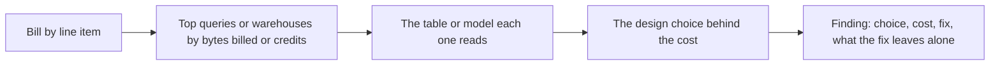

# Lesson 19. Reviewing a Warehouse Schema and Its Bill

**Mission link:** The mission asks you to review someone else's warehouse schema and bill; this lesson works one review end to end, so that each finding names the choice, what it costs in bytes or credits, the fix, and what the fix does not change.
**Primary source:** [Docs: "Optimize query cost", Google Cloud](https://cloud.google.com/bigquery/docs/best-practices-costs)
**Prerequisites:** [Lesson 18](0018-warehouse-postgres-or-lakehouse.md), [Bytes scanned](../GLOSSARY.md), [Slowly changing dimension](../GLOSSARY.md)

## Warm-up

1. ▢ A table is partitioned by day. Name one filter that prunes and one that silently scans every partition.

Check

`WHERE event_date >= '2026-10-01'` on the partitioning column prunes. A filter on a different column, or one the planner cannot evaluate against partition metadata before the scan (for example a value that only a subquery produces at run time), can leave every partition in the scan.

2. ▢ What does a type 1 change do to a report on last year's data, and what does a type 2 change do?

Check

Type 1 overwrites the attribute, so last year's facts now group under the new value and the old report changes when rerun. Type 2 adds a new dimension row with validity dates, so last year's facts keep pointing at the row that was true then and the old report stays the same.

3. ▢ Why does a Snowflake virtual warehouse that runs all day cost money even when no query is running?

Check

It bills credits per second while it runs, whatever runs on it. Only suspending it stops the meter, which is what auto-suspend is for.

## Know this

### Review the bill first, then the schema

A schema review that starts from the DDL finds style problems. One that starts from the bill finds the choices that cost money, in the order they cost it:

On BigQuery, `INFORMATION_SCHEMA.JOBS` gives bytes billed and slot-milliseconds per query ([JOBS view](https://cloud.google.com/bigquery/docs/information-schema-jobs)). On Snowflake, credits are billed per virtual warehouse per second it runs ([Understanding compute cost](https://docs.snowflake.com/en/user-guide/cost-understanding-compute)), so the first cut is credits by warehouse, then the queries on the expensive one. Write every cost in the platform's billing unit (TiB scanned, credits, RPU-hours) and multiply by the current rate from the pricing page only at the end; the unit is what your fix changes, and rates move.

### The system under review

A retailer runs product analytics on BigQuery on-demand and finance reporting on Snowflake. Four findings came out of one month's bill.

### Finding 1: an unpartitioned events table under `SELECT *` dashboards

`events` holds two years (730 days) of clickstream, 120 columns, 1.5 TiB of logical bytes, neither partitioned nor clustered, with rows streamed in all day. An operations dashboard has 3 tiles. Each tile's query is `SELECT *` over a view on `events` with a 7-day filter on `event_date`, and the dashboard refreshes every 5 minutes for 10 business hours: 120 refreshes, 360 queries a day. The tiles use 6 columns, which hold 4% of the table's bytes.

| Step | Bytes per query | Per day (360 queries) | Per 30 days |
|---|---|---|---|
| As built | 1.5 TiB | 540 TiB | 16,200 TiB |
| Name the 6 columns | 61.4 GiB | 21.6 TiB | 648 TiB |
| Partition by `event_date`, 7 of 730 days | 0.59 GiB | 212 GiB | 6.2 TiB |
| Refresh hourly, 30 queries a day | 0.59 GiB | 17.7 GiB | 0.52 TiB |

Each row assumes the bytes are spread evenly over days, which a real table only approximates; the dry run is what confirms it. The date filter alone saved nothing, because without partitions nothing could be skipped. Google's guidance makes the first two fixes from its own side: query only the columns you need, and filter on the partitioning column so the query processes only the partitions in the date range ([Optimize query computation](https://cloud.google.com/bigquery/docs/best-practices-performance-compute)). The 5-minute refresh also defeats the result cache, because a table receiving rows every few seconds has changed between refreshes. To keep this from returning, set a maximum bytes billed on the dashboard's queries: a query whose estimate exceeds it fails without a charge ([Optimize query cost](https://cloud.google.com/bigquery/docs/best-practices-costs)).

What the fix leaves alone: the numbers on the dashboard, which is the test of a cost fix (lesson 17).

### Finding 2: an always-on, oversized virtual warehouse

`FINANCE_WH` is X-Large with auto-suspend disabled. Snowflake doubles the credit rate with each size step, X-Small at 1 credit an hour up to X-Large at 16 ([Overview of warehouses](https://docs.snowflake.com/en/user-guide/warehouses-overview)). Query history shows about 3 busy hours a day: a 40-minute batch at 07:00 and ad hoc queries.

| Configuration | Billed hours a day | Credits a day | Credits per 30 days |
|---|---|---|---|
| X-Large, never suspends | 24 | 384 | 11,520 |
| X-Large, auto-suspend after 60 s idle | about 4 | about 64 | about 1,920 |
| Medium, auto-suspend, measured 2.5 times slower | about 10 | about 40 | about 1,200 |

Billed hours exceed busy hours because each resume bills a minimum of 60 seconds and the warehouse idles until suspend. The resize is a trade, not a free saving: the 07:00 batch now takes about 100 minutes, so ask whether anything waits on it. If it does, give the batch its own warehouse (lesson 6) and keep the ad hoc one small. A resource monitor with a credit quota caps the month whichever you choose ([Working with resource monitors](https://docs.snowflake.com/en/user-guide/resource-monitors)).

### Finding 3: a type 1 customer dimension where history was needed

`dim_customer` overwrites `region` when a customer moves. Finance's revenue-by-region report for closed quarters changes each time it is rerun, and last quarter no longer matches the figure the board saw. This finding costs no bytes worth mentioning. It costs a wrong answer, which is the most expensive line in any review.

The fix is a type 2 dimension: a new row per change, with validity dates, and facts keyed to the surrogate key that was current at the time of the sale ([Type 2: Add New Row](https://www.kimballgroup.com/data-warehouse-business-intelligence-resources/kimball-techniques/dimensional-modeling-techniques/type-2/)). The history it needs is only recoverable if the raw source rows were kept, which is the ELT argument from lesson 14. If they were not, history starts on the day of the fix, and the review has to say so.

### Finding 4: the one that is fine

A 4 GB `dim_product` is unpartitioned and unclustered. Partitioning it would save almost nothing and add partitions to manage. A review that flags every unpartitioned table teaches the team to ignore reviews; say "checked, fine at this size" and move on.

### Predict, then run

Pick a public BigQuery table such as `bigquery-public-data.samples.wikipedia`. Before running anything, predict the bytes a dry run reports for `SELECT *` and for a query naming two columns, then predict whether adding `LIMIT 10` changes either. Run the dry runs (they are free) and compare.

## Practice

1. ▢ In what order does this lesson review a warehouse, and why start there?

Check

Bill first, then the top queries or warehouses by bytes billed or credits, then the tables they read, then the design choice behind each. Starting from the bill orders the findings by what they cost; starting from the DDL orders them by what looks odd.

2. ▢ In finding 1, the team partitions `events` but keeps `SELECT *` and the 5-minute refresh. Predict the 30-day bytes billed.

Hint

Apply the 7 of 730 fraction to the full 1.5 TiB rather than to the 6 columns.

Check

1.5 TiB times 7/730 is about 14.7 GiB per query. Times 360 queries is about 5.2 TiB a day, about 155 TiB per 30 days. Partitioning alone cuts the bill about a hundredfold; naming the columns is a further factor of 25.

3. ▢ Which statement about finding 2 is correct?

    - a) Auto-suspend changes the result of every finance query
    - b) Medium saves credits only if queries stay fast
    - c) Auto-suspend stops billing for hours when nothing runs
    - d) Disabling auto-suspend makes each finance query cost less

Check

**c)** Credits are billed per second the warehouse runs, so suspending it removes the idle hours from the bill. (a) is false: suspending changes when compute runs, not what a query returns. (b) is false: Medium at 2.5 times slower still costs fewer credits, since its rate is a quarter of X-Large's. (d) is false: an always-on warehouse bills the same rate whether or not a query is running, so idle hours add cost without making any query cheaper.

4. ▢ Interleave lesson 16. A colleague's review of finding 1 says: "Switch the project to capacity pricing and the problem goes away." Name what that changes and what it leaves.

Check

It changes the billing unit from TiB scanned to slots held, so the bill stops growing with bytes. It leaves the 1.5 TiB scans in place: they now consume the reservation's slots, queue other teams' queries behind them, and push toward a larger reservation. The bytes are still the root cause, and fixing them makes either pricing model cheaper.

5. ▢ Write finding 3 as one review comment, in the form choice, cost, fix, what the fix leaves alone.

Check

Choice: `dim_customer` overwrites `region` (type 1). Cost: closed-quarter revenue by region changes on rerun and no longer matches reported figures. Fix: type 2 with validity dates and facts keyed to the surrogate key current at sale time, rebuilt from raw history if it was kept. Leaves alone: current-state reports, which still group by each customer's present region through the current row.

## Real-world reps

- [ ] Run the predict-then-run dry runs on a public BigQuery table and write down the bytes for `SELECT *`, two named columns, and each with `LIMIT 10`.
- [ ] Pull last month's top ten queries by bytes billed from `INFORMATION_SCHEMA.JOBS`, or the top warehouses by credits on Snowflake, and for the first one write a finding in the form choice, cost, fix, what it leaves alone.
- [ ] Tomorrow: find one table you would have flagged and decide, with a number, that it is fine at its size.

## Going further

- [Schema and Bill Review](../reference/schema-and-bill-review.md)
- [Docs: "Optimize query cost", Google Cloud](https://cloud.google.com/bigquery/docs/best-practices-costs)
- [Docs: "Optimize query computation", Google Cloud](https://cloud.google.com/bigquery/docs/best-practices-performance-compute)
- [Docs: "JOBS view", Google Cloud](https://cloud.google.com/bigquery/docs/information-schema-jobs)
- [Docs: "Understanding compute cost", Snowflake](https://docs.snowflake.com/en/user-guide/cost-understanding-compute)
- [Docs: "Working with resource monitors", Snowflake](https://docs.snowflake.com/en/user-guide/resource-monitors)
- [Resources](../RESOURCES.md)

---

Not landing? Reread the primary source at the top, since this lesson compresses it and compression is where understanding leaks. Check the [glossary](../GLOSSARY.md) for any term that felt slippery.

If the lesson itself is unclear rather than the material, that is a defect: [open an issue](https://github.com/TokenCemetery/teach/issues).
