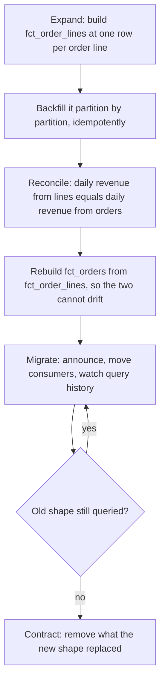

# Lesson 20. Changing a Model Others Query

**Mission link:** The mission ends at changing a model others query without breaking them; this lesson carries one breaking change through to the end, and closes on the habit a senior engineer is trusted for: settling a disputed claim from the vendor's documentation instead of from memory.
**Primary source:** [Docs: "Model contracts", dbt](https://docs.getdbt.com/docs/mesh/govern/model-contracts)
**Prerequisites:** [Lesson 19](0019-reviewing-a-warehouse-schema-and-its-bill.md), [Grain](../GLOSSARY.md), [Idempotent load](../GLOSSARY.md)

## Warm-up

1. ▢ What is an idempotent load, and why does a backfill need one?

Check

A load whose rerun with the same input leaves the table exactly as one run would. A backfill runs over many partitions and some runs fail partway, so every partition has to be safe to load again without duplicating or losing rows.

2. ▢ `fct_orders` is declared at one row per order. A new column `product_id` is added to it. What is wrong?

Check

An order can hold several products, so `product_id` is not true at the declared grain. Either the table has silently become one row per order line, which multiplies every order-level measure, or the column holds one arbitrary product per order. The grain decides which columns belong.

3. ▢ In a review, what four parts does a finding have?

Check

The choice, what it costs (in bytes, credits or a wrong answer), the fix, and what the fix leaves alone.

## Know this

### Find who depends on the model before changing it

You cannot avoid breaking consumers you have not listed. Query history lists them: BigQuery's `INFORMATION_SCHEMA.JOBS` records the tables each job referenced ([JOBS view](https://cloud.google.com/bigquery/docs/information-schema-jobs)), and Snowflake and Redshift keep comparable query and access history. Group by user or service account over at least one full business cycle, since a quarterly finance extract does not appear in a week of history. The list is your migration plan and your contact list.

### Views are the contract, tables are the implementation

If consumers read a view rather than the table behind it, you can repartition, recluster, rename or rebuild the table and change only the view's definition. On BigQuery a logical view adds no storage, and querying it bills the bytes of the underlying table fields it references ([Introduction to views](https://cloud.google.com/bigquery/docs/views-intro)). One trap from the same page: the schema BigQuery reports for a view is stored when the view is created and is not updated when the underlying tables change, until the view is recreated. Query results stay correct; tools that read the reported schema do not.

### Additive and breaking changes

| Change | Kind | Who it breaks |
|---|---|---|
| Add a nullable column | Additive | Consumers that `INSERT ... SELECT *` into a fixed schema, or read columns by position |
| Add a row filter or new rows | Additive in form | Anyone whose totals now change |
| Remove or rename a column | Breaking | Every query that names it |
| Change a column's type | Breaking | Joins, casts and anything typed downstream |
| Change the grain | Breaking, silently | Every `SUM` and `COUNT`: the columns look the same and the answers are wrong |
| Change a column's meaning, such as gross to net revenue | Breaking, silently | Every report that uses it, with no error anywhere |

The last two are the dangerous ones, because no schema check catches them.

### Expand, migrate, contract

The same sequence that keeps a row-store migration safe keeps a model change safe (see the SQL track's [expand, migrate, contract](../../../programming/sql/reference/operating.md#expand-migrate-contract) and the CI/CD track's [migrations in a deploy](../../../infrastructure/ci-cd/reference/deployments.md#migrations-in-a-deploy)). Worked case: product analytics needs revenue by product, and `fct_orders` is at one row per order.

Note what did not happen: `fct_orders` never changed grain in place. A new model with a new grain gets a new name; the old one keeps its meaning until nothing reads it.

### Backfills cost bytes and need a check

A backfill reads the source history once per partition it rebuilds. Price it like any query before running it (lesson 17): a dry run on one day, multiplied by the number of days. Write each partition with an overwrite or a merge so a failed day can be rerun (lesson 15). Finish with a reconciliation query that compares a measure the old and new models share, day by day; a backfill that "completed" but disagrees on one day has a bug, not a rounding error.

### Model contracts catch the loud breaks

A dbt model with `contract: enforced: true` must declare every column's name and data type; dbt runs a preflight check that the model's query returns exactly those columns and types, and includes them in the DDL it submits ([Model contracts](https://docs.getdbt.com/docs/mesh/govern/model-contracts)). Compared with a previous project state, dbt reports a contract error for removing a column, changing a column's `data_type`, removing or modifying a constraint, or removing a contracted model. That turns the loud breaks in the table above into failed builds rather than broken dashboards. It does not see a grain change or a change of meaning, which is why the reconciliation query exists.

### Deprecate in writing

A deprecation notice names what changes, why, the replacement, the date the old shape goes away, and a before-and-after query a consumer can copy. Send it to the people query history named, then watch the history: remove the old shape when its usage reaches zero, or call the remaining owners by name.

### Settling a disputed claim from the source

Two claims come up in every warehouse team, and both sides usually argue from memory:

- **"Add `LIMIT 1000` to the dashboard query, it will be cheap."** Google's cost guidance says that for non-clustered tables, `LIMIT` does not affect the amount of data read, and that on a clustered table it can reduce the bytes scanned ([Optimize query cost](https://cloud.google.com/bigquery/docs/best-practices-costs)). Both "LIMIT never helps" and "LIMIT always helps" are wrong.
- **"The table is clustered on `customer_id`, so this query scans 2 GB."** The clustering page says clustering can reduce costs, that BigQuery might not be able to estimate the bytes accurately before execution, and that clustering does not guarantee a reduction in slots ([Introduction to clustered tables](https://cloud.google.com/bigquery/docs/clustered-tables)). The cost guidance adds that for clustered tables the bytes-billed estimate is an upper bound. So a dry run cannot settle it either.

The method: write the claim so it can be false, find the vendor page, quote the sentence, then test it where the page says the truth is visible. For a clustered table that means running the query and reading `total_bytes_billed` from the JOBS view, not trusting the dry run. Put the link and the measured number in the thread, and the dispute ends.

### Predict, then run

On a clustered BigQuery table you can query, predict the dry-run bytes and the billed bytes for a filter on the clustering column, with and without `LIMIT 100`. Run all four (two dry runs, two real runs) and compare against your prediction.

## Practice

1. ▢ Why is a grain change the most dangerous change you can make to a model others query?

Check

It keeps the same columns and types, so no schema check, contract or query fails, while every sum and count over it changes. The breakage reaches consumers as wrong numbers, not as errors.

2. ▢ A colleague adds a nullable `channel` column to a contracted model and says nothing can break. Name a consumer it can break, and say whether dbt's contract check flags it.

Hint

Think about consumers that do not name their columns.

Check

A downstream job that runs `INSERT INTO target SELECT * FROM model` into a table with a fixed column list now fails, or a consumer reading by position gets shifted columns. dbt's contract does not flag it as breaking: adding a column is not in its list of breaking changes, though the model's own declared columns must be updated for its preflight check to pass.

3. ▢ Which statement about `LIMIT` on BigQuery matches Google's documentation?

    - a) It never changes bytes read, on any table at all
    - b) It always cuts bytes read in proportion to the limit
    - c) It can reduce the bytes scanned on a clustered table
    - d) It reduces bytes read only when used with ORDER BY

Check

**c)** The cost guidance says `LIMIT` does not affect data read on non-clustered tables and can reduce bytes scanned on clustered ones. (a) ignores the clustered case. (b) has no support in the docs: nothing is proportional. (d) invents a condition the page does not state.

4. ▢ Interleave lesson 13. Finding 3 of lesson 19 moves `dim_customer` from type 1 to type 2. Its surrogate key now changes meaning for consumers. Plan the change with expand, migrate, contract.

Check

Expand: build `dim_customer_history` (type 2, validity dates, a current-row flag) beside the type 1 table, backfilled from raw history, and key new fact rows to the history table's surrogate key. Reconcile: current rows match the type 1 table one for one. Migrate: give `dim_customer` consumers a view of current rows with the old columns, announce the history model to finance with a query for "region at time of sale", and watch history for direct reads of the old table. Contract: drop the type 1 table once nothing reads it.

5. ▢ A teammate insists a nightly job "scans 40 GB, the dry run says so", but the table is clustered and the bill disagrees. Settle it.

Hint

What does the documentation say a clustered table's estimate is?

Check

Quote the cost guidance: for clustered tables the bytes-billed estimate is an upper bound. The dry run's 40 GB is therefore a ceiling, not a measurement. Read `total_bytes_billed` for the job from `INFORMATION_SCHEMA.JOBS`; that number, with the link, is the answer.

## Real-world reps

- [ ] For one model you own, list every consumer from query history over the last 90 days, grouped by user or service account, and note any you did not expect.
- [ ] Write a deprecation notice for one real or planned change: what, why, the replacement, the date, and a before-and-after query.
- [ ] Tomorrow: take one claim about your warehouse that your team repeats from memory, find the vendor sentence that settles it, and test it with a real run.

## Going further

- [Schema and Bill Review](../reference/schema-and-bill-review.md)
- [Docs: "Model contracts", dbt](https://docs.getdbt.com/docs/mesh/govern/model-contracts)
- [Docs: "Introduction to views", Google Cloud](https://cloud.google.com/bigquery/docs/views-intro)
- [Docs: "Optimize query cost", Google Cloud](https://cloud.google.com/bigquery/docs/best-practices-costs)
- [Docs: "Introduction to clustered tables", Google Cloud](https://cloud.google.com/bigquery/docs/clustered-tables)
- [Resources](../RESOURCES.md)

---

That is the arc. You started from why one layout reads fewer bytes than another and finished placing a workload, reviewing a bill and changing what others depend on; the habit that carries past these twenty lessons is to state the bytes, the unit and the source before stating the opinion.

Not landing? Reread the primary source at the top, since this lesson compresses it and compression is where understanding leaks. Check the [glossary](../GLOSSARY.md) for any term that felt slippery.

If the lesson itself is unclear rather than the material, that is a defect: [open an issue](https://github.com/TokenCemetery/teach/issues).
