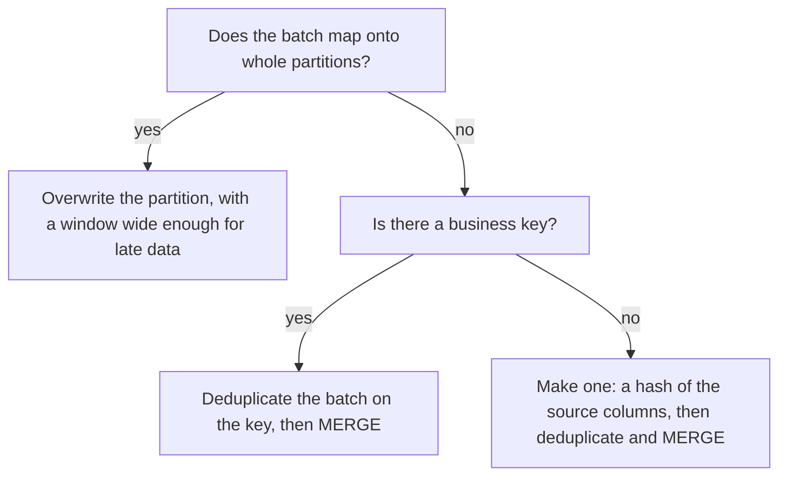

# Loading

Stage 6 compressed for lookup. [Lesson 14](../lessons/0014-elt-and-batch-loading.md) covers ELT, the three layers and batch loading by file; [lesson 15](../lessons/0015-micro-batch-streaming-and-idempotent-merges.md) covers micro-batch, streaming and making a load idempotent.

Limits and defaults were read from each vendor's documentation in October 2026. Each row names its page; check it for the current value.

## Load methods per platform

| | Batch | Micro-batch | Streaming |
|---|---|---|---|
| BigQuery | Load job or `LOAD DATA` from Cloud Storage; atomic; free on the shared slot pool | Scheduled load jobs; 1,500 load jobs per table per day | Storage Write API: default stream (at-least-once) or committed stream with client offsets |
| Snowflake | `COPY INTO` from a stage, on a virtual warehouse | Snowpipe: serverless, per file, typically within a minute | Snowpipe Streaming: Named Channels (offset tokens, ordered) or Elastic Channels (at-least-once) |
| Redshift | `COPY` from S3 or a manifest, split across slices; appends | `COPY JOB` on an S3 path, tracks loaded files by name | Streaming ingestion into a materialized view from Kinesis or Kafka |

Pages: [Introduction to loading data](https://cloud.google.com/bigquery/docs/loading-data), [Batch loading data](https://cloud.google.com/bigquery/docs/batch-loading-data), [Storage Write API](https://cloud.google.com/bigquery/docs/write-api), [COPY INTO table](https://docs.snowflake.com/en/sql-reference/sql/copy-into-table), [Snowpipe](https://docs.snowflake.com/en/user-guide/data-load-snowpipe-intro), [Snowpipe Streaming](https://docs.snowflake.com/en/user-guide/snowpipe-streaming/data-load-snowpipe-streaming-overview), [Redshift COPY](https://docs.aws.amazon.com/redshift/latest/dg/r_COPY.html), [COPY JOB](https://docs.aws.amazon.com/redshift/latest/dg/r_COPY-JOB.html), [Streaming ingestion to a materialized view](https://docs.aws.amazon.com/redshift/latest/dg/materialized-view-streaming-ingestion.html).

## File sizing

| Platform | Guidance | Page |
|---|---|---|
| Snowflake | Roughly 100 to 250 MB per file, compressed. Parallel load operations cannot exceed the file count. Avoid files of 100 GB or more. Aggregate small files | [Preparing your data files](https://docs.snowflake.com/en/user-guide/data-load-considerations-prepare) |
| Snowflake, Snowpipe | Same band. If 100 to 250 MB takes over a minute to accumulate, write a smaller file once a minute. Billed per GB loaded, no per-file charge | [Preparing your data files](https://docs.snowflake.com/en/user-guide/data-load-considerations-prepare) |
| Redshift | Parquet, ORC and uncompressed CSV of 128 MB or more split automatically. Unsplittable files (gzipped CSV, JSON): split into roughly equal files of 1 MB to 1 GB compressed, count a multiple of the slice count. One `COPY` per table, not several concurrent | [Redshift loading best practices](https://docs.aws.amazon.com/redshift/latest/dg/c_loading-data-best-practices.html) |
| BigQuery | Compressed CSV or JSON at most 4 GB per file. Up to 15 TB per load job, 10,000 source URIs, 10 million files. Avro preferred, Parquet and ORC also load in parallel | [Quotas and limits: load jobs](https://cloud.google.com/bigquery/quotas#load_jobs), [Batch loading data](https://cloud.google.com/bigquery/docs/batch-loading-data) |

Sizing a split: total compressed bytes divided by the target size gives the file count; on Redshift, round it to a multiple of the slices. 400 GB at 250 MB is 1,600 files, 25 per slice on 64 slices.

## Source formats

| Format | Splittable for a parallel load | Notes |
|---|---|---|
| Parquet, ORC | Yes, by row group or stripe | Typed, compressed per column chunk. Do not gzip the whole file: BigQuery cannot load that |
| Avro | Yes, by block, even when compressed | BigQuery's preferred load format |
| CSV, uncompressed | Yes, by byte range | Parsing cost on every load |
| CSV or JSON, gzipped | No | Split it yourself, or one worker reads it all |

## What remembers a file already loaded

| Method | Remembers | For how long | Override |
|---|---|---|---|
| Snowflake `COPY INTO` | Name, size and ETag per table | 64 days; older uncertain files skipped by default | `LOAD_UNCERTAIN_FILES = TRUE`, or `FORCE = TRUE` (reloads, duplicates) |
| Snowpipe | Path and name per pipe, including failed files | 14 days; a modified file with the same name is still ignored | Stage under a new name; recreating the pipe drops its metadata |
| Redshift `COPY JOB` | File name | While the job exists | |
| Redshift `COPY` | Nothing | | Every run appends |
| BigQuery load job | Nothing | | Every `WRITE_APPEND` run appends; `WRITE_TRUNCATE` replaces |

Pages: [COPY INTO table](https://docs.snowflake.com/en/sql-reference/sql/copy-into-table) and its linked load considerations page, [Snowpipe](https://docs.snowflake.com/en/user-guide/data-load-snowpipe-intro), [COPY JOB](https://docs.aws.amazon.com/redshift/latest/dg/r_COPY-JOB.html), [Redshift COPY](https://docs.aws.amazon.com/redshift/latest/dg/r_COPY.html), [Batch loading data](https://cloud.google.com/bigquery/docs/batch-loading-data).

## Stream offsets

| Platform | Offset | Exactly-once how | At-least-once path |
|---|---|---|---|
| BigQuery | Append offset on a committed stream | The append is written only if its offset matches the next append offset | Default stream; any append without an offset |
| Snowflake | Offset token per Named Channel | Reopen the channel, read the latest committed token, resume after it; uncommitted buffered data is discarded | Elastic Channels. A channel idle 30 days is deleted with its token |
| Redshift | Stream, shard and sequence number, or topic, partition and offset | Each record processed once into the materialized view | |

Offsets deduplicate a **source position**, never a **business event**. An event produced twice upstream sits at two offsets and lands twice. For how that happens on the Kafka side, see the Kafka track's [delivery guarantees sheet](../../kafka/reference/delivery-guarantees.md).

## Idempotency patterns

| Pattern | How | Rerun leaves | Breaks when |
|---|---|---|---|
| Load metadata, file dedup | Let `COPY INTO`, Snowpipe or `COPY JOB` skip files already loaded | The same files loaded once | A file is renamed, the window expires, `FORCE` is used, or one event sits in two files |
| Staging table plus `MERGE` | Load the batch to staging, keep one row per business key, `MERGE` on that key | Every row matched, nothing changed | The batch is not deduplicated (see the trap below), or the key is wrong |
| Delete then insert by partition | In one transaction, `DELETE` the batch's day and `INSERT` it from raw | The same day, rebuilt | Late data for an earlier day falls outside the window |
| Insert-overwrite of a partition | BigQuery `WRITE_TRUNCATE` to `table$YYYYMMDD` | The same partition, replaced | As above; Snowflake's `INSERT OVERWRITE` truncates the whole table, not a partition |
| Stream offsets | Committed offset per channel or stream, resume after it | No retried append twice | Upstream produced the event twice; offsets were lost |

dbt names these as its `merge`, `delete+insert` and `insert_overwrite` incremental strategies, with support varying by adapter ([Incremental models](https://docs.getdbt.com/docs/build/incremental-models)).



## Deduplicating a batch

Works on all three platforms. BigQuery and Snowflake also accept `QUALIFY rn = 1` in place of the outer query.

```sql
SELECT *
FROM (
    SELECT r.*,
           ROW_NUMBER() OVER (PARTITION BY order_id
                              ORDER BY updated_at DESC, loaded_at DESC) AS rn
    FROM raw_orders AS r
    WHERE loaded_at >= :batch_start AND loaded_at < :batch_end
) AS ranked
WHERE rn = 1
```

## The duplicate-match `MERGE` trap

Two source rows with the same key fail in two stages:

1. **Key not yet in the target:** no match, and `WHEN NOT MATCHED THEN INSERT` inserts one row per source copy. No error. The duplicate is planted.
2. **Key already in the target:** a target row matches two source rows, and the merge errors.

| Platform | Behaviour when a target row matches several source rows | Page |
|---|---|---|
| Snowflake | Errors while `ERROR_ON_NONDETERMINISTIC_MERGE` is `TRUE`, the default; when `FALSE`, an undefined source row wins | [MERGE](https://docs.snowflake.com/en/sql-reference/sql/merge) |
| BigQuery | Errors: "UPDATE/MERGE must match at most one source row for each target row" | [DML statements](https://cloud.google.com/bigquery/docs/reference/standard-sql/dml-syntax) |
| Redshift | Errors: "Found multiple matches to update the same tuple". No `WITH` clause, no condition on `WHEN MATCHED`, and the source may not reference the target | [MERGE](https://docs.aws.amazon.com/redshift/latest/dg/r_MERGE.html) |

A target that already holds a key twice, matched by one source row, is updated twice without error on all three, so the planted duplicate survives until a duplicated batch arrives.

## Traps worth checking

- A rerun with `FORCE = TRUE` "to be safe", which reloads files already in the table.
- A corrected file restaged to Snowpipe under its old name, which is ignored.
- A scheduled BigQuery load job or Redshift `COPY` in append mode with retries, which duplicates on every retry that follows a success.
- Exactly-once ingestion trusted to remove duplicates that were produced upstream.
- A `MERGE` with no deduplication that has worked for weeks, because every duplicate so far was a new key.
- A partition overwrite whose window misses late-arriving rows.

## Sources

- [Docs: "Introduction to loading data", Google Cloud](https://cloud.google.com/bigquery/docs/loading-data)
- [Docs: "Introduction to the BigQuery Storage Write API", Google Cloud](https://cloud.google.com/bigquery/docs/write-api)
- [Docs: "Preparing your data files", Snowflake](https://docs.snowflake.com/en/user-guide/data-load-considerations-prepare)
- [Docs: "COPY INTO table", Snowflake](https://docs.snowflake.com/en/sql-reference/sql/copy-into-table)
- [Docs: "Snowpipe", Snowflake](https://docs.snowflake.com/en/user-guide/data-load-snowpipe-intro)
- [Docs: "Snowpipe Streaming", Snowflake](https://docs.snowflake.com/en/user-guide/snowpipe-streaming/data-load-snowpipe-streaming-overview)
- [Docs: "COPY", Amazon Redshift](https://docs.aws.amazon.com/redshift/latest/dg/r_COPY.html)
- [Docs: "Amazon Redshift best practices for loading data", AWS](https://docs.aws.amazon.com/redshift/latest/dg/c_loading-data-best-practices.html)
- [Docs: "Streaming ingestion to a materialized view", Amazon Redshift](https://docs.aws.amazon.com/redshift/latest/dg/materialized-view-streaming-ingestion.html)
- [Docs: "MERGE", Snowflake](https://docs.snowflake.com/en/sql-reference/sql/merge)
- [Docs: "Data manipulation language (DML) statements", Google Cloud](https://cloud.google.com/bigquery/docs/reference/standard-sql/dml-syntax)
- [Docs: "MERGE", Amazon Redshift](https://docs.aws.amazon.com/redshift/latest/dg/r_MERGE.html)
- [Docs: "Incremental models", dbt](https://docs.getdbt.com/docs/build/incremental-models)
- [Resources](../RESOURCES.md)
