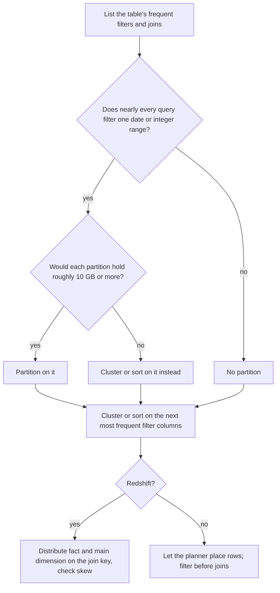

# Physical Design

Stage 4 compressed for lookup: [lesson 7](../lessons/0007-partitioning-and-pruning.md) (partitioning and pruning), [lesson 8](../lessons/0008-clustering-and-sort-keys.md) (clustering and sort keys), [lesson 9](../lessons/0009-joins-and-data-distribution.md) (joins and distribution) and [lesson 10](../lessons/0010-the-row-store-advice-that-stops-applying.md) (the row-store habits to drop and keep).

Limits and defaults were read from each vendor's documentation in October 2026. Each section names its page; check it for the current value.

## The three levers

| Lever | What it changes | What it saves | Decided by |
|---|---|---|---|
| Partition | Which unit each row is stored in, by one declared column | Whole partitions skipped, known before the query runs | The column nearly every query filters on, usually a date |
| Clustering key or sort key | The order of rows inside storage | Blocks skipped by their min and max, known only at run time | The next most frequent filter columns, by cardinality |
| Distribution | Which worker holds each row | Rows not moved across the network for a join | The column the largest join uses, without skew |

## Per platform

| | BigQuery | Snowflake | Redshift |
|---|---|---|---|
| Declared partitions | Time-unit column (hour, day, month, year), ingestion time, integer range | None; automatic micro-partitions of 50 to 500 MB uncompressed | None in native tables; Spectrum external tables partition by S3 folder |
| Ordering | Clustering, up to 4 columns, in order | Clustering key, a few columns or expressions | Sort key: compound (default) or interleaved (up to 8 columns); `SORTKEY AUTO` recommended |
| Block metadata | Per storage block | Per micro-partition: value range and distinct count per column | Zone map per 1 MB block |
| Keeping order | Automatic reclustering, not billed | Automatic Clustering, serverless credits plus storage for rewritten micro-partitions | `VACUUM` re-sorts the unsorted region; `VACUUM REINDEX` for interleaved |
| Distribution | Chosen by the planner per join | Chosen by the planner per join | `DISTSTYLE KEY`, `EVEN`, `ALL` or `AUTO` (the default) |
| Where to read it | Dry run bytes; execution details per stage | Query profile: partitions scanned of total; `SYSTEM$CLUSTERING_INFORMATION` | `EXPLAIN` redistribution labels; `SVV_TABLE_INFO` |

Sources: [Introduction to partitioned tables](https://cloud.google.com/bigquery/docs/partitioned-tables), [Introduction to clustered tables](https://cloud.google.com/bigquery/docs/clustered-tables), [Micro-partitions and data clustering](https://docs.snowflake.com/en/user-guide/tables-clustering-micropartitions), [Clustering keys and clustered tables](https://docs.snowflake.com/en/user-guide/tables-clustering-keys), [Sort keys](https://docs.aws.amazon.com/redshift/latest/dg/t_Sorting_data.html), [Data distribution for query optimization](https://docs.aws.amazon.com/redshift/latest/dg/t_Distributing_data.html).

## Partitioning

### BigQuery options

| Option | Effect |
|---|---|
| `PARTITION BY DATE(ts)`, `TIMESTAMP_TRUNC(ts, HOUR)` and similar | Time-unit partitioning; boundaries in UTC |
| Ingestion time | Partition by load time; filter on `_PARTITIONTIME` or `_PARTITIONDATE` |
| `RANGE_BUCKET(col, GENERATE_ARRAY(start, end, interval))` | Integer-range partitioning |
| `require_partition_filter = TRUE` | A query without a usable partition filter fails instead of scanning everything |
| `__NULL__`, `__UNPARTITIONED__` | Where null and out-of-range values land |

Prefer clustering to partitioning when partitions would average under about 10 GB, when queries filter on several columns, or when the column has high cardinality ([Introduction to partitioned tables](https://cloud.google.com/bigquery/docs/partitioned-tables)).

### Redshift Spectrum

One S3 folder per value, named `key=value`; `PARTITIONED BY` on the external table; one `ALTER TABLE ... ADD PARTITION` per folder; list them in `SVV_EXTERNAL_PARTITIONS` ([External tables for Redshift Spectrum](https://docs.aws.amazon.com/redshift/latest/dg/c-spectrum-external-tables.html)).

### Filters that prune and filters that do not

| Filter | Prunes? | Why |
|---|---|---|
| `ts >= '2026-03-01' AND ts < '2026-04-01'` | Yes | Bare column against constants |
| `DATE(ts) = '2026-03-30'`, `CAST(ts AS DATE) = ...` | Yes on BigQuery | A function it maps onto partition boundaries |
| `EXTRACT(MONTH FROM ts) = 3` | No | The engine cannot map a month number to boundaries |
| `CAST(ts AS STRING) LIKE '2026-03%'` | No | A text comparison hides the column |
| `ts + INTERVAL 1 DAY > CURRENT_TIMESTAMP()` | No | Arithmetic on the column; move it to the other side |
| `ts = (SELECT max(ts) FROM ...)` | No | Not a constant; Snowflake also never prunes on a subquery predicate |
| Filter on a joined dimension only | No static pruning | Repeat the literal range on the fact's own column |
| `part_col = X OR other_col = Y` | No | Rows in any partition can match |

BigQuery's full list of functions that keep pruning is in [Querying partitioned tables](https://cloud.google.com/bigquery/docs/querying-partitioned-tables). Confirm any filter with a dry run or the query profile.

## Clustering and sort keys

| Choice | Rule |
|---|---|
| Which columns | Those most often in `WHERE` and join conditions, most frequent first |
| Cardinality | Enough distinct values to prune, not so many that ordering is costly; cluster a fine timestamp as an expression such as `TO_DATE(ts)` on Snowflake |
| Column order | Filters must use a prefix of a compound or BigQuery clustering key; Snowflake orders multi-column keys from lower to higher cardinality |
| Do not repeat | A daily-partitioned table gains nothing from clustering on the same date |
| When to skip | Small tables (BigQuery: under about 64 MB; Snowflake: keys are meant for large, typically multi-terabyte, tables) and tables rewritten across the board often |
| Interleaved | Redshift only; any subset of columns prunes; never on a column that only grows (date, timestamp, identity); slower loads and vacuums |

Clustering depth on Snowflake is the average number of micro-partitions overlapping at a value: 1 is the floor, lower is better, and partitions scanned in the profile is the number that pays.

## Distribution and joins

| Movement | What moves | Redshift `EXPLAIN` | BigQuery plan step |
|---|---|---|---|
| Co-located | Nothing | `DS_DIST_NONE` | |
| Inner side is `ALL` | Nothing | `DS_DIST_ALL_NONE` | |
| Broadcast | Small side × workers | `DS_BCAST_INNER` | `JOIN EACH WITH ALL` |
| Redistribute one side | That side | `DS_DIST_INNER`, `DS_DIST_OUTER` | |
| Shuffle both | Most of both tables | `DS_DIST_BOTH` | `JOIN EACH WITH EACH` |
| Outer side is `ALL` | Inner side to one slice; join runs serially | `DS_DIST_ALL_INNER` | |

Redshift distribution styles:

| Style | Placement | Use for |
|---|---|---|
| `KEY` | Hash of one column | A large table and the dimension it joins most, on the same column |
| `EVEN` | Round robin | Tables that join nothing, or have no clear key |
| `ALL` | Full copy per node; storage × nodes | Slow-moving dimensions that cannot be co-located |
| `AUTO` | `ALL` while small, then `KEY` or `EVEN` | The default |

Skew: a key with few values, a dominant placeholder value, or a narrow filter on the distribution column puts the work on a few slices. Choose a key with high cardinality in the filtered rows. Sources: [Distribution styles](https://docs.aws.amazon.com/redshift/latest/dg/c_choosing_dist_sort.html), [Evaluating the query plan](https://docs.aws.amazon.com/redshift/latest/dg/c_data_redistribution.html), [Choose the best distribution style](https://docs.aws.amazon.com/redshift/latest/dg/c_best-practices-best-dist-key.html), [Query plan and timeline](https://cloud.google.com/bigquery/docs/query-plan-explanation).

## Row-store habits

| Habit | On a warehouse | Mechanism | Do instead |
|---|---|---|---|
| Secondary B-tree index on a slow filter | Drop | No index on ordinary tables; blocks pruned by min and max | Partition or cluster on the column (lessons 7, 8) |
| `LIMIT` to cut cost | Drop | Columns are read before rows are assembled; `LIMIT` trims output only | Select fewer columns, filter on the partition, use the free table preview |
| `SELECT *` for convenience | Drop | Bytes scanned sums over referenced columns | Name the columns (lesson 1) |
| Highly normalized schema joined per query | Drop | Each join may shuffle or broadcast rows between workers | Star schema one join deep, or nesting (lesson 9, stage 5) |
| Single-row `UPDATE`/`DELETE` in a loop | Drop | Blocks are large and compressed; Snowflake micro-partitions are immutable and rewritten whole | Stage the changes, one `MERGE` (lesson 15) |
| Point lookups as a serving path | Drop | One row costs a block per column plus a distributed query | Serve from a row store |
| Filter early | Keep | Fewer blocks read if it prunes; fewer rows moved before a join | Filter on partition and cluster columns; repeat filters on joined tables on Redshift |
| Avoid needless joins | Keep, more so | Every join can move data | Drop joins nobody selects from; window functions over self-joins |
| Correct data types | Keep, more so | Dates partition and prune; narrow keys join faster; one type encodes well | `DATE` not `STRING`; `INT64` join keys on BigQuery |

The row-store side of each habit: [Performance](../../../programming/sql/reference/performance.md) (scans, indexes, join strategies) and [Schema design](../../../programming/sql/reference/schema-design.md) (normal forms, type choice, denormalisation). Sources: [Optimize query computation](https://cloud.google.com/bigquery/docs/best-practices-performance-compute), [Query design best practices](https://docs.aws.amazon.com/redshift/latest/dg/c_designing-queries-best-practices.html), [Optimize query cost](https://cloud.google.com/bigquery/docs/best-practices-costs).

## Choosing a layout

## Sources

- [Docs: "Introduction to partitioned tables", Google Cloud](https://cloud.google.com/bigquery/docs/partitioned-tables)
- [Docs: "Introduction to clustered tables", Google Cloud](https://cloud.google.com/bigquery/docs/clustered-tables)
- [Docs: "Micro-partitions and data clustering", Snowflake](https://docs.snowflake.com/en/user-guide/tables-clustering-micropartitions)
- [Docs: "Clustering keys and clustered tables", Snowflake](https://docs.snowflake.com/en/user-guide/tables-clustering-keys)
- [Docs: "Sort keys", Amazon Redshift](https://docs.aws.amazon.com/redshift/latest/dg/t_Sorting_data.html)
- [Docs: "Data distribution for query optimization", Amazon Redshift](https://docs.aws.amazon.com/redshift/latest/dg/t_Distributing_data.html)
- [Docs: "Choose the best distribution style", Amazon Redshift](https://docs.aws.amazon.com/redshift/latest/dg/c_best-practices-best-dist-key.html)
- [Docs: "Optimize query computation", Google Cloud](https://cloud.google.com/bigquery/docs/best-practices-performance-compute)
- [Docs: "Query design best practices", Amazon Redshift](https://docs.aws.amazon.com/redshift/latest/dg/c_designing-queries-best-practices.html)
- [Resources](../RESOURCES.md)
