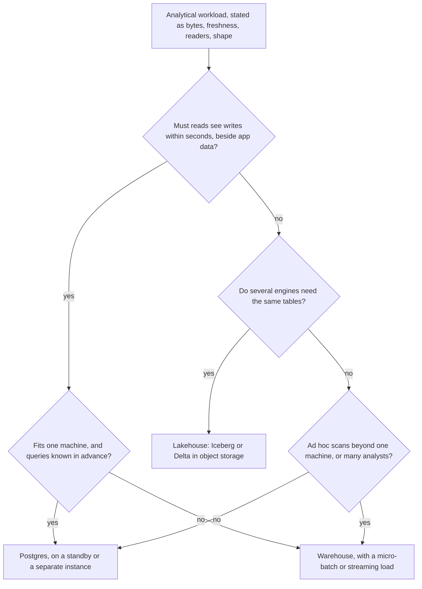

# Schema and Bill Review

Stage 8 compressed for lookup. [Lesson 18](../lessons/0018-warehouse-postgres-or-lakehouse.md) covers where a workload belongs, [lesson 19](../lessons/0019-reviewing-a-warehouse-schema-and-its-bill.md) works a review of a schema and its bill, and [lesson 20](../lessons/0020-changing-a-model-others-query.md) covers changing a model others query; this sheet is the checklist and the decision.

Platform values come from the vendor pages named under each table. Rates and defaults move, so every cost here is in the billing unit (TiB scanned, credits, RPU-hours), never in money.

## Review order

1. Bill by line item: query bytes, compute, storage.
2. Top queries by bytes billed, or top compute by credits or RPU-hours.
3. The tables and models those queries read.
4. The design choice behind each cost, checked against the list below.
5. Write each finding as: choice, cost in the billing unit, fix, what the fix leaves alone.
6. Say "checked, fine at this size" for what you looked at and did not flag.

## Checklist by stage

### Storage and execution (stages 1 and 2)

| Check | What it costs when wrong |
|---|---|
| Dashboards and jobs name their columns instead of `SELECT *` | Every unreferenced column's bytes, on every run |
| Wide raw payloads (JSON blobs) sit in their own column, not mixed into hot columns | The payload's bytes on any query that touches it |
| Columns have their real types, not strings | Larger chunks, weaker encoding, casts on every read |

### Compute (stage 3)

| Check | What it costs when wrong |
|---|---|
| Snowflake auto-suspend is on, at a short idle timeout | Credits for every idle hour; the rate doubles per size step |
| Compute is sized from a measured run, not from the largest size | Credits or slots paid for speed nobody waits on |
| Batch, BI and ad hoc run on separate compute | Queueing: one team's scan delays another's dashboard |
| Concurrency scaling (multi-cluster, Redshift concurrency scaling) has a ceiling | Extra clusters billed under a burst nobody capped |

Sources: Snowflake [Understanding compute cost](https://docs.snowflake.com/en/user-guide/cost-understanding-compute) and [Overview of warehouses](https://docs.snowflake.com/en/user-guide/warehouses-overview); Redshift [Workload management](https://docs.aws.amazon.com/redshift/latest/dg/cm-c-implementing-workload-management.html); BigQuery [Understand slots](https://cloud.google.com/bigquery/docs/slots).

### Physical design (stage 4)

| Check | What it costs when wrong |
|---|---|
| Large tables filtered by date are partitioned by that date | The whole table's referenced columns, on every date-filtered query |
| Filters reach the partition column directly, not through a function or a subquery | A filter that looks pruning and scans everything |
| BigQuery tables that must always be filtered require a partition filter | One unfiltered query scanning the full history |
| Clustering or sort keys match the most selective common filter | Blocks read whose min and max could have excluded them |
| Small tables are left unpartitioned | Partitions to manage for no bytes saved |
| Redshift joins on large tables co-locate by distribution key | Rows redistributed across nodes on every join |

Sources: [Introduction to partitioned tables](https://cloud.google.com/bigquery/docs/partitioned-tables), [Introduction to clustered tables](https://cloud.google.com/bigquery/docs/clustered-tables), [Sort keys](https://docs.aws.amazon.com/redshift/latest/dg/t_Sorting_data.html), [Data distribution for query optimization](https://docs.aws.amazon.com/redshift/latest/dg/t_Distributing_data.html).

### Modelling (stage 5)

| Check | What it costs when wrong |
|---|---|
| Every fact table has a written grain, and every column is true at it | Measures multiplied or silently misattributed |
| Dimensions that reports group history by are type 2 | Closed-period reports change when rerun |
| Facts join to the surrogate key current at the event | History rewritten to today's attribute values |

Source: Kimball Group [Dimensional Modeling Techniques](https://www.kimballgroup.com/data-warehouse-business-intelligence-resources/kimball-techniques/dimensional-modeling-techniques/).

### Loading (stage 6)

| Check | What it costs when wrong |
|---|---|
| Every load can be rerun without duplicates (merge or partition overwrite) | Double-counted rows after any retry |
| Raw source rows are kept before transformation | History that cannot be rebuilt when a model changes |
| Batch files are sized for parallel load, not thousands of tiny files | Slow loads and per-file overhead |

Sources: [Preparing your data files](https://docs.snowflake.com/en/user-guide/data-load-considerations-prepare), [Amazon Redshift best practices for loading data](https://docs.aws.amazon.com/redshift/latest/dg/c_loading-data-best-practices.html).

### Cost controls (stage 7)

| Check | What it costs when wrong |
|---|---|
| BigQuery dashboards and jobs set a maximum bytes billed | No ceiling on one bad query; over the limit, a query fails without a charge |
| Snowflake accounts have a resource monitor with a quota | No ceiling on a month's credits |
| Redshift Serverless has usage limits | No ceiling on RPU-hours |
| Refresh rates match how often the data changes | The same bytes scanned many times for the same answer |
| Repeated aggregations use a materialized view or a cached result | Full scans for an answer computed once |
| Nobody runs queries to preview data | Bytes billed for what a table preview shows free |

Sources: [Optimize query cost](https://cloud.google.com/bigquery/docs/best-practices-costs), [Working with resource monitors](https://docs.snowflake.com/en/user-guide/resource-monitors), [Billing for Amazon Redshift Serverless](https://docs.aws.amazon.com/redshift/latest/mgmt/serverless-billing.html).

## Changing a model others query

| Change | Kind | Caught by a dbt enforced contract |
|---|---|---|
| Add a nullable column | Additive | No; the contract's own columns must be updated |
| Remove a column | Breaking | Yes |
| Change a column's data type | Breaking | Yes |
| Remove or modify a constraint | Breaking | Yes |
| Remove, rename or disable a contracted model | Breaking | Yes: error if versioned, warning if not |
| Change the grain | Breaking, silently | No: reconcile old against new |
| Change a column's meaning | Breaking, silently | No: rename the column instead |

Source: dbt [Model contracts](https://docs.getdbt.com/docs/mesh/govern/model-contracts).

Sequence: list consumers from query history, expand (new column or new model beside the old), backfill idempotently, reconcile, migrate with a written deprecation notice, contract when history shows no reads.

## Claims to settle from the page, not from memory

| Claim | What the documentation says |
|---|---|
| `LIMIT` makes a BigQuery query cheaper | No effect on data read for non-clustered tables; can reduce bytes scanned on clustered ones ([Optimize query cost](https://cloud.google.com/bigquery/docs/best-practices-costs)) |
| The dry run says what a clustered query will bill | For clustered tables the estimate is an upper bound ([Optimize query cost](https://cloud.google.com/bigquery/docs/best-practices-costs)) |
| Clustering guarantees a smaller scan | It can reduce costs, BigQuery may not estimate bytes accurately before execution, and it does not guarantee fewer slots ([Introduction to clustered tables](https://cloud.google.com/bigquery/docs/clustered-tables)) |
| A BigQuery view's schema follows its tables | It is stored at creation and not updated until the view is recreated ([Introduction to views](https://cloud.google.com/bigquery/docs/views-intro)) |

## Placement: warehouse, Postgres or lakehouse

| Store | Right when | What it costs |
|---|---|---|
| Postgres | Data fits one machine, queries known and indexable, seconds of freshness beside app data | Row-store scans read every column; analytics competes with transactions or with replay on a standby |
| Warehouse | Ad hoc scans over large data, many analysts, one SQL engine is enough | A load path and its latency; a bill in bytes scanned or compute held |
| Lakehouse | Several engines read the same tables, very large cold history, open formats required | Compaction, snapshot expiry and a catalog to run; transactions on one table at a time |

When the usual "use a warehouse" is wrong: small, fresh, app-facing data; many tiny high-concurrency lookups; a main reader that is not SQL. When "use Postgres" is wrong: ad hoc analyst scans against the primary the application depends on.

Sources: [Lakehouse, CIDR 2021](https://www.cidrdb.org/cidr2021/papers/cidr2021_paper17.pdf), [Iceberg Table Spec](https://iceberg.apache.org/spec/); for the Postgres side, the [replication sheet](../../postgres/reference/replication.md) and the SQL track's [performance sheet](../../../programming/sql/reference/performance.md).
