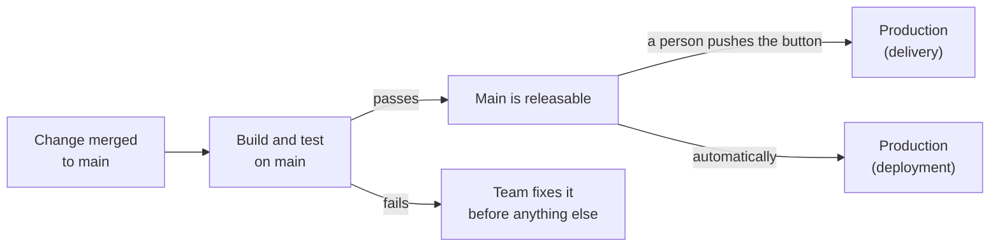

# Lesson 1. What CI and CD Promise

**Mission link:** The mission says to prove every change builds and passes its tests in minutes and to ship it through a pipeline you own. Before you write any pipeline you need to know what it is for, because a pipeline is a tool, and the three promises it serves are practices a team keeps or fails to keep.
**Primary source:** [Article: "Continuous Integration", Martin Fowler](https://martinfowler.com/articles/continuousIntegration.html)
**Prerequisites:** Comfort with Git branches and merging, and with building and testing a project in one language. Nothing else is assumed. Terms used here: [Continuous integration](../GLOSSARY.md), [Continuous delivery](../GLOSSARY.md), [Continuous deployment](../GLOSSARY.md), [Pipeline](../GLOSSARY.md)

## Know this

### Three promises, three names

The three terms get used as if they were one thing with different spellings. They are three separate promises, and each one builds on the one before.

|Practice|The promise|What a person still decides|
|---|---|---|
|Continuous integration|Every change is merged into one mainline and proven there by an automated build and test run, and a broken build is fixed at once|Nothing: the merge is the decision|
|Continuous delivery|The mainline is releasable at all times, so any commit that passed can go to production at the push of a button|Whether and when to push the button|
|Continuous deployment|Every change that passes the pipeline goes to production automatically|Nothing after the merge|

Fowler defines continuous integration as a practice where each team member merges into the shared codebase at least daily, and each merge is verified by an automated build, including tests, so integration errors surface as early as possible ([Fowler](https://martinfowler.com/articles/continuousIntegration.html)). His continuous delivery page sets the bar for the next promise: the software is deployable throughout its life, the team keeps it deployable ahead of new features, and anyone can get fast automated feedback on production readiness after any change ([Fowler](https://martinfowler.com/bliki/ContinuousDelivery.html)). The same page separates the last two: continuous deployment sends every change through the pipeline into production automatically, continuous delivery only means you could deploy at any moment and may choose not to, and you cannot do deployment without doing delivery.



The picture also shows why the words matter. Delivery and deployment run the same pipeline up to the box in the middle. They differ in who decides what happens after it, and that is a business choice, not a technical failing: a team that holds a release for a regulator or a launch date is still doing continuous delivery.

### Integration is a practice, not a server

The word "continuous" in continuous integration describes how often people merge, not how often a machine runs. Fowler's practices include one version-controlled mainline, a build that tests itself, everyone pushing to the mainline every day, a build on every push to it, fixing a broken build immediately, keeping the build fast and hiding work in progress ([Fowler](https://martinfowler.com/articles/continuousIntegration.html)). Only some of those are about tooling. A pipeline supplies the automated build and the build on every push. It cannot make people merge daily, and it cannot make them stop and fix a red build.

That is the gap the glossary points at with its avoid notes: a CI server and "tests on pull requests" are tools for the practice, not the practice. A team can have both and still integrate every two weeks, with each long-lived branch passing its own tests and then colliding at merge time. Fowler's table of contents even has a sidebar for this, "Semi-Integration (it isn't Continuous Integration)". The word that matters in the definition is the mainline: the tests have to pass on the code everyone else is also changing.

"Hide work in progress" is the practice that makes small daily merges possible. If a change is too big to finish today, you merge it in a form that does nothing yet, for example behind a switch, rather than keeping it on a branch. Lesson 20 returns to that idea as a feature flag, which separates deploying code from releasing it.

### What a pipeline guarantees

A pipeline is the automated path from a commit to production. In its simplest form it builds and tests every change the same way, in a clean environment, and records the result where the team can see it. That is a narrow guarantee, and it is worth stating exactly:

- It guarantees that the checks you wrote ran against that commit and passed or failed.
- It does not guarantee the code is correct beyond what those checks assert.
- It does not guarantee the team integrates often, or that anyone acts on a red result.

The promise of delivery adds one more requirement that is easy to miss: the mainline stays releasable only if the team treats a failing mainline as the most urgent work. Fowler's wording is that the team prioritizes keeping the software deployable over working on new features. A pipeline that is red for three days is not delivering anything, whatever tool runs it.

### Judging a delivery process by outcomes

Features of a tool are a poor measure of a delivery process. DORA's research measures it by outcomes, grouped into throughput and instability ([DORA](https://dora.dev/guides/dora-metrics-four-keys/)):

|Group|Metric|Question it answers|
|---|---|---|
|Throughput|Change lead time|How long from a commit to production?|
|Throughput|Deployment frequency|How often does production change?|
|Throughput|Failed deployment recovery time|How long to recover from a bad deployment?|
|Instability|Change fail rate|How many deployments need immediate intervention?|
|Instability|Deployment rework rate|How many deployments are unplanned fixes for an incident?|

DORA's guide notes that a common way to improve all five is to reduce the batch size of changes, since smaller changes are easier to move through delivery and easier to recover from. That is the engine behind the three promises: integrate often so each change is small, prove each one automatically, and the cost and risk of every release fall together. The rest of this track makes each of those steps concrete.

## Practice

1. ▢ A team runs the full test suite on every pull request and requires it to pass. Each developer works on a branch for about two weeks, then opens a pull request. Which statement is right?

    - a) They practise continuous integration, because every merge gets tested automatically
    - b) They practise continuous delivery, because every merge gets tested automatically
    - c) They own the tooling for continuous integration without the practice
    - d) They follow the practice of continuous integration without the tooling

<details markdown="1"><summary>Check</summary>

**c)** The tests run, which is the tooling half. The practice needs everyone to merge into the mainline at least daily, and two-week branches defer every integration problem until the merge. (a) confuses a tested merge with frequent integration. (b) mixes up the practices: delivery is about the mainline being releasable, and a mainline that takes a big collision every two weeks seldom is. (d) has it backwards, since the automation exists and the frequency does not.

</details>

2. ▢ Name which of the three promises each team keeps. Team X merges to main and a pipeline deploys to production on its own whenever tests pass. Team Y merges to main, the pipeline builds, tests and stages a release, and a release manager clicks "deploy" on Thursdays. Team Z builds and tests on main, but nobody has ever deployed an artifact from it without manual patching.

<details markdown="1"><summary>Check</summary>

Team X does continuous deployment. Team Y does continuous delivery: main is releasable at any time and a person chooses the moment, and a weekly cadence is a legitimate choice. Team Z does continuous integration only. Its main is proven to build and pass tests, but it is not releasable, because a release needs manual patching. Fowler's key test for delivery is that a sponsor could ask for a deploy at a moment's notice and nobody would panic ([Fowler](https://martinfowler.com/bliki/ContinuousDelivery.html)), and Team Z fails it.

</details>

3. ▢ Predict, then run. In a repository you work in, find out how often changes reach the mainline. Predict first: on how many different days in the last 14 days did something land on `main` (or your default branch), and how many commits landed on the busiest day? Then run this, which counts first-parent commits per day:

    ```console
    $ git log main --first-parent --since="14 days ago" --format=%cs | sort | uniq -c
    ```

<details markdown="1"><summary>Hint</summary>

`--first-parent` follows only the mainline, so a merged branch counts as one entry on the day it landed, not once per commit on the branch. A team that merges daily shows many separate days with small counts.

</details>

<details markdown="1"><summary>Check</summary>

For a team that integrates often, expect output like this, one line per day with a count in front:

```text
      2 2026-10-05
      4 2026-10-06
      1 2026-10-07
      3 2026-10-08
      2 2026-10-09
      5 2026-10-12
```

Many days with small counts mean frequent, small integrations. A team on long-lived branches shows the opposite shape: a few days with large counts and gaps of a week or more between them. The first shape is what the continuous integration practice produces, and the second is why a green pipeline on each branch still leaves integration risk. Your own numbers are the point, not these.

</details>

4. ▢ Debug this. A team reports: "We do continuous delivery." Their main branch has been failing its tests since Monday. Developers keep merging new work on top of it, saying the failure is "just that flaky integration test". On Thursday a customer needs a fix, and nobody can say which commit on main is safe to ship. Which promises are broken, and what would the team have to change?

<details markdown="1"><summary>Hint</summary>

Check each promise against what the team does in the first sentence of its definition, not against what tools they own.

</details>

<details markdown="1"><summary>Check</summary>

Two promises are broken. Continuous integration says a broken build is fixed at once, and here the team merges on top of red. Continuous delivery says main is releasable at all times, and when nobody can name a safe commit, it is not. The fix is a team rule before it is a pipeline change: a red main stops new merges until it is green or the offending change is reverted. The "flaky test" claim, if true, is its own problem to solve (lesson 9), because a test the team has learned to ignore protects nothing.

</details>

5. ▢ Fowler says you cannot do continuous deployment without doing continuous delivery. In your own words, why must that be true, and what would a team that tried deploying every change without delivery's discipline be risking?

<details markdown="1"><summary>Check</summary>

Deployment sends every passing change to production with no human in between, so the only thing between a commit and users is the pipeline and the state of main. If main is not reliably releasable, because the pipeline is not trusted, builds are not repeatable or the team lets it stay red, the automation ships whatever it finds. Delivery's discipline, a mainline kept releasable with fast trustworthy feedback, is what makes removing the human safe. Without it, continuous deployment is continuous exposure.

</details>

## Real-world reps

- [ ] Pick one service you work on and write one sentence naming which of the three promises its process keeps today, using the table in this lesson. Then name the thing that would have to change to keep the next one.
- [ ] Look at the history of your team's main branch for the last month. Find how long it was red in total, or how long the longest red stretch lasted, and who noticed it first.
- [ ] Tomorrow: without notes, define continuous integration, continuous delivery and continuous deployment in one sentence each, and say which decision a person still makes in each.

## Going further

- [Workflow Syntax](../reference/workflow-syntax.md), the stage 1 and 2 sheet this track builds from lesson 2 on
- [Article: "Continuous Integration", Martin Fowler](https://martinfowler.com/articles/continuousIntegration.html)
- [Article: "Continuous Delivery", Martin Fowler](https://martinfowler.com/bliki/ContinuousDelivery.html)
- [Guide: "DORA's software delivery metrics", DORA](https://dora.dev/guides/dora-metrics-four-keys/)
- [Resources](../RESOURCES.md)

---

Not landing? Reread the primary source at the top, since this lesson compresses it and compression is where understanding leaks. Check the [glossary](../GLOSSARY.md) for any term that felt slippery.

If the lesson itself is unclear rather than the material, that is a defect: [open an issue](https://github.com/TokenCemetery/teach/issues).
