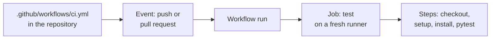

# Lesson 2. Pipelines as Code

**Mission link:** The mission says to own the pipeline, and you can only own what you can read, review and change like any other code. This lesson creates the repository every later lesson works in and gives it its first pipeline, so that "a change was proven" stops being a claim and becomes a check you can open.
**Primary source:** [Docs: "Understanding GitHub Actions", GitHub](https://docs.github.com/en/actions/get-started/understand-github-actions)
**Prerequisites:** [Lesson 1](0001-what-ci-and-cd-promise.md), [Pipeline](../GLOSSARY.md), [Workflow](../GLOSSARY.md), [Job](../GLOSSARY.md), [Step](../GLOSSARY.md), [Runner](../GLOSSARY.md), [Action](../GLOSSARY.md)

## Warm-up

1. ▢ Which of the three promises says that a broken build is fixed at once, and which one adds that main can go to production at the push of a button?

<details markdown="1"><summary>Check</summary>

Continuous integration carries the "fixed at once" promise, and continuous delivery adds the push-of-a-button one on top of it. Continuous deployment removes the button (lesson 1).

</details>

2. ▢ A team runs tests on every pull request but merges branches after two weeks. Do they practise continuous integration?

<details markdown="1"><summary>Check</summary>

No. They have the tooling but not the practice, which needs everyone to merge into the mainline at least daily (lesson 1). A pipeline cannot supply that frequency.

</details>

3. ▢ Name two things a pipeline does not guarantee, even when it is green.

<details markdown="1"><summary>Check</summary>

That the code is correct beyond what the checks assert, and that the team integrates often or acts on a red result (lesson 1).

</details>

## Know this

### The pipeline lives in the repository

For a long time pipelines were configured by clicking through a CI server's web interface. The configuration lived in the server, nobody reviewed a change to it, and a build that behaved differently last month left no trail. **Pipeline as code** moves the definition into a file in the repository, next to the code it builds. Jenkins' documentation calls this the foundation of "Pipeline-as-code": the delivery pipeline is treated as part of the application, versioned and reviewed like any other code, and a `Jenkinsfile` committed to source control gives you review of pipeline changes, an audit trail and a single source of truth ([Jenkins](https://www.jenkins.io/doc/book/pipeline/)).

Three consequences follow, and they are the reason to do it:

- **A change to the pipeline is a change to the code.** It goes through the same pull request, the same review and the same history.
- **The pipeline has a version.** Every commit carries the pipeline definition that built it, so you can read how a past build was made.
- **It applies to branches by default.** A file in the repository exists on every branch that contains it, so a new branch gets the pipeline without anyone configuring a server.

In GitHub Actions the file is a **workflow**: a YAML file in the `.github/workflows` directory of the repository, which runs when an event triggers it ([Docs](https://docs.github.com/en/actions/get-started/understand-github-actions)). The file must have a `.yml` or `.yaml` extension ([Workflow syntax](https://docs.github.com/en/actions/reference/workflows-and-actions/workflow-syntax)), and a repository can hold several, each doing a different task.

### The service you will build the pipeline for

Every lesson from here on works in one throwaway public repository, `ci-cd-practice`. It is public so GitHub-hosted runners are free to use. It holds a tiny Flask service with a health endpoint and a version endpoint, and a test file. The packaging and testing commands belong to the language tracks, see [Python: Project and Packaging](../../../programming/python/reference/project-and-packaging.md). What matters here is that the same two commands, install and test, work on your machine and on a runner.

`app.py`:

```python
import os

from flask import Flask

app = Flask(__name__)


@app.get("/healthz")
def healthz():
    return "ok"


@app.get("/version")
def version():
    return os.environ.get("APP_VERSION", "dev")
```

`test_app.py`:

```python
import pytest

from app import app


@pytest.fixture
def client():
    return app.test_client()


def test_healthz(client):
    response = client.get("/healthz")
    assert response.status_code == 200
    assert response.get_data(as_text=True) == "ok"


def test_version(client, monkeypatch):
    monkeypatch.setenv("APP_VERSION", "1.2.3")
    response = client.get("/version")
    assert response.get_data(as_text=True) == "1.2.3"
```

`requirements.txt` pins both packages with exact versions, so a run today and a run next month install the same two packages:

```text
flask==3.1.3
pytest==9.1.1
```

A `.gitignore` with the lines `.venv/`, `__pycache__/` and `.pytest_cache/` keeps local files out of the repository. Create the directory, the four files, and run the tests on your own machine first:

```console
$ mkdir ci-cd-practice && cd ci-cd-practice
$ git init -b main
$ python3 -m venv .venv
$ .venv/bin/pip install -r requirements.txt
$ .venv/bin/pytest
============================= test session starts ==============================
collected 2 items

test_app.py ..                                                           [100%]

============================== 2 passed in 0.18s ===============================
```

A pipeline automates what you can already do by hand, so if the tests do not pass here they will not pass on the runner. Commit the files, then create the public repository on GitHub and push. With the GitHub CLI, signed in through `gh auth login`, one command does both, and creating the repository in the web interface and adding it as `origin` is equivalent:

```console
$ git add . && git commit -m "Add the practice service"
$ gh repo create ci-cd-practice --public --source=. --remote=origin --push
```

### The first workflow

Create `.github/workflows/ci.yml`. Later lessons extend this file, so keep it:

```yaml
name: ci

on:
  push:
    branches: [main]
  pull_request:

jobs:
  test:
    runs-on: ubuntu-latest
    steps:
      - uses: actions/checkout@v7
      - uses: actions/setup-python@v7
        with:
          python-version: "3.13"
      - run: pip install -r requirements.txt
      - run: pytest
```

Read it from the top, because a workflow is a nest of the same words you met in the glossary:

|Key|Meaning here|
|---|---|
|`name: ci`|The workflow's name in the Actions tab|
|`on`|The events that start a run: a push to `main`, and any pull request. Lesson 3 covers this key in full|
|`jobs`|One job, named `test`. The name after `jobs` is its ID, and it is also the name the pull request shows for this check|
|`runs-on: ubuntu-latest`|The job runs on a GitHub-hosted Ubuntu runner, a fresh virtual machine for this job (lesson 4)|
|`uses: actions/checkout@v7`|A step that runs an action to copy the repository onto the runner. The runner starts empty, so without this step there is no `app.py` to test|
|`uses: actions/setup-python@v7` with `python-version`|A step that installs Python 3.13 and puts it on the path|
|`run: pip install ...` and `run: pytest`|Steps that run shell commands, the same two you ran by hand|

Commit this on a branch and open a pull request, rather than pushing to `main`, because that is how the file will be changed from now on:

```console
$ git switch -c add-ci
$ git add .github && git commit -m "Add the first CI workflow"
$ git push -u origin add-ci
$ gh pr create --fill
```

Open the pull request on GitHub. Under the checks you will find one named `test`, running on the `pull_request` event. When it finishes, open its log and expand the `Run pytest` step. It shows the same output you saw locally, with a runner's paths:

```text
Run pytest
============================= test session starts ==============================
platform linux -- Python 3.13.14, pytest-9.1.1, pluggy-1.7.0
rootdir: /home/runner/work/ci-cd-practice/ci-cd-practice
collected 2 items

test_app.py ..                                                           [100%]

============================== 2 passed in 0.24s ===============================
```

Merge the pull request. The merge is a push to `main`, so the same workflow runs again, this time on the `push` event. That second run is the continuous integration check from lesson 1: proof, on the mainline, that the merged code passes.

### Which version of the pipeline runs

A workflow is code in a commit, so it is the version in that commit that runs. On a push, GitHub runs the workflow files as they exist in the pushed commit, which includes workflows that are not merged into the default branch ([Events that trigger workflows](https://docs.github.com/en/actions/reference/workflows-and-actions/events-that-trigger-workflows)). A pull request is tested against the merge of its branch into the base, and the commit under test is that merge commit. That is why a change to `ci.yml` is reviewed and tested in the same pull request that proposes it. Practice item 4 has you watch it happen.

### Same idea, three tools

Jenkins and GitLab CI make the same move, a file in the repository, but their models differ in ways that matter later, so the track notes them where they do:

|Idea|GitHub Actions|Jenkins|GitLab CI|
|---|---|---|---|
|The file|`.github/workflows/*.yml`, several allowed|`Jenkinsfile`|`.gitlab-ci.yml`|
|What a file defines|A workflow of jobs, each on its own runner|A pipeline of stages, run on an agent|A pipeline of jobs grouped into stages, run by runners|
|Where the work runs|A fresh runner per job|An agent, whose workspace may not be cleaned up afterwards|A runner, in the Docker image set by `image`|

The same test job in each, for comparison. Jenkins' Declarative Pipeline defines `stages` containing `steps`, and runs shell commands with the `sh` step ([Jenkins](https://www.jenkins.io/doc/book/pipeline/)):

```groovy
pipeline {
    agent any
    stages {
        stage('Test') {
            steps {
                sh 'pip install -r requirements.txt'
                sh 'pytest'
            }
        }
    }
}
```

GitLab runs a job's `script` commands in the Docker image named by `image` ([GitLab](https://docs.gitlab.com/ci/yaml/)):

```yaml
test:
  image: python:3.13
  script:
    - pip install -r requirements.txt
    - pytest
```

The vocabulary shifts. A GitLab job is the closest match to a GitHub job, and GitLab groups jobs into stages that run in sequence, with the jobs inside one stage in parallel ([GitLab](https://docs.gitlab.com/ci/pipelines/)). A GitHub workflow has no stages: jobs run in parallel unless `needs` orders them (lesson 4). A Declarative Jenkins pipeline is a list of stages that each hold steps, all run under one pipeline block. Where this track says "runner", Jenkins says "agent", which is why the glossary lists it under terms to avoid.



## Practice

1. ▢ Which statement about pipeline as code is true?

    - a) A change to the pipeline can be reviewed in a pull request
    - b) A change to the pipeline must be applied on the server
    - c) A change to the pipeline leaves no record in history
    - d) A change to the pipeline applies only to the default branch

<details markdown="1"><summary>Check</summary>

**a)** The definition is a file in the repository, so changing it is a commit that goes through review like any other. (b) describes UI-configured pipelines, the thing pipeline as code replaces. (c) is the opposite of the audit trail the Jenkins documentation lists as a benefit. (d) is wrong because the file exists on every branch that contains it.

</details>

2. ▢ Predict, then run. In `ci-cd-practice`, on a new branch, change `return "ok"` in `app.py` to `return "OK"`, push the branch and open a pull request. What does the `test` check show, and which line of the log tells you why?

<details markdown="1"><summary>Hint</summary>

The test compares the response body with a lowercase string. Pytest prints the expected and actual values on the failing line.

</details>

<details markdown="1"><summary>Check</summary>

The `test` check fails with a red cross on the pull request, and the log of the `Run pytest` step ends like this:

```text
=================================== FAILURES ===================================
_________________________________ test_healthz _________________________________

client = <FlaskClient <Flask 'app'>>

    def test_healthz(client):
        response = client.get("/healthz")
        assert response.status_code == 200
>       assert response.get_data(as_text=True) == "ok"
E       AssertionError: assert 'OK' == 'ok'
E
E         - ok
E         + OK

test_app.py:14: AssertionError
=========================== short test summary info ============================
FAILED test_app.py::test_healthz - AssertionError: assert 'OK' == 'ok'
========================= 1 failed, 1 passed in 0.24s ==========================
Error: Process completed with exit code 1.
```

The line starting `E       AssertionError` names the mismatch, and the final `Error: Process completed with exit code 1.` is the runner reporting that the step's command exited non-zero, which is what fails the step and the job. A pipeline fails a job when a command exits with a non-zero status, nothing more. Push the lowercase fix to the same branch and the check re-runs and passes.

</details>

3. ▢ Debug this. Tests pass on your machine, but the check on a pull request fails with the log below. What is missing from the workflow, and why did it work locally?

    ```text
    Run pytest
    ============================= test session starts ==============================
    platform linux -- Python 3.13.14, pytest-9.1.1, pluggy-1.7.0
    rootdir: /home/runner/work/ci-cd-practice/ci-cd-practice
    collected 0 items / 1 error

    ==================================== ERRORS ====================================
    _________________________ ERROR collecting test_app.py _________________________
    ImportError while importing test module '/home/runner/work/ci-cd-practice/ci-cd-practice/test_app.py'.
    Hint: make sure your test modules/packages have valid Python names.
    Traceback:
    /opt/hostedtoolcache/Python/3.13.14/x64/lib/python3.13/importlib/__init__.py:88: in import_module
        return _bootstrap._gcd_import(name[level:], package, level)
    test_app.py:3: in <module>
        from app import app
    app.py:3: in <module>
        from flask import Flask
    E   ModuleNotFoundError: No module named 'flask'
    =========================== short test summary info ============================
    ERROR test_app.py
    !!!!!!!!!!!!!!!!!!!! Interrupted: 1 error during collection !!!!!!!!!!!!!!!!!!!!
    =============================== 1 error in 0.08s ===============================
    Error: Process completed with exit code 2.
    ```

<details markdown="1"><summary>Hint</summary>

Look at which step installs packages. The runner is a fresh machine for every job, so it has nothing you installed by hand.

</details>

<details markdown="1"><summary>Check</summary>

The workflow is missing the `pip install -r requirements.txt` step before `pytest`. Locally Flask was already installed in your virtual environment, so the import worked. The runner starts from an image with Python and no project dependencies, and a pipeline has to install everything it needs from files in the repository. This is the main reason a green local run proves little: a pipeline starts from nothing and so shows what the repository really contains.

</details>

4. ▢ Predict, then run. On a branch, add one more step to `ci.yml` after `pytest`: `- run: echo "pipeline version ${{ github.sha }}"`. Open a pull request. Does the check on the pull request run your new step, even though `main` still has the old file? Then merge and look at the `push` run on `main`. Which commit does the `sha` in the output name in each case?

<details markdown="1"><summary>Check</summary>

The check on the pull request runs the new step, because the run is made against the pull request's merge commit, which contains your edited file. The `sha` it prints is that merge commit's, not the tip of your branch. After the merge, the `push` run on `main` prints the SHA of the commit that was pushed, and it runs the file as it exists in that commit ([Events](https://docs.github.com/en/actions/reference/workflows-and-actions/events-that-trigger-workflows)). The pipeline is versioned with the code, so the review of a pipeline change sees that change working before it merges.

</details>

5. ▢ Builds start failing the morning after someone changed the pipeline. With a UI-configured server you cannot tell what changed or when. What does pipeline as code let you do in the same situation, and what does it not do for you?

<details markdown="1"><summary>Check</summary>

The change is in the history, so you can see who changed what and when, compare the pipeline before and after, and revert it with the same tool you revert code with. It was also reviewable before it took effect, since it came through a pull request. Pipeline as code does not make the change correct, it makes the change visible and reversible.

</details>

## Real-world reps

- [ ] Push the practice repository, add `ci.yml` through a pull request, and confirm that the `test` check ran on the pull request and again on `main` after the merge. Note the two event names in the Actions tab.
- [ ] Open `ci.yml` in an editor and, line by line, say out loud what each key does without looking at the table. Mark any key you cannot explain, and look it up in the [Workflow syntax](https://docs.github.com/en/actions/reference/workflows-and-actions/workflow-syntax) reference.
- [ ] Tomorrow: without notes, write down three reasons a pipeline belongs in the repository rather than in a server's web interface, and name the file each of GitHub Actions, Jenkins and GitLab CI reads.

## Going further

- [Workflow Syntax](../reference/workflow-syntax.md)
- [Docs: "Understanding GitHub Actions", GitHub](https://docs.github.com/en/actions/get-started/understand-github-actions)
- [Docs: "Pipeline", Jenkins User Documentation](https://www.jenkins.io/doc/book/pipeline/)
- [Docs: "CI/CD YAML syntax reference", GitLab](https://docs.gitlab.com/ci/yaml/)
- [Resources](../RESOURCES.md)

---

Not landing? Reread the primary source at the top, since this lesson compresses it and compression is where understanding leaks. Check the [glossary](../GLOSSARY.md) for any term that felt slippery.

If the lesson itself is unclear rather than the material, that is a defect: [open an issue](https://github.com/TokenCemetery/teach/issues).
