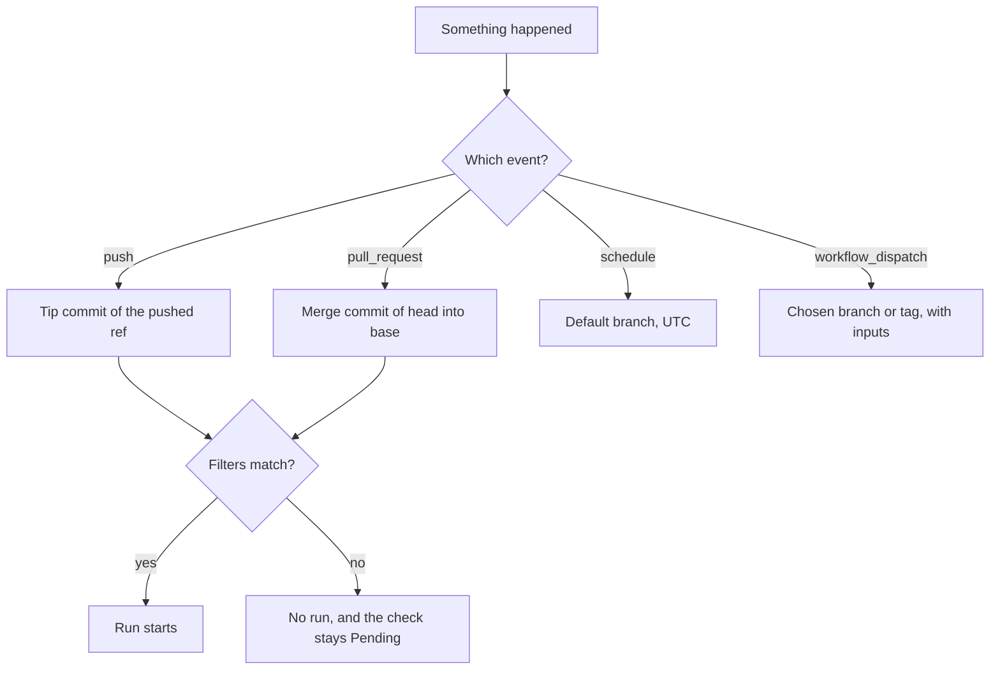

# Lesson 3. Triggers and Events

**Mission link:** The mission says every change is proven on the code that will actually ship. Which commit a run tests depends on the event that started it, and a trigger that fires too rarely, too often or against the wrong commit quietly breaks that proof. This lesson is how you decide when a pipeline runs and what it runs on.
**Primary source:** [Docs: "Events that trigger workflows", GitHub](https://docs.github.com/en/actions/reference/workflows-and-actions/events-that-trigger-workflows)
**Prerequisites:** [Lesson 1](0001-what-ci-and-cd-promise.md), [Lesson 2](0002-pipelines-as-code.md), [Event](../GLOSSARY.md), [Workflow](../GLOSSARY.md)

## Warm-up

1. ▢ In `ci.yml`, what is the difference between the key `jobs.test` and the name `ci`?

<details markdown="1"><summary>Check</summary>

`ci` is the workflow's `name`, shown in the Actions tab. `test` is the job's ID, and it is also the name the pull request shows for that check (lesson 2).

</details>

2. ▢ A job's log shows `ModuleNotFoundError: No module named 'flask'` although the tests pass on your machine. What does that tell you about the runner?

<details markdown="1"><summary>Check</summary>

The runner is a fresh machine with Python and nothing the project needs, so the workflow has to install dependencies itself from files in the repository, here with a `pip install -r requirements.txt` step (lesson 2).

</details>

3. ▢ Which commit does a run on `main` after a merge test, and why is that the continuous integration check?

<details markdown="1"><summary>Check</summary>

The merged commit that was pushed to `main`, with the workflow file as it exists in that commit. It proves the code on the mainline passes, which is the promise continuous integration makes (lessons 1 and 2).

</details>

## Know this

### An event starts a run

A workflow runs because an **event** happened: someone pushed, opened a pull request, a schedule fired, or a person clicked a button. The `on` key lists the events a workflow listens to, and each event carries a payload and a commit to run against ([Docs](https://docs.github.com/en/actions/reference/workflows-and-actions/events-that-trigger-workflows)). Four events cover most pipelines:

|Event|Fires when|`GITHUB_SHA` is|`GITHUB_REF` is|
|---|---|---|---|
|`push`|A commit or tag is pushed|The tip commit pushed to the ref|The updated ref, such as `refs/heads/main`|
|`pull_request`|A pull request is opened, updated or reopened, by default|The last merge commit on the pull request's merge branch|`refs/pull/<number>/merge`|
|`schedule`|A cron time arrives|The last commit on the default branch|The default branch|
|`workflow_dispatch`|A person or the API dispatches it|The last commit on the branch or tag it was dispatched against|That branch or tag|

The commit column is the part to memorise. A `pull_request` run does not test the tip of your branch. It tests the result of merging your branch into its base, which is what `main` would hold after the merge. That is the useful behaviour for continuous integration, because two branches that each pass alone can still fail together. When a job needs the branch tip itself, `github.event.pull_request.head.sha` holds it, and `actions/checkout` checks out the merge commit by default because it follows `GITHUB_REF`. A pull request with a merge conflict starts no `pull_request` run at all until the conflict is resolved ([Docs](https://docs.github.com/en/actions/reference/workflows-and-actions/events-that-trigger-workflows)).

If you list several events, any one of them starts a run, and if several happen at once each starts its own run ([Triggering a workflow](https://docs.github.com/en/actions/how-tos/write-workflows/choose-when-workflows-run/trigger-a-workflow)). That is why `ci.yml` from lesson 2 listens to `push` only on `main`:

```yaml
on:
  push:
    branches: [main]
  pull_request:
```

Had it listened to `push` on every branch as well as `pull_request`, a push to a branch with an open pull request would fire both events, and the same commit would be tested twice, once as itself and once as a merge. Limiting `push` to `main` gives each change exactly one run before the merge and one on the mainline after it.

### Activity types

Many events have several **activity types**. A `pull_request` can be `opened`, `synchronize`, `reopened`, `closed`, `labeled` and more. By default the workflow runs only for `opened`, `synchronize` and `reopened`, and the `types` key changes that:

```yaml
on:
  pull_request:
    types: [opened, synchronize, reopened, ready_for_review]
```

Naming types replaces the default, so the list above has to repeat the three defaults it still wants.

### Filters: branches, tags and paths

A filter narrows an event. Three kinds exist, and they work the same way across the events that support them ([Triggering a workflow](https://docs.github.com/en/actions/how-tos/write-workflows/choose-when-workflows-run/trigger-a-workflow)):

|Filter|Matches|Notes|
|---|---|---|
|`branches`, `branches-ignore`|Branch names. For `pull_request`, the base branch the pull request targets|Not both for the same event|
|`tags`, `tags-ignore`|Tag names|Not both for the same event|
|`paths`, `paths-ignore`|Changed file paths|Not evaluated for pushes of tags|

Rules that cause most of the confusion:

- **Branch and path filters combine with AND.** If you define both `branches` and `paths`, the workflow runs only when both are satisfied.
- **Only branches defined means tags do not run.** If you define only `branches`, the workflow does not run for tag pushes, and the reverse. Define neither and either one triggers.
- **Glob patterns.** `*` matches zero or more characters but not `/`, and `**` matches any characters including `/` ([Workflow syntax](https://docs.github.com/en/actions/reference/workflows-and-actions/workflow-syntax)). So `docs/*` matches a file directly in `docs`, and `docs/**` matches everything beneath it.
- **Negation is ordered.** A pattern starting with `!` excludes, and a later positive pattern includes again, so the order of the list matters. A list of only `!` patterns is invalid: define at least one positive pattern, or use the `-ignore` form.
- **Paths are compared by a diff.** GitHub builds the changed-file list with a two-dot diff for pushes and a three-dot diff for pull requests. If a push has more than 1,000 commits, or the diff times out, the workflow always runs.

A filter that skips a workflow also skips its checks. The docs warn that checks of a workflow skipped by path filtering, branch filtering or a commit message stay "Pending", and a pull request that requires them is blocked from merging ([Triggering a workflow](https://docs.github.com/en/actions/how-tos/write-workflows/choose-when-workflows-run/trigger-a-workflow)). Lesson 26 returns to this as a monorepo problem.

### Schedule and manual runs

`schedule` takes POSIX cron syntax, five fields for minute, hour, day of month, month and day of week. It runs in UTC unless you add a `timezone` key, and the shortest interval is once every 5 minutes. Four behaviours surprise people:

- It runs only from the **default branch**, and only if the workflow file is on it.
- It can be delayed at busy moments, including the start of every hour, and jobs queued under heavy load may be dropped. The docs suggest scheduling at a different time of the hour from the busy start, for example minute 17 instead of minute 0.
- In a **public repository**, scheduled workflows are disabled automatically when the repository has had no activity for 60 days. Your throwaway practice repository is exactly that kind of repository.
- It tests whatever is on the default branch at that moment, so it is a way to catch a rotting dependency, not a way to test a change.

`workflow_dispatch` adds a "Run workflow" button, and the API and the GitHub CLI can use it too. The button appears only when the workflow file exists on the default branch. It can take `inputs`, each with a `type` of `string`, `boolean`, `choice`, `number` or `environment`, readable in the `inputs` context ([Events](https://docs.github.com/en/actions/reference/workflows-and-actions/events-that-trigger-workflows), [Workflow syntax](https://docs.github.com/en/actions/reference/workflows-and-actions/workflow-syntax)).

One more rule keeps pipelines from looping. Events caused by the repository's `GITHUB_TOKEN` do not start new runs, with two exceptions: `workflow_dispatch` and `repository_dispatch` always do ([Triggering a workflow](https://docs.github.com/en/actions/how-tos/write-workflows/choose-when-workflows-run/trigger-a-workflow)). A workflow that pushes a commit with that token therefore does not trigger the `push` workflows.



## Practice

1. ▢ A workflow has `on: push` with `branches: [main]` and `paths: ["docs/**"]`. Someone pushes a commit to `main` that changes only `app.py`. What happens?

    - a) The workflow runs, because the push was to main
    - b) The workflow is skipped, because both filters must match
    - c) The workflow runs, because either filter may be satisfied
    - d) The workflow is skipped, because pushes need a tag filter

<details markdown="1"><summary>Check</summary>

**b)** With both a `branches` and a `paths` filter, the workflow runs only when both are satisfied. The branch matches and the path does not, so there is no run. (a) and (c) treat the filters as an OR. (d) is invented: a push without a `tags` filter simply does not run for tag pushes, and this push is to a branch.

</details>

2. ▢ Predict, then run. Add `.github/workflows/events-demo.yml` to `ci-cd-practice` on a branch, merge it, then open a pull request that edits the README. The workflow prints the event, ref and commits:

    ```yaml
    name: events-demo

    on:
      push:
        branches: [main]
      pull_request:
      workflow_dispatch:

    jobs:
      show:
        runs-on: ubuntu-latest
        env:
          HEAD_SHA: ${{ github.event.pull_request.head.sha }}
        steps:
          - run: |
              echo "event: $GITHUB_EVENT_NAME"
              echo "ref:   $GITHUB_REF"
              echo "sha:   $GITHUB_SHA"
              echo "head:  $HEAD_SHA"
    ```

    For the pull request run, predict the value of `ref`, whether `sha` equals `head`, and what `head` shows when you instead press "Run workflow" on `main`.

<details markdown="1"><summary>Hint</summary>

`GITHUB_SHA` for a pull request is a merge commit. The head commit is only defined in the pull request's event payload.

</details>

<details markdown="1"><summary>Check</summary>

For the pull request run the log shows two different commits and a merge ref:

```text
event: pull_request
ref:   refs/pull/7/merge
sha:   9b4e7a02c1d85f3e6a07b9c4d2e1f08a36b5c7d9
head:  3f2a9c1d0e8b47a6c5d4e3f2a1b0c9d8e7f6a5b4
```

`sha` is the merge commit of your branch into `main`, so it differs from `head`, the tip of your branch. A manual dispatch has no pull request, so `github.event.pull_request.head.sha` is empty and the `head:` line prints nothing after the label, while `event` is `workflow_dispatch`, `ref` is `refs/heads/main` and `sha` is the last commit on `main`. The pull request number and the hashes will be your own.

</details>

3. ▢ Debug this. You added a `workflow_dispatch` trigger to a new workflow on a feature branch and pushed. On the Actions page there is no "Run workflow" button for it. A teammate adds a nightly `schedule` to the same file and it never fires either. What single fact explains both, and what is the fix?

<details markdown="1"><summary>Hint</summary>

Both triggers have a requirement about which branch the file must be on.

</details>

<details markdown="1"><summary>Check</summary>

Both `workflow_dispatch` and `schedule` only act on workflow files that exist on the default branch: the button is shown only when the file is on the default branch, and scheduled workflows run only from it. A file that lives only on a feature branch has neither. Merge the file into `main`. After that the button appears, and the schedule runs against the latest commit on `main`. Once a workflow has run at least once, you can dispatch it against another branch through the API or the CLI.

</details>

4. ▢ Predict. A workflow uses this filter. Which of these pushes start a run: one changing only `test_app.py`, one changing only `app.py`, and one changing `test_app.py` and `app.py`? Then predict what changes if the two lines swap places.

    ```yaml
    on:
      push:
        paths:
          - "**.py"
          - "!test_*.py"
    ```

<details markdown="1"><summary>Check</summary>

Only `test_app.py`: no run. The positive `**.py` matches it, then the later negative `!test_*.py` excludes it again. Only `app.py`: runs. Both files: runs, because at least one changed file, `app.py`, remains included. With the lines swapped, `!test_*.py` is evaluated first and the later positive `**.py` includes `test_app.py` again, so a push touching only `test_app.py` runs too. Order is part of the meaning of a negation filter.

</details>

5. ▢ A teammate changes `ci.yml` to `on: [push, pull_request]` "so every branch gets tested". How many runs does one push to a branch with an open pull request start, and what do you recommend?

<details markdown="1"><summary>Check</summary>

Two: the push event runs the workflow on the branch tip, and the `synchronize` activity of `pull_request` runs it on the merge commit. If several triggering events happen at once, several runs start. Keep `push` limited to `main` with `branches: [main]` and let `pull_request` cover every branch with an open pull request, so a change is tested once as a merge before it lands and once on the mainline after.

</details>

6. ▢ A workflow step pushes a commit using the repository's `GITHUB_TOKEN`, and another workflow listens to `push` on that branch. Will the second workflow run, and what would change if the step pushed with a token belonging to a person?

<details markdown="1"><summary>Check</summary>

No: events created by `GITHUB_TOKEN` do not start new runs, except `workflow_dispatch` and `repository_dispatch`, which prevents accidental recursive workflows ([Triggering a workflow](https://docs.github.com/en/actions/how-tos/write-workflows/choose-when-workflows-run/trigger-a-workflow)). A push made with a token that belongs to a person is not covered by that rule, so it does start runs.

</details>

## Real-world reps

- [ ] Add `events-demo.yml` to `ci-cd-practice`, press "Run workflow" on `main` once it is merged, and open a pull request. Compare the `event`, `ref` and `sha` lines of the two runs, and check that `sha` on the pull request run is not a commit on your branch.
- [ ] Open the workflow files of a repository you work in and, for each, write down its `on` block in plain words: which events, which branches, which paths. Find one workflow that runs on both `push` and `pull_request` and say whether it runs twice per update.
- [ ] Tomorrow: without notes, list the four events, the commit each one runs against, and the two requirements a `schedule` or `workflow_dispatch` file must meet.

## Going further

- [Workflow Syntax](../reference/workflow-syntax.md)
- [Docs: "Events that trigger workflows", GitHub](https://docs.github.com/en/actions/reference/workflows-and-actions/events-that-trigger-workflows)
- [Docs: "Triggering a workflow", GitHub](https://docs.github.com/en/actions/how-tos/write-workflows/choose-when-workflows-run/trigger-a-workflow)
- [Docs: "Workflow syntax for GitHub Actions", GitHub](https://docs.github.com/en/actions/reference/workflows-and-actions/workflow-syntax)
- [Resources](../RESOURCES.md)

---

Not landing? Reread the primary source at the top, since this lesson compresses it and compression is where understanding leaks. Check the [glossary](../GLOSSARY.md) for any term that felt slippery.

If the lesson itself is unclear rather than the material, that is a defect: [open an issue](https://github.com/TokenCemetery/teach/issues).
