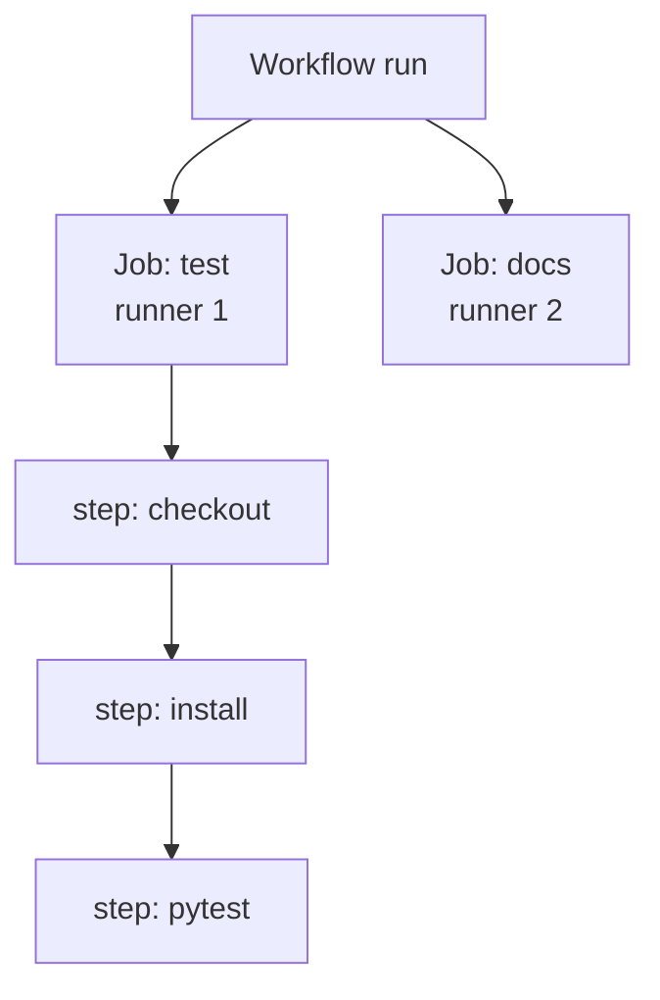
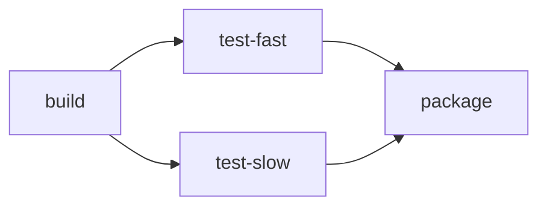

# Lesson 4. Jobs, Steps and Runners

**Mission link:** The mission says to get feedback in minutes and to trust it. Both depend on how work is split: jobs that can run side by side shorten the wait, and jobs that start from a clean machine make a green result mean something. This lesson is the model of where each command runs and what it can see.
**Primary source:** [Docs: "Using jobs in a workflow", GitHub](https://docs.github.com/en/actions/how-tos/write-workflows/choose-what-workflows-do/use-jobs)
**Prerequisites:** [Lesson 2](0002-pipelines-as-code.md), [Lesson 3](0003-triggers-and-events.md), [Job](../GLOSSARY.md), [Step](../GLOSSARY.md), [Runner](../GLOSSARY.md), [Workflow](../GLOSSARY.md)

## Warm-up

1. ▢ A pull request run starts. Which commit does the runner test, and which commit is the tip of your branch?

<details markdown="1"><summary>Check</summary>

The runner tests the last merge commit of the pull request's merge branch (`GITHUB_SHA`, ref `refs/pull/<number>/merge`). The branch tip is `github.event.pull_request.head.sha` (lesson 3).

</details>

2. ▢ Why does `ci.yml` limit `push` to `main` when it also listens to `pull_request`?

<details markdown="1"><summary>Check</summary>

A push to a branch with an open pull request would otherwise fire both events and test the same change twice. With the limit, each change gets one run before the merge and one on the mainline after it (lesson 3).

</details>

3. ▢ Name the two requirements for a `workflow_dispatch` button to appear.

<details markdown="1"><summary>Check</summary>

The workflow must listen to `workflow_dispatch`, and the workflow file must exist on the default branch (lesson 3).

</details>

## Know this

### Jobs, steps and runners

A **job** is a set of steps that runs on one runner. A **step** is either a shell command or an action, and steps run in order. A **runner** is the machine that executes a job, and each runner runs a single job at a time ([Docs](https://docs.github.com/en/actions/get-started/understand-github-actions)).



Two sharing rules explain nearly every surprise in this lesson:

|Level|What is shared|What is not|
|---|---|---|
|Steps in one job|The runner's file system, the workspace directory and anything installed|Shell state: each `run` starts a new process and shell, so a `cd` or an `export` in one does not reach the next|
|Jobs in one workflow|Only what is passed explicitly: outputs, artifacts, caches|Files, installed tools, environment variables. Each job gets its own runner|

The first row comes from the docs: each `run` keyword is a new process and shell, and the lines of one multi-line `run` share a shell ([Workflow syntax](https://docs.github.com/en/actions/reference/workflows-and-actions/workflow-syntax)). Lesson 5 shows the supported ways to pass a value on, and lesson 11 shows artifacts.

### Parallel by default, ordered by needs

Jobs run in parallel by default. To run one after another, name the prerequisite with `needs`, a job ID or a list of IDs ([Using jobs](https://docs.github.com/en/actions/how-tos/write-workflows/choose-what-workflows-do/use-jobs)):

```yaml
jobs:
  build:
    runs-on: ubuntu-latest
    steps:
      - run: echo build
  test-fast:
    needs: build
    runs-on: ubuntu-latest
    steps:
      - run: echo fast tests
  test-slow:
    needs: build
    runs-on: ubuntu-latest
    steps:
      - run: echo slow tests
  package:
    needs: [test-fast, test-slow]
    runs-on: ubuntu-latest
    steps:
      - run: echo package
```



`test-fast` and `test-slow` run at the same time once `build` succeeds, and `package` waits for both. The wall-clock time of the run is the longest chain, which the glossary calls the critical path, not the sum of every job. Lesson 10 uses that.

If a job fails or is skipped, every job that needs it is skipped too, along the whole chain, unless a job's `if` lets it continue, for example `if: ${{ always() }}`. A job ID must start with a letter or `_` and contain only letters, digits, `-` or `_`; the optional `name` is only what the interface displays ([Using jobs](https://docs.github.com/en/actions/how-tos/write-workflows/choose-what-workflows-do/use-jobs)). Pull requests show a check by that name, so renaming a job later can break a required check, which lessons 26 and 29 return to.

### What a step can do

A failing step stops the job: later steps are skipped unless they carry an `if` such as `${{ always() }}`, and `continue-on-error: true` on a step lets the job pass when that step fails. The shell matters here, because the default is not the strict one:

|`shell`|Command run on Linux|A failing command before a pipe|
|---|---|---|
|Not set|`bash -e {0}`|Ignored, the step passes|
|`bash`|`bash --noprofile --norc -eo pipefail {0}`|Reported, the step fails|

Those commands are from the [workflow syntax reference](https://docs.github.com/en/actions/reference/workflows-and-actions/workflow-syntax). A step such as `pytest | tee test.log` hides a test failure under the default shell. Setting `defaults.run.shell: bash` for the workflow or job, or `shell: bash` on one step, makes the strict form the rule. `working-directory` sets where a step's command runs, and `defaults.run` can set both keys for every `run` step.

A job also has `timeout-minutes`, which defaults to 360 minutes before GitHub cancels it. A stuck test then holds a runner for six hours, so lesson 10 sets it lower.

### Runners: hosted or self-hosted

`runs-on` picks the runner by label. With a GitHub-hosted runner, each job runs in a fresh instance of the image the label names ([Workflow syntax](https://docs.github.com/en/actions/reference/workflows-and-actions/workflow-syntax)):

|Label|Runner|
|---|---|
|`ubuntu-latest`|Ubuntu Linux, the label this track uses|
|`windows-latest`|Windows|
|`macos-latest`|A runner on Apple hardware|
|`[self-hosted, linux]`|A machine you run, matched by its labels|

A `-latest` label is the latest stable image GitHub provides, which might not be the newest release of the operating system, and which moves over time. Standard hosted runners are free and unlimited for public repositories, which is why the practice repository is public.

|Choose|When|Cost|
|---|---|---|
|GitHub-hosted|Default|A clean machine per job, nothing to patch. You depend on GitHub's images and capacity|
|Self-hosted|You need hardware, network access or software the hosted images lack|You update the operating system and all software yourself, and the machine does not have to be clean for each job ([Self-hosted runners](https://docs.github.com/en/actions/concepts/runners/self-hosted-runners))|

The cost of "not clean" is a security one. GitHub's secure use guide says self-hosted runners should almost never be used for public repositories, because anyone can open a pull request against the repository and compromise a runner that persists. Even recycling a runner after each job does not guarantee it ran only one job. Just-in-time runners, created through the REST API, run at most one job before they are removed ([Secure use](https://docs.github.com/en/actions/reference/security/secure-use)).

### Where Jenkins and GitLab differ

Jenkins runs a pipeline on an agent, and a pipeline's workspace may not be cleaned up automatically after a period of inactivity, depending on configuration ([Jenkins](https://www.jenkins.io/doc/book/pipeline/)). The clean-machine guarantee is therefore GitHub-hosted behaviour, not something every CI system gives. GitLab groups jobs into stages: stages run in sequence and the jobs in one stage run in parallel, and `needs` lets a job start without waiting for its whole stage, forming a directed graph ([GitLab](https://docs.gitlab.com/ci/yaml/)). GitHub's `needs` is the job-level version of that, with no stage layer.

## Practice

1. ▢ A workflow has jobs `lint`, `test` and `package`, with `package` declaring `needs: [lint, test]`. Which statement is right?

    - a) lint and test run in parallel, then package runs
    - b) lint runs first, then test, then package runs
    - c) all three jobs run in parallel on one shared runner
    - d) test runs first, then lint, then package runs

<details markdown="1"><summary>Check</summary>

**a)** Jobs without `needs` between them run in parallel, each on its own runner, and `package` waits for both. (b) and (d) invent an order that nothing declares. (c) is wrong twice: `package` is ordered after the others, and each job has its own runner.

</details>

2. ▢ Predict, then run. Add `.github/workflows/jobs-demo.yml` to `ci-cd-practice`, merge it, and press "Run workflow". Predict what the `read` job does and whether the run succeeds:

    ```yaml
    name: jobs-demo

    on: workflow_dispatch

    jobs:
      write:
        runs-on: ubuntu-latest
        steps:
          - run: echo "written by $GITHUB_JOB" > note.txt
          - run: cat note.txt
      read:
        runs-on: ubuntu-latest
        steps:
          - run: cat note.txt
    ```

<details markdown="1"><summary>Hint</summary>

Both jobs start together, and a job's files live on its own runner.

</details>

<details markdown="1"><summary>Check</summary>

`write` succeeds and prints `written by write`. `read` fails, because it runs on a different, fresh runner where `note.txt` does not exist:

```text
Run cat note.txt
cat: note.txt: No such file or directory
Error: Process completed with exit code 1.
```

Adding `needs: write` to `read` would only order them, and the file would still be missing, since ordering does not share a file system. To pass the file you need an artifact (lesson 11), and to pass a small value you need an output (lesson 5).

</details>

3. ▢ Predict, then run. Change the file so three jobs, `a`, `b` and `c`, each run `sleep 20`. Compare the run time when they have no `needs` with the run time when `b` needs `a` and `c` needs `b`. Roughly how long does each take?

<details markdown="1"><summary>Hint</summary>

Count the longest chain of dependent jobs and add a few seconds of runner start-up per job in that chain.

</details>

<details markdown="1"><summary>Check</summary>

With no `needs` the three jobs run side by side, so the run takes about 20 seconds plus start-up of one runner. With the chain they run one after another and the run takes about 60 seconds plus three start-ups. The run's wall-clock time is its critical path, so splitting independent work into parallel jobs shortens the wait, and chaining jobs that do not depend on each other lengthens it for nothing. The exact seconds vary with runner availability.

</details>

4. ▢ Debug this. A step `run: pytest | tee test.log` fails in the test, yet the job is green. The log ends with `1 failed, 1 passed in 0.19s` and no error. Why, and what is the smallest fix?

<details markdown="1"><summary>Hint</summary>

Look at which shell runs a `run` step when none is set, and what it does about the exit status of a pipe.

</details>

<details markdown="1"><summary>Check</summary>

With `shell` unset the command is `bash -e {0}`, with no `pipefail`. The pipe's exit status is that of `tee`, which succeeded, so the step passes even though `pytest` failed. Set `shell: bash` on the step, or `defaults.run.shell: bash` for the job, which runs `bash --noprofile --norc -eo pipefail {0}` and fails the step when `pytest` does.

</details>

5. ▢ A teammate proposes a self-hosted runner for the public practice repository "because it is faster and free". What do you say?

<details markdown="1"><summary>Check</summary>

Hosted runners are already free for a public repository, so the cost argument does not hold. Speed is a real reason for self-hosted runners, but on a public repository anyone can open a pull request that runs code on your machine, and a self-hosted runner is not guaranteed to be clean between jobs. GitHub's guidance is that self-hosted runners should almost never be used for public repositories ([Secure use](https://docs.github.com/en/actions/reference/security/secure-use)).

</details>

## Real-world reps

- [ ] Run `jobs-demo.yml` as written and read the `read` job's log. Then add `needs: write` to `read` and confirm the file is still missing, so you have seen that ordering does not share files.
- [ ] Open a workflow in a repository you work in and draw its jobs as a graph from the `needs` keys. Mark the longest chain and say which job you would split or move to shorten it.
- [ ] Tomorrow: without notes, state what steps in one job share, what two jobs share, and the difference in shell between `shell` unset and `shell: bash`.

## Going further

- [Workflow Syntax](../reference/workflow-syntax.md)
- [Docs: "Using jobs in a workflow", GitHub](https://docs.github.com/en/actions/how-tos/write-workflows/choose-what-workflows-do/use-jobs)
- [Docs: "GitHub-hosted runners", GitHub](https://docs.github.com/en/actions/concepts/runners/github-hosted-runners)
- [Docs: "Self-hosted runners", GitHub](https://docs.github.com/en/actions/concepts/runners/self-hosted-runners)
- [Docs: "Pipeline", Jenkins User Documentation](https://www.jenkins.io/doc/book/pipeline/)
- [Docs: "CI/CD YAML syntax reference", GitLab](https://docs.gitlab.com/ci/yaml/)
- [Resources](../RESOURCES.md)

---

Not landing? Reread the primary source at the top, since this lesson compresses it and compression is where understanding leaks. Check the [glossary](../GLOSSARY.md) for any term that felt slippery.

If the lesson itself is unclear rather than the material, that is a defect: [open an issue](https://github.com/TokenCemetery/teach/issues).
