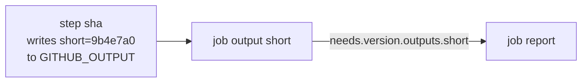

# Lesson 5. Actions, Expressions and Outputs

**Mission link:** The mission says to write a pipeline as code that runs when intended and passes data between jobs. Reusing an action saves you from rewriting common steps, and expressions with outputs are how a pipeline decides what to do and hands a result to the next job, such as a version that a later stage must deploy.
**Primary source:** [Docs: "Evaluate expressions in workflows and actions", GitHub](https://docs.github.com/en/actions/reference/workflows-and-actions/expressions)
**Prerequisites:** [Lesson 3](0003-triggers-and-events.md), [Lesson 4](0004-jobs-steps-and-runners.md), [Action](../GLOSSARY.md), [Expression](../GLOSSARY.md), [Job](../GLOSSARY.md), [Step](../GLOSSARY.md)

## Warm-up

1. ▢ Two jobs have no `needs` between them. Job one writes a file in its workspace. Can job two read it?

<details markdown="1"><summary>Check</summary>

No. The jobs start together on separate fresh runners, and jobs share only what is passed explicitly. Even with `needs` the file system is not shared (lesson 4).

</details>

2. ▢ A step runs `pytest | tee test.log`, pytest fails, and the job is green. Which setting fixes it?

<details markdown="1"><summary>Check</summary>

`shell: bash`, on the step or through `defaults.run.shell`. With `shell` unset the command is `bash -e {0}` and has no `pipefail`, so the exit status is `tee`'s (lesson 4).

</details>

3. ▢ A `pull_request` run is started. What is `github.event.pull_request.head.sha`, and how does it differ from `github.sha`?

<details markdown="1"><summary>Check</summary>

It is the tip of the pull request's branch. `github.sha` is the merge commit of that branch into the base (lesson 3).

</details>

## Know this

### Actions: reusable steps

An **action** is a reusable unit of steps that a step calls with `uses`. The reference is the owner, repository and a version, `{owner}/{repo}@{ref}`, and `with` passes the action's inputs ([Workflow syntax](https://docs.github.com/en/actions/reference/workflows-and-actions/workflow-syntax)):

```yaml
steps:
  - uses: actions/checkout@v7
  - uses: actions/setup-python@v7
    with:
      python-version: "3.13"
```

The `ref` can be a branch, a tag or a commit SHA. The docs strongly recommend naming a version, because an unversioned action can break your workflow when its owner publishes an update. They call the commit SHA of a released version the safest choice for stability and security, and say a major version tag such as `v7` should receive fixes while staying compatible, at the author's discretion. This track uses major tags for now, which are convenient and are not pinned. Lesson 23 explains the difference and pins them.

Three more forms exist: `./path/to/dir` for an action in the same repository, which needs a checkout first, `docker://image:tag` for a Docker image, and `{owner}/{repo}/{path}@{ref}` for an action in a subdirectory. A caller sees no difference between a JavaScript, Docker container or composite action. `run` is the other kind of step: a shell command, with the shell rules of lesson 4.

### Contexts: the data a workflow can read

A **context** is an object of information available to expressions. These are the ones the first lessons need ([Contexts reference](https://docs.github.com/en/actions/reference/workflows-and-actions/contexts)):

|Context|Holds|Example|
|---|---|---|
|`github`|The event and the run|`github.sha`, `github.ref_name`, `github.event_name`|
|`env`|Environment variables set in the workflow|`env.LOG_LEVEL`|
|`vars`, `secrets`|Configuration variables and secrets|`secrets.TOKEN` (lesson 14)|
|`steps`|Earlier steps of this job that have an `id`|`steps.sha.outputs.short`, `steps.sha.outcome`|
|`needs`|Outputs and results of the jobs this job directly needs|`needs.version.outputs.short`|
|`runner`|The machine running the job|`runner.os`|
|`matrix`, `inputs`|Matrix values, and inputs of a manual or reusable workflow|`inputs.note`|

Rules: you read a property as `github.sha` or `github['sha']`; a property that does not exist evaluates to an empty string, so a typo does not fail, it gives you nothing; and `needs` holds only direct dependencies, not the dependencies of those dependencies. Contexts are different from the environment variables on the runner, such as `GITHUB_SHA` or `CI`, which exist only inside a running job. A context can be used before a job is routed to a runner, which is how `if` works.

### Expressions: `${{ }}` and `if`

An **expression** is a value in `${{ ... }}` that GitHub evaluates before a step runs. It combines contexts, literals, operators and functions ([Expressions](https://docs.github.com/en/actions/reference/workflows-and-actions/expressions)):

|Part|What is available|
|---|---|
|Literals|`true`, `false`, `null`, numbers, and strings in single quotes only|
|Operators|Grouping, index and property access, `!`, the four comparisons, `==`, `!=`, `&&`, and the or operator|
|Functions|`contains`, `startsWith`, `endsWith`, `format`, `join`, `toJSON`, `fromJSON`, `hashFiles`|

Behaviours that cause bugs: string comparison ignores case, and comparing different types coerces both to numbers. A step output is always a string, so to compare it with a number you convert it with `fromJSON()`. `contains(fromJSON('["push", "pull_request"]'), github.event_name)` is true for either event.

`if` decides whether a step or job runs. In an `if` you can omit the `${{ }}`, except that an expression starting with `!` has to be wrapped or quoted, because `!` is reserved in YAML:

```yaml
- if: github.event_name == 'push'
  run: echo "on the mainline"
- if: ${{ ! startsWith(github.ref, 'refs/tags/') }}
  run: echo "not a tag"
```

An `if` runs with a default status check of `success()`, which means all previous steps have succeeded, unless you name another status function:

|Function|True when|
|---|---|
|`success()`|All previous steps succeeded. The default|
|`failure()`|Any previous step of the job failed, or an ancestor job failed|
|`cancelled()`|The run was cancelled|
|`always()`|Always, even when cancelled|

The docs warn against `always()` for anything that could suffer a critical failure, like getting the sources, because the run may hang. They recommend `if: ${{ !cancelled() }}` to run a step whether or not an earlier one failed. `steps.<id>.outcome` is a step's result before `continue-on-error` applies and `conclusion` is the result after it.

### Outputs: passing values on

A value moves from one step to a later one in the same job through the file named by `GITHUB_OUTPUT`, and from one job to another through a job output read from `needs` ([Workflow commands](https://docs.github.com/en/actions/reference/workflows-and-actions/workflow-commands), [Passing information between jobs](https://docs.github.com/en/actions/how-tos/write-workflows/choose-what-workflows-do/pass-job-outputs)):

```yaml
jobs:
  version:
    runs-on: ubuntu-latest
    outputs:
      short: ${{ steps.sha.outputs.short }}
    steps:
      - id: sha
        run: echo "short=${GITHUB_SHA::7}" >> "$GITHUB_OUTPUT"
  report:
    needs: version
    runs-on: ubuntu-latest
    steps:
      - env:
          SHORT: ${{ needs.version.outputs.short }}
        run: echo "building $SHORT"
```

The step has an `id`, because that is how `steps.sha` finds it. The job maps the step output to a job output with `outputs`, and `report` reads it as `needs.version.outputs.short`, which works only because `report` needs `version`. A job output is capped at 1 MB, with 50 MB for all outputs of a run, and a value that looks like a secret is redacted ([Workflow syntax](https://docs.github.com/en/actions/reference/workflows-and-actions/workflow-syntax)). Outputs carry small values, never files, which is what artifacts are for.



Writing to `GITHUB_ENV` is different: it sets an environment variable for the later steps of the same job, never the step that wrote it, and never other jobs. The example passes the value through `env`, instead of writing `${{ needs.version.outputs.short }}` inside the script. The shell then sees an ordinary variable. Lesson 16 shows why that habit protects you when a value is controlled by someone else.

|Need|Use|Reaches|
|---|---|---|
|A value for later steps of this job|`GITHUB_OUTPUT` and `steps.<id>.outputs`, or `GITHUB_ENV`|The same job only|
|A value for another job|A job `outputs` entry and `needs.<job>.outputs`|Jobs that `need` it|
|A file for another job|An artifact (lesson 11)|Any later job|

## Practice

1. ▢ In `report`, which expression reads the output `short` of the job `version`?

    - a) `${{ needs.version.outputs.short }}`
    - b) `${{ steps.version.outputs.short }}`
    - c) `${{ jobs.version.outputs.short }}`
    - d) `${{ github.version.outputs.short }}`

<details markdown="1"><summary>Check</summary>

**a)** Jobs read the outputs of their direct dependencies through `needs`. (b) reads a step of the same job, and no step has that id. (c) is how a reusable workflow maps its job outputs, not how a job reads another job. (d) is not a property of the `github` context.

</details>

2. ▢ Predict, then run. Add `.github/workflows/outputs-demo.yml` to `ci-cd-practice` with the two jobs above and `on: workflow_dispatch`, merge it and run it. What does the `report` log print? Then change `steps.sha.outputs.short` in the job's `outputs` to `steps.sha.outputs.shrt` and run it again. What does it print, and does the run fail?

<details markdown="1"><summary>Hint</summary>

A property that does not exist evaluates to an empty string.

</details>

<details markdown="1"><summary>Check</summary>

The first run prints the first seven characters of the commit SHA:

```text
Run echo "building $SHORT"
building 9b4e7a0
```

After the typo it prints `building ` with nothing after it, and the run is green. A missing property is an empty string, not an error, so the typo gives you silence rather than a failure. That is why a value that must exist is worth checking, for example with `test -n "$SHORT"`, and why the value you read back needs to be looked at once.

</details>

3. ▢ Debug this. A step sets a variable and the next step does not see it:

    ```yaml
    - run: export VERSION=1.2.3
    - run: echo "version is $VERSION"
    ```

    The second step prints `version is `. Name the cause and two fixes.

<details markdown="1"><summary>Hint</summary>

Each `run` is its own process and shell.

</details>

<details markdown="1"><summary>Check</summary>

Each `run` starts a new shell, so the `export` ends with the first one. One fix is `echo "VERSION=1.2.3" >> "$GITHUB_ENV"`, which exposes `VERSION` to later steps of the job. The other is a step output: give the step an `id`, write `echo "version=1.2.3" >> "$GITHUB_OUTPUT"` and read `steps.<id>.outputs.version`. Putting both commands in one multi-line `run` also works, since its lines share a shell, but then nothing outside that step can use the value.

</details>

4. ▢ A step must run only when the event is a push, the branch is `main`, and the previous steps did not fail. Write the `if`. Then write one that runs a "collect logs" step even when an earlier step failed, but not when the run was cancelled.

<details markdown="1"><summary>Check</summary>

```yaml
if: github.event_name == 'push' && github.ref_name == 'main'
```

The default `success()` check is added unless you name a status function, so earlier failures already skip the step. For the second:

```yaml
if: ${{ !cancelled() }}
```

This runs after a failure and is skipped on cancellation. `always()` would run it on cancellation too, and the docs advise against it for anything that could hang the run.

</details>

5. ▢ A job output `count` holds `"10"` from a step. The expression `needs.build.outputs.count > 9` is used in an `if`. Is that reliable, and what is a safer form?

<details markdown="1"><summary>Check</summary>

Step outputs are strings. Comparing a string with a number coerces both to numbers, so `"10" > 9` works, but an empty or non-numeric value becomes `NaN`, and any relational comparison with `NaN` is false. The explicit form `fromJSON(needs.build.outputs.count) > 9` states the intent. If the value can be empty, check for that separately instead of letting the comparison hide it.

</details>

## Real-world reps

- [ ] Add `outputs-demo.yml`, run it, then add a step to `report` with `if: ${{ failure() }}` and a step before it that runs `exit 1`. Confirm that the failure step runs and that the job is red.
- [ ] Take one workflow in a repository you work in and list every `${{ }}` in it. For each, name the context it reads and whether the value could be set by someone outside your team.
- [ ] Tomorrow: without notes, name the three ways to pass a value or a file between steps and jobs, and which of them reaches another job.

## Going further

- [Workflow Syntax](../reference/workflow-syntax.md)
- [Docs: "Evaluate expressions in workflows and actions", GitHub](https://docs.github.com/en/actions/reference/workflows-and-actions/expressions)
- [Docs: "Contexts reference", GitHub](https://docs.github.com/en/actions/reference/workflows-and-actions/contexts)
- [Docs: "Passing information between jobs", GitHub](https://docs.github.com/en/actions/how-tos/write-workflows/choose-what-workflows-do/pass-job-outputs)
- [Docs: "Workflow commands for GitHub Actions", GitHub](https://docs.github.com/en/actions/reference/workflows-and-actions/workflow-commands)
- [Resources](../RESOURCES.md)

---

Not landing? Reread the primary source at the top, since this lesson compresses it and compression is where understanding leaks. Check the [glossary](../GLOSSARY.md) for any term that felt slippery.

If the lesson itself is unclear rather than the material, that is a defect: [open an issue](https://github.com/TokenCemetery/teach/issues).
