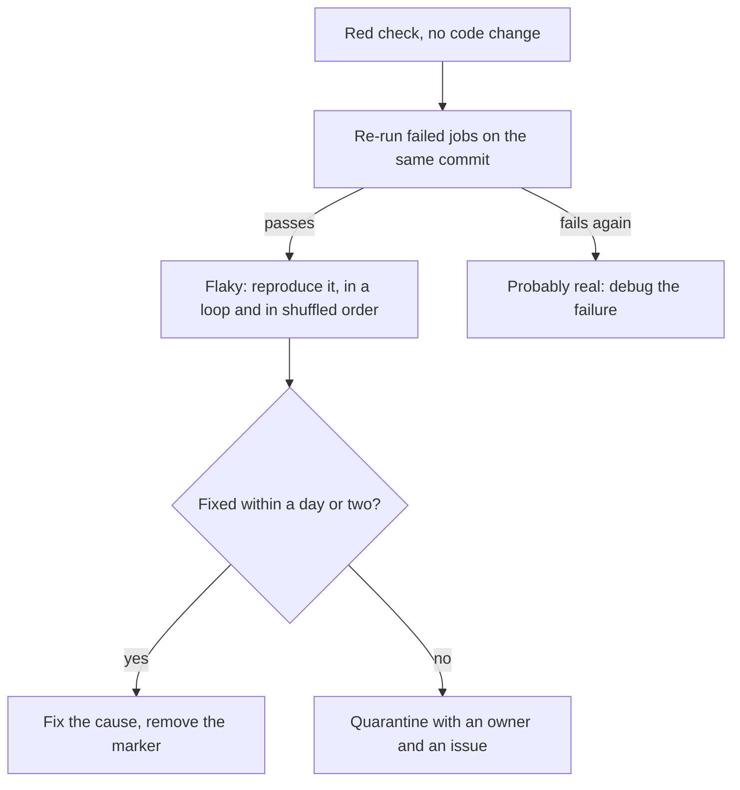

# Lesson 9. Flaky Tests

**Mission link:** The mission says a pipeline must be trusted as well as fast. A red check that people re-run until it turns green is a pipeline nobody believes, so a flaky test is a defect in the pipeline itself and has to be handled as one.
**Primary source:** [Article: "Flaky Tests at Google and How We Mitigate Them", John Micco, Google Testing Blog](https://testing.googleblog.com/2016/05/flaky-tests-at-google-and-how-we.html)
**Prerequisites:** [Lesson 1](0001-what-ci-and-cd-promise.md), [Lesson 3](0003-triggers-and-events.md), [Lesson 6](0006-build-and-test-stages.md), [Lesson 7](0007-matrix-builds.md), [Flaky test](../GLOSSARY.md), [Continuous integration](../GLOSSARY.md)

## Warm-up

1. ▢ Continuous integration promises that a broken mainline is fixed at once. What has to be true of the red build for that promise to hold?

<details markdown="1"><summary>Check</summary>

A red build has to mean something is broken. If people learn that red often means "re-run it", the team stops treating a failure as an emergency and the promise to fix it at once quietly lapses (lesson 1). Everything in this lesson is about keeping red meaningful.

</details>

2. ▢ You re-run a failed workflow run from the Actions tab. Which commit does the re-run use?

<details markdown="1"><summary>Check</summary>

The same one. A re-run uses the same `GITHUB_SHA` and `GITHUB_REF` as the original event, even if the branch has moved since ([Re-running workflows and jobs](https://docs.github.com/en/actions/how-tos/manage-workflow-runs/re-run-workflows-and-jobs), lesson 3). That is what makes a re-run useful as evidence: any difference between the attempts is not the code.

</details>

3. ▢ In lesson 7's matrix, `fail-fast` is `true` by default. How could a flaky test on one cell make a whole run look worse than it is?

<details markdown="1"><summary>Check</summary>

If the flaky cell fails first, it cancels every in-progress and queued sibling, so the run shows one red job and several cancelled ones, and you lose the information about whether the other cells would have passed (lesson 7).

</details>

## Know this

### What flaky means and what it costs

A [flaky test](../GLOSSARY.md) passes and fails on the same code. Google defines a flaky result the same way, as a test that shows both a passing and a failing result with the same code, and reports that about 1.5% of all its test runs are flaky and that almost 16% of its tests have some level of flakiness ([Micco](https://testing.googleblog.com/2016/05/flaky-tests-at-google-and-how-we.html)). Flakiness is the normal state of a large suite that nobody manages, not a sign of a careless team.

The cost is arithmetic. If a suite has `N` independent tests and each one flakes with probability `p`, the run is green with probability `(1 - p)^N`. A thousand tests at 0.1% each pass together only about 37% of the time, so two runs in three go red with no code change. The other cost is cultural: Google found that about 84% of the pass-to-fail transitions it observed involved a flaky test, which makes every new failure start with the question "is this real?" That question is where trust leaks away.

Micco lists the root causes at Google as concurrency, relying on non-deterministic or undefined behaviour, flaky third-party code and infrastructure problems. In a small service the usual suspects are narrower:

|Cause|Looks like|
|---|---|
|Shared state between tests|Passes alone or in file order, fails in another order or after a particular test|
|Time and timing|A `sleep` that is usually long enough, or an assertion on the current time or on elapsed time|
|Concurrency|A race between a request and the thing it waits for|
|External services|A test that reaches the network, or a database that is not ready yet|
|Randomness|Unseeded random values, or data whose order is not defined|

Martin Fowler's [article on non-determinism](https://martinfowler.com/articles/nonDeterminism.html) covers the same ground in more depth.

### Finding the cause

Treat it as a defect with a reproduction, not as bad luck:

1. **Confirm it is the test.** Re-run the failed jobs on the same commit. The re-run keeps the same `GITHUB_SHA`, so a failure that passes on retry has told you the code did not change the outcome. The re-run options include only the failed jobs and a switch for debug logging ([Docs](https://docs.github.com/en/actions/how-tos/manage-workflow-runs/re-run-workflows-and-jobs)).
2. **Reproduce it on purpose.** Run the one test many times in a loop, then run the whole file in a different order. For pytest, the `pytest-randomly` plugin shuffles test order and prints a seed such as `Using --randomly-seed=1553614239`, and `pytest --randomly-seed=1553614239` replays that exact order ([pytest-randomly](https://pypi.org/project/pytest-randomly/)).
3. **Read what the test depends on.** Look for state it shares, time it assumes, and anything outside the process.
4. **Fix the cause, not the symptom.** Replace the sleep with a wait for the condition, give each test its own state, fake the clock, seed the randomness.



### Retries hide, quarantine contains

An automatic retry makes the symptom disappear: a test that fails twice in a row has a much lower chance of flaking three times, so the suite goes green. Google used re-runs and a flag that reports failure only after three failures in a row, and its own verdict is that this reduces false positives but encourages developers to ignore flakiness until a test starts failing three times in a row, "which is hardly a perfect solution." It also delays a real failure: a 15-minute test marked flaky takes 45 minutes to report a genuine break ([Micco](https://testing.googleblog.com/2016/05/flaky-tests-at-google-and-how-we.html)).

Retry plugins such as `pytest-rerunfailures`, with `pytest --reruns 2`, exist, and they are a tool for triage rather than a fix. If you use one, make the pipeline report every test that needed a retry, so the flake is counted rather than buried.

**Quarantine** is the honest alternative. Google's tool removes a test from the critical path when its flakiness is too high and files a bug. The same source warns that this can mask a real race condition or another bug in the code under test, so a quarantine is a loan, not a disposal. For the practice repository:

```ini
[pytest]
markers =
    integration: needs a running Postgres, set through DATABASE_URL
    quarantine: known flaky, tracked by an issue, runs outside the required checks
```

```yaml
  unit:
    # ...
      - run: pytest -m "not integration and not quarantine"

  quarantine:
    runs-on: ubuntu-latest
    continue-on-error: true
    steps:
      - uses: actions/checkout@v7
      - uses: actions/setup-python@v7
        with:
          python-version: "3.13"
      - run: pip install -r requirements.txt
      - run: pytest -m quarantine
```

`continue-on-error: true` lets the run pass when this job fails, and the job must not be a required check or something else `needs`. Three rules keep it a quarantine and not a graveyard: every quarantined test carries a comment with the issue that tracks it and a person who owns it, the quarantine job still runs so the failure rate stays visible, and the list has a size or age limit the team enforces.

## Practice

1. ▢ A suite has 50 independent tests, and each flakes on 1% of runs. How often does a run with no code change go green, and how often red?

<details markdown="1"><summary>Hint</summary>

The run is green only if every test passes: multiply the single-test pass probability by itself 50 times.

</details>

<details markdown="1"><summary>Check</summary>

`0.99^50` is about 0.605, so roughly 60% of runs are green and 40% are red for no reason. A 1% flake rate sounds negligible per test and still makes four runs in ten fail. The probability falls as the suite grows, which is why a large suite needs flakiness managed, not tolerated.

</details>

2. ▢ What is the difference between a retry and a quarantine, and which one keeps a signal that something is wrong?

    - a) A retry hides it, a quarantine tracks it
    - b) A retry tracks it, a quarantine hides it
    - c) A retry fixes it, a quarantine removes it
    - d) A retry removes it, a quarantine fixes it

<details markdown="1"><summary>Check</summary>

**a)** A retry makes the result green and the evidence disappears, unless you report each retried test. A quarantine keeps the test running outside the required path with an owner and an issue, so the flakiness stays visible. (b) reverses them. (c) and (d) credit either one with fixing the cause, which neither does: only changing the test or the code does.

</details>

3. ▢ Predict, then run. Add this test to `ci-cd-practice`, push it on a branch, and use "Re-run all jobs" on the same run five times.

    ```python
    import random


    def test_unstable():
        assert random.random() > 0.3
    ```

    About how likely is it that all five attempts pass? Which commit do the re-runs test, and why does that matter?

<details markdown="1"><summary>Hint</summary>

The test passes with probability 0.7 on each attempt, and the attempts are independent.

</details>

<details markdown="1"><summary>Check</summary>

All five pass with probability `0.7^5`, about 17%, so most of the time at least one attempt fails. Every re-run tests the same commit, so the mix of red and green across attempts is the proof that the code did not change the outcome and the test is flaky. Remove the test afterwards, or mark it `quarantine` and run the quarantine job to see it fail without blocking the required check.

</details>

4. ▢ Debug this. `test_version_from_environment` fails in CI some of the time and never on a developer's laptop. The job sets `APP_VERSION: "1.0.0"` in its `env`. Find the cause and fix it.

    ```python
    import os


    def test_version_override(client):
        os.environ["APP_VERSION"] = "2.0.0"
        assert client.get("/version").get_data(as_text=True) == "2.0.0"


    def test_version_from_environment(client):
        assert client.get("/version").get_data(as_text=True) == "1.0.0"
    ```

    ```text
    Using --randomly-seed=1553614239
    FAILED test_app.py::test_version_from_environment - AssertionError: assert '2.0.0' == '1.0.0'
    ```

<details markdown="1"><summary>Hint</summary>

The tests pass in the order they are written. What does the first one leave behind for the second?

</details>

<details markdown="1"><summary>Check</summary>

`os.environ["APP_VERSION"] = "2.0.0"` changes the process environment for the rest of the run and nothing restores it. When test order is shuffled and `test_version_override` runs first, the other test sees `2.0.0`. Use pytest's `monkeypatch`, which undoes the change when the test ends:

```python
def test_version_override(client, monkeypatch):
    monkeypatch.setenv("APP_VERSION", "2.0.0")
    assert client.get("/version").get_data(as_text=True) == "2.0.0"
```

`pytest --randomly-seed=1553614239` replays the failing order, so you can prove the fix against the exact failure.

</details>

5. ▢ A teammate adds `--reruns 3` to the required `unit` job "to stop the noise". Name two things it makes worse and one thing to do alongside any retry.

<details markdown="1"><summary>Check</summary>

It delays the report of a genuine failure, since a real break is run several times before it shows. It also removes the pressure to fix the test, because the pipeline stays green, which is the failure mode Micco describes of developers ignoring flakiness until a test fails several times in a row. Alongside any retry, list which tests needed one in the run summary or log and open an issue for each, so the flake is counted and has an owner.

</details>

## Real-world reps

- [ ] Add `test_unstable` to `ci-cd-practice`, re-run the workflow five times, and write down how many attempts passed. Then mark it `quarantine`, move it out of the `unit` command as shown in the lesson, and confirm the required job stays green while the quarantine job shows the failure.
- [ ] Add `pytest-randomly` locally with `pip install pytest-randomly`, run `pytest` a few times, and note the seed it prints. If any run fails, replay it with `--randomly-seed`.
- [ ] Look at the last month of failed runs in a repository you work in and count how many went green on re-run with no commit in between. Write that number down. It is your flake rate.
- [ ] Tomorrow: without notes, state why a flaky suite goes red more often as it grows, give the formula, and explain in one sentence why quarantine is better than a retry and what it still costs.

## Going further

- [Fast Feedback](../reference/fast-feedback.md)
- [Article: "Flaky Tests at Google and How We Mitigate Them", John Micco, Google Testing Blog](https://testing.googleblog.com/2016/05/flaky-tests-at-google-and-how-we.html)
- [Article: "Eradicating Non-Determinism in Tests", Martin Fowler](https://martinfowler.com/articles/nonDeterminism.html)
- [Docs: "Re-running workflows and jobs", GitHub](https://docs.github.com/en/actions/how-tos/manage-workflow-runs/re-run-workflows-and-jobs)
- [Resources](../RESOURCES.md)

---

Not landing? Reread the primary source at the top, since this lesson compresses it and compression is where understanding leaks. Check the [glossary](../GLOSSARY.md) for any term that felt slippery.

If the lesson itself is unclear rather than the material, that is a defect: [open an issue](https://github.com/TokenCemetery/teach/issues).
