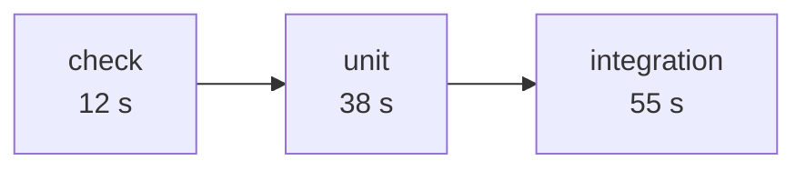
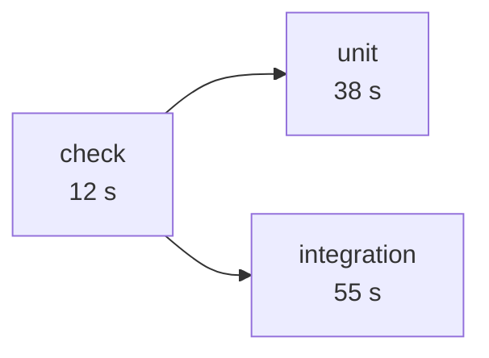

# Lesson 10. Making a Pipeline Fast

**Mission link:** The mission says to prove every change in minutes, because people wait for the result and a slow pipeline trains them to stop waiting. Speed comes from three levers: a shorter critical path, no work on runs nobody needs, and a ceiling on how long any job may take.
**Primary source:** [Docs: "Control the concurrency of workflows and jobs", GitHub](https://docs.github.com/en/actions/how-tos/write-workflows/choose-when-workflows-run/control-workflow-concurrency)
**Prerequisites:** [Lesson 4](0004-jobs-steps-and-runners.md), [Lesson 6](0006-build-and-test-stages.md), [Lesson 7](0007-matrix-builds.md), [Lesson 8](0008-caching.md), [Lesson 9](0009-flaky-tests.md), [Critical path](../GLOSSARY.md), [Concurrency group](../GLOSSARY.md), [Job](../GLOSSARY.md)

## Warm-up

1. ▢ Three jobs run in parallel and take 20, 45 and 30 seconds. How long does the workflow take, ignoring runner start-up, and what would change if each `needs` the one before it?

<details markdown="1"><summary>Check</summary>

45 seconds in parallel, since the run lasts as long as its slowest job. Chained, it takes 20 + 45 + 30 = 95 seconds, the sum (lessons 4 and 6). The ordering that gives you cheap failures first costs you time on a green run, and this lesson is about getting back what it cost.

</details>

2. ▢ Name the two ways lesson 8 says a cached run can differ from an uncached one, and the one thing a cache must never be able to change.

<details markdown="1"><summary>Check</summary>

A run may restore nothing (a miss) or something stale (a restore-key match), so it can start slower or with an outdated dependency set. A cache must never change whether the pipeline passes. It is allowed to affect only how long the run takes (lesson 8).

</details>

3. ▢ A flaky test fails a required job, and someone re-runs it. Why does that count as slowness, not only as noise?

<details markdown="1"><summary>Check</summary>

The re-run is a second full pass through the critical path, so the person waits for the pipeline twice for one change. As lesson 9 showed, time lost to flakiness counts against speed as much as slow tests do.

</details>

## Know this

### The critical path sets the wait

The [critical path](../GLOSSARY.md) is the longest chain of dependent jobs in a run. It, not the total of all job times, is what you wait for, however much runs in parallel. Total minutes is a cost measure and the critical path is a wait measure, and mixing them up leads to optimising the wrong job.

Here is lesson 6's chain with illustrative durations. Each job waits for the one before it:



The critical path is 12 + 38 + 55 = 105 seconds. Neither `unit` nor `integration` reads anything from the other, so the only reason for `integration` to wait for `unit` was to avoid starting a database on a broken change. Keep the cheap gate and let the two expensive jobs run side by side:



Now the critical path is 12 + 55 = 67 seconds. A syntax error still stops everything in 12 seconds, because both jobs `need` `check`. What you gave up is skipping `integration` when a unit test fails. That is a deliberate trade: you pay a little more runner time on a red run and wait much less on a green one.

To shorten the critical path, look at the longest chain and ask of each job:

- **Does it have to wait?** Remove any `needs` that exists only for tidiness.
- **Can it be smaller?** Split a slow test job so halves run in parallel, or cache what it downloads (lesson 8).
- **Can it be skipped?** A change to a README needs no integration tests. Path filters decide that and lesson 26 covers them.
- **Does every matrix cell earn its place?** Fewer cells on pull requests and the full grid on `main` is a common split (lesson 7).

Only the longest chain matters, so the job to shorten is the one on the critical path. If the second-longest chain is nearly as long, shortening the first yields less than it appears to.

### Cancel what nobody needs

When you push a second commit to a pull request, the run for the first one is already out of date. Letting it finish spends minutes on a result nobody will read, and it can hold runners that the new run needs. A [concurrency group](../GLOSSARY.md) fixes that: GitHub Actions allows at most one running and one pending run or job per group ([Docs](https://docs.github.com/en/actions/how-tos/write-workflows/choose-when-workflows-run/control-workflow-concurrency)).

By default, when a new run joins a group that already has a run in progress, the new one waits as pending, and any older pending run in the same group is cancelled and replaced. The one in progress keeps going. Set `cancel-in-progress: true` and the one in progress is cancelled as well.

The group name is any string or expression using the `github`, `inputs` and `vars` contexts, and the match is case insensitive. The pattern from the docs is one group per workflow and ref:

```yaml
concurrency:
  group: ${{ github.workflow }}-${{ github.ref }}
  cancel-in-progress: ${{ github.event_name == 'pull_request' }}
```

Two details are deliberate. Including `github.workflow` keeps groups unique across workflows, because otherwise a run of one workflow can cancel a run of another that happens to share a group name. And `cancel-in-progress` accepts an expression, so here it is true for pull requests and false for pushes to `main`. Superseded pull-request runs are waste. Every commit that lands on `main` should be tested to completion, because continuous integration promises that each merge is proven, and cancelling the run for one commit because the next one arrived leaves that commit unproven (lesson 1).

For runs that must queue, such as deployments, the `queue` property accepts `max`, which allows up to 100 runs to wait instead of replacing each other. It cannot be combined with `cancel-in-progress: true`. Lesson 17 returns to this for deployments.

### Timeouts

A job that hangs holds a runner and a place in the queue until something stops it. Without a setting, the default `timeout-minutes` for a job is 360, six hours, which is also the job limit on GitHub-hosted runners ([Workflow syntax](https://docs.github.com/en/actions/reference/workflows-and-actions/workflow-syntax), [Actions limits](https://docs.github.com/en/actions/reference/limits)). A step can have its own `timeout-minutes` too.

Set a timeout on every job, at a few times its normal duration: long enough that a slow day does not trip it, short enough that a hang is caught in minutes and not hours. A job that takes one minute does not need to be allowed six hours.

```yaml
  integration:
    needs: check
    runs-on: ubuntu-latest
    timeout-minutes: 10
    steps:
      - run: pytest -m integration
        timeout-minutes: 5
```

When the limit passes, GitHub cancels the job automatically, so a hang ends in a visible result and not in a queue that stalls without explanation. A timeout is a safety net, not a cure: if a job regularly hits it, the job needs to be faster or the limit needs to be honest.

### The three levers together

|Lever|What it attacks|Where it lives|
|---|---|---|
|Critical path|Waiting on a green run|`needs`, job and test splitting, caching, path filters|
|Concurrency|Work nobody will read|`concurrency` with `cancel-in-progress`|
|Timeouts|A hung job holding the queue|`timeout-minutes` on jobs and steps|

## Practice

1. ▢ A workflow has `lint` (10 s), `build` (40 s, needs `lint`), `docs` (30 s, needs `lint`), `unit` (60 s, needs `build`), `integration` (90 s, needs `build`) and `package` (20 s, needs `unit` and `integration`). What is the critical path and its length? If `integration` drops to 50 seconds, what is the new length?

<details markdown="1"><summary>Hint</summary>

Find the longest chain from `lint` to `package`, then recompute after the change: a different chain may now be longest.

</details>

<details markdown="1"><summary>Check</summary>

The critical path is `lint`, `build`, `integration`, `package`: 10 + 40 + 90 + 20 = 160 seconds, although the jobs add up to 250 seconds. `docs` is off the path, so speeding it up changes nothing. With `integration` at 50 seconds, the chain through `unit` is longer: 10 + 40 + 60 + 20 = 130 seconds. Saving 40 seconds of work in one job saved only 30 seconds of waiting.

</details>

2. ▢ Which `cancel-in-progress` value suits a workflow that runs on pull requests and on pushes to `main`?

    - a) `true`
    - b) `false`
    - c) `${{ github.event_name == 'pull_request' }}`
    - d) `${{ github.ref == 'refs/heads/main' }}`

<details markdown="1"><summary>Check</summary>

**c)** Superseded pull-request runs are cancelled and every push to `main` runs to completion. (a) would cancel the run for a commit on `main` when the next one lands, leaving the first commit untested. (b) lets stale pull-request runs burn minutes and hold runners. (d) is the inverse of what is wanted: it cancels runs on `main` and protects the stale pull-request ones.

</details>

3. ▢ Predict, then run. In `ci-cd-practice`, add `- run: sleep 90` as the last step of the `check` job so runs are slow, and a `concurrency` block with the group from this lesson and no `cancel-in-progress`. Push three commits to a branch within ten seconds of each other. Which of the three runs complete, which are cancelled, and in what order do the completed ones run? Then set `cancel-in-progress: true`, push three more, and say what changes.

<details markdown="1"><summary>Hint</summary>

A group holds one running and one pending run. Each new arrival replaces the pending one. With cancellation on, it also replaces the running one.

</details>

<details markdown="1"><summary>Check</summary>

Without cancellation: run 1 starts and finishes, run 2 waits as pending and is replaced and cancelled when run 3 arrives, and run 3 starts after run 1 ends. So two runs complete, the first and the last, and the middle one is cancelled before it starts. With `cancel-in-progress: true`: run 1 is cancelled when run 2 arrives, run 2 is cancelled when run 3 arrives, and only run 3 completes. Remove the `sleep` afterwards.

</details>

4. ▢ Debug this. A pull request check has shown "In progress" for 47 minutes. The only log is the last line below. Find two defects, one in the step and one in the job.

    ```yaml
      integration:
        needs: check
        runs-on: ubuntu-latest
        services:
          postgres:
            image: postgres:17
            env:
              POSTGRES_PASSWORD: postgres
        steps:
          - uses: actions/checkout@v7
          - run: until (echo > /dev/tcp/localhost/5432) 2>/dev/null; do sleep 1; done
          - run: pytest -m integration
    ```

    ```text
    Run until (echo > /dev/tcp/localhost/5432) 2>/dev/null; do sleep 1; done
    ```

<details markdown="1"><summary>Hint</summary>

Ask what the loop waits for, and what the service block is missing that lesson 6 required for that wait to ever end.

</details>

<details markdown="1"><summary>Check</summary>

The step waits forever for a port that is never published: the service has no `ports` mapping, so `localhost:5432` is never reachable from the runner (lesson 6). That is the cause. The job-level defect is that nothing bounds the wait. Without `timeout-minutes` the job may run for 360 minutes. Fix both: add `ports: [5432:5432]` and health options to the service, and put `timeout-minutes` on the job and on the wait step so a missing service fails in minutes.

</details>

5. ▢ `ci.yml` and `docs.yml` both declare `concurrency: {group: "${{ github.ref }}", cancel-in-progress: true}`. You push once. What happens, and what is the fix?

<details markdown="1"><summary>Check</summary>

Both runs start from the same push and share the group name, so whichever joins second cancels the other, and one of your workflows is cancelled on every push. The docs warn that group names must be unique across workflows, otherwise any previously in-progress or pending run is cancelled regardless of workflow. Build the group with `github.workflow`, as in `${{ github.workflow }}-${{ github.ref }}`, so each workflow cancels only its own earlier runs.

</details>

## Real-world reps

- [ ] Change `ci.yml` in `ci-cd-practice` so `integration` needs `check` instead of `unit`. Compare the run's total duration before and after, and name which chain is now the critical path.
- [ ] Add the `concurrency` block and a `timeout-minutes` to every job. Push two commits to a pull request quickly and confirm the first run shows as cancelled.
- [ ] Open the last green run of a repository you work in and write down each job's duration and its `needs`. Draw the chain, mark the critical path, and name the single job you would shorten first and why.
- [ ] Tomorrow: without notes, say what the critical path is and why total minutes is the wrong number to optimise for waiting, what `cancel-in-progress` should be on `main` and why, and the default job timeout.

## Going further

- [Fast Feedback](../reference/fast-feedback.md)
- [Docs: "Control the concurrency of workflows and jobs", GitHub](https://docs.github.com/en/actions/how-tos/write-workflows/choose-when-workflows-run/control-workflow-concurrency)
- [Docs: "Workflow syntax for GitHub Actions", GitHub](https://docs.github.com/en/actions/reference/workflows-and-actions/workflow-syntax), `concurrency` and `timeout-minutes`
- [Docs: "Actions limits", GitHub](https://docs.github.com/en/actions/reference/limits)
- [Resources](../RESOURCES.md)

---

Not landing? Reread the primary source at the top, since this lesson compresses it and compression is where understanding leaks. Check the [glossary](../GLOSSARY.md) for any term that felt slippery.

If the lesson itself is unclear rather than the material, that is a defect: [open an issue](https://github.com/TokenCemetery/teach/issues).
