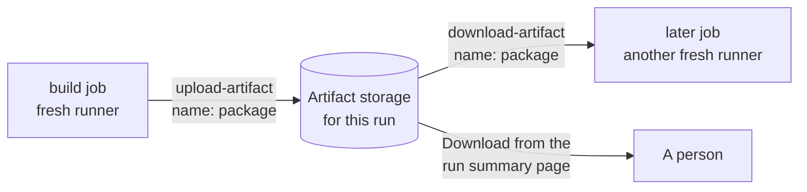

# Lesson 11. Artifacts

**Mission link:** The mission says to produce one versioned artifact and hand that same one to every later stage. Before an artifact can be versioned or promoted, a job has to be able to save it and another job has to be able to fetch it, because no two jobs share a disk.
**Primary source:** [Docs: "Workflow artifacts", GitHub](https://docs.github.com/en/actions/concepts/workflows-and-actions/workflow-artifacts)
**Prerequisites:** [Lesson 4](0004-jobs-steps-and-runners.md), [Lesson 5](0005-actions-expressions-and-outputs.md), [Lesson 8](0008-caching.md), [Artifact](../GLOSSARY.md), [Cache](../GLOSSARY.md), [Job](../GLOSSARY.md), [Runner](../GLOSSARY.md)

## Warm-up

1. ▢ Job `build` writes `dist/app.tar.gz` and job `test` has `needs: build`. Does `test` find the file on disk?

<details markdown="1"><summary>Check</summary>

No. Each job runs on its own fresh runner, and `needs` only orders the jobs, it shares nothing (lesson 4). The file has to leave the first runner and arrive on the second, which is what this lesson adds.

</details>

2. ▢ What must a cache never be trusted to hold, and what happens to a run that depends on it anyway?

<details markdown="1"><summary>Check</summary>

Anything the run cannot rebuild. A cache can be missing or stale at any time (lesson 8), so a run that depends on it passes or fails depending on whether an eviction happened first.

</details>

3. ▢ A job needs to hand the next job the string `1.4.2`. Which mechanism from lesson 5 fits, and why would it be the wrong one for a 20 MB tarball?

<details markdown="1"><summary>Check</summary>

A job output read through `needs`. Outputs are small strings meant for decisions and parameters, not files. A tarball goes through an artifact, and only its name or digest travels as an output.

</details>

## Know this

### What an artifact is

An artifact is a file or a collection of files produced during a workflow run. It persists after the job that made it has finished and can be shared with other jobs in the same workflow ([Docs](https://docs.github.com/en/actions/concepts/workflows-and-actions/workflow-artifacts)). Typical contents are built binaries or packages, test reports, coverage output, logs and screenshots of a failed browser test. GitHub provides two actions for it, `actions/upload-artifact` and `actions/download-artifact`.



### Upload in one job, download in another

This workflow extends the `ci.yml` from lesson 2. The `test` job keeps its report even when tests fail, and `build` and `inspect` pass a package along:

```yaml
name: ci
on:
  push:
    branches: [main]
  pull_request:

jobs:
  test:
    runs-on: ubuntu-latest
    steps:
      - uses: actions/checkout@v7
      - uses: actions/setup-python@v7
        with:
          python-version: "3.13"
      - run: pip install -r requirements.txt
      - run: pytest --junitxml=report.xml
      - name: Keep the test report
        if: ${{ !cancelled() }}
        uses: actions/upload-artifact@v7
        with:
          name: test-report
          path: report.xml
          if-no-files-found: error
          retention-days: 14

  build:
    needs: test
    runs-on: ubuntu-latest
    steps:
      - uses: actions/checkout@v7
      - name: Package the service
        run: |
          mkdir dist
          tar -czf dist/ci-cd-practice.tar.gz app.py requirements.txt
      - uses: actions/upload-artifact@v7
        with:
          name: package
          path: dist/ci-cd-practice.tar.gz
          if-no-files-found: error

  inspect:
    needs: build
    runs-on: ubuntu-latest
    steps:
      - uses: actions/download-artifact@v8
        with:
          name: package
      - run: tar -tzf ci-cd-practice.tar.gz
```

Three details carry the weight. `if: ${{ !cancelled() }}` makes the report upload run after a failed test step, which is exactly when you want the report, while a cancelled run skips it. `needs: build` is what guarantees the artifact exists before `inspect` asks for it. And `name` is how the download finds it.

### The rules that bite

From the [upload-artifact README](https://github.com/actions/upload-artifact) and the [download-artifact README](https://github.com/actions/download-artifact):

|Rule|What it means in practice|
|---|---|
|A name is immutable within a run|Artifacts from `upload-artifact@v4` and later cannot be modified, so two jobs, or two matrix legs, uploading the same name conflict. Put the matrix value in the name, such as `test-report-${{ matrix.python-version }}`|
|`overwrite: true` replaces, it does not edit|The replaced artifact gets a new ID and the old one no longer exists|
|`if-no-files-found` defaults to `warn`|A wrong `path` uploads nothing and the step still passes. Set `error` for an artifact a later job depends on|
|Hidden files are skipped|Anything starting with a dot, or inside a dot folder, needs `include-hidden-files: true`|
|Permissions are not preserved|Zipping resets files to `644` and directories to `755`. Put executables in a `tar` first, as the tarball here does|
|Downloads stay in the run|Without a `github-token` and `run-id`, `download-artifact` fetches only from the current run|
|Download with a `name`|The files land directly in `path`, which defaults to the workspace|
|Download without a `name`|Every artifact of the run arrives, each in a subdirectory named after it, unless `merge-multiple: true`|
|500 artifacts per job|One job cannot create more than that, so upload one archive rather than one artifact per file|

Uploading also produces outputs, `artifact-id` and `artifact-digest`, the SHA-256 digest of the artifact. The downloader checks the digest it received against the one the server recorded, and its `digest-mismatch` input defaults to `error`. Keep that in mind: it is the first step toward the rule that what was tested is what ships.

### Retention and deletion

By default GitHub stores build logs and artifacts for 90 days ([Docs](https://docs.github.com/en/actions/how-tos/manage-workflow-runs/remove-workflow-artifacts)). A repository can lower this, and `retention-days` on the upload action sets a shorter period for one artifact, between 1 and 90 inclusive, never above the repository's limit. For a public repository the setting runs from 1 to 90 days ([Docs](https://docs.github.com/en/repositories/managing-your-repositorys-settings-and-features/enabling-features-for-your-repository/managing-github-actions-settings-for-a-repository)). Deleting a workflow run deletes its artifacts too.

So an artifact is kept, but not forever, and it lives and dies with its run. A container registry or a release page is where something that must outlive 90 days goes. Lesson 13 publishes an image to a registry for that reason.

### An artifact is not a cache

The two look alike, since both store files on GitHub, and the docs say they cannot be used interchangeably:

|Question|Cache|Artifact|
|---|---|---|
|Purpose|Skip repeated work|Keep or hand over an output|
|Written by|`actions/cache` or a tool that has its own|`actions/upload-artifact`|
|Found by|A key, with fallbacks, across runs and branches|A name, inside one run, or a run ID|
|If it is missing|The job must regenerate it and carry on|The consumer has nothing to work with and fails|
|Trust|Speeds up, must never change the result|Is the result|
|Typical contents|`~/.cache/pip`, intermediate build output|A package, a report, a binary|

A dependency directory restored from the lockfile's hash is a cache. The tarball you are about to ship is an artifact. If you notice yourself writing a fallback for a missing artifact, you wanted a cache.

Other systems draw the line differently. GitLab CI collects an `artifacts:` list per job, and by default later-stage jobs download all artifacts of earlier stages automatically, narrowed with `dependencies` or `needs` ([Docs](https://docs.gitlab.com/ci/yaml/)). GitHub makes the download an explicit step. Jenkins stores files from a build with the `archiveArtifacts` step ([Docs](https://www.jenkins.io/doc/pipeline/tour/tests-and-artifacts/)).

## Practice

1. ▢ Which task needs an artifact rather than a cache?

    - a) Reusing pip's downloaded packages to speed up installs
    - b) Handing the built tarball to a later job
    - c) Skipping a rebuild when the source is unchanged
    - d) Warming the compiler's incremental state between pull requests

<details markdown="1"><summary>Check</summary>

**b)** The tarball is the output that a later job depends on, so it has to be there or the pipeline stops. (a) and (d) are work saved across runs, and (c) is the same idea for a whole build: all three only make a run faster, and a job must still succeed without them. That is the definition of a cache.

</details>

2. ▢ The `inspect` job should unpack the package into a directory called `app` and print its files. Write the steps, assuming the artifact is named `package` and holds `ci-cd-practice.tar.gz`.

<details markdown="1"><summary>Hint</summary>

`download-artifact` takes a `path`. The archive itself is a file inside whatever directory that points at.

</details>

<details markdown="1"><summary>Check</summary>

```yaml
steps:
  - uses: actions/download-artifact@v8
    with:
      name: package
      path: package
  - run: |
      mkdir app
      tar -xzf package/ci-cd-practice.tar.gz -C app
      ls app
```

With a `name`, the artifact is extracted directly into `path`, so the tarball sits at `package/ci-cd-practice.tar.gz`. Leaving `name` out would download every artifact of the run, each in its own subdirectory, and the path would be different.

</details>

3. ▢ Predict, then run. In `ci-cd-practice`, change `test` to a matrix and leave the upload step as it was, then push to a branch and open the run. What happens, and what is the fix?

    ```yaml
    test:
      strategy:
        matrix:
          python-version: ["3.12", "3.13"]
      runs-on: ubuntu-latest
      steps:
        - uses: actions/checkout@v7
        - uses: actions/setup-python@v7
          with:
            python-version: ${{ matrix.python-version }}
        - run: pip install -r requirements.txt
        - run: pytest --junitxml=report.xml
        - uses: actions/upload-artifact@v7
          if: ${{ !cancelled() }}
          with:
            name: test-report
            path: report.xml
    ```

<details markdown="1"><summary>Hint</summary>

Both legs finish at about the same time and both upload under one name. What does the rules table say about a name that already exists?

</details>

<details markdown="1"><summary>Check</summary>

One leg uploads `test-report` and the other fails its upload step with a conflict error, roughly:

```text
Error: Failed to CreateArtifact: Received non-retryable error: Failed request: (409) Conflict: an artifact with this name already exists on the workflow run
```

The exact wording varies by action version, but the cause does not: artifacts are immutable, so a second writer of the same name cannot add to it. Name each leg's artifact after its matrix value:

```yaml
          name: test-report-${{ matrix.python-version }}
```

The run summary then lists `test-report-3.12` and `test-report-3.13`. Which leg failed depends on timing, which is why this bug can look flaky until you read the message.

</details>

4. ▢ Debug this. The `inspect` job fails every time, though `build` is green and the artifact appears on the run summary.

    ```yaml
      inspect:
        runs-on: ubuntu-latest
        steps:
          - uses: actions/download-artifact@v8
            with:
              name: package
    ```

    ```console
    Error: Unable to download artifact(s): Artifact not found for name: package
            Please ensure that your artifact is not expired and the artifact was uploaded using actions/upload-artifact@v4+
    ```

<details markdown="1"><summary>Hint</summary>

Read the job header, not the step. What decides when `inspect` starts relative to `build`?

</details>

<details markdown="1"><summary>Check</summary>

`inspect` has no `needs: build`, so it starts at the same moment as `build` and asks for an artifact that has not been uploaded yet. The artifact appears on the summary page only later, which makes the failure look impossible. Add `needs: build`. Any other cause, such as a different `name` or an expired artifact, would give the same message, so check the name and the date as well, but a missing `needs` is the usual one.

</details>

5. ▢ Label each file as cache or artifact, and say which one you would be comfortable losing: the pip download directory, `report.xml`, and the package tarball that a deploy job will install.

<details markdown="1"><summary>Check</summary>

The pip directory is a cache, and losing it only costs a slower install. `report.xml` and the tarball are artifacts. You can tolerate losing the report after its retention ends, since it only explains an old run. You cannot lose the tarball between the job that built it and the job that deploys it, and for anything that must outlive 90 days it belongs in a registry or release, not in artifact storage.

</details>

## Real-world reps

- [ ] In `ci-cd-practice`, add the `test-report` upload to `ci.yml`, push it, and open the run summary. Find the artifact, note its size and its digest column, download the zip, and open `report.xml`.
- [ ] Open the repository settings, find the artifact and log retention setting under Actions, General, and write down the value. Then pick one artifact in a project you work on and decide whether its retention should be shorter or longer than that.
- [ ] Tomorrow: without notes, write the three differences between a cache and an artifact, say what `needs` does and does not share between jobs, and explain why a matrix needs the matrix value in the artifact name.

## Going further

- [Artifacts and Versioning](../reference/artifacts-and-versioning.md)
- [Docs: "Workflow artifacts", GitHub](https://docs.github.com/en/actions/concepts/workflows-and-actions/workflow-artifacts)
- [Docs: "Store and share data with workflow artifacts", GitHub](https://docs.github.com/en/actions/tutorials/store-and-share-data)
- [Repository: actions/upload-artifact, GitHub](https://github.com/actions/upload-artifact)
- [Repository: actions/download-artifact, GitHub](https://github.com/actions/download-artifact)
- [Resources](../RESOURCES.md)

---

Not landing? Reread the primary source at the top, since this lesson compresses it and compression is where understanding leaks. Check the [glossary](../GLOSSARY.md) for any term that felt slippery.

If the lesson itself is unclear rather than the material, that is a defect: [open an issue](https://github.com/TokenCemetery/teach/issues).
