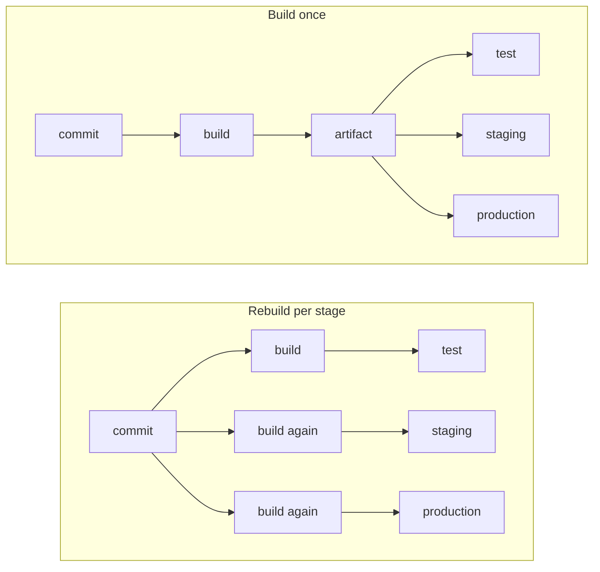

# Lesson 12. Versioning a Build

**Mission link:** The mission says to produce artifacts with a version traceable to a commit and to build once. When production misbehaves, the first question is which code is running, and the second is whether it is the code that passed the tests. A build identity and a single build answer both.
**Primary source:** [Book chapter: "Release Engineering", Site Reliability Engineering, Google](https://sre.google/sre-book/release-engineering/)
**Prerequisites:** [Lesson 3](0003-triggers-and-events.md), [Lesson 5](0005-actions-expressions-and-outputs.md), [Lesson 11](0011-artifacts.md), [Artifact](../GLOSSARY.md), [Build once](../GLOSSARY.md), [Digest](../GLOSSARY.md)

## Warm-up

1. ▢ Which commit does a `pull_request` run build, and which does a `push` run build?

<details markdown="1"><summary>Check</summary>

A `push` run uses the commit that was pushed. A `pull_request` run uses the last merge commit on the pull request's merge branch, `refs/pull/<number>/merge`, which is not the commit at the tip of the author's branch ([Docs](https://docs.github.com/en/actions/reference/workflows-and-actions/events-that-trigger-workflows)). That difference matters in a moment, when a version has to name a commit.

</details>

2. ▢ How does a value computed in a step reach a later job?

<details markdown="1"><summary>Check</summary>

The step writes `name=value` to the file named by `GITHUB_OUTPUT`, the job lists it under `outputs`, and the later job reads it as `needs.<job>.outputs.<name>` (lesson 5).

</details>

3. ▢ What does `download-artifact` check about the file it fetched, and what happens when the check fails?

<details markdown="1"><summary>Check</summary>

It compares the downloaded content's hash with the digest the server recorded at upload. Its `digest-mismatch` input defaults to `error`, so a mismatch fails the step (lesson 11).

</details>

## Know this

### Two questions a running build must answer

Which commit is this, and which build produced it? Google's release engineering chapter says every binary there supports a flag that displays the build date, the revision number and the build identifier, so that anyone can associate a binary with a record of how it was built ([Docs](https://sre.google/sre-book/release-engineering/)). The practice service has the same door already: `GET /version` returns `APP_VERSION`. The work in this lesson is deciding what goes into that value and making sure it is set by the pipeline, never by hand.

### What the workflow already knows

GitHub Actions sets these on every run ([Docs](https://docs.github.com/en/actions/reference/workflows-and-actions/variables)):

|Variable|Meaning|Changes on a re-run?|
|---|---|---|
|`GITHUB_SHA`|The commit SHA that triggered the workflow, which depends on the event|No|
|`GITHUB_RUN_ID`|A unique number for each run in the repository|No|
|`GITHUB_RUN_NUMBER`|A number for each run of this workflow, starting at 1|No|
|`GITHUB_RUN_ATTEMPT`|The attempt of this run, 1 for the first and plus 1 for each re-run|Yes|
|`GITHUB_REF_NAME`|The short name of the branch or tag|No|

A re-run uses the same `GITHUB_SHA` and `GITHUB_REF` as the original event ([Docs](https://docs.github.com/en/actions/how-tos/manage-workflow-runs/re-run-workflows-and-jobs)). Two things follow. A version built from the run number and the SHA is the same on every attempt. And only builds from a `push` to a branch you deploy from should ever be shipped, since a pull request run's `GITHUB_SHA` is a merge commit that exists only for that run.

`actions/checkout` fetches a single commit by default, so anything that needs history, such as `git describe` or a commit count, requires `fetch-depth: 0` ([Docs](https://github.com/actions/checkout)). The scheme below avoids needing it.

### Choosing what the version says

|Scheme|Example|Strength|Weakness|
|---|---|---|---|
|Semantic version|`0.1.0`|Says what a change means to its users: major for incompatible changes, minor for compatible additions, patch for compatible fixes|A person decides it, and many builds share it|
|Run number|`58`|Increases on its own, readable aloud|Names a run, not a commit, and is per workflow|
|Commit SHA|`9f3e1aa`|Names the exact source|Not ordered, and says nothing about compatibility|
|Combined|`0.1.0+58.9f3e1aa`|Meaning, order and source in one string|Build metadata carries no precedence|

The combined form uses SemVer's build metadata, a plus sign followed by dot separated identifiers made of ASCII letters, digits and hyphens. The specification is explicit that build metadata must be ignored when determining precedence, so `0.1.0+58.9f3e1aa` and `0.1.0+59.c4d2b11` have the same precedence ([Spec](https://semver.org/)). That is the right reading: they are two builds of the same promised version, and the metadata tells them apart without claiming one is newer in the compatibility sense. Docker tags cannot contain a plus sign, a detail lesson 13 meets.

The workflow below keeps the release number in a `VERSION` file that a person edits in a pull request, which makes a release a reviewed change, and lets the pipeline append the metadata:

```yaml
  build:
    needs: test
    runs-on: ubuntu-latest
    outputs:
      version: ${{ steps.version.outputs.version }}
      sha256: ${{ steps.package.outputs.sha256 }}
    steps:
      - uses: actions/checkout@v7
      - name: Compute the version
        id: version
        run: echo "version=$(cat VERSION)+${GITHUB_RUN_NUMBER}.${GITHUB_SHA::7}" >> "$GITHUB_OUTPUT"
      - name: Package the service
        id: package
        env:
          VERSION: ${{ steps.version.outputs.version }}
        run: |
          mkdir dist
          echo "$VERSION" > version.txt
          tar -czf dist/ci-cd-practice.tar.gz app.py requirements.txt version.txt
          echo "sha256=$(sha256sum dist/ci-cd-practice.tar.gz | cut -d' ' -f1)" >> "$GITHUB_OUTPUT"
      - uses: actions/upload-artifact@v7
        with:
          name: package
          path: dist/ci-cd-practice.tar.gz
          if-no-files-found: error

  verify:
    needs: build
    runs-on: ubuntu-latest
    steps:
      - uses: actions/download-artifact@v8
        with:
          name: package
      - name: Confirm this is the package that was built
        env:
          EXPECTED: ${{ needs.build.outputs.sha256 }}
        run: echo "${EXPECTED}  ci-cd-practice.tar.gz" | sha256sum --check
```

```console
$ echo "${EXPECTED}  ci-cd-practice.tar.gz" | sha256sum --check
ci-cd-practice.tar.gz: OK
```

The version goes into the artifact as `version.txt`, so a deployed copy can set `APP_VERSION` from the file it came with, and the SHA-256 travels as a job output so any later job can prove it holds the same bytes. The version names the commit. The digest names the bytes. Keep both, because they answer different questions.

### Build once

Build once means one build produces the artifact that every later stage tests, promotes and deploys. The alternative is a pipeline that checks out the same commit and builds again for staging and again for production.



Every extra build is a chance for the result to differ from what was tested, even from the same commit. A dependency that is not pinned can move between builds, and the tools on the runner image can be updated between them. The `requirements.txt` of the practice service pins `flask` and `pytest` with `==`, but the packages those two pull in are not listed, so they are free to move. Google's chapter describes the goal as hermetic builds: building the same revision on different machines is expected to give identical results, because builds depend on known versions of tools and libraries rather than whatever is installed ([Docs](https://sre.google/sre-book/release-engineering/)). Pinning what a build uses is lesson 23. Building once is the part you control today: if there is only one build, there is nothing to differ from.

A tag follows from this. A tag such as `v0.1.0` names a commit. If that commit already went through the pipeline on its way to `main`, its package exists, and a release should promote that package rather than build again on the tag. Lesson 18 does the promotion.

## Practice

1. ▢ For a build triggered by a push to `main`, which value alone names the exact commit it came from?

    - a) The workflow's run number, on its own
    - b) The version string stored in VERSION
    - c) The GITHUB_SHA the run was given
    - d) The run attempt, counted from one

<details markdown="1"><summary>Check</summary>

**c)** For a push, `GITHUB_SHA` is the pushed commit. (a) names a run, and a re-run keeps it. (b) is shared by every build until someone edits the file. (d) says how many times this run was tried and nothing about the source.

</details>

2. ▢ `VERSION` contains `0.2.0`, the run number is 58 and `GITHUB_SHA` starts with `9f3e1aa6`. What does the "Compute the version" step write, and does `0.2.0+58.9f3e1aa` come before or after `0.2.0+59.c4d2b11` under SemVer?

<details markdown="1"><summary>Check</summary>

It writes `version=0.2.0+58.9f3e1aa`, because `${GITHUB_SHA::7}` keeps the first seven characters. Neither comes before the other: build metadata is ignored when determining precedence, so the two versions have the same precedence. Order between builds is a fact about the run numbers, which you can read, and not about SemVer.

</details>

3. ▢ Predict, then run. Add a step that prints four variables, push, and then use Re-run all jobs on the run's page. Which of the four values differ between attempt 1 and attempt 2?

    ```yaml
          - run: printenv | grep -E '^GITHUB_(RUN_ATTEMPT|RUN_ID|RUN_NUMBER|SHA)=' | sort
    ```

<details markdown="1"><summary>Hint</summary>

Compare each name with the table in Know this. A re-run is the same event replayed, not a new event.

</details>

<details markdown="1"><summary>Check</summary>

Only `GITHUB_RUN_ATTEMPT` changes:

```text
GITHUB_RUN_ATTEMPT=1
GITHUB_RUN_ID=11204357881
GITHUB_RUN_NUMBER=58
GITHUB_SHA=9f3e1aa6b7c84d2e0a5f31c8d9b6e7a4c2f01b38
```

On the second attempt the first line reads `GITHUB_RUN_ATTEMPT=2` and the other three are identical. So a version built from the run number and the SHA is the same for both attempts, even though the attempts rebuilt the package and could, if dependencies moved, have produced different bytes. That is why the digest is kept next to the version.

</details>

4. ▢ Debug this. Staging passes every check. Production returns 500 on `/healthz`, yet `/version` reports `0.1.0+58.9f3e1aa` on both. The workflow has this shape, and these lines come from the two jobs' logs. Name the cause and the fix.

    ```yaml
    jobs:
      staging:
        steps:
          - uses: actions/checkout@v7
          - run: pip install -r requirements.txt
          - run: tar -czf app.tar.gz app.py requirements.txt
          - run: ./deploy staging app.tar.gz
      production:
        needs: staging
        steps:
          - uses: actions/checkout@v7
          - run: pip install -r requirements.txt
          - run: tar -czf app.tar.gz app.py requirements.txt
          - run: ./deploy production app.tar.gz
    ```

    ```console
    staging:     Successfully installed Flask-3.1.2 Werkzeug-3.1.3 itsdangerous-2.2.0
    production:  Successfully installed Flask-3.1.2 Werkzeug-3.1.4 itsdangerous-2.2.0
    ```

<details markdown="1"><summary>Hint</summary>

Both jobs report the same version. What does that string identify, and what does it not?

</details>

<details markdown="1"><summary>Check</summary>

Each job builds its own package. `requirements.txt` pins only `flask` and `pytest`, so Werkzeug, which Flask depends on, resolved to a newer release the second time. The version string names the commit, which is identical, and says nothing about the bytes, so the mismatch was invisible. Build once: one `build` job packages and uploads, and `staging` and `production` download that artifact and check its SHA-256 before deploying. Locking the transitive dependencies as well (lesson 23) makes even the single build repeatable.

</details>

5. ▢ A teammate proposes publishing a release by pushing the tag `v1.0.0` and letting a tag-triggered workflow run the full build again. What is the risk, and what do you do instead?

<details markdown="1"><summary>Check</summary>

The tag build is a second build of a commit that was already built and tested on its way to `main`, so what ships was never the thing that passed the tests, and the two can differ for the reasons in this lesson. Instead, find the successful run for that commit, take its artifact, and promote it, with the tag only naming the commit. Where the package must exist outside run storage, publish the existing artifact rather than rebuilding it.

</details>

## Real-world reps

- [ ] In `ci-cd-practice`, add a `VERSION` file containing `0.1.0`, add the `build` and `verify` jobs from this lesson, push, and read the `version=` line in the log. Confirm that `verify` prints `ci-cd-practice.tar.gz: OK`, then download the artifact and check that `version.txt` inside matches the log.
- [ ] Take a service you work on and find how a running instance can tell you its version. Write down whether it names a commit, and whether production and staging could run different builds of the same commit.
- [ ] Tomorrow: without notes, explain what `GITHUB_SHA` is for a pull request run, why a version and a digest are both needed, and the difference between a build that is repeated and one that is built once.

## Going further

- [Artifacts and Versioning](../reference/artifacts-and-versioning.md)
- [Book chapter: "Release Engineering", Site Reliability Engineering, Google](https://sre.google/sre-book/release-engineering/)
- [Specification: "Semantic Versioning 2.0.0"](https://semver.org/)
- [Docs: "Store information in variables", GitHub](https://docs.github.com/en/actions/reference/workflows-and-actions/variables)
- [Resources](../RESOURCES.md)

---

Not landing? Reread the primary source at the top, since this lesson compresses it and compression is where understanding leaks. Check the [glossary](../GLOSSARY.md) for any term that felt slippery.

If the lesson itself is unclear rather than the material, that is a defect: [open an issue](https://github.com/TokenCemetery/teach/issues).
